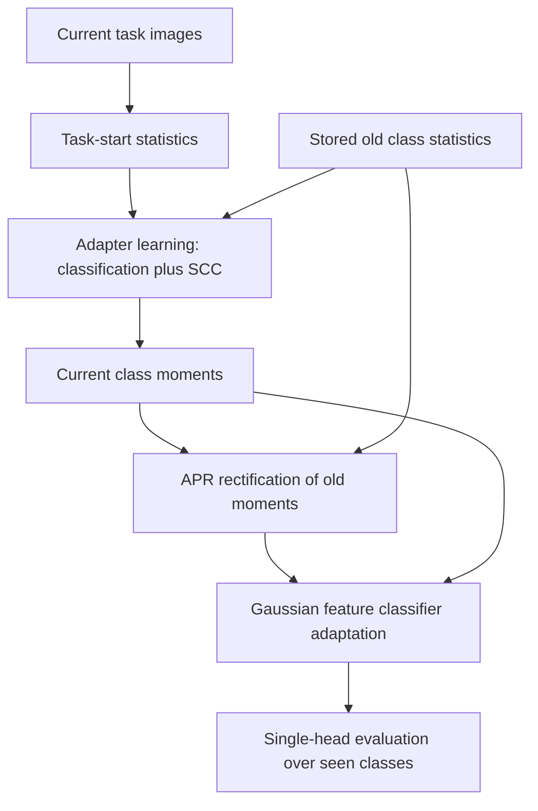

# Structure-Based Exemplar-Free Class-Incremental Learning Research

**Status: active exploratory research, as inspected on 2026-10-12 KST.** There is no confirmed common winning method or publication-ready claim. The latest prepared BOB-versus-strong-augmentation full-trajectory experiment has recorded GPU smoke failures and has not produced completed full comparison results. The report's proposed real-only SupCon pilot remains an idea; it was not implemented by this organization task.

## Project overview and research motivation

Class-incremental learning adds classes over successive tasks and evaluates one classifier over all classes seen so far. Exemplar-free learning avoids retaining/replaying old raw images during ordinary incremental training. The challenge is to learn the new classes while preserving old decisions as representations and competitors change.

This project started from the CDS/Structure implementation and examined whether local class geometry, old/new separation, prototype drift, or classifier adaptation explains errors and can be improved. It now also studies acquisition-time errors, local versus all-seen predictions, and matched conventional/generated augmentation. Diagnostic access to old data is clearly labelled and does not constitute exemplar-free method evidence.

## Problem definition and research questions

- Do multi-center or Mahalanobis constraints improve learning without sacrificing new-class accuracy?
- Does targeting similar old/new pairs resolve the stability/plasticity trade-off?
- Is memory drift a performance bottleneck, or merely an observed phenomenon?
- Do Gaussian feature sources and classifier procedures explain recoverable errors?
- Where does a birth-time acquisition improvement fail to transfer to all-seen competition and later retention?

The source records show dataset-specific and negative results. Research hypotheses and verified observations are separated in [current status](docs/STATUS.md) and the preserved [evidence report](research_report_for_professor/EFCIL_research_report.md).

## Methodology: inspected baseline and experimental changes

The local base derives from upstream CDS commit `a0db2168663982a4cad24981231721a3518ddf29`. Its actual implementation alternates teacher/student nonlinear ViT adapters; do not substitute the paper's LoRA description for the code. Stage 1 uses current-class classification and SCC. Current-class statistics are computed, APR rectifies old moments, and Gaussian feature classifier adaptation follows. No old raw-image replay is used in the ordinary baseline.



Verified changes include multi-center local statistics; diagonal/full Mahalanobis separation; adaptive margins; similarity controls; selective SCC/separation/Proto-CLAD; random-projection auxiliary geometry; stored birth projected prototypes; diagnostic oracle/source/probe procedures; cross-task reweighting; ranking-preserving corrections; and matched generation pilots. The [experiment catalogue](docs/EXPERIMENTS.md) identifies their baselines, source/config paths, result states and limitations. Adapted FCS/PIC, CEOS, SGDS, FeCAM and RP ideas are not full official reproductions unless explicitly supported by source provenance.

## Research and experiment workflow

Early CIFAR diagnostics/PCDS/subspace studies → multi-center and old/new separation → adaptive and similarity controls → selective and RP experiments → memory/source/representation diagnostics → acquisition/error-trajectory analysis → conventional/generated-view comparison → local/all transition audit. The latest BOB full-trajectory preparation is a separate pending intervention. Exact documented dates and unresolved status conflicts appear in [history](docs/HISTORY.md); filesystem mtimes are only hints.

## Repository structure

```text
structure_multicenter_separation/        shared Structure implementation
structure_e3_followup/                  adaptive/CEOS/PIC extensions
structure_similarity_aware_followup/    similarity extension
structure_selective_similarity_sweep/   protocol and selective methods
structure_rp_protoclad_task5/           auxiliary RP geometry
structure_stored_apr_rp/                stored birth projected moments
structure_prototype_oracle_audit/       diagnostics and baseline metadata
type_a_generative_augmentation/         completed matched pilot and raw evidence
ia10_bob_vs_strong_full/                latest incomplete full-trajectory experiment
<other original project directories>/  earlier methods, diagnostics and archives
experiments/                            stable IDs, cards and config/run index
research_log/                           evidenced dated entries and blank template
docs/                                  methods, results, status and reproduction
results/                               indexes; original raw results stay with experiments
provenance/                            origin hashes, source snapshot objects and exclusions
tools/                                 management and validation utilities
environments/                          separate legacy/diagnostic/generator environments
CHANGELOG.md                           evidence-based methodological changes
```

Sibling paths and config inheritance are retained because later learners import earlier implementations. Baselines and proposals are labelled in the catalogue rather than forced into independent packages. Earlier handoff/bundle copies are preservation-only and are excluded from pooled comparisons.

## Experimental setup

The main IA5/IA10/CAR5/CAR10 studies use model seed 1993 and a ViT-B/16 adapter implementation. IA5 is 5×40 classes; IA10 is 10×20. Cars has 196 classes, so its tasks are not all equal. For the inspected ImageNet-A local split: 5,981 train / 1,519 test images, with content split hashes preserved in `protocol_manifest.json`. Its split provenance is not fully established; it is an internal controlled protocol rather than an exact official-paper reproduction.

Representative main runs use 30 initial / 15 incremental epochs, SCC/APR and 256 Gaussian features per class for classifier adaptation. Exact settings vary across early and later studies; each `resolved_config.json` and task protocol takes precedence. [Environment and reproduction guide](docs/REPRODUCIBILITY.md) separates Python 3.9/timm .6.12 Structure from newer CIFAR diagnostics and generator environments.

## Results

The 5-task selective study has no method that improves average incremental accuracy on both datasets in the recorded single seed. StoredAPR RP reduces IA5 new-class accuracy by 1.845 pp relative to its Structure comparator. Oracle/source procedures are diagnostic and have dataset-specific gains; they are not deployment-ready EFCIL methods. The tested generic img2img recipe did not retain a common late/local/all-seen advantage over matched strong augmentation.

[Results](docs/RESULTS.md) contains protocol-separated raw-source tables for incremental/final accuracy, forgetting and old/new accuracy, plus acquisition and repair/harm evidence. [Run index](results/cil_run_index.csv) records incomplete and smoke runs without treating them as completed results. The preserved [854-row numerical evidence table](research_report_for_professor/key_results.csv) includes metric units and source paths.

## Limitations and future work

Most headline comparisons use one model seed. Tiny improvements are descriptive, not significant. Oracle moments/real old banks, test-derived error subgroups and head probes are diagnostic-only. Initial source-exposure imbalance, inactive separation losses and cross-task CA parity failure remain documented. IA10 evaluation before and after `after_task` differs by one correct sample in saved records; matched controls are kept separate.

The completed local/all audit maintains STOP for the tested generic generation recipe. A real-only current-task SupCon matched pilot is proposed in the latest synthesis, while the separate BOB-full comparison is implemented but interrupted at feasibility. Neither supplies successful-method evidence. Generator label fidelity remains unverified. [Status](docs/STATUS.md) records these distinct branches and open questions.

## Continue the research

Use [daily workflow](docs/WORKFLOW.md) and `python tools/new_experiment.py --help` to add a stable ID and linked code/config/result/analysis record. Write verified daily notes in `research_log/`, update `CHANGELOG.md` when the method changes, regenerate indexes, validate and make a normal Git commit. [한국어 안내](docs/GUIDE_KO.md) gives a short practical guide; [upload commands](docs/UPLOAD.md) publish privately after authentication.

[Live experiment record index](docs/EXPERIMENT_INDEX.md) includes future registered experiments.

## Browse by category

[Categorized directory and file map](docs/CATEGORIES.md) describes every top-level item. Each folder guide links its purpose, evidence state and original sources.
