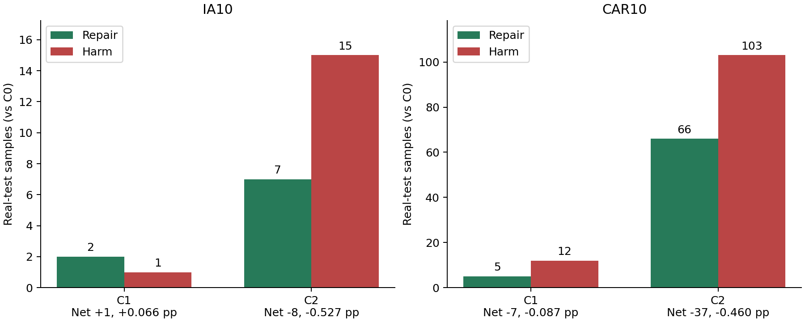
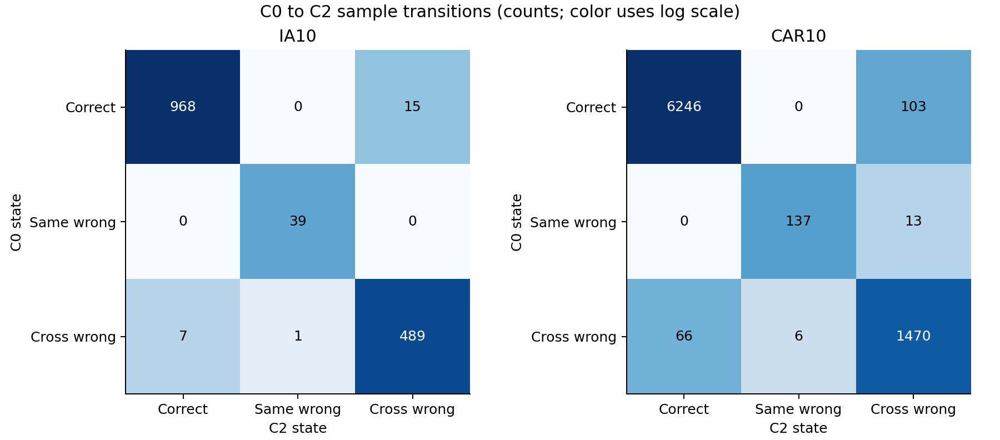
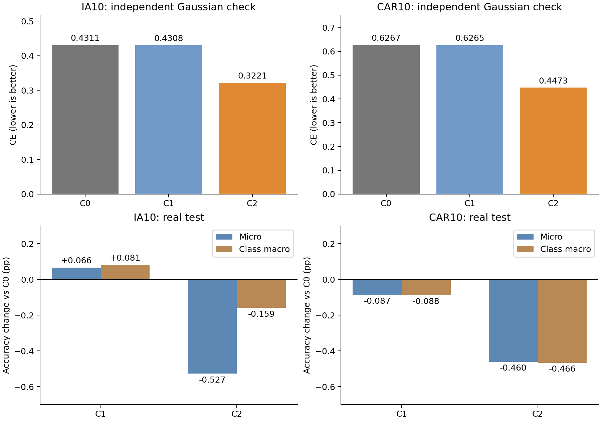

# B1 ranking-preserving task correction — T10 pilot

보고서 작성일: 2026-10-08. IA10·CAR10 모두 물리 GPU 4에서 완료했다. 실행 기록의 시작은 2026-10-08 **12:42:24 KST**, 종료는 **12:42:34 KST**이며, 전체 약 9.72초였다. 기존 feature cache를 사용해 작은 correction만 fitting하므로 원본 Structure 학습 시간과 비교할 수 없다.

기존 Structure post-CA head와 representation을 고정했다. C0는 동일 checkpoint의 원 점수, C1은 task별 상수 bias, C2는 frozen logit descriptor에서 만든 입력별 task-common correction이다. C1/C2는 전 class Gaussian 256개씩의 같은 fit bank를 사용한다. Check bank와 real test는 학습·선택에 사용하지 않았다.

**사전 기준에 따른 종합 판정: STOP**. 단일 seed·최종 T10 head-only pilot이며 full incremental method 성능은 뜻하지 않는다.

## 핵심 결과와 판단

C2는 IA10에서 7개를 복원하고 15개를 새로 틀려 **net −8개, −0.527 pp**, CAR10에서 66개를 복원하고 103개를 새로 틀려 **net −37개, −0.460 pp**였다. Fixed B1 복원도 IA10 2/126개(1.59%), CAR10 29/473개(6.13%)로 사전 기준인 10%에 미치지 못했다. C2는 C1보다도 각각 −0.592 pp, −0.373 pp 낮았다.

이번에는 원 checkpoint의 예측과 cached vanilla가 모두 정확히 일치했고, task 내부 순위·점수 차이 불변성도 통과했다. 따라서 이전 cross-task 2× pilot의 Control 재현성 실패와는 다른 결과다. **내부 순위를 유지하는 구조 자체는 구현됐지만, 이 Gaussian 학습 기반 logit-descriptor 보정은 실제 test의 task 간 경쟁을 순개선하지 못했다.** Independent Gaussian check에서도 CE는 개선됐으므로, 단순히 같은 fit bank만 외웠다는 설명만으로 결과를 설명하기는 어렵다. 실제 입력으로의 transfer 문제 또는 이 correction family의 한계가 남지만, 둘 중 원인을 이번 결과만으로 확정할 수는 없다.

사전 중단 기준에 따라 현재 prototype의 계수·구조를 test 결과에 맞춰 확대하거나 sweep할 근거는 없다. 이 결과는 모든 ranking-preserving 보정 함수의 불가능성을 뜻하지 않는다. 명세에서 정한 작은 함수군의 우선순위를 내리는 결과다. 명세의 다음 target인 Type A birth-time 일반화 실험은 후속 계획이며 이번 실행에는 포함하지 않았다.

## 실행한 실험

| 항목 | 설정 |
|---|---|
| Source | IA10·CAR10 vanilla Structure T10 post-CA, training seed 1993 |
| 학습 대상 | C1: centered bias `b`; C2: centered `A phi + b`; C0: identity |
| Descriptor | task별 max, top1–top2 gap, logsumexp → fit Gaussian 통계로 표준화 → [-5,5] clip |
| Fit source | Stored/APR mean·covariance와 원 CA mean scaling; 신규 class도 Gaussian |
| Unique fit/check exposure | IA10 각각 51,200개, CAR10 각각 50,176개; check는 독립 draw |
| Bank seed | IA10 20261008, CAR10 20261009 |
| Objective | all-class CE + offset L2(λ=1) + parameter L2(η=0.001) |
| Optimizer | full-batch L-BFGS, lr=1, max_iter=100, max_eval=150, history_size=20, strong_wolfe |
| Precision/초기화 | correction float64, A=b=0 |
| Inference | 모든 task 보정 후 전체 class score의 global argmax |
| Test 사용 | 최종 평가만 수행; fitting·정규화·계수·iterate 선택에 사용하지 않음 |

## Real test: C0 대비 paired 결과

| Protocol | Branch | N | Accuracy | Macro | Repair | Harm | Net | ΔAcc | Fixed B1 repair | B1 accuracy |
|---|---|---:|---:|---:|---:|---:|---:|---:|---:|---:|
| IA10 | C0 | 1519 | 64.71% | 53.59% | 0 | 0 | 0 | +0.000 pp | 0 / 126 | 0.00% |
| IA10 | C1 | 1519 | 64.78% | 53.67% | 2 | 1 | 1 | +0.066 pp | 2 / 126 | 1.59% |
| IA10 | C2 | 1519 | 64.19% | 53.43% | 7 | 15 | -8 | -0.527 pp | 2 / 126 | 1.59% |
| CAR10 | C0 | 8041 | 78.96% | 79.06% | 0 | 0 | 0 | +0.000 pp | 0 / 473 | 0.00% |
| CAR10 | C1 | 8041 | 78.87% | 78.97% | 5 | 12 | -7 | -0.087 pp | 5 / 473 | 1.06% |
| CAR10 | C2 | 8041 | 78.50% | 78.59% | 66 | 103 | -37 | -0.460 pp | 29 / 473 | 6.13% |

Repair는 C0 wrong→correct, harm은 C0 correct→wrong이다. CSV를 다시 집계해 `ΔAcc=100×(repair−harm)/N`와 정확도 차이가 일치하는지 검산했다. B1은 C0에서 모두 오답인 고정 subset이므로 그 subset 안의 harm은 0이며, 전체 test의 harm을 함께 봐야 한다. C1의 IA10 +0.066 pp는 정답 1개 순증가이고 CAR10은 −0.087 pp여서 dataset 공통의 개선은 아니다.

## Same/cross 오류와 old/new

| Protocol | Branch | Same-task wrong | Cross-task wrong | Old ΔAcc | New ΔAcc | Old→New | New→Old |
|---|---|---:|---:|---:|---:|---:|---:|
| IA10 | C0 | 39 | 497 | +0.000 pp | +0.000 pp | 50 | 40 |
| IA10 | C1 | 39 | 496 | +0.072 pp | +0.000 pp | 50 | 40 |
| IA10 | C2 | 40 | 504 | -0.573 pp | +0.000 pp | 51 | 40 |
| CAR10 | C0 | 150 | 1542 | +0.000 pp | +0.000 pp | 183 | 137 |
| CAR10 | C1 | 154 | 1545 | -0.055 pp | -0.385 pp | 174 | 140 |
| CAR10 | C2 | 143 | 1586 | -0.413 pp | -0.899 pp | 173 | 145 |

| Protocol | C2 subset | N | C0→C2 accuracy | Repair | Harm | Net |
|---|---|---:|---|---:|---:|---:|
| IA10 | Old (T1–T9) | 1395 | 64.52%→63.94% | 6 | 14 | −8 |
| IA10 | New (T10) | 124 | 66.94%→66.94% | 1 | 1 | 0 |
| CAR10 | Old (T1–T9) | 7262 | 78.68%→78.27% | 60 | 90 | −30 |
| CAR10 | New (T10) | 779 | 81.51%→80.62% | 6 | 13 | −7 |

IA10의 New 정확도는 같지만 sample 1개를 고치고 다른 1개를 틀렸다. CAR10은 Old와 New가 모두 악화했다. Old→New 오분류가 10개 감소한 사실만으로 old class가 개선됐다고 볼 수 없다. 같은 Old 오류가 다른 Old task로 이동할 수 있고, 실제 Old 순이득은 −30개다.

## C0→C2 sample별 3×3 전이

행은 C0 상태, 열은 C2 상태이며, 각 표의 합은 전체 test 수다.

| IA10: C0\C2 | Correct | Same-task wrong | Cross-task wrong | 합 |
|---|---:|---:|---:|---:|
| Correct | 968 | 0 | 15 | 983 |
| Same-task wrong | 0 | 39 | 0 | 39 |
| Cross-task wrong | 7 | 1 | 489 | 497 |

| CAR10: C0\C2 | Correct | Same-task wrong | Cross-task wrong | 합 |
|---|---:|---:|---:|---:|
| Correct | 6246 | 0 | 103 | 6349 |
| Same-task wrong | 0 | 137 | 13 | 150 |
| Cross-task wrong | 66 | 6 | 1470 | 1542 |

두 protocol 모두 **correct→same-task wrong은 0개**였고, 새 harm은 전부 다른 task로의 이동이었다. CAR10의 same-task 오류 150→143 감소는 13개가 cross-task wrong으로 이동하고 6개가 반대로 이동한 결과다. 기존 same-task wrong을 정답으로 복원한 것은 0개다. 이는 내부 ranking을 보존하면 정답 class가 이미 자기 task의 local winner가 아닌 sample은 복구할 수 없다는 구조와 일치한다.

Cross-task 오류는 IA10 497→504(+7개), CAR10 1542→1586(+44개)로 증가했다. 따라서 이번 실패를 within-task class 순위 손상 탓으로 설명할 수는 없다. 순위가 유지된 상태에서도 correct sample을 다른 task로 잘못 보내는 harm이 repair보다 컸다.

## Fixed retention error type

C0의 A/B1/B2/C 및 final-correct 그룹은 기존 trajectory에서 고정했다. 아래는 C2의 paired 변화다.

분모는 **birth≤T9인 retention subset**이다. B는 B1+B2의 합이며, 전체 test와 마지막 task의 sample을 포함한 분모와 구분한다.

| Protocol | Type | N | C0 correct | C2 correct | Repair | Harm | Net |
|---|---|---:|---:|---:|---:|---:|---:|
| IA10 | A | 327 | 0 | 1 | 1 | 0 | 1 |
| IA10 | B1 | 126 | 0 | 2 | 2 | 0 | 2 |
| IA10 | B2 | 29 | 0 | 1 | 1 | 0 | 1 |
| IA10 | B 합계 | 155 | 0 | 3 | 3 | 0 | 3 |
| IA10 | C | 13 | 0 | 2 | 2 | 0 | 2 |
| IA10 | final_correct | 900 | 900 | 886 | 0 | 14 | -14 |
| CAR10 | A | 907 | 0 | 15 | 15 | 0 | 15 |
| CAR10 | B1 | 473 | 0 | 29 | 29 | 0 | 29 |
| CAR10 | B2 | 87 | 0 | 10 | 10 | 0 | 10 |
| CAR10 | B 합계 | 560 | 0 | 39 | 39 | 0 | 39 |
| CAR10 | C | 81 | 0 | 6 | 6 | 0 | 6 |
| CAR10 | final_correct | 5714 | 5714 | 5624 | 0 | 90 | -90 |

## Gaussian fitting과 실제 test의 차이

| Protocol | Branch | Fit CE | Independent check CE | Regularized objective 초기→최종 |
|---|---|---:|---:|---|
| IA10 | C0 | 0.431528 | 0.431093 | — |
| IA10 | C1 | 0.431251 | 0.430838 | 0.431528→0.431363 |
| IA10 | C2 | 0.321944 | 0.322080 | 0.431528→0.364391 |
| CAR10 | C0 | 0.626646 | 0.626735 | — |
| CAR10 | C1 | 0.626448 | 0.626540 | 0.626646→0.626525 |
| CAR10 | C2 | 0.447362 | 0.447319 | 0.626646→0.512872 |

Fit CE와 regularized objective는 서로 다르다. C2는 독립 check CE도 낮췄지만 실제 test의 micro와 macro 정확도는 양쪽 모두 하락했다. 이는 Gaussian pool에서 학습된 보정의 이득이 real test로 전달되지 않았다는 관측이다. Test에서 C2 offset RMS/max abs는 IA10 0.285/1.650, CAR10 0.347/1.966이고, C1은 0.0149/0.0332 및 0.0123/0.0191이었다. 더 큰 입력별 보정이 더 좋은 실제 판단으로 이어지지는 않았다.

## 구현·학습 검증

| Protocol | C0 vs trajectory prediction mismatch | C1 fit/check CE | C2 fit/check CE | C1/C2 closure calls | C1/C2 코드 수렴 표시 | C1/C2 local argmax mismatch | C1/C2 max pair-margin drift |
|---|---:|---|---|---|---|---|---|
| IA10 | 0 | 0.4313/0.4308 | 0.3219/0.3221 | 4/50 | True/True | 0/0 | 8.88e-16/8.88e-16 |
| CAR10 | 0 | 0.6264/0.6265 | 0.4474/0.4473 | 3/63 | True/True | 0/0 | 8.88e-16/8.88e-16 |

학습·평가 정확도는 checkpoint의 frozen cosine head에서 계산한 logits 기준이다. Gaussian CE 개선만으로 성공을 판정하지 않는다. C0의 fixed B1 정확도는 정의상 0이어야 한다. Within-task 순위·margin 불변성과 baseline correct→same-task-wrong harm 0개를 검증했다.

Sample CSV에서 ID 중복, 고정 B1 수, 정확도·repair·harm, 오류 state와 3×3 전이표를 다시 집계했고 저장된 JSON/CSV와 모두 일치했다. 결과 감사 기록은 [report_audit.json](report_audit.json)이다. C0 prediction mismatch 0은 최종 feature cache에 원 checkpoint head를 적용한 예측과 기존 trajectory의 일치 검사이며, 이번에 raw image부터 backbone을 다시 평가한 것은 아니다.

코드의 `converged=True`는 L-BFGS가 max_iter/max_eval 예산에 걸리지 않고 종료했다는 표시다. C2 반복 수는 IA10 47, CAR10 58이며 최종 gradient max abs는 각각 2.54×10⁻⁶, 3.08×10⁻⁶이었다. Finite objective와 초기 대비 감소, 예산 미도달은 확인됐으나 정확한 정지 사유를 별도로 저장하지는 않았다. 이를 수학적 최적점 도달의 증명으로 읽지 않는다.

## 사전 기준·해석

| C2 기준 | IA10 | CAR10 |
|---|---|---|
| Overall ≥+0.5 pp | FAIL: −0.527 pp (net −8) | FAIL: −0.460 pp (net −37) |
| Fixed B1 repair ≥10% | FAIL: 2/126; 필요 13개 | FAIL: 29/473; 필요 48개 |
| Old/New 각각 ≥−1 pp | PASS: −0.573/0.000 pp | PASS: −0.413/−0.899 pp |
| Macro ≥−0.2 pp | PASS: −0.159 pp | FAIL: −0.466 pp |
| C0 parity/zero correction | PASS | PASS |
| Local rank/pair margin invariant | PASS | PASS |
| Optimizer 예산 미도달·objective 감소 | PASS | PASS |

- **IA10: FAIL**; C2−C1 overall -0.592 pp; 차이 <0.2 pp: False. Runtime 5.2s, peak GPU allocated 611.7 MiB, 추가 C2 계수·정규화 통계 저장량 float64 2960 bytes (float32 전환 시 예상 1480 bytes; float32 배포 정확도는 별도 검증 필요).
- **CAR10: FAIL**; C2−C1 overall -0.373 pp; 차이 <0.2 pp: False. Runtime 4.5s, peak GPU allocated 625.2 MiB, 추가 C2 계수·정규화 통계 저장량 float64 2960 bytes (float32 전환 시 예상 1480 bytes; float32 배포 정확도는 별도 검증 필요).

Pilot PASS는 IA10·CAR10 모두 C2 overall ≥+0.5 pp, fixed B1 repair ≥10%, old/new 각각 ≥−1 pp, macro ≥−0.2 pp 및 parity·ranking 불변성·fit 수렴을 요구한다. Optimizer가 budget에 걸리면 결과는 inconclusive로 취급한다. C1/C2가 양쪽에서 0.2 pp 미만 차이면 conditional 효과를 주장하지 않는다. 이 기준을 넘더라도 독립 seed, 전 task trajectory 및 기존 calibration 비교가 필요하다.

현재는 양쪽 모두 C2가 악화하고 B1 복원 대비 전체 harm이 더 크므로 **현재 prototype 중단**에 해당한다. C1/C2 차이는 0.2 pp보다 크지만 C2가 낮은 방향이므로 입력 조건 보정의 필요성을 뒷받침하지 않는다. 저장량은 class mapping·NPZ 컨테이너 비용을 제외한 계수·정규화 통계 수치이며, peak GPU 값은 해당 시점의 프로세스 누적 high-water mark다.

## 산출물

각 protocol의 `sample_predictions.csv`, `transition_tables.csv` (correct/same/cross 3×3), `error_destination_task.csv`, `true_task_repair_harm.csv`, `metrics.json`, `correction_parameters.npz`에 sample·task별 결과와 재현 정보를 저장했다. 전체 설정은 `config.json`, 완료 상태는 `run_manifest.json`을 참조한다.

원자료: [IA10 metrics](IA10/metrics.json), [CAR10 metrics](CAR10/metrics.json), [IA10 sample CSV](IA10/sample_predictions.csv), [CAR10 sample CSV](CAR10/sample_predictions.csv.gz), [config](config.json), [실행 완료 기록](run_manifest.json), [실행 로그](logs/pilot_gpu4_retry.log). 그림과 sample 감사만 다시 생성하려면 `python plot_results.py`를 실행한다.
