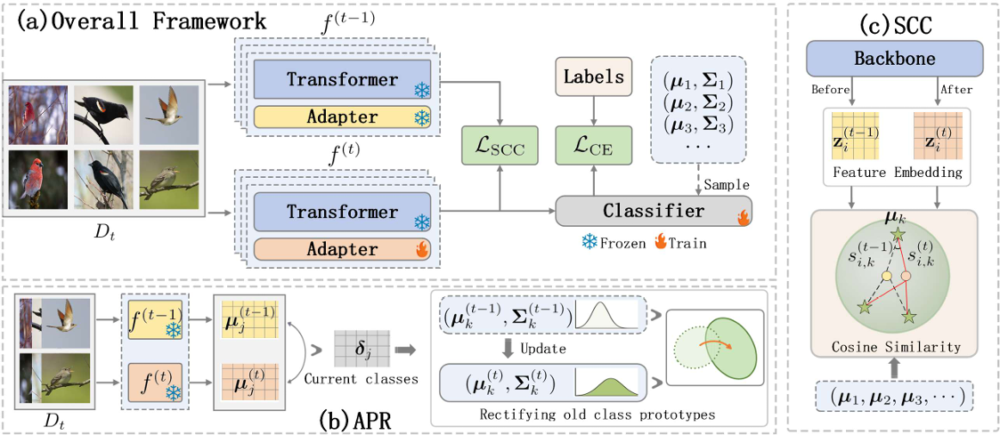

> Archive reader note: this preserved source README contains the upstream authors’ paper description and claims. It does not describe a publication or verified SOTA contribution by this archive’s owner. See the repository-root README and experiment catalogue for local changes and evidence boundaries.

# Exemplar-Free Class Incremental Learning via Preserving Class-Discriminative Structure

<div align="center">

<div>
    <a href='' target='_blank'>Xin Zhang</a><sup>1</sup>&emsp;
    <a href='' target='_blank'>Liang Bai</a><sup>1,*</sup>&emsp;
    <a href='' target='_blank'>Guanchao Wang</a><sup>1</sup>&emsp;
    <a href='' target='_blank'>Xian Yang</a><sup>2</sup>
</div>
<div>
<sup>1</sup>Institute of Intelligent Information Processing, Shanxi University, Taiyuan 030006, China&emsp;
<sup>2</sup>Alliance Manchester Business School, The University of Manchester, Manchester M13 9PL, United Kingdom
</div>
<div>
<sup>*</sup>Corresponding author
</div>
</div>

The code repository for "Exemplar-Free Class Incremental Learning via Preserving Class-Discriminative Structure" in PyTorch. 

## News

- [03/2026] The paper has been accepted by **CVPR 2026**.

## Abstract

Class-incremental learning (CIL) aims to enable models to continuously learn new classes while overcoming catastrophic forgetting. The emergence of large-scale pre-trained models, such as Vision Transformers (ViTs), has transformed the landscape of visual recognition. However, existing approaches overlook a crucial cause of catastrophic forgetting: the collapse of the class-discriminative structure, which comprises intra-class structure (characterizing the shape of individual classes) and inter-class structure (characterizing global geometric relationships among class prototypes).

To address these challenges, we propose a unified framework designed to maintain this structure through two complementary mechanisms:
- **Adaptive Prototype Rectification (APR)**: Dynamically corrects old class prototypes by propagating displacement patterns from new prototypes to preserve the intra-class structure.
- **Structural Consistency Constraint (SCC)**: A lightweight constraint that preserves inter-class structure by stabilizing the relationships between new task samples and old prototypes.

Extensive experiments demonstrate that our framework outperforms existing leading methods on multiple EFCIL benchmarks, validating that preserving the class-discriminative structure is crucial for mitigating catastrophic forgetting.

## Pipeline

<div align="center">

</div>

## Requirements

### Dependencies

Create the conda environment using the provided `cds.yaml`:

```bash
conda env create -f cds.yaml
conda activate cds
```

Or install the key dependencies manually:
- Python 3.9.19
- [PyTorch 2.4.1](https://pytorch.org/)
- [torchvision 0.19.1](https://github.com/pytorch/vision)
- [timm 0.6.12](https://github.com/huggingface/pytorch-image-models)
- numpy, scipy, pillow, tqdm, pyyaml

## Training

Run the main script:

```bash
python main.py
```

One explicit configuration can also be run with:

```bash
python main.py --config exps_jsons/adapter_cifar224.json
```

## Class-discriminative drift-prevention diagnostic

The additional `cdsp` learner is an isolated hypothesis-testing path; the
official `models/CDS_adapter.py` behavior is unchanged. CDS repairs class
statistics after drift with APR/SCC/synthetic classifier adaptation. The new
diagnostic instead asks whether constraining old discriminative directions can
reduce drift enough for stored prototypes to remain useful.

The existing CDS adapter is nonlinear:
`up_proj(ReLU(down_proj(x)))`. Therefore this is inspired by the
protected-subspace philosophy of methods such as KeepLoRA, but it is not an
implementation of KeepLoRA. For each selected Transformer layer, hooks collect
the exact CLS representation entering the active MLP adapter's `down_proj`.
Only current-task train data is visited. The code retains class prototypes and
compressed bases, never individual features or old training samples.

| Method | APR | SCC | Synthetic CA | Prototype eval | Protected space |
| --- | --- | --- | --- | --- | --- |
| CDS Original | yes | yes | yes | no | none |
| Prototype Baseline | no | no | no | yes | none |
| Task Subspace | no | no | no | yes | generic task features |
| Inter Subspace | no | no | no | yes | inter-class prototypes |
| Inter + Intra | no | no | no | yes | inter-class + within-class |

For protection modes, each active adapter obeys `D Q = 0` where `D` is
`down_proj.weight`. The weight is projected at task start, its gradient is
projected before the optimizer update, and the weight plus signed optimizer
momentum are reprojected after every update. Adapter biases are zeroed and
frozen only in protection configs. Task 0 has an empty protected basis.

The console and log file show batch progress, epoch/task/seed elapsed time, ETA,
protected ranks, residual dimensions, and constraint violation ratios. Results
are written under `results/cdsp/cifar224/<method>/seed_<seed>/` as:

- `metrics.json`
- `task_metrics.csv`
- `task_accuracy_matrix.csv`
- `class_accuracy.csv`
- `subspace_stats.csv`
- `prototype_drift.csv`
- `checkpoints/checkpoint_task_XX.pth`

The primary prototype classifier competes over every seen class without oracle
task IDs. Head accuracy is recorded alongside it. Old test images are used only
for evaluation-only prototype and pairwise-geometry drift metrics. To resume,
set `"resume_checkpoint"` in a diagnostic JSON config to a saved checkpoint.

## PTM-guided placement and soft anchor stability

The isolated `ptm_guided` learner keeps the same frozen ViT-B/16-IN21K and
nonlinear bottleneck adapter. It uses an explicit adapter-free forward to store
one normalized frozen-PTM prototype when each class first appears. During
training, a decaying cosine placement loss provides a weak new-class prior.
For old classes, only the adapter response at stored layer/class anchors is
softly stabilized; no raw images or individual old features are retained.

Three controlled conditions are provided:

- `adapter_baseline`: classification loss only
- `ptm_place_only`: classification plus decaying PTM placement
- `ptm_place_move`: placement plus old-anchor response stability

APR, SCC, synthetic classifier adaptation, old-sample distillation, replay and
CDSP hard projection are disabled in all three. See
[`PTM_GUIDED_EXPERIMENT_PLAN.md`](PTM_GUIDED_EXPERIMENT_PLAN.md) for the method
and [`RUN_PTM_GUIDED.md`](RUN_PTM_GUIDED.md) for the GPU 3 parallel Phase-1
command and the GPU 4 sequential fallback commands.
Unrun values and the Structure paper reference table are kept in
[`RESULTS_PTM_GUIDED_VS_STRUCTURE.md`](RESULTS_PTM_GUIDED_VS_STRUCTURE.md).

## Citation
