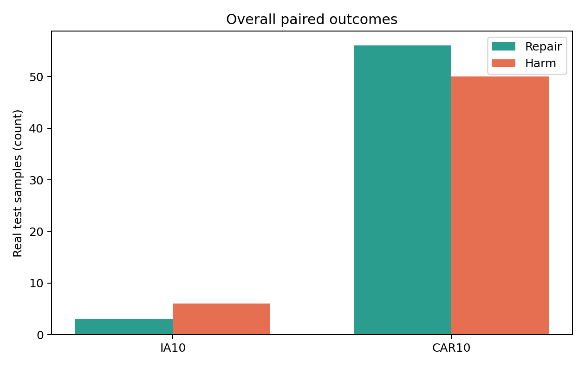
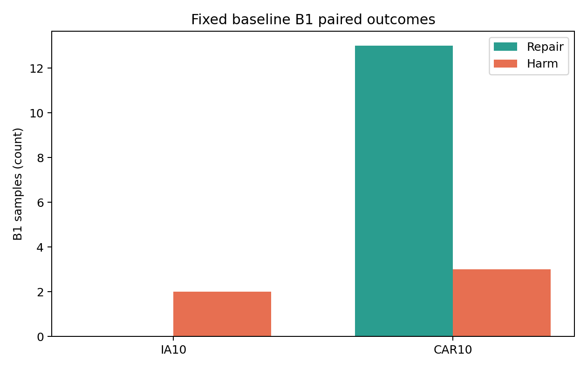
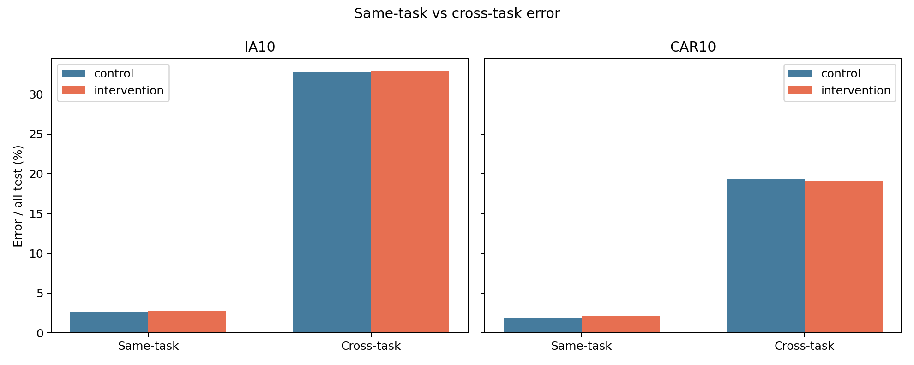
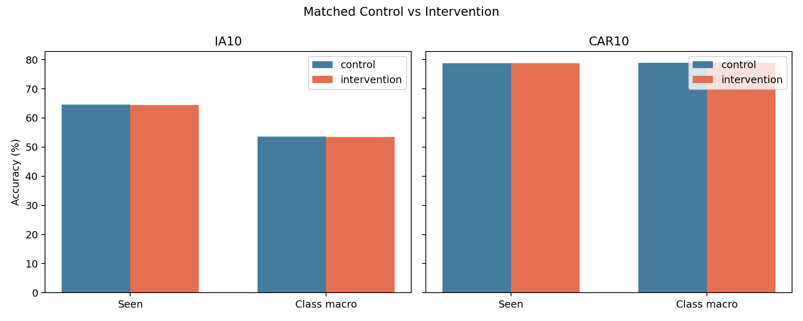
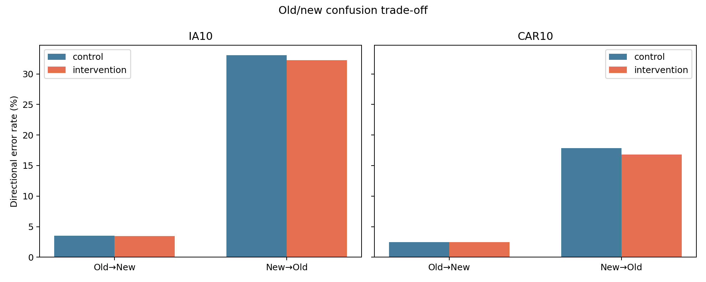

# Cross-Task CA Reweighting Pilot — IA10 / CAR10

실행 상태: **두 protocol 모두 완료** (seed 1993, 물리 GPU 4, 2026-10-07 UTC). 이 보고서는 저장된 sample별 예측, paired 집계, B1 집계, 감사 파일을 바탕으로 작성했다. 새 backbone 학습은 하지 않았고 T10의 classifier adaptation(CA) head만 비교했다.

진단용 CA head-only pilot: vanilla Structure T10 최종 representation을 고정하고 원래 pre-CA head와 Gaussian replay를 재사용했다. Control은 원래 all-class CE이며, Intervention은 같은 logits에서 within-task + 2×cross-task loss다. 계수 2는 실행 전 고정했고 sweep/선택은 하지 않았다.

```text
CROSS-TASK CA PROTOTYPE PROMISING = NO
FULL METHOD READY = NO
```

위 YES는 두 protocol 모두에서 사전 고정한 Control parity S0 및 S1–S6가 성립할 때만 표시한다. 단일 seed·T10 head-only 결과이므로 YES여도 정식 method 입증은 아니다.

**요약:** IA10은 전체 정확도와 B1 모두 악화했고, CAR10은 전체 +0.07 pp 및 B1 +2.11 pp의 작은 개선을 보였다. 방향이 일치하지 않고 두 protocol 모두 S0 원본 CA 재현성 기준을 통과하지 못했다. 따라서 사전 정의된 판정은 NO다. 다만 S0 실패 때문에 이 결과를 원본 Structure CA에 대한 확정적인 우열 판정으로 해석해서는 안 된다.

## 실험 구성과 비교 기준

- IA10·CAR10 각각 T10 최종 representation을 고정하고, 동일한 pre-CA head에서 Control과 Intervention을 시작했다.
- 두 branch는 epoch별 전 class Gaussian bank, minibatch 순서, optimizer·scheduler·step 수를 공유했다. 신규 class도 실제 feature bank가 아니라 기존 Structure CA와 일치하는 Gaussian 생성 방식을 사용했다.
- `L_within + L_cross = L_CE` 수치 검사를 통과했다. Intervention의 유일한 차이는 `L_cross` 가중치를 1에서 2로 높인 것이다.
- 평가는 task ID나 후보 class 제한 없이 전체 seen class에 대한 real test argmax로 수행했다. 아래 변화량은 **matched Control 대비 Intervention**이며, `Original vanilla T10`과 `Vanilla cached`는 별도 참조값이다.

## 전체 real test: paired repair / harm

| Protocol | N | Original vanilla T10 | Vanilla cached | Matched Control | Intervention | Repair | Harm | Net gain | ΔAcc |
|---|---:|---:|---:|---:|---:|---:|---:|---:|---:|
| IA10 | 1519 | 64.65% | 64.71% | 64.58% | 64.38% | 3 | 6 | -3 | -0.20 pp |
| CAR10 | 8041 | 78.96% | 78.96% | 78.76% | 78.83% | 56 | 50 | +6 | +0.07 pp |

## 고정 baseline B1 subset

B1 ID는 이전 trajectory diagnostic에서 고정했다. Intervention 결과로 다시 선정하지 않았다.

| Protocol | B1 N | Control acc | Intervention acc | Repair | Harm | Net gain | B1 repair > overall harm? |
|---|---:|---:|---:|---:|---:|---:|---|
| IA10 | 126 | 2.38% | 0.79% | 0 | 2 | -2 | NO |
| CAR10 | 473 | 2.96% | 5.07% | 13 | 3 | +10 | NO |

고정 B1 표본은 IA10 126개, CAR10 473개로 사전 예상 수와 일치했다. CAR10에서 B1 13개를 복원했지만 전체 test에서 50개가 새로 틀렸고, B1 정확도 증가도 사전 정의한 S3 기준인 5 pp에 미치지 못했다. IA10에서는 B1 복원이 없고 2개가 추가 악화했다.

## Same-task / Cross-task 오류와 old/new trade-off

오류 유형은 true class와 예측 class의 *최초 등장 task*가 같은지로 분류했다. Old/New은 T10 직전까지의 class와 T10 신규 class를 뜻한다.

| Protocol | Branch | Same-task errors | Cross-task errors | Macro acc | Old acc | New acc | Old→New | New→Old |
|---|---|---:|---:|---:|---:|---:|---:|---:|
| IA10 | control | 40 | 498 | 53.66% | 64.44% | 66.13% | 49 (3.51%) | 41 (33.06%) |
| IA10 | intervention | 42 | 499 | 53.45% | 64.16% | 66.94% | 48 (3.44%) | 40 (32.26%) |
| CAR10 | control | 154 | 1554 | 78.85% | 78.49% | 81.26% | 179 (2.46%) | 139 (17.84%) |
| CAR10 | intervention | 168 | 1534 | 78.91% | 78.46% | 82.28% | 178 (2.45%) | 131 (16.82%) |

CAR10의 cross-task 오류는 20개 줄었으나 same-task 오류가 14개 늘어 순이득이 6개에 그쳤다. IA10은 cross-task 오류 1개와 same-task 오류 2개가 모두 증가했다. CAR10에서 new 정확도는 +1.03 pp, old 정확도는 −0.03 pp였고, IA10에서는 new +0.81 pp, old −0.29 pp였다. 큰 old/new 손실은 없었지만 IA10의 전체·macro 정확도는 하락했다.

## 사전 고정 판정 S0–S6

S0 Control parity는 원본 최종 head와 weight max abs ≤0.001 및 cached vanilla 대비 정확도 차이 ≤0.5 pp를 요구한다. S3 ‘명확한 B1 이득’은 net ≥5개이면서 B1 정확도 ≥5 pp 개선, S6 ‘큰 old/new 손실 없음’은 어느 쪽도 −1 pp 미만으로 악화하지 않는 것으로 실행 전에 정의했다. 세부 기준은 [implementation_notes.md](implementation_notes.md).

| Protocol | S0 parity | S1 | S2 | S3 | S4 | S5 | S6 | 모두 충족 |
|---|---|---|---|---|---|---|---|---|
| IA10 | NO | NO | NO | NO | NO | NO | YES | NO |
| CAR10 | NO | YES | YES | NO | YES | YES | YES | NO |

사전 정의한 운영 기준상 조건 하나라도 실패하면 이 **고정 계수 2의 T10 CA reweighting pilot은 유망하지 않다**고 판정하고 계수 재조정이나 post-hoc candidate 제한을 하지 않는다. 이는 원본 CA와의 parity가 확인된 상태에서 방법 자체의 효과가 반증되었다는 뜻은 아니다.

## 핵심 질문의 답

- IA10: 전체 정확도 변화 -0.20 pp; repair 3 vs harm 6. B1 복원 net -2/126개; B1 repair 0개와 전체 harm 6개. Cross-task 오류 변화 +1개, same-task 오류 변화 +2개. Macro 변화 -0.20 pp; old/new 변화 -0.29 pp / +0.81 pp.
- CAR10: 전체 정확도 변화 +0.07 pp; repair 56 vs harm 50. B1 복원 net +10/473개; B1 repair 13개와 전체 harm 50개. Cross-task 오류 변화 -20개, same-task 오류 변화 +14개. Macro 변화 +0.07 pp; old/new 변화 -0.03 pp / +1.03 pp.

두 protocol의 방향이 같은지와 full incremental/independent seed 확대 여부는 위 S0–S6의 공동 결과에 따라 판단한다: **이 고정 pilot은 확대하지 않음**. 어느 경우에도 현재 단계에서 full method는 준비되지 않았다.

## Control parity와 해석 한계

- IA10: trajectory baseline과 최종 feature cache 기반 vanilla head의 예측 불일치 0개; matched Control−cached vanilla 정확도 -0.1317 pp; head weight 최대 절댓값 차이 0.011874177.
- CAR10: trajectory baseline과 최종 feature cache 기반 vanilla head의 예측 불일치 0개; matched Control−cached vanilla 정확도 -0.1990 pp; head weight 최대 절댓값 차이 0.0069486145.

두 protocol의 정확도 차이는 S0의 0.5 pp 허용 범위 안이지만, head weight 차이는 0.001을 초과하므로 **S0는 둘 다 실패**했다. Feature cache와 trajectory baseline의 예측은 일치하므로 확인된 차이는 matched Control의 CA 재현 단계에 있다. 정확한 원인은 이 실험만으로 특정할 수 없다. Control과 Intervention은 같은 bank·순서·초기 head를 공유하므로 내부 paired 비교는 가능하지만, 그 Control을 원본 vanilla CA와 완전히 같은 실행으로 간주하거나 작은 CAR10 이득을 원본 대비 개선으로 주장할 수는 없다. 후속 연구 판단이 필요하다면 먼저 S0 불일치 원인을 분리해 재현성을 검증해야 한다.

B1의 birth-candidate restriction은 subset을 정의하는 과거 oracle 분석일 뿐, 이번 inference에는 사용하지 않았다. B1 개선이 전체 accuracy 개선을 보장하지 않으며, Control이 vanilla와 다르면 핵심 인과 비교는 동일 bank를 공유한 Control vs Intervention이다. 이번 prototype 자체를 새로운 논문 method로 부르지 않는다. LUCIR, SS-IL, CCIL/Essentials for Class Incremental Learning 등 기존 intra/inter-task 학습 연구와의 중복 검토, independent seed/class order, full incremental run은 별도 후속 단계다.

## Plots











Reproducibility: [audit.md](audit.md), [run_manifest.json](run_manifest.json), branch별 sample CSV, [cross-protocol summary](cross_protocol/summary.csv), [decision table](cross_protocol/decision_table.csv).
