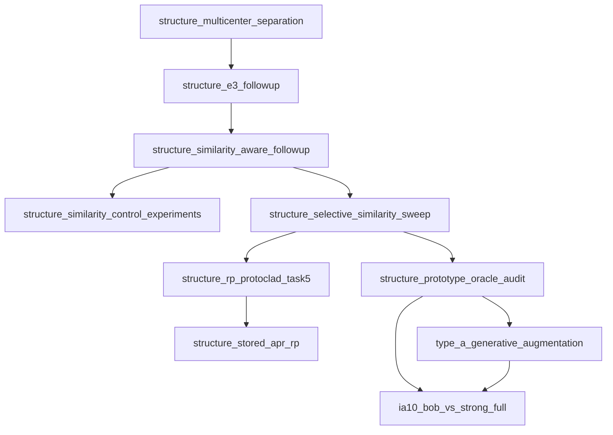

# Preserved package dependencies

Arrows point from the reused package to its dependent extension. The dependency declarations are visible in the entrypoints' `DEFAULT_BASE`, `DEFAULT_E3`, `DEFAULT_SIMILARITY`, `DEFAULT_SELECTIVE`, `ROOTS` and `bootstrap_paths` logic. Additional direct base imports are omitted from this compact view.

This is source reuse, not a claim that every method trains sequentially through all predecessor experiments. Later diagnostics also require earlier baseline checkpoint states and metadata, which are external artifacts. BOB reuses generation-view/learner infrastructure while its generator itself uses the separate pinned BeyondObjects vendor source.

`configs/*.json` supports relative `extends` chains. All 66 non-snapshot configuration inheritance links were checked for existing parents during packaging. Source snapshot objects are content-addressed evidence; they are not laid out as runnable packages. Their original paths can be recovered from `provenance/snapshot_manifest.csv`.

Keeping these sibling directories avoids import collisions between the several `models`, `utils`, `data` and `analysis` packages. Use the intended entrypoint rather than importing all experimental learners into one interpreter indiscriminately. Similar filenames are not proof that modules are interchangeable. `provenance/dependency_references.csv` and `duplicates.csv` support later deliberate refactoring, which was not performed here.
