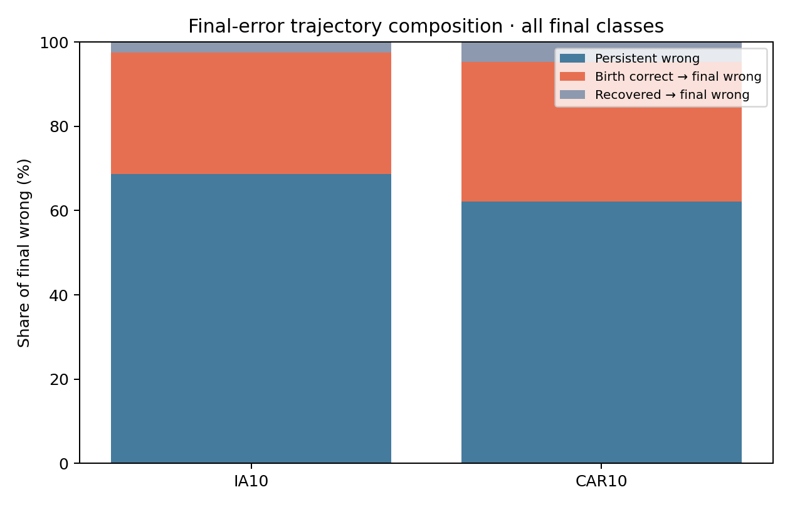
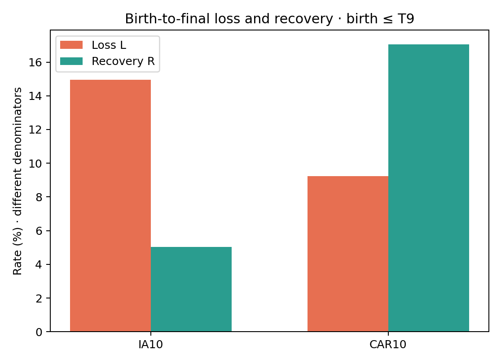
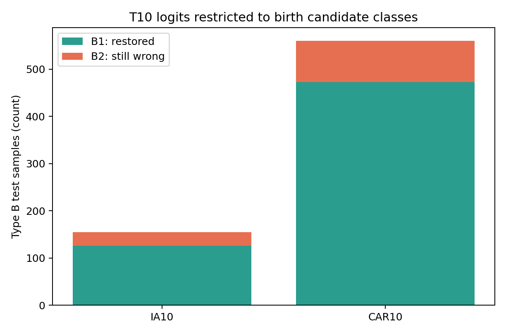

# Final Error Trajectory Diagnostic — IA10 / CAR10

진단 전용: seed 1993의 vanilla Structure task-end checkpoint T1~T10을 고정하여 official test sample의 birth 이후 예측만 추적했다. 학습·보정·튜닝은 하지 않았다.

실행 상태: IA10·CAR10 모두 `complete`이며 T1~T10 각 10개 checkpoint가 기록됐다. 최종 task-end 정확도는 IA10 **983/1,519 = 64.71%**, CAR10 **6,349/8,041 = 78.96%**이다. 이 값은 아래 trajectory에 쓰인 checkpoint 직접 추론 결과다.

실행 GPU 주의: 실행 안내는 GPU 3용이었지만 [실제 run manifest](run_manifest.json)의 `physical_gpu`는 **4**다. `error_trajectory_gpu3.log`라는 파일명만으로 GPU 3에서 실행됐다고 판단할 수 없다. 이 보고서는 실제 저장된 GPU 4 실행 결과를 분석하며, GPU 3 재실행 결과라고 주장하지 않는다.

## 판정 요약

```text
DOMINANT IA10 FAILURE MODE = A
DOMINANT CAR10 FAILURE MODE = A
COMMON FAILURE MODE = YES
NEXT INTERVENTION TARGET = current-task acquisition / initial class learning
METHOD READY = NO
```

지배 유형은 retention subset (birth ≤ T9)의 최종 오류 A/B/C 최대 비율로 정했다. B가 최대이면 B1/B2의 다수 쪽으로 나눴으며 동률은 MIXED다. 이는 탐색 우선순위일 뿐 인과 확정이나 방법론 승인 근거가 아니다.

핵심적으로, T10 이전에 등장한 class만 남겨도 지속 오답 A가 IA10 최종 오류의 **66.06%**, CAR10의 **58.59%**로 가장 크다. 동시에 나중에 틀린 B도 각각 **31.31%**, **36.18%**로 무시할 수 없다. B 내부의 **81.29% / 84.46%**는 birth 때의 후보 class로 제한하면 다시 정답이 된다. 따라서 공통 *주된* 진단은 birth 시점부터의 오류지만, **later-class competition은 공통의 중요한 2차 현상**이다. B1이 높다는 사실만으로 class 추가만이 원인이라거나 특정 calibration 방법이 유효하다고 결론 내릴 수는 없다.

## Table A — 최종 오류 구성

각 칸: count / final errors 중 비율 / 전체 test 중 burden (pp).

| Protocol | Scope | A 지속 오답 | B birth 정답→final 오답 | C 중간 회복→final 오답 |
|---|---|---:|---:|---:|
| IA10 | all_final_classes | 368 / 68.66% / 24.23 pp | 155 / 28.92% / 10.20 pp | 13 / 2.43% / 0.86 pp |
| IA10 | retention_birth_le9 | 327 / 66.06% / 23.44 pp | 155 / 31.31% / 11.11 pp | 13 / 2.63% / 0.93 pp |
| CAR10 | all_final_classes | 1051 / 62.12% / 13.07 pp | 560 / 33.10% / 6.96 pp | 81 / 4.79% / 1.01 pp |
| CAR10 | retention_birth_le9 | 907 / 58.59% / 12.49 pp | 560 / 36.18% / 7.71 pp | 81 / 5.23% / 1.12 pp |

## Table B — Birth→Final loss / recovery

L과 R의 분모가 다르므로 크기만 비교해 최종 accuracy 변화로 해석하지 않는다.

| Protocol | Scope | Birth correct N | Lost N | L | Birth wrong N | Recovered N | R |
|---|---|---:|---:|---:|---:|---:|---:|
| IA10 | all_final_classes | 1120 | 155 | 13.84% | 399 | 18 | 4.51% |
| IA10 | retention_birth_le9 | 1037 | 155 | 14.95% | 358 | 18 | 5.03% |
| CAR10 | all_final_classes | 6706 | 560 | 8.35% | 1335 | 203 | 15.21% |
| CAR10 | retention_birth_le9 | 6071 | 560 | 9.22% | 1191 | 203 | 17.04% |

## Table C — Type B의 birth candidate restriction

T10 표현과 head/logit은 고정하고 birth 때 존재하던 후보 class만 남겼다.

| Protocol | Scope | Type B N | B1 복원 N (%) | B2 여전히 오답 N (%) | B1 / all test | B2 / all test |
|---|---|---:|---:|---:|---:|---:|
| IA10 | all_final_classes | 155 | 126 (81.29%) | 29 (18.71%) | 8.29 pp | 1.91 pp |
| IA10 | retention_birth_le9 | 155 | 126 (81.29%) | 29 (18.71%) | 9.03 pp | 2.08 pp |
| CAR10 | all_final_classes | 560 | 473 (84.46%) | 87 (15.54%) | 5.88 pp | 1.08 pp |
| CAR10 | retention_birth_le9 | 560 | 473 (84.46%) | 87 (15.54%) | 6.51 pp | 1.20 pp |

## 질문별 해석

1. 지속 오답 A는 전체 최종 오류에서 IA10 **68.66% (368/536)**, CAR10 **62.12% (1,051/1,692)**다. T10-born 오류가 모두 A에 속하므로 retention subset에서는 각각 **66.06% (327/495)**, **58.59% (907/1,548)**로 낮아지지만 여전히 최대 유형이다.
2. Birth 정답→final 오답 B는 IA10 **155개**(전체 최종 오류의 28.92%; retention 오류의 31.31%), CAR10 **560개**(33.10%; 36.18%)다. Birth 오답→중간 회복→final 오답 C는 IA10 **13개**(전체 2.43%), CAR10 **81개**(4.79%)다. C는 존재하지만 주요 구성은 아니다.
3. Retention subset의 손실률 L은 IA10 **155/1,037 = 14.95%**, CAR10 **560/6,071 = 9.22%**다. 회복률 R은 각각 **18/358 = 5.03%**, **203/1,191 = 17.04%**다. 분모가 다르므로 `R > L`을 곧바로 정확도 개선으로 읽으면 안 된다. 실제 전환 개수는 두 protocol 모두 손실이 회복보다 많다.
4. Type B 중 birth 후보 제한으로 복원되는 B1은 IA10 **126/155 = 81.29%**, CAR10 **473/560 = 84.46%**다. 반대로 B2는 **29/155 = 18.71%**, **87/560 = 15.54%**로, birth 당시 있던 class들 사이에서도 최종 ranking이 잘못된 사례다. B1은 전체 retention test의 **9.03 pp / 6.51 pp**를 차지하므로 later failure 안에서 후발 후보와의 경쟁이 핵심이지만, 전체 최종 오류에서 A보다 큰 것은 아니다.
5. 두 protocol의 지배 유형은 모두 A이므로 공통 failure mode는 **YES**로 표기했다. 다음 개입 위치는 *current-task acquisition / initial class learning*으로 좁힐 수 있지만, A의 원인이 표본 부족인지, intrinsic ambiguity인지, 표현 한계인지는 아직 구분되지 않았다. 새 방법이 준비됐다는 뜻은 아니다.

## Class-macro 요약

Class-macro는 class별 비율을 먼저 계산한 뒤 평균한다. 오류 구성 비율은 최종 오답이 있는 class만, all-test burden은 모든 class를 포함한다. 아래 수치는 micro 표와 다른 분모이므로 직접 합산하지 않는다.

| Protocol | Scope | A/B/C: final-error share | A/B/C: all-test burden | L / R | B1 / Type B |
|---|---|---:|---:|---:|---:|
| IA10 | all_final_classes | 72.20 / 25.94 / 1.86% | 34.73 / 10.79 / 0.89 pp | 17.19 / 5.24% | 78.51% |
| IA10 | retention_birth_le9 | 69.17 / 28.77 / 2.06% | 33.49 / 11.98 / 0.99 pp | 18.94 / 5.88% | 78.51% |
| CAR10 | all_final_classes | 63.69 / 31.31 / 5.00% | 13.07 / 6.87 / 1.01 pp | 8.35 / 17.85% | 76.44% |
| CAR10 | retention_birth_le9 | 59.70 / 34.75 / 5.55% | 12.50 / 7.61 / 1.12 pp | 9.24 / 19.88% | 76.44% |

## Class-macro 및 birth-task 분해

최종 오답이 없는 class는 오류 구성 비율 평균에서 제외하지만 all-test burden 평균에는 포함한다. 상세 원자료는 각 protocol CSV와 [cross-protocol summary](cross_protocol/summary.csv)에 있다. 아래 birth-task 행은 micro 기준이며 T10-born의 L=0은 이후 task가 없기 때문이다.

### IA10

| Birth | N test | Final wrong | A/B/C | L | R | B1/B2 |
|---|---:|---:|---:|---:|---:|---:|
| T1 | 175 | 70 | 19/47/4 | 31.13% | 4.17% | 42/5 |
| T2 | 185 | 59 | 21/37/1 | 23.12% | 12.00% | 30/7 |
| T3 | 116 | 39 | 24/14/1 | 15.91% | 10.71% | 14/0 |
| T4 | 222 | 64 | 37/26/1 | 14.44% | 9.52% | 21/5 |
| T5 | 143 | 53 | 42/9/2 | 9.38% | 6.38% | 7/2 |
| T6 | 134 | 42 | 31/10/1 | 9.80% | 0.00% | 6/4 |
| T7 | 146 | 52 | 45/6/1 | 6.12% | 4.17% | 3/3 |
| T8 | 127 | 53 | 47/4/2 | 5.26% | 3.92% | 2/2 |
| T9 | 147 | 63 | 61/2/0 | 2.33% | 0.00% | 1/1 |
| T10 | 124 | 41 | 41/0/0 | 0.00% | 0.00% | 0/0 |

### CAR10

| Birth | N test | Final wrong | A/B/C | L | R | B1/B2 |
|---|---:|---:|---:|---:|---:|---:|
| T1 | 838 | 240 | 67/161/12 | 21.30% | 3.66% | 150/11 |
| T2 | 838 | 179 | 67/98/14 | 13.52% | 28.32% | 83/15 |
| T3 | 811 | 190 | 86/92/12 | 13.39% | 20.97% | 86/6 |
| T4 | 817 | 151 | 83/49/19 | 7.15% | 22.73% | 42/7 |
| T5 | 812 | 133 | 85/38/10 | 5.49% | 20.83% | 29/9 |
| T6 | 842 | 190 | 131/57/2 | 8.38% | 17.90% | 44/13 |
| T7 | 769 | 140 | 103/27/10 | 4.26% | 16.30% | 17/10 |
| T8 | 777 | 190 | 166/22/2 | 3.69% | 7.18% | 12/10 |
| T9 | 758 | 135 | 119/16/0 | 2.60% | 16.20% | 10/6 |
| T10 | 779 | 144 | 144/0/0 | 0.00% | 0.00% | 0/0 |

## 시각화







## 해석의 경계

A는 관측한 task-end checkpoint에서 계속 오답이었다는 뜻이지 학습 중 어느 시점에도 정답이 아니었다는 뜻은 아니다. B1은 후발 class competitor가 최종 오류에 필요했다는 증거이지 class 추가만이 원인이라는 증거는 아니다. B2는 기존 class 간 최종 ranking도 틀렸다는 뜻이며 backbone 표현과 classifier head 변화는 분리하지 못한다. C는 checkpoint 사이 예측 상태가 비단조적임을 뜻한다. T10-born class의 최종 오류는 retention 실패가 아니므로 전체와 birth≤T9 결과를 분리했다.

## 재현성

[audit.md](audit.md)와 [run_manifest.json](run_manifest.json)에 체크포인트 SHA-256, training branch/seed, task·class 순서, transform, 후보 class, canonical sample ID digest 및 샘플 수를 기록했다. 추론은 원본 checkpoint의 frozen network와 원본 test transform으로 수행했다. 이전 feature cache는 logit source로 사용하지 않았다.

원본 task-summary의 평가는 `after_task()` 직전이고 본 진단은 저장된 `task_end` checkpoint(`after_task()` 직후)를 평가한다. Correct-count 차이(진단 − 원본): IA10: T9 +2, T10 +1; CAR10: T1 +1, T2 +1, T4 +1, T7 +1, T9 +1. 0이 아니면 해당 task의 비교 해석에 주의한다.

추가로 원래 학습 시점의 git commit은 manifest에 `null`이지만 source snapshot hash와 현재 baseline 코드 commit은 audit에 남아 있다. Test split 검증 해시는 원본 설정대로 상대 경로·파일 크기 기반이며 파일 내용 자체의 동일성까지 증명하지는 않는다.
