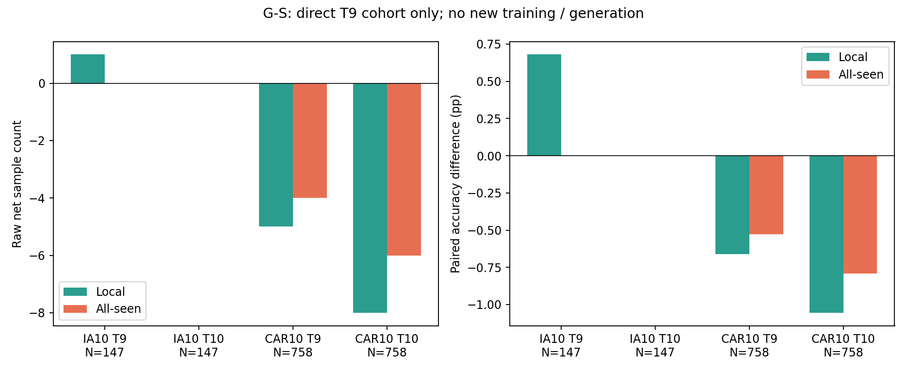
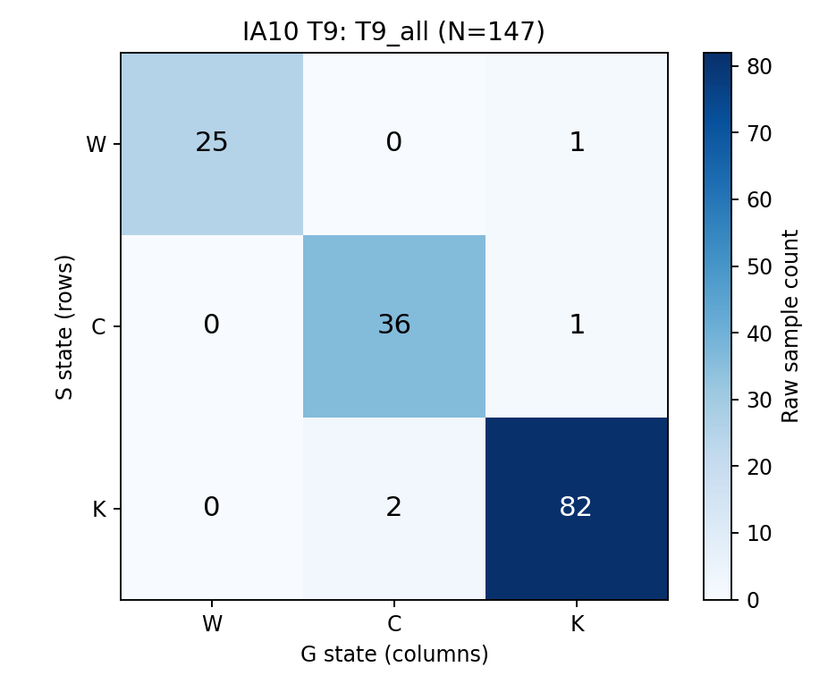
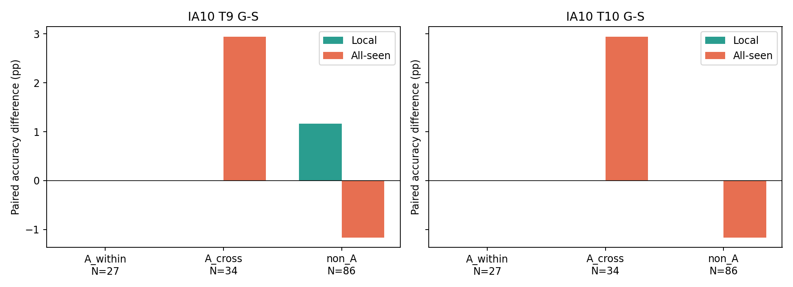
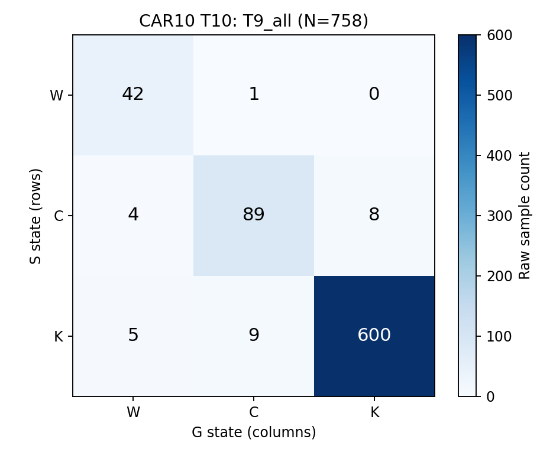
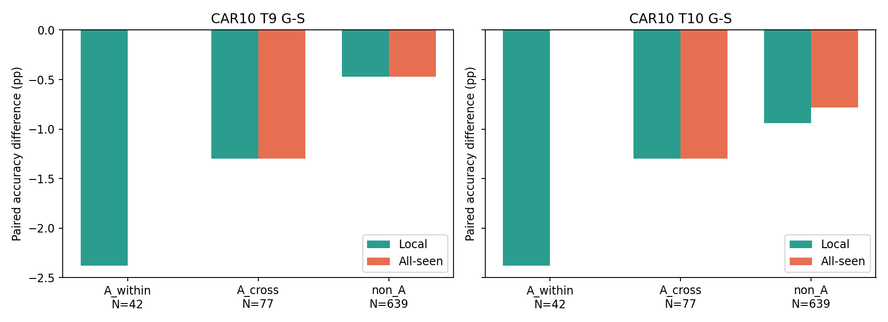

# T9 Local/All Paired Transition Audit — 결과 보고서

작성일: 2026-10-12 14:07:08 KST

## 1. 결론

**두 데이터셋에서 공통으로 local acquisition이 개선됐으나 all-seen 경쟁에 가려졌다는 해석은 지지되지 않는다. 현재 generation 방향은 STOP을 유지한다.**

IA10 T9의 G−S local 순이득은 **1개(+0.680%p)**지만 T10에는 0개로 바뀐다. CAR10은 T9 local **−5개(−0.660%p)**, T10 local **−8개(−1.055%p)**로 악화됐다. IA10 T9에는 W→C가 없고, local repair 1개는 W→K다. 따라서 그 local repair 자체가 all-seen 경쟁에 가려진 사례는 아니다. 대신 별도의 K→C harm 2개가 전체 net을 상쇄한다.

```text
IA10_LOCAL_SIGNAL = YES
CAR10_LOCAL_SIGNAL = NO
LOCAL_SIGNAL_PERSISTS_TO_T10 = NO
DATASET_COMMON_EVIDENCE = NO
ALL_SEEN_TRANSLATION = NO
GENERATION_DIRECTION = STOP
NEXT_METHOD = REVIEW_REAL_ONLY_CE_SUPCON_MATCHED_PILOT
```

YES/NO는 이번 seed의 정미 count 방향이며 통계적 유의성이나 인과 증명이 아니다. Persistence는 명세 Case 1의 ‘양 dataset에서 T9 local net>0, T10 local net≥0’로 판정했다. IA10만의 T10=0은 비음수 조건은 만족하지만 양의 우위가 유지된 것은 아니다. 새 SupCon 코드는 구현·실행하지 않았으며 다음 real-only matched pilot 검토 대상으로만 기록한다.

## 2. 분석 범위와 고정 정의

새 학습·이미지 생성·증강·inference 없이 기존 S/G/R prediction CSV만 재사용했다. T9/T10에서 local은 sample의 **원 birth task class set**으로 제한된 저장 예측이다. 특히 이 분석의 direct cohort는 birth==9이므로 T10에도 G9를 사용하며, T10 신규 class set으로 바꾸지 않는다.

- W: local 오답.
- C: local 정답, all-seen 오답.
- K: all-seen 정답(local도 정답).

A-within/A-cross는 기존 vanilla persistent Type A 중 birth checkpoint의 local/all prediction으로 고정한 subtype을 사용했다. S/G prediction은 subtype 정의에 사용하지 않았다. T9 non-A는 B1/B2/C/final_correct를 포함하므로 전부 vanilla birth-correct라고 가정하지 않는다. 각 sample의 vanilla_birth_all_correct도 별도 저장했다.

| Protocol | T9 direct 전체 | T9 A-within | T9 A-cross | T9 non-A | 과거 birth≤T8 | T10 new |
|---|---:|---:|---:|---:|---:|---:|
| IA10 | 147 | 27 | 34 | 86 | 1,248 | 124 |
| CAR10 | 758 | 42 | 77 | 639 | 6,504 | 779 |

327/907의 전체 A를 direct acquisition 분모로 쓰지 않는다. Historical cohort는 collateral effect이며 direct repair와 구분한다. Whole seen은 T9에서는 historical+direct, T10에서는 historical+direct+T10 new이다. T1 branch는 별도 acquisition이며 T10까지 이어지지 않았다.

기존 prediction은 birth-task local argmax와 all argmax를 저장하지만 true logit은 저장하지 않았다. Optional true-logit column을 임의 복원하지 않았으며 추가 inference가 결론에 필요하지 않아 실행하지 않았다. Margin은 기존 값을 sample CSV에 참고용으로 포함했다.

## 3. 필수 summary — G−S

Accuracy는 %, 차이는 %p. Local repair=W→C+W→K, local harm=C→W+K→W. All repair=W→K+C→K, all harm=K→W+K→C. `net=repair−harm`, `Δ=100×net/N`.

| Protocol | Time | Cohort | N | S local | G local | Local repair/harm/net | Local Δ pp | S all | G all | All repair/harm/net | All Δ pp |
|---|---|---|---:|---:|---:|---|---:|---:|---:|---|---:|
| IA10 | T9 | T9_all | 147 | 82.313 | 82.993 | 1/0/+1 | +0.680 | 57.143 | 57.143 | 2/2/+0 | +0.000 |
| IA10 | T9 | T9_A_within | 27 | 11.111 | 11.111 | 0/0/+0 | +0.000 | 0.000 | 0.000 | 0/0/+0 | +0.000 |
| IA10 | T9 | T9_A_cross | 34 | 97.059 | 97.059 | 0/0/+0 | +0.000 | 0.000 | 2.941 | 1/0/+1 | +2.941 |
| IA10 | T9 | T9_non_A | 86 | 98.837 | 100.000 | 1/0/+1 | +1.163 | 97.674 | 96.512 | 1/2/-1 | -1.163 |
| IA10 | T10 | T9_all | 147 | 82.993 | 82.993 | 1/1/+0 | +0.000 | 57.143 | 57.143 | 1/1/+0 | +0.000 |
| IA10 | T10 | T9_A_within | 27 | 11.111 | 11.111 | 1/1/+0 | +0.000 | 0.000 | 0.000 | 0/0/+0 | +0.000 |
| IA10 | T10 | T9_A_cross | 34 | 97.059 | 97.059 | 0/0/+0 | +0.000 | 0.000 | 2.941 | 1/0/+1 | +2.941 |
| IA10 | T10 | T9_non_A | 86 | 100.000 | 100.000 | 0/0/+0 | +0.000 | 97.674 | 96.512 | 0/1/-1 | -1.163 |
| CAR10 | T9 | T9_all | 758 | 94.063 | 93.404 | 2/7/-5 | -0.660 | 81.926 | 81.398 | 8/12/-4 | -0.528 |
| CAR10 | T9 | T9_A_within | 42 | 7.143 | 4.762 | 1/2/-1 | -2.381 | 0.000 | 0.000 | 0/0/+0 | +0.000 |
| CAR10 | T9 | T9_A_cross | 77 | 97.403 | 96.104 | 1/2/-1 | -1.299 | 3.896 | 2.597 | 0/1/-1 | -1.299 |
| CAR10 | T9 | T9_non_A | 639 | 99.374 | 98.905 | 0/3/-3 | -0.469 | 96.714 | 96.244 | 8/11/-3 | -0.469 |
| CAR10 | T10 | T9_all | 758 | 94.327 | 93.272 | 1/9/-8 | -1.055 | 81.003 | 80.211 | 8/14/-6 | -0.792 |
| CAR10 | T10 | T9_A_within | 42 | 7.143 | 4.762 | 1/2/-1 | -2.381 | 0.000 | 0.000 | 0/0/+0 | +0.000 |
| CAR10 | T10 | T9_A_cross | 77 | 96.104 | 94.805 | 0/1/-1 | -1.299 | 7.792 | 6.494 | 1/2/-1 | -1.299 |
| CAR10 | T10 | T9_non_A | 639 | 99.844 | 98.905 | 0/6/-6 | -0.939 | 95.149 | 94.366 | 7/12/-5 | -0.782 |



## 4. Class macro 및 class별 net

Class macro는 각 cohort에서 sample이 존재하는 class를 동일 가중치로 평균한다. 특정 subtype에 sample이 없는 class를 0으로 넣지 않는다. 모든 cohort의 macro와 per-class raw net은 CSV에 저장했다.

| Protocol | Time | Class 수 | S macro local | G macro local | Macro local Δ pp | S macro all | G macro all | Macro all Δ pp |
|---|---|---:|---:|---:|---:|---:|---:|---:|
| IA10 | T9 | 20 | 74.618 | 75.333 | +0.714 | 50.049 | 51.874 | +1.825 |
| IA10 | T10 | 20 | 75.365 | 75.333 | -0.032 | 50.049 | 49.732 | -0.317 |
| CAR10 | T9 | 19 | 94.258 | 93.656 | -0.602 | 82.277 | 81.791 | -0.486 |
| CAR10 | T10 | 19 | 94.506 | 93.487 | -1.019 | 81.238 | 80.518 | -0.719 |

IA10 T9의 net이 0이 아닌 class: c170: local +0, all +1 (N=2); c171: local +0, all -1 (N=6); c177: local +0, all -1 (N=9); c178: local +1, all +1 (N=7).

IA10 T10의 net이 0이 아닌 class: c160: local +0, all +1 (N=21); c169: local +1, all +0 (N=13); c174: local -1, all +0 (N=12); c177: local +0, all -1 (N=9).

CAR10 T9의 net이 0이 아닌 class: c159: local -2, all -1 (N=41); c160: local -1, all +0 (N=46); c163: local +0, all +2 (N=38); c164: local +0, all -1 (N=42); c165: local +0, all +1 (N=39); c167: local -2, all -1 (N=42); c170: local +0, all -1 (N=39); c171: local -2, all -1 (N=42); c172: local +0, all -1 (N=34); c174: local +0, all +1 (N=39); c175: local +1, all +0 (N=35); c176: local +1, all -2 (N=44).

CAR10 T10의 net이 0이 아닌 class: c159: local -3, all -3 (N=41); c160: local -1, all +0 (N=46); c163: local +0, all +2 (N=38); c164: local +0, all -1 (N=42); c167: local +0, all -1 (N=42); c169: local -1, all +0 (N=34); c170: local +0, all +1 (N=39); c171: local -1, all -3 (N=42); c176: local -2, all -1 (N=44).

IA10 T9 micro local +0.680%p는 c178(N=7)의 정미 1개에 해당한다. All micro는 0이지만 class macro all은 +1.825%p이며, 작은 class의 이득과 다른 class의 손실에 동일 class 가중치를 준 차이다. 이 macro 개선도 T10에는 −0.317%p로 바뀐다. Macro를 누락하거나 micro와 혼동하지 않으며 주 판정은 명세의 direct sample-level net 기준을 따른다.

Class ID는 기존 remapped label이며 새로운 sample/class selector에 사용하지 않는다.

## 5. 모든 고정 cohort의 3×3 transition

행=S, 열=G. 각 표의 9개 cell 합은 해당 cohort N이다. 아래 그림은 direct 전체이고 subtype 그림·표도 함께 제공한다.

### IA10 T9



T9_all (N=147)

| S \ G | W | C | K |
|---|---:|---:|---:|
| W | 25 | 0 | 1 |
| C | 0 | 36 | 1 |
| K | 0 | 2 | 82 |

T9_A_within (N=27)

| S \ G | W | C | K |
|---|---:|---:|---:|
| W | 24 | 0 | 0 |
| C | 0 | 3 | 0 |
| K | 0 | 0 | 0 |

T9_A_cross (N=34)

| S \ G | W | C | K |
|---|---:|---:|---:|
| W | 1 | 0 | 0 |
| C | 0 | 32 | 1 |
| K | 0 | 0 | 0 |

T9_non_A (N=86)

| S \ G | W | C | K |
|---|---:|---:|---:|
| W | 0 | 0 | 1 |
| C | 0 | 1 | 0 |
| K | 0 | 2 | 82 |

### IA10 T10


T9_all (N=147)

| S \ G | W | C | K |
|---|---:|---:|---:|
| W | 24 | 1 | 0 |
| C | 1 | 36 | 1 |
| K | 0 | 1 | 83 |

T9_A_within (N=27)

| S \ G | W | C | K |
|---|---:|---:|---:|
| W | 23 | 1 | 0 |
| C | 1 | 2 | 0 |
| K | 0 | 0 | 0 |

T9_A_cross (N=34)

| S \ G | W | C | K |
|---|---:|---:|---:|
| W | 1 | 0 | 0 |
| C | 0 | 32 | 1 |
| K | 0 | 0 | 0 |

T9_non_A (N=86)

| S \ G | W | C | K |
|---|---:|---:|---:|
| W | 0 | 0 | 0 |
| C | 0 | 2 | 0 |
| K | 0 | 1 | 83 |



### CAR10 T9


T9_all (N=758)

| S \ G | W | C | K |
|---|---:|---:|---:|
| W | 43 | 2 | 0 |
| C | 4 | 80 | 8 |
| K | 3 | 9 | 609 |

T9_A_within (N=42)

| S \ G | W | C | K |
|---|---:|---:|---:|
| W | 38 | 1 | 0 |
| C | 2 | 1 | 0 |
| K | 0 | 0 | 0 |

T9_A_cross (N=77)

| S \ G | W | C | K |
|---|---:|---:|---:|
| W | 1 | 1 | 0 |
| C | 2 | 70 | 0 |
| K | 0 | 1 | 2 |

T9_non_A (N=639)

| S \ G | W | C | K |
|---|---:|---:|---:|
| W | 4 | 0 | 0 |
| C | 0 | 9 | 8 |
| K | 3 | 8 | 607 |

### CAR10 T10



T9_all (N=758)

| S \ G | W | C | K |
|---|---:|---:|---:|
| W | 42 | 1 | 0 |
| C | 4 | 89 | 8 |
| K | 5 | 9 | 600 |

T9_A_within (N=42)

| S \ G | W | C | K |
|---|---:|---:|---:|
| W | 38 | 1 | 0 |
| C | 2 | 1 | 0 |
| K | 0 | 0 | 0 |

T9_A_cross (N=77)

| S \ G | W | C | K |
|---|---:|---:|---:|
| W | 3 | 0 | 0 |
| C | 1 | 66 | 1 |
| K | 0 | 2 | 4 |

T9_non_A (N=639)

| S \ G | W | C | K |
|---|---:|---:|---:|
| W | 1 | 0 | 0 |
| C | 1 | 22 | 7 |
| K | 5 | 7 | 596 |



## 6. 명세의 핵심 질문에 대한 답

1. **T9 전체 cohort local 개선?** IA10은 repair/harm=1/0으로 +1개. CAR10은 2/7로 −5개다.
2. **두 dataset 공통?** 아니다. IA10의 1개 신호만으로 dataset-common acquisition improvement를 주장할 수 없다.
3. **T10까지 유지?** IA10은 1/1, net=0; CAR10은 1/9, net=−8. 공통 양의 이득은 없다. IA10은 명세의 비음수 경계만 만족한다.
4. **W→C가 많았는가?** IA10 T9 0개, T10 1개. CAR10 T9 2개, T10 1개다. 분모는 각각 147/758이며 주된 개선 경로라고 할 수 없다.
5. **Local repair가 all 정답이 되지 않은 sample?** CAR10 T9 W→C 2개는 실제 존재하지만 C→W 4개와 K→W 3개로 상쇄된다. IA10 T9의 유일한 local repair는 W→K라 all 정답까지 복구됐다. ‘local aggregate Δ > all Δ’만으로 해당 repair가 competition에 가려졌다고 해석하면 안 된다.
6. **A-within에 local repair가 집중?** 아니다. IA10 T9 A-within local net=0, CAR10=−1이다. IA10의 local +1은 non-A의 W→K 1개에서 나온다.
7. **A-cross 변화?** IA10 T9/T10에서 local net=0, all net=+1(C→K). CAR10은 T9/T10 모두 local net=−1, all net=−1이다.
8. **A 이득이 다른 harm으로 상쇄?** IA10 T9의 A 전체 all net=+1이 non-A −1과 상쇄된다. 이는 A-within acquisition repair가 아니라 A-cross의 C→K다. CAR10 T9는 A 전체 all net=−1, non-A −3으로 둘 다 손실이다. Non-A 전체를 originally-correct로 부르지는 않는다.
9. **Historical collateral harm?** 아래 별도 표처럼 T9와 T10에서 두 protocol 모두 G−S historical net이 음수다. Direct acquisition 분모와 섞지 않는다.
10. **다음 질문?** 현재 recipe 중단을 유지하고 real-only CE+SupCon matched pilot을 검토한다. 공통 local-positive/all-negative evidence가 없으므로 이번 결과만으로 acquisition→competition interface를 공통 다음 병목으로 확정하지 않는다. SupCon의 효능 역시 아직 검증한 것이 아니다.

## 7. Historical collateral 및 whole-seen 영향

| Protocol | Time | Scope | N | S all | G all | Repair | Harm | Net | Δ pp |
|---|---|---|---:|---:|---:|---:|---:|---:|---:|
| IA10 | T9 | historical_birth_le_T8 | 1248 | 66.186 | 66.026 | 14 | 16 | -2 | -0.160 |
| IA10 | T9 | T9_direct | 147 | 57.143 | 57.143 | 2 | 2 | +0 | +0.000 |
| IA10 | T9 | whole_seen | 1395 | 65.233 | 65.090 | 16 | 18 | -2 | -0.143 |
| IA10 | T10 | historical_birth_le_T8 | 1248 | 65.545 | 65.304 | 6 | 9 | -3 | -0.240 |
| IA10 | T10 | T9_direct | 147 | 57.143 | 57.143 | 1 | 1 | +0 | +0.000 |
| IA10 | T10 | T10_new | 124 | 66.935 | 66.129 | 0 | 1 | -1 | -0.806 |
| IA10 | T10 | whole_seen | 1519 | 64.845 | 64.582 | 7 | 11 | -4 | -0.263 |
| CAR10 | T9 | historical_birth_le_T8 | 6504 | 79.228 | 79.059 | 24 | 35 | -11 | -0.169 |
| CAR10 | T9 | T9_direct | 758 | 81.926 | 81.398 | 8 | 12 | -4 | -0.528 |
| CAR10 | T9 | whole_seen | 7262 | 79.510 | 79.303 | 32 | 47 | -15 | -0.207 |
| CAR10 | T10 | historical_birth_le_T8 | 6504 | 78.398 | 78.167 | 17 | 32 | -15 | -0.231 |
| CAR10 | T10 | T9_direct | 758 | 81.003 | 80.211 | 8 | 14 | -6 | -0.792 |
| CAR10 | T10 | T10_new | 779 | 80.873 | 80.745 | 4 | 5 | -1 | -0.128 |
| CAR10 | T10 | whole_seen | 8041 | 78.883 | 78.610 | 29 | 51 | -22 | -0.274 |

Scope별 raw repair/harm/net 합이 whole seen의 값과 일치함을 검사했다. Scope별 %p는 분모가 달라 단순 합산하지 않는다. Historical과 T10 new의 local을 G9로 강제 제한하지 않았으며 이 표에서는 all-seen collateral만 보고한다.

## 8. T1 별도 재확인

| Protocol | 비교 | N | Reference acc | G acc | W→K repair | K→W harm | Net | Δ pp |
|---|---|---:|---:|---:|---:|---:|---:|---:|
| IA10 | G-S | 175 | 86.286 | 87.429 | 5 | 3 | +2 | +1.143 |
| IA10 | G-R | 175 | 85.143 | 87.429 | 6 | 2 | +4 | +2.286 |
| CAR10 | G-S | 838 | 89.499 | 90.573 | 16 | 7 | +9 | +1.074 |
| CAR10 | G-R | 838 | 90.095 | 90.573 | 15 | 11 | +4 | +0.477 |

T1에는 C가 없고 local=all임을 검사했다. T1→T10 retention은 이번 분석으로 추정하지 않는다.

## 9. Optional G−R — 주 결론을 대체하지 않음

| Protocol | Time | N | Local repair/harm/net | Local Δ pp | All repair/harm/net | All Δ pp |
|---|---|---:|---|---:|---|---:|
| IA10 | T9 | 147 | 1/1/+0 | +0.000 | 2/2/+0 | +0.000 |
| IA10 | T10 | 147 | 1/1/+0 | +0.000 | 0/1/-1 | -0.680 |
| CAR10 | T9 | 758 | 2/9/-7 | -0.923 | 11/13/-2 | -0.264 |
| CAR10 | T10 | 758 | 0/10/-10 | -1.319 | 8/14/-6 | -0.792 |

R을 포함한 모든 고정 cohort의 W/C/K summary·행렬은 CSV/JSON에 저장했다. G−R의 부분적 이득이 있더라도 G−S의 공통 우위 부재를 뒤집지 않는다.

## 10. 검증·재현·한계

A1: 147/758 direct sample 수, A2: T9 all accuracy 및 정답수(IA S/G=84/84, CAR=621/617), A3: T10 T9 cohort accuracy 및 정답수(IA=84/84, CAR=614/608), A4: 유일 W/C/K state, A5: transition 9-cell 합을 검사했다. 추가로 model seed 1993/protocol/partition, prediction label/birth/task/branch/range, T10 G9 local candidate, 기존 paired repair/harm, whole seen scope 합, vanilla subtype audit의 반복 seed 일치, input SHA-256 불변을 검사했다.

이 분석은 prediction 상태의 전이이며 head/representation/label fidelity 원인을 분리하는 새로운 causal intervention이 아니다. 기존 generation pilot의 단일 seed·CAR fine-grained label fidelity 미검증 한계도 그대로 적용된다. Threshold/parent/prompt/subtype을 바꾸지 않았고 generator/GM에 접근하거나 학습하지 않았다.

명령어(CPU 분석; GPU 번호 불필요):

```bash
cd ${RESEARCH_WORKSPACE}/generation_local_all_transition_audit
source ${RESEARCH_WORKSPACE}/miniconda3/etc/profile.d/conda.sh
conda activate cds
CUDA_VISIBLE_DEVICES= python run.py
```

[실행 manifest](run_manifest.json) · [검증·분석 명세](audit.md) · [통합 summary](cross_protocol/summary.csv) · [decision table](cross_protocol/decision_table.csv) · [decision JSON](cross_protocol/decision.json)

[IA10 sample transitions](IA10/t9_sample_state_transitions.csv) · [CAR10 sample transitions](CAR10/t9_sample_state_transitions.csv)

[IA10 per-class](IA10/per_class_summary.csv) · [CAR10 per-class](CAR10/per_class_summary.csv)

[IA10 전체 transition matrices](IA10/transition_matrices.json) · [CAR10 전체 transition matrices](CAR10/transition_matrices.json)

[기존 generation pilot 결과](../type_a_generative_augmentation/final_report.md)
