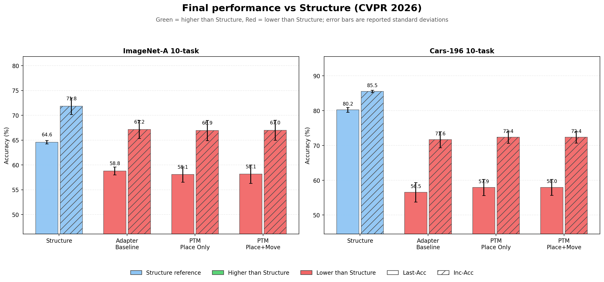
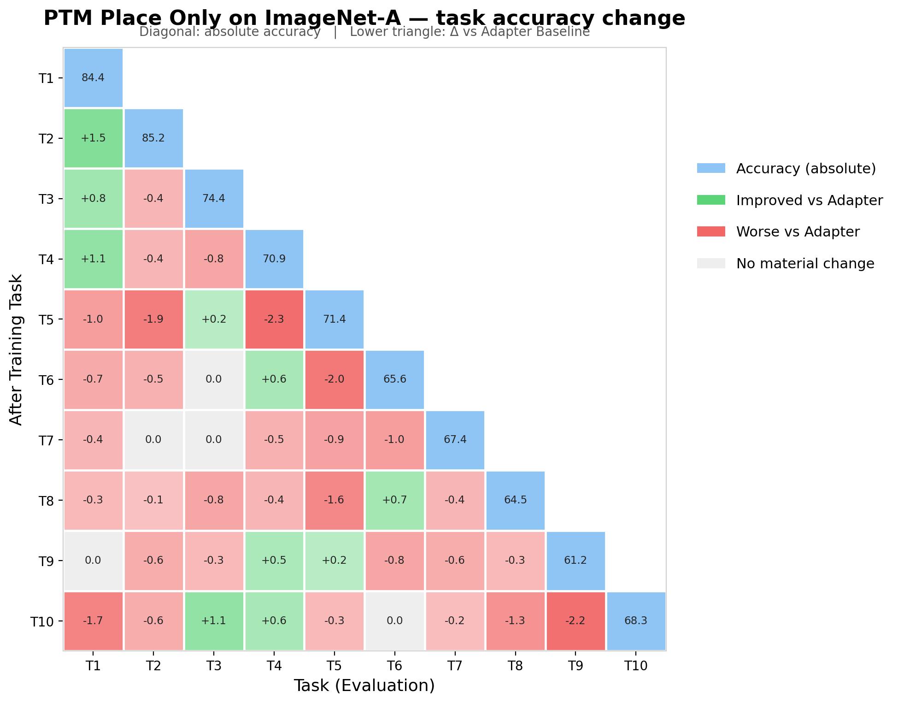
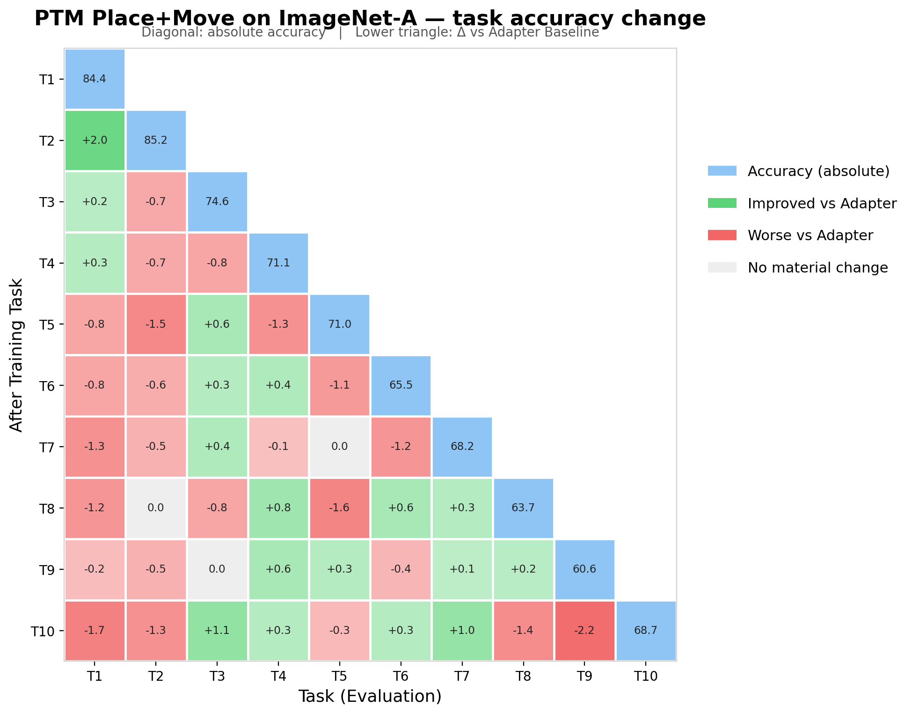
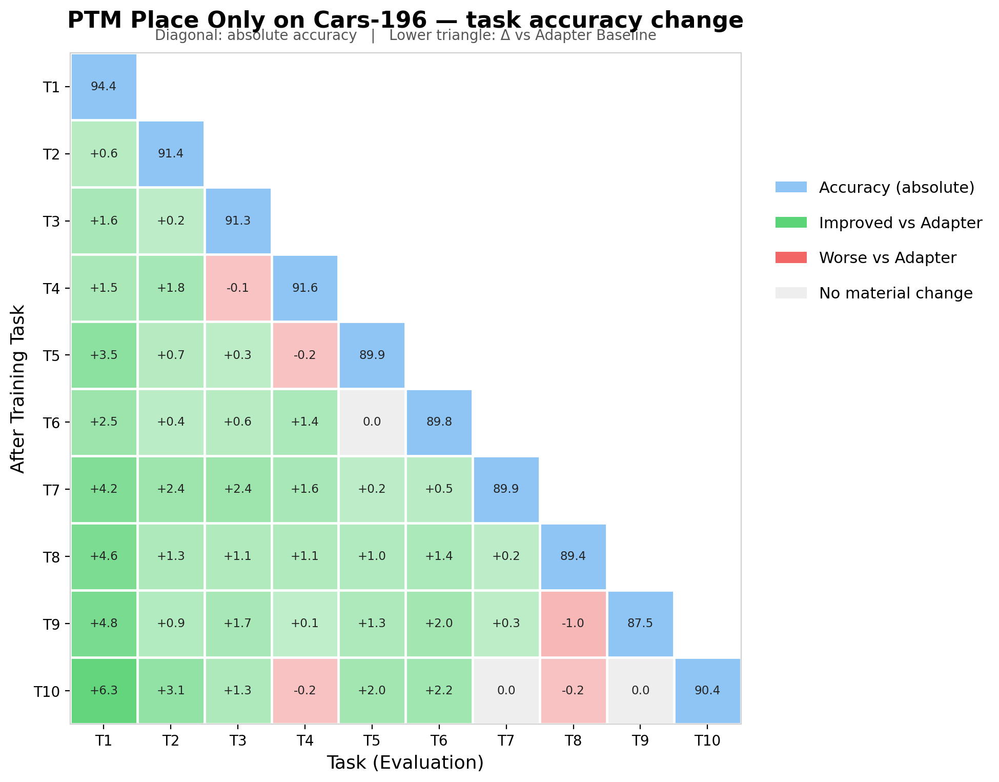
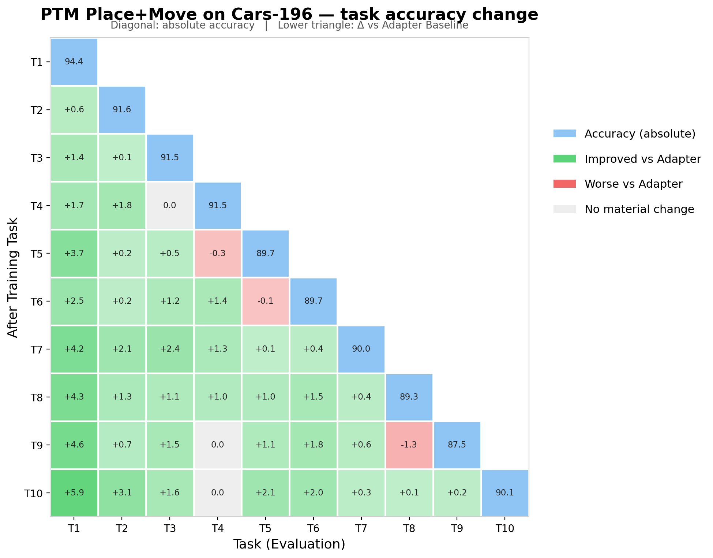

# PTM-Guided Adapter vs Structure (CVPR 2026)

> 이 문서는 `scripts/summarize_ptm_guided_results.py`로 생성된다. Structure 수치는 논문 reference이며, 이 repository에서 실행한 결과가 아니다.

## 1. 실험 가설

Frozen ViT-B/16-IN21K geometry를 new-class placement prior로 사용하고, bottleneck adapter가 classification에 필요한 만큼만 representation을 refine하게 한다. 이후 task에서는 old class layer anchor에서 비선형 adapter response의 과도한 변화만 soft constraint로 억제한다.

## 2. 방법론과 목적함수

### 2.1 공통 adapter와 classification objective

Frozen ViT-B/16-IN21K backbone에 bottleneck adapter만 학습한다. layer $\ell$의 비선형 residual adapter는 다음과 같다.

$$A_{\ell,\phi}(h)=s_\ell W^{\ell}_{\mathrm{up}}\,\mathrm{ReLU}(W^{\ell}_{\mathrm{down}}h+b^{\ell}_{\mathrm{down}})+b^{\ell}_{\mathrm{up}}.$$

분류기는 기존 코드와 동일한 CosFace objective를 사용한다.

$$\mathcal L_{\mathrm{cls}}=-\frac1B\sum_{i=1}^{B}\log\frac{\exp(s(\cos\theta_{y_i}-m))}{\exp(s(\cos\theta_{y_i}-m))+\sum_{j\ne y_i}\exp(s\cos\theta_j)}.$$

### 2.2 Frozen-PTM placement prior

클래스 $c$가 처음 등장할 때 adapter를 명시적으로 끈 frozen PTM feature로 prototype을 한 번 계산한다.

$$p_c=\operatorname{Norm}\!\left(\frac{1}{|D_c|}\sum_{x\in D_c}f_{\theta_0}(x;\,\text{adapter off})\right).$$

학습 batch에서 adapter feature의 클래스 평균을 $\bar z_c$라 하면 placement loss는

$$\bar z_c=\operatorname{Norm}\!\left(\frac{1}{|B_c|}\sum_{i:y_i=c}f_{\theta_0,\phi}(x_i)\right),\qquad \mathcal L_{\mathrm{place}}=\frac1{|C_B|}\sum_{c\in C_B}\left(1-\cos(\bar z_c,p_c)\right).$$

이며 강도는 학습 후반에 0으로 감소한다.

$$\lambda_{\mathrm{place}}(e)=\lambda_f+\frac{\lambda_0-\lambda_f}{2}\left(1+\cos\frac{\pi e}{E-1}\right),\qquad \lambda_f=0.$$

### 2.3 Old-anchor functional movement constraint

클래스가 학습될 때 각 adapter 입력의 클래스 평균만 anchor로 저장한다. raw image나 sample feature는 보존하지 않는다.

$$a_{\ell,c}=\frac1{|D_c|}\sum_{x\in D_c}h_\ell(x),\qquad r^{t-1}_{\ell,c}=A_{\ell,\phi^{t-1}}(a_{\ell,c}).$$

다음 task 시작 시 old anchor에서의 직전 adapter response를 target으로 고정하고 현재 response 변화만 soft하게 제한한다.

$$\mathcal L_{\mathrm{move}}=\frac1{|\mathcal A_{\mathrm{old}}|}\sum_{(\ell,c)\in\mathcal A_{\mathrm{old}}}\operatorname{SmoothL1}\!\left(A_{\ell,\phi^t}(a_{\ell,c}),r^{t-1}_{\ell,c}\right).$$

Task 1에는 old anchor가 없으므로 $\mathcal L_{\mathrm{move}}=0$이다.

### 2.4 세 ablation의 정확한 차이

$$\begin{aligned}\text{Adapter Baseline:}\quad &\mathcal L=\mathcal L_{\mathrm{cls}},\\\text{PTM Place Only:}\quad &\mathcal L=\mathcal L_{\mathrm{cls}}+\lambda_{\mathrm{place}}(e)\mathcal L_{\mathrm{place}},\\\text{PTM Place+Move:}\quad &\mathcal L=\mathcal L_{\mathrm{cls}}+\lambda_{\mathrm{place}}(e)\mathcal L_{\mathrm{place}}+\lambda_{\mathrm{move}}\mathcal L_{\mathrm{move}}.\end{aligned}$$

| Method | 직접 제약하는 대상 | 사용하는 old 정보 | 시점 |
|---|---|---|---|
| Adapter Baseline | new-class classification | 없음 | task 학습 중 |
| PTM Place Only | new class의 adapted mean과 frozen PTM 위치 | 없음 | task 학습 중, cosine decay |
| PTM Place + Move | placement + old anchor에서 adapter 기능 변화 | class/layer 평균 anchor와 response | 다음 task 학습 중 |
| 기존 CDSP | $D Q_{old}=0$ gradient hard projection | old discriminative subspace | optimizer update 전/후 |

### 2.5 Structure와의 수식적 차이

Structure의 SCC는 현재 task sample을 reference point, old prototype을 anchor로 삼아 old/new model의 angular relation vector를 보존한다.

$$r_i^{t}=[\cos(f_{\theta^t}(x_i),\mu_1^{t-1}),\ldots,\cos(f_{\theta^t}(x_i),\mu_K^{t-1})]^\top,$$

$$\mathcal L_{\mathrm{SCC}}=\frac1B\sum_{i=1}^{B}\|r_i^t-r_i^{t-1}\|_2^2,\qquad \mathcal L_{\mathrm{Structure}}=\mathcal L_{\mathrm{CE}}+\lambda\mathcal L_{\mathrm{SCC}}.$$

APR은 new-class prototype의 관측 이동 $\delta_j=\mu_j^t-\mu_j^{t-1}$을 이용해 old class $k$의 이동을 추정한다.

$$\Delta_k=\sum_{j\in C_t}w_{k,j}\delta_j,\qquad w_{k,j}=\frac{\exp(\gamma s_{k,j})}{\sum_{l\in C_t}\exp(\gamma s_{k,l})},$$

$$\mu_k^t=\mu_k^{t-1}+\Delta_k,\qquad \Sigma_k^t=\Sigma_k^{t-1}+\rho\Delta_k\Delta_k^\top+\epsilon I.$$

그 후 rectified distribution에서 $\tilde z_k\sim\mathcal N(\mu_k^t,\Sigma_k^t)$를 sampling해 classifier를 다시 학습한다. 즉 Structure는 SCC로 학습 중 sample-to-prototype 관계를 유지하고 APR과 synthetic feature로 사후 분포·classifier를 보정한다. 본 PTM 방법은 APR/SCC/synthetic CA 없이, new class에는 frozen-PTM 위치 prior를 주고 old class에는 nonlinear adapter response의 국소 변화만 제한한다.

모든 조건은 exemplar-free이며 raw old image replay를 사용하지 않는다.

## 3. Dataset/task protocol

| Dataset | Classes | Tasks | Per-task class sizes |
|---|---:|---:|---|
| ImageNet-A | 200 | 5 / 10 / 20 | 40 / 20 / 10 |
| Cars-196 | 196 | 5 / 10 / 20 | 40×4+36 / 20×9+16 / 10×19+6 |
| ObjectNet | 200 | 10 | 20 |
| OmniBenchmark | 300 | 10 | 30 |
| ImageNet-R | 200 | 10 | 20 |

각 config는 class-order seed 1993, 1996, 1997을 실행한다. Last-Acc는 해당 stage 종료 후 모든 seen class accuracy, Inc-Acc는 그 stage까지의 Last-Acc 평균이다.

## 4. Structure CVPR 2026 reference

| Dataset | Tasks | Last-Acc | Inc-Acc |
|---|---:|---:|---:|
| ImageNet-A | 5 | 66.65 ± 0.20 | 74.09 ± 4.09 |
| ImageNet-A | 10 | 64.58 ± 0.35 | 71.84 ± 1.67 |
| ImageNet-A | 20 | 62.30 ± 0.79 | 69.90 ± 2.08 |
| Cars-196 | 5 | 83.52 ± 0.32 | 87.25 ± 0.70 |
| Cars-196 | 10 | 80.23 ± 0.68 | 85.53 ± 0.35 |
| Cars-196 | 20 | 66.14 ± 0.56 | 74.11 ± 0.64 |
| ObjectNet | 10 | 63.39 ± 0.71 | 74.27 ± 1.29 |
| OmniBenchmark | 10 | 79.19 ± 0.16 | 84.37 ± 0.77 |
| ImageNet-R | 10 | 79.17 ± 0.08 | 83.84 ± 0.56 |

## 5. 최종 결과 요약 (3 seeds, mean ± sample std)

| Dataset | Tasks | Method | Seeds | Last-Acc | Inc-Acc | Our - Structure Last | Our - Structure Inc |
|---|---:|---|---:|---:|---:|---:|---:|
| ImageNet-A | 5 | `ptm_place_move` | 2/3 | 62.87 ± 1.30 | 70.26 ± 1.31 | -3.78 | -3.83 |
| ImageNet-A | 10 | `adapter_baseline` | 3/3 | 58.79 ± 0.81 | 67.15 ± 1.80 | N/A | N/A |
| ImageNet-A | 10 | `ptm_place_only` | 3/3 | 58.06 ± 1.54 | 66.94 ± 2.04 | N/A | N/A |
| ImageNet-A | 10 | `ptm_place_move` | 3/3 | 58.15 ± 1.87 | 66.99 ± 2.01 | -6.43 | -4.85 |
| ImageNet-A | 20 | `ptm_place_move` | 2/3 | 52.30 ± 1.17 | 62.06 ± 2.96 | -9.99 | -7.84 |
| Cars-196 | 5 | `ptm_place_move` | 0/3 | PENDING | PENDING | PENDING | PENDING |
| Cars-196 | 10 | `adapter_baseline` | 3/3 | 56.53 ± 2.78 | 71.65 ± 2.28 | N/A | N/A |
| Cars-196 | 10 | `ptm_place_only` | 3/3 | 57.92 ± 2.33 | 72.37 ± 1.74 | N/A | N/A |
| Cars-196 | 10 | `ptm_place_move` | 3/3 | 57.97 ± 2.29 | 72.37 ± 1.71 | -22.26 | -13.16 |
| Cars-196 | 20 | `ptm_place_move` | 0/3 | PENDING | PENDING | PENDING | PENDING |
| ObjectNet | 10 | `ptm_place_move` | 0/3 | PENDING | PENDING | PENDING | PENDING |
| OmniBenchmark | 10 | `ptm_place_move` | 0/3 | PENDING | PENDING | PENDING | PENDING |
| ImageNet-R | 10 | `ptm_place_move` | 0/3 | PENDING | PENDING | PENDING | PENDING |

### 5.1 Phase 1 결과 해석

- **ImageNet-A**
  - `ptm_place_only` vs baseline: Last -0.73, Inc -0.21, Forgetting +0.20.
  - `ptm_place_move` vs baseline: Last -0.64, Inc -0.16, Forgetting +0.06.
- **Cars-196**
  - `ptm_place_only` vs baseline: Last +1.39, Inc +0.73, Forgetting -2.50.
  - `ptm_place_move` vs baseline: Last +1.43, Inc +0.72, Forgetting -2.55.

ImageNet-A에서는 PTM constraint가 representation drift를 줄였지만 정확도 향상으로 이어지지 않았다. Cars-196에서는 placement가 Last/Inc-Acc와 forgetting을 개선했으나, movement를 추가한 이득은 Place Only 대비 매우 작다.

### 5.2 결과 그래프

색 기준이 서로 다르므로 주의한다. 최종 막대그래프는 **Structure 논문값**을 기준으로 초록/빨강을 표시한다. Task heatmap은 Structure의 task별 matrix가 공개되어 있지 않아 **동일 실행의 Adapter Baseline**을 기준으로 초록/빨강을 표시한다.

#### 최종 성능 vs Structure

#### ImageNet-A task별 변화

#### Cars-196 task별 변화

## 6. 모든 stage별 결과 (3 seeds mean ± std)

`Stage t`는 t번째 task까지 학습한 직후를 뜻한다. Old/New은 각각 이전 task 클래스와 현재 task 클래스 정확도다.

### 6.1 ImageNet-A 10-task

#### `adapter_baseline`

| Stage | Seen classes | Last-Acc | Inc-Acc | Top-5 | Old Acc | New Acc | Forgetting |
|---:|---:|---:|---:|---:|---:|---:|---:|
| 1 | 20 | 83.77 ± 1.98 | 83.77 ± 1.98 | 95.93 ± 1.09 | 0.00 ± 0.00 | 83.77 ± 1.98 | 0.00 ± 0.00 |
| 2 | 40 | 77.72 ± 2.56 | 80.74 ± 2.25 | 94.85 ± 1.79 | 70.29 ± 7.14 | 84.94 ± 4.06 | 13.48 ± 5.49 |
| 3 | 60 | 72.40 ± 3.63 | 77.96 ± 2.68 | 91.61 ± 2.27 | 71.51 ± 2.34 | 74.96 ± 7.28 | 12.94 ± 3.31 |
| 4 | 80 | 68.45 ± 4.12 | 75.58 ± 2.96 | 90.19 ± 2.98 | 67.25 ± 3.30 | 71.11 ± 7.74 | 13.58 ± 1.76 |
| 5 | 100 | 67.11 ± 2.39 | 73.89 ± 2.84 | 88.75 ± 2.03 | 65.55 ± 4.34 | 72.34 ± 6.79 | 13.13 ± 0.46 |
| 6 | 120 | 63.83 ± 0.69 | 72.21 ± 2.48 | 87.59 ± 1.87 | 63.39 ± 0.52 | 66.46 ± 7.36 | 14.06 ± 2.12 |
| 7 | 140 | 61.06 ± 1.85 | 70.62 ± 2.31 | 85.83 ± 1.47 | 59.83 ± 2.01 | 68.01 ± 2.48 | 15.55 ± 1.99 |
| 8 | 160 | 59.73 ± 1.31 | 69.26 ± 2.14 | 84.21 ± 0.61 | 59.10 ± 1.66 | 64.70 ± 2.67 | 15.29 ± 1.35 |
| 9 | 180 | 58.65 ± 0.61 | 68.08 ± 1.92 | 83.12 ± 1.13 | 58.11 ± 0.89 | 61.97 ± 5.37 | 15.00 ± 0.87 |
| 10 | 200 | 58.79 ± 0.81 | 67.15 ± 1.80 | 82.77 ± 0.40 | 57.29 ± 1.53 | 69.69 ± 3.26 | 14.71 ± 1.01 |

#### `ptm_place_only`

| Stage | Seen classes | Last-Acc | Inc-Acc | Top-5 | Old Acc | New Acc | Forgetting |
|---:|---:|---:|---:|---:|---:|---:|---:|
| 1 | 20 | 84.36 ± 2.56 | 84.36 ± 2.56 | 95.95 ± 0.54 | 0.00 ± 0.00 | 84.36 ± 2.56 | 0.00 ± 0.00 |
| 2 | 40 | 78.61 ± 2.28 | 81.48 ± 2.40 | 94.37 ± 2.29 | 71.81 ± 6.57 | 85.23 ± 3.57 | 12.55 ± 4.52 |
| 3 | 60 | 72.45 ± 3.80 | 78.47 ± 2.86 | 91.17 ± 3.21 | 71.79 ± 2.56 | 74.43 ± 7.25 | 13.16 ± 2.57 |
| 4 | 80 | 68.42 ± 3.92 | 75.96 ± 3.07 | 90.28 ± 2.64 | 67.27 ± 3.10 | 70.90 ± 7.74 | 13.72 ± 1.54 |
| 5 | 100 | 65.88 ± 2.17 | 73.94 ± 2.88 | 88.89 ± 2.00 | 64.27 ± 3.39 | 71.43 ± 6.75 | 14.38 ± 0.86 |
| 6 | 120 | 63.23 ± 1.30 | 72.16 ± 2.59 | 87.51 ± 1.74 | 62.82 ± 0.42 | 65.64 ± 8.95 | 14.42 ± 1.82 |
| 7 | 140 | 60.61 ± 2.30 | 70.51 ± 2.47 | 85.69 ± 1.18 | 59.42 ± 2.72 | 67.38 ± 2.66 | 15.76 ± 2.38 |
| 8 | 160 | 59.35 ± 1.13 | 69.11 ± 2.29 | 84.00 ± 0.88 | 58.69 ± 1.65 | 64.46 ± 3.88 | 15.42 ± 0.85 |
| 9 | 180 | 58.40 ± 1.21 | 67.92 ± 2.12 | 83.29 ± 1.06 | 57.92 ± 1.49 | 61.19 ± 5.53 | 14.94 ± 1.05 |
| 10 | 200 | 58.06 ± 1.54 | 66.94 ± 2.04 | 82.60 ± 0.51 | 56.70 ± 2.28 | 68.31 ± 2.77 | 14.91 ± 1.76 |

#### `ptm_place_move`

| Stage | Seen classes | Last-Acc | Inc-Acc | Top-5 | Old Acc | New Acc | Forgetting |
|---:|---:|---:|---:|---:|---:|---:|---:|
| 1 | 20 | 84.36 ± 2.56 | 84.36 ± 2.56 | 95.95 ± 0.54 | 0.00 ± 0.00 | 84.36 ± 2.56 | 0.00 ± 0.00 |
| 2 | 40 | 78.84 ± 2.09 | 81.60 ± 2.31 | 94.28 ± 2.22 | 72.26 ± 6.34 | 85.23 ± 3.57 | 12.10 ± 4.40 |
| 3 | 60 | 72.20 ± 3.31 | 78.47 ± 2.60 | 91.33 ± 3.08 | 71.33 ± 2.10 | 74.65 ± 6.56 | 13.64 ± 2.81 |
| 4 | 80 | 68.16 ± 3.76 | 75.89 ± 2.80 | 90.35 ± 2.54 | 66.83 ± 2.68 | 71.05 ± 7.97 | 14.18 ± 1.33 |
| 5 | 100 | 66.14 ± 2.98 | 73.94 ± 2.83 | 88.93 ± 2.09 | 64.73 ± 3.87 | 70.97 ± 7.11 | 14.03 ± 0.93 |
| 6 | 120 | 63.36 ± 1.10 | 72.18 ± 2.53 | 87.25 ± 1.71 | 63.01 ± 0.53 | 65.48 ± 8.25 | 14.24 ± 2.22 |
| 7 | 140 | 60.75 ± 2.21 | 70.54 ± 2.40 | 85.43 ± 1.23 | 59.43 ± 2.52 | 68.25 ± 2.87 | 15.69 ± 2.26 |
| 8 | 160 | 59.39 ± 1.22 | 69.15 ± 2.23 | 83.81 ± 0.71 | 58.83 ± 1.71 | 63.65 ± 4.28 | 15.37 ± 0.93 |
| 9 | 180 | 58.55 ± 0.87 | 67.97 ± 2.06 | 83.14 ± 1.19 | 58.17 ± 1.49 | 60.58 ± 5.34 | 14.74 ± 0.46 |
| 10 | 200 | 58.15 ± 1.87 | 66.99 ± 2.01 | 82.69 ± 0.47 | 56.75 ± 2.45 | 68.72 ± 1.52 | 14.77 ± 1.84 |

### 6.2 Cars-196 10-task

#### `adapter_baseline`

| Stage | Seen classes | Last-Acc | Inc-Acc | Top-5 | Old Acc | New Acc | Forgetting |
|---:|---:|---:|---:|---:|---:|---:|---:|
| 1 | 20 | 94.45 ± 1.74 | 94.45 ± 1.74 | 99.72 ± 0.18 | 0.00 ± 0.00 | 94.45 ± 1.74 | 0.00 ± 0.00 |
| 2 | 40 | 86.89 ± 3.83 | 90.67 ± 2.78 | 98.71 ± 0.16 | 82.09 ± 6.29 | 91.70 ± 2.07 | 12.35 ± 4.56 |
| 3 | 60 | 81.02 ± 5.04 | 87.45 ± 2.97 | 97.89 ± 0.58 | 75.41 ± 7.88 | 92.29 ± 0.85 | 17.65 ± 6.72 |
| 4 | 80 | 76.19 ± 3.57 | 84.64 ± 3.08 | 96.66 ± 0.75 | 70.88 ± 4.96 | 92.44 ± 0.91 | 21.94 ± 4.23 |
| 5 | 100 | 72.44 ± 3.23 | 82.20 ± 2.98 | 95.03 ± 1.14 | 67.85 ± 4.24 | 90.80 ± 0.95 | 24.82 ± 3.68 |
| 6 | 120 | 66.49 ± 3.69 | 79.58 ± 2.90 | 93.81 ± 1.35 | 61.67 ± 4.59 | 90.24 ± 2.24 | 30.67 ± 4.35 |
| 7 | 140 | 63.94 ± 2.05 | 77.35 ± 2.75 | 92.51 ± 1.15 | 59.46 ± 2.39 | 90.93 ± 0.85 | 32.55 ± 2.23 |
| 8 | 160 | 60.40 ± 2.31 | 75.23 ± 2.35 | 91.41 ± 0.72 | 56.05 ± 2.47 | 91.17 ± 1.88 | 35.79 ± 2.92 |
| 9 | 180 | 58.11 ± 2.01 | 73.33 ± 2.26 | 89.99 ± 1.19 | 54.27 ± 2.47 | 89.03 ± 2.27 | 37.42 ± 2.34 |
| 10 | 196 | 56.53 ± 2.78 | 71.65 ± 2.28 | 88.13 ± 1.36 | 53.38 ± 3.29 | 91.53 ± 1.97 | 38.02 ± 3.33 |

#### `ptm_place_only`

| Stage | Seen classes | Last-Acc | Inc-Acc | Top-5 | Old Acc | New Acc | Forgetting |
|---:|---:|---:|---:|---:|---:|---:|---:|
| 1 | 20 | 94.36 ± 1.81 | 94.36 ± 1.81 | 99.72 ± 0.18 | 0.00 ± 0.00 | 94.36 ± 1.81 | 0.00 ± 0.00 |
| 2 | 40 | 87.03 ± 3.51 | 90.70 ± 2.66 | 98.77 ± 0.28 | 82.66 ± 5.93 | 91.42 ± 1.82 | 11.70 ± 4.18 |
| 3 | 60 | 81.29 ± 4.20 | 87.56 ± 2.65 | 97.99 ± 0.35 | 76.33 ± 6.39 | 91.27 ± 0.63 | 16.56 ± 5.30 |
| 4 | 80 | 76.79 ± 2.54 | 84.87 ± 2.59 | 96.71 ± 0.59 | 71.94 ± 3.77 | 91.58 ± 1.66 | 20.41 ± 2.95 |
| 5 | 100 | 73.14 ± 2.18 | 82.52 ± 2.43 | 95.23 ± 0.87 | 68.95 ± 3.08 | 89.86 ± 1.68 | 23.17 ± 2.47 |
| 6 | 120 | 67.22 ± 2.34 | 79.97 ± 2.25 | 93.93 ± 0.93 | 62.65 ± 3.04 | 89.75 ± 2.44 | 29.05 ± 2.76 |
| 7 | 140 | 65.41 ± 1.70 | 77.89 ± 2.14 | 93.09 ± 0.91 | 61.36 ± 2.12 | 89.89 ± 1.59 | 30.04 ± 1.99 |
| 8 | 160 | 61.51 ± 2.70 | 75.84 ± 1.89 | 91.84 ± 0.57 | 57.56 ± 2.84 | 89.40 ± 2.44 | 33.61 ± 3.09 |
| 9 | 180 | 59.08 ± 1.57 | 73.98 ± 1.74 | 90.18 ± 0.23 | 55.54 ± 1.76 | 87.55 ± 2.32 | 35.35 ± 1.65 |
| 10 | 196 | 57.92 ± 2.33 | 72.37 ± 1.74 | 88.70 ± 0.84 | 55.01 ± 2.62 | 90.36 ± 1.56 | 35.52 ± 2.58 |

#### `ptm_place_move`

| Stage | Seen classes | Last-Acc | Inc-Acc | Top-5 | Old Acc | New Acc | Forgetting |
|---:|---:|---:|---:|---:|---:|---:|---:|
| 1 | 20 | 94.36 ± 1.81 | 94.36 ± 1.81 | 99.72 ± 0.18 | 0.00 ± 0.00 | 94.36 ± 1.81 | 0.00 ± 0.00 |
| 2 | 40 | 87.18 ± 3.55 | 90.77 ± 2.68 | 98.71 ± 0.28 | 82.74 ± 5.70 | 91.62 ± 1.97 | 11.63 ± 3.93 |
| 3 | 60 | 81.27 ± 4.39 | 87.60 ± 2.72 | 98.07 ± 0.34 | 76.16 ± 6.66 | 91.52 ± 0.40 | 16.82 ± 5.60 |
| 4 | 80 | 76.84 ± 2.64 | 84.91 ± 2.66 | 96.75 ± 0.59 | 72.02 ± 3.95 | 91.54 ± 1.81 | 20.49 ± 3.14 |
| 5 | 100 | 73.06 ± 2.19 | 82.54 ± 2.49 | 95.21 ± 0.81 | 68.90 ± 3.07 | 89.66 ± 1.50 | 23.33 ± 2.31 |
| 6 | 120 | 67.23 ± 2.20 | 79.99 ± 2.28 | 93.91 ± 0.85 | 62.67 ± 2.87 | 89.71 ± 2.62 | 29.06 ± 2.46 |
| 7 | 140 | 65.31 ± 1.49 | 77.89 ± 2.13 | 93.14 ± 0.92 | 61.23 ± 1.86 | 89.97 ± 1.54 | 30.20 ± 1.63 |
| 8 | 160 | 61.50 ± 2.82 | 75.84 ± 1.88 | 91.90 ± 0.50 | 57.57 ± 2.91 | 89.33 ± 2.78 | 33.64 ± 3.14 |
| 9 | 180 | 58.97 ± 1.47 | 73.97 ± 1.71 | 90.07 ± 0.38 | 55.43 ± 1.61 | 87.54 ± 2.40 | 35.50 ± 1.43 |
| 10 | 196 | 57.97 ± 2.29 | 72.37 ± 1.71 | 88.75 ± 0.85 | 55.08 ± 2.57 | 90.13 ± 1.21 | 35.47 ± 2.40 |

## 7. Task accuracy matrix (3-seed mean ± std)

행은 학습을 마친 stage, 열은 평가 대상 task다. `—`는 아직 학습하지 않은 task를 뜻한다.

### ImageNet-A / `adapter_baseline`

| Trained through | Eval T1 | Eval T2 | Eval T3 | Eval T4 | Eval T5 | Eval T6 | Eval T7 | Eval T8 | Eval T9 | Eval T10 |
|---:|---:|---:|---:|---:|---:|---:|---:|---:|---:|---:|
| T1 | 83.8 ± 2.0 | — | — | — | — | — | — | — | — | — |
| T2 | 70.3 ± 7.1 | 84.9 ± 4.1 | — | — | — | — | — | — | — | — |
| T3 | 65.6 ± 7.5 | 77.2 ± 2.8 | 75.0 ± 7.3 | — | — | — | — | — | — | — |
| T4 | 59.4 ± 5.7 | 74.0 ± 3.5 | 69.6 ± 9.6 | 71.1 ± 7.7 | — | — | — | — | — | — |
| T5 | 57.3 ± 3.0 | 72.4 ± 5.0 | 65.4 ± 10.0 | 67.2 ± 8.7 | 72.3 ± 6.8 | — | — | — | — | — |
| T6 | 53.7 ± 2.5 | 68.8 ± 7.3 | 63.6 ± 6.7 | 61.6 ± 7.2 | 69.2 ± 7.0 | 66.5 ± 7.4 | — | — | — | — |
| T7 | 46.1 ± 5.5 | 61.8 ± 4.4 | 62.6 ± 6.2 | 58.9 ± 6.8 | 65.6 ± 6.6 | 65.2 ± 8.1 | 68.0 ± 2.5 | — | — | — |
| T8 | 44.6 ± 6.1 | 61.1 ± 0.8 | 62.1 ± 7.3 | 57.0 ± 5.7 | 65.3 ± 7.8 | 61.2 ± 10.5 | 63.2 ± 2.0 | 64.7 ± 2.7 | — | — |
| T9 | 42.7 ± 1.8 | 60.5 ± 1.3 | 60.7 ± 5.7 | 55.5 ± 5.8 | 62.0 ± 6.7 | 61.6 ± 8.0 | 62.6 ± 1.3 | 60.7 ± 2.5 | 62.0 ± 5.4 | — |
| T10 | 43.1 ± 1.4 | 58.6 ± 1.4 | 58.8 ± 5.8 | 53.8 ± 6.1 | 59.8 ± 5.9 | 59.8 ± 9.8 | 61.4 ± 1.4 | 61.1 ± 3.5 | 59.4 ± 4.8 | 69.7 ± 3.3 |

### ImageNet-A / `ptm_place_only`

| Trained through | Eval T1 | Eval T2 | Eval T3 | Eval T4 | Eval T5 | Eval T6 | Eval T7 | Eval T8 | Eval T9 | Eval T10 |
|---:|---:|---:|---:|---:|---:|---:|---:|---:|---:|---:|
| T1 | 84.4 ± 2.6 | — | — | — | — | — | — | — | — | — |
| T2 | 71.8 ± 6.6 | 85.2 ± 3.6 | — | — | — | — | — | — | — | — |
| T3 | 66.4 ± 7.6 | 76.8 ± 3.8 | 74.4 ± 7.3 | — | — | — | — | — | — | — |
| T4 | 60.5 ± 5.1 | 73.6 ± 3.4 | 68.8 ± 9.5 | 70.9 ± 7.7 | — | — | — | — | — | — |
| T5 | 56.3 ± 4.5 | 70.5 ± 4.3 | 65.6 ± 9.7 | 64.9 ± 8.7 | 71.4 ± 6.8 | — | — | — | — | — |
| T6 | 52.9 ± 2.8 | 68.3 ± 7.7 | 63.7 ± 7.1 | 62.1 ± 7.6 | 67.2 ± 6.3 | 65.6 ± 9.0 | — | — | — | — |
| T7 | 45.7 ± 7.7 | 61.9 ± 4.0 | 62.5 ± 5.5 | 58.4 ± 6.7 | 64.7 ± 6.3 | 64.3 ± 9.0 | 67.4 ± 2.7 | — | — | — |
| T8 | 44.3 ± 5.2 | 61.0 ± 2.2 | 61.3 ± 7.7 | 56.6 ± 6.7 | 63.7 ± 8.8 | 61.9 ± 12.0 | 62.8 ± 2.3 | 64.5 ± 3.9 | — | — |
| T9 | 42.7 ± 3.3 | 59.9 ± 0.6 | 60.4 ± 5.7 | 56.1 ± 5.8 | 62.2 ± 7.4 | 60.8 ± 11.3 | 62.0 ± 1.2 | 60.4 ± 4.0 | 61.2 ± 5.5 | — |
| T10 | 41.4 ± 3.6 | 58.0 ± 0.8 | 59.9 ± 5.7 | 54.3 ± 4.2 | 59.6 ± 7.0 | 59.7 ± 10.5 | 61.2 ± 1.9 | 59.8 ± 3.6 | 57.2 ± 6.1 | 68.3 ± 2.8 |

### ImageNet-A / `ptm_place_move`

| Trained through | Eval T1 | Eval T2 | Eval T3 | Eval T4 | Eval T5 | Eval T6 | Eval T7 | Eval T8 | Eval T9 | Eval T10 |
|---:|---:|---:|---:|---:|---:|---:|---:|---:|---:|---:|
| T1 | 84.4 ± 2.6 | — | — | — | — | — | — | — | — | — |
| T2 | 72.3 ± 6.3 | 85.2 ± 3.6 | — | — | — | — | — | — | — | — |
| T3 | 65.8 ± 7.8 | 76.5 ± 3.7 | 74.6 ± 6.6 | — | — | — | — | — | — | — |
| T4 | 59.6 ± 5.1 | 73.3 ± 4.4 | 68.8 ± 9.5 | 71.1 ± 8.0 | — | — | — | — | — | — |
| T5 | 56.5 ± 5.3 | 70.9 ± 5.0 | 66.0 ± 10.9 | 65.9 ± 8.5 | 71.0 ± 7.1 | — | — | — | — | — |
| T6 | 52.9 ± 3.1 | 68.2 ± 7.5 | 63.9 ± 7.5 | 61.9 ± 7.5 | 68.1 ± 6.3 | 65.5 ± 8.2 | — | — | — | — |
| T7 | 44.8 ± 7.6 | 61.3 ± 4.0 | 63.0 ± 5.0 | 58.8 ± 5.6 | 65.6 ± 6.2 | 64.0 ± 7.9 | 68.2 ± 2.9 | — | — | — |
| T8 | 43.5 ± 3.8 | 61.1 ± 1.9 | 61.3 ± 7.7 | 57.8 ± 5.7 | 63.7 ± 9.9 | 61.8 ± 12.2 | 63.5 ± 2.6 | 63.7 ± 4.3 | — | — |
| T9 | 42.5 ± 3.0 | 60.0 ± 1.4 | 60.7 ± 5.7 | 56.1 ± 6.4 | 62.3 ± 7.1 | 61.2 ± 9.9 | 62.6 ± 1.6 | 60.9 ± 3.9 | 60.6 ± 5.3 | — |
| T10 | 41.5 ± 5.6 | 57.4 ± 0.7 | 59.9 ± 5.7 | 54.0 ± 3.9 | 59.6 ± 7.4 | 60.1 ± 10.0 | 62.4 ± 1.1 | 59.8 ± 2.7 | 57.1 ± 5.7 | 68.7 ± 1.5 |

### Cars-196 / `adapter_baseline`

| Trained through | Eval T1 | Eval T2 | Eval T3 | Eval T4 | Eval T5 | Eval T6 | Eval T7 | Eval T8 | Eval T9 | Eval T10 |
|---:|---:|---:|---:|---:|---:|---:|---:|---:|---:|---:|
| T1 | 94.4 ± 1.7 | — | — | — | — | — | — | — | — | — |
| T2 | 82.1 ± 6.3 | 91.7 ± 2.1 | — | — | — | — | — | — | — | — |
| T3 | 72.7 ± 7.4 | 78.2 ± 8.7 | 92.3 ± 0.9 | — | — | — | — | — | — | — |
| T4 | 67.6 ± 12.7 | 68.4 ± 1.1 | 76.6 ± 2.4 | 92.4 ± 0.9 | — | — | — | — | — | — |
| T5 | 55.9 ± 11.8 | 66.5 ± 2.4 | 71.1 ± 3.2 | 78.1 ± 6.3 | 90.8 ± 1.0 | — | — | — | — | — |
| T6 | 49.0 ± 12.3 | 58.3 ± 4.4 | 60.4 ± 1.9 | 65.3 ± 9.1 | 75.4 ± 5.5 | 90.2 ± 2.2 | — | — | — | — |
| T7 | 43.3 ± 8.0 | 51.7 ± 4.0 | 55.0 ± 4.3 | 62.1 ± 6.4 | 69.0 ± 2.7 | 75.5 ± 2.9 | 90.9 ± 0.9 | — | — | — |
| T8 | 35.7 ± 4.5 | 45.6 ± 6.0 | 53.1 ± 8.4 | 57.9 ± 5.5 | 60.5 ± 2.7 | 63.4 ± 8.0 | 76.1 ± 3.0 | 91.2 ± 1.9 | — | — |
| T9 | 32.2 ± 9.6 | 45.4 ± 2.7 | 48.1 ± 4.9 | 54.0 ± 6.2 | 57.4 ± 6.5 | 58.8 ± 5.0 | 64.3 ± 3.6 | 74.4 ± 4.0 | 89.0 ± 2.3 | — |
| T10 | 28.8 ± 14.2 | 38.5 ± 2.1 | 47.4 ± 8.1 | 50.8 ± 10.8 | 56.4 ± 3.9 | 54.0 ± 6.7 | 63.7 ± 3.9 | 70.1 ± 7.8 | 71.2 ± 5.5 | 91.5 ± 2.0 |

### Cars-196 / `ptm_place_only`

| Trained through | Eval T1 | Eval T2 | Eval T3 | Eval T4 | Eval T5 | Eval T6 | Eval T7 | Eval T8 | Eval T9 | Eval T10 |
|---:|---:|---:|---:|---:|---:|---:|---:|---:|---:|---:|
| T1 | 94.4 ± 1.8 | — | — | — | — | — | — | — | — | — |
| T2 | 82.7 ± 5.9 | 91.4 ± 1.8 | — | — | — | — | — | — | — | — |
| T3 | 74.3 ± 5.6 | 78.3 ± 8.1 | 91.3 ± 0.6 | — | — | — | — | — | — | — |
| T4 | 69.1 ± 10.3 | 70.2 ± 1.1 | 76.5 ± 2.0 | 91.6 ± 1.7 | — | — | — | — | — | — |
| T5 | 59.4 ± 9.6 | 67.2 ± 2.4 | 71.4 ± 2.5 | 77.9 ± 5.0 | 89.9 ± 1.7 | — | — | — | — | — |
| T6 | 51.5 ± 9.8 | 58.7 ± 6.3 | 61.1 ± 1.4 | 66.6 ± 7.4 | 75.4 ± 2.9 | 89.8 ± 2.4 | — | — | — | — |
| T7 | 47.5 ± 6.4 | 54.1 ± 4.7 | 57.5 ± 3.7 | 63.6 ± 5.9 | 69.2 ± 2.7 | 76.0 ± 1.1 | 89.9 ± 1.6 | — | — | — |
| T8 | 40.3 ± 2.7 | 46.9 ± 5.1 | 54.2 ± 9.1 | 59.0 ± 5.8 | 61.5 ± 2.1 | 64.8 ± 7.1 | 76.3 ± 3.6 | 89.4 ± 2.4 | — | — |
| T9 | 37.0 ± 5.9 | 46.3 ± 4.4 | 49.8 ± 4.2 | 54.1 ± 6.9 | 58.6 ± 4.9 | 60.8 ± 3.8 | 64.6 ± 3.3 | 73.5 ± 7.2 | 87.5 ± 2.3 | — |
| T10 | 35.1 ± 9.1 | 41.6 ± 0.2 | 48.7 ± 6.3 | 50.6 ± 9.2 | 58.4 ± 3.6 | 56.2 ± 3.4 | 63.7 ± 3.0 | 70.0 ± 6.7 | 71.2 ± 7.9 | 90.4 ± 1.6 |

### Cars-196 / `ptm_place_move`

| Trained through | Eval T1 | Eval T2 | Eval T3 | Eval T4 | Eval T5 | Eval T6 | Eval T7 | Eval T8 | Eval T9 | Eval T10 |
|---:|---:|---:|---:|---:|---:|---:|---:|---:|---:|---:|
| T1 | 94.4 ± 1.8 | — | — | — | — | — | — | — | — | — |
| T2 | 82.7 ± 5.7 | 91.6 ± 2.0 | — | — | — | — | — | — | — | — |
| T3 | 74.1 ± 5.8 | 78.2 ± 8.4 | 91.5 ± 0.4 | — | — | — | — | — | — | — |
| T4 | 69.3 ± 10.3 | 70.2 ± 0.7 | 76.6 ± 2.3 | 91.5 ± 1.8 | — | — | — | — | — | — |
| T5 | 59.7 ± 9.7 | 66.7 ± 2.8 | 71.6 ± 2.5 | 77.8 ± 5.2 | 89.7 ± 1.5 | — | — | — | — | — |
| T6 | 51.5 ± 10.0 | 58.5 ± 6.6 | 61.6 ± 1.4 | 66.6 ± 7.4 | 75.2 ± 2.5 | 89.7 ± 2.6 | — | — | — | — |
| T7 | 47.5 ± 5.4 | 53.8 ± 4.6 | 57.5 ± 3.1 | 63.4 ± 6.0 | 69.1 ± 2.8 | 75.9 ± 1.6 | 90.0 ± 1.5 | — | — | — |
| T8 | 40.0 ± 2.7 | 46.9 ± 4.9 | 54.2 ± 9.7 | 58.9 ± 6.2 | 61.5 ± 1.5 | 64.9 ± 7.2 | 76.5 ± 3.6 | 89.3 ± 2.8 | — | — |
| T9 | 36.9 ± 5.5 | 46.2 ± 4.6 | 49.6 ± 3.9 | 53.9 ± 6.8 | 58.4 ± 4.8 | 60.6 ± 3.9 | 64.9 ± 3.3 | 73.2 ± 7.1 | 87.5 ± 2.4 | — |
| T10 | 34.7 ± 9.4 | 41.6 ± 0.6 | 49.0 ± 6.2 | 50.9 ± 9.1 | 58.5 ± 3.7 | 55.9 ± 3.9 | 64.0 ± 3.5 | 70.2 ± 6.8 | 71.4 ± 8.5 | 90.1 ± 1.2 |

## 8. 모든 stage별 loss, drift, 시간 및 메모리

Loss는 각 seed에서 해당 stage의 epoch 평균을 먼저 구한 뒤 3 seeds로 집계했다. 시간은 prototype 수집·학습·통계·평가를 포함한 stage wall time이며, GPU memory는 process peak allocated memory다. 세 method를 GPU 3에서 동시에 실행했으므로 wall time은 단독 실행 속도가 아니라 GPU 경합이 포함된 측정값이다.

### ImageNet-A 10-task diagnostics

#### `adapter_baseline`

| Stage | Cls loss | Place loss | Move loss | Total loss | PTM proto drift | PTM geometry | Anchor drift | Time (min) | Peak GPU (GiB) |
|---:|---:|---:|---:|---:|---:|---:|---:|---:|---:|
| 1 | 1.7903 ± 0.1729 | 0.0000 ± 0.0000 | 0.000000 ± 0.000000 | 1.7903 ± 0.1729 | 0.6106 ± 0.0279 | 0.3620 ± 0.0120 | 0.0000 ± 0.0000 | 5.2 ± 0.7 | 4.63 ± 0.00 |
| 2 | 1.7326 ± 0.2342 | 0.0000 ± 0.0000 | 0.000000 ± 0.000000 | 1.7326 ± 0.2342 | 0.6405 ± 0.0397 | 0.3306 ± 0.0152 | 0.0451 ± 0.0149 | 2.8 ± 0.5 | 4.63 ± 0.00 |
| 3 | 1.7574 ± 0.1063 | 0.0000 ± 0.0000 | 0.000000 ± 0.000000 | 1.7574 ± 0.1063 | 0.6554 ± 0.0183 | 0.3239 ± 0.0170 | 0.0616 ± 0.0100 | 2.3 ± 0.0 | 4.63 ± 0.00 |
| 4 | 1.8918 ± 0.1611 | 0.0000 ± 0.0000 | 0.000000 ± 0.000000 | 1.8918 ± 0.1611 | 0.6428 ± 0.0304 | 0.3216 ± 0.0098 | 0.0887 ± 0.0176 | 2.8 ± 0.5 | 4.63 ± 0.00 |
| 5 | 1.7020 ± 0.0321 | 0.0000 ± 0.0000 | 0.000000 ± 0.000000 | 1.7020 ± 0.0321 | 0.6299 ± 0.0292 | 0.3116 ± 0.0149 | 0.1045 ± 0.0104 | 2.7 ± 0.2 | 4.63 ± 0.00 |
| 6 | 1.7663 ± 0.3622 | 0.0000 ± 0.0000 | 0.000000 ± 0.000000 | 1.7663 ± 0.3622 | 0.6362 ± 0.0130 | 0.3228 ± 0.0036 | 0.1166 ± 0.0182 | 2.5 ± 0.3 | 4.63 ± 0.00 |
| 7 | 1.7622 ± 0.2263 | 0.0000 ± 0.0000 | 0.000000 ± 0.000000 | 1.7622 ± 0.2263 | 0.6381 ± 0.0149 | 0.3231 ± 0.0128 | 0.1273 ± 0.0133 | 2.9 ± 0.4 | 4.63 ± 0.00 |
| 8 | 1.7998 ± 0.0712 | 0.0000 ± 0.0000 | 0.000000 ± 0.000000 | 1.7998 ± 0.0712 | 0.6344 ± 0.0059 | 0.3310 ± 0.0053 | 0.1378 ± 0.0054 | 2.6 ± 0.2 | 4.63 ± 0.00 |
| 9 | 1.9380 ± 0.2310 | 0.0000 ± 0.0000 | 0.000000 ± 0.000000 | 1.9380 ± 0.2310 | 0.6413 ± 0.0195 | 0.3209 ± 0.0089 | 0.1435 ± 0.0090 | 3.0 ± 0.3 | 4.63 ± 0.00 |
| 10 | 1.6791 ± 0.0508 | 0.0000 ± 0.0000 | 0.000000 ± 0.000000 | 1.6791 ± 0.0508 | 0.6188 ± 0.0030 | 0.3199 ± 0.0136 | 0.1573 ± 0.0201 | 3.3 ± 0.6 | 4.63 ± 0.00 |

#### `ptm_place_only`

| Stage | Cls loss | Place loss | Move loss | Total loss | PTM proto drift | PTM geometry | Anchor drift | Time (min) | Peak GPU (GiB) |
|---:|---:|---:|---:|---:|---:|---:|---:|---:|---:|
| 1 | 1.8255 ± 0.1776 | 0.4316 ± 0.0160 | 0.000000 ± 0.000000 | 2.0267 ± 0.1772 | 0.5008 ± 0.0326 | 0.3359 ± 0.0163 | 0.0000 ± 0.0000 | 6.2 ± 1.2 | 4.63 ± 0.00 |
| 2 | 1.7689 ± 0.2363 | 0.4285 ± 0.0119 | 0.000000 ± 0.000000 | 1.9802 ± 0.2384 | 0.4741 ± 0.0363 | 0.2942 ± 0.0191 | 0.0513 ± 0.0159 | 3.1 ± 0.6 | 4.63 ± 0.00 |
| 3 | 1.7937 ± 0.1029 | 0.4439 ± 0.0104 | 0.000000 ± 0.000000 | 2.0134 ± 0.1080 | 0.4743 ± 0.0110 | 0.2857 ± 0.0304 | 0.0703 ± 0.0110 | 2.7 ± 0.1 | 4.63 ± 0.00 |
| 4 | 1.9269 ± 0.1705 | 0.4290 ± 0.0226 | 0.000000 ± 0.000000 | 2.1369 ± 0.1806 | 0.4668 ± 0.0323 | 0.2806 ± 0.0046 | 0.0963 ± 0.0191 | 3.1 ± 0.7 | 4.63 ± 0.00 |
| 5 | 1.7314 ± 0.0385 | 0.4005 ± 0.0194 | 0.000000 ± 0.000000 | 1.9294 ± 0.0418 | 0.4445 ± 0.0271 | 0.2565 ± 0.0211 | 0.1111 ± 0.0111 | 2.9 ± 0.2 | 4.63 ± 0.00 |
| 6 | 1.7995 ± 0.3645 | 0.4191 ± 0.0364 | 0.000000 ± 0.000000 | 2.0054 ± 0.3820 | 0.4526 ± 0.0242 | 0.2716 ± 0.0040 | 0.1223 ± 0.0190 | 2.7 ± 0.4 | 4.63 ± 0.00 |
| 7 | 1.7953 ± 0.2324 | 0.4193 ± 0.0103 | 0.000000 ± 0.000000 | 1.9989 ± 0.2302 | 0.4601 ± 0.0142 | 0.2809 ± 0.0143 | 0.1315 ± 0.0131 | 3.1 ± 0.4 | 4.63 ± 0.00 |
| 8 | 1.8337 ± 0.0704 | 0.4301 ± 0.0189 | 0.000000 ± 0.000000 | 2.0435 ± 0.0792 | 0.4588 ± 0.0127 | 0.2881 ± 0.0171 | 0.1395 ± 0.0067 | 2.5 ± 0.7 | 4.63 ± 0.00 |
| 9 | 1.9767 ± 0.2321 | 0.4245 ± 0.0193 | 0.000000 ± 0.000000 | 2.1829 ± 0.2424 | 0.4512 ± 0.0164 | 0.2768 ± 0.0111 | 0.1447 ± 0.0113 | 2.9 ± 0.4 | 4.63 ± 0.00 |
| 10 | 1.7118 ± 0.0479 | 0.3934 ± 0.0157 | 0.000000 ± 0.000000 | 1.9038 ± 0.0514 | 0.4252 ± 0.0039 | 0.2591 ± 0.0100 | 0.1601 ± 0.0202 | 3.2 ± 0.9 | 4.63 ± 0.00 |

#### `ptm_place_move`

| Stage | Cls loss | Place loss | Move loss | Total loss | PTM proto drift | PTM geometry | Anchor drift | Time (min) | Peak GPU (GiB) |
|---:|---:|---:|---:|---:|---:|---:|---:|---:|---:|
| 1 | 1.8255 ± 0.1776 | 0.4316 ± 0.0160 | 0.000000 ± 0.000000 | 2.0267 ± 0.1772 | 0.5008 ± 0.0326 | 0.3359 ± 0.0163 | 0.0000 ± 0.0000 | 6.2 ± 1.1 | 4.63 ± 0.00 |
| 2 | 1.7682 ± 0.2351 | 0.4286 ± 0.0117 | 0.000085 ± 0.000040 | 1.9795 ± 0.2371 | 0.4751 ± 0.0354 | 0.2951 ± 0.0182 | 0.0509 ± 0.0156 | 3.3 ± 0.7 | 4.63 ± 0.00 |
| 3 | 1.7951 ± 0.1029 | 0.4440 ± 0.0098 | 0.000050 ± 0.000008 | 2.0148 ± 0.1080 | 0.4759 ± 0.0104 | 0.2871 ± 0.0321 | 0.0701 ± 0.0112 | 2.7 ± 0.1 | 4.63 ± 0.00 |
| 4 | 1.9286 ± 0.1684 | 0.4293 ± 0.0235 | 0.000060 ± 0.000032 | 2.1387 ± 0.1788 | 0.4676 ± 0.0326 | 0.2817 ± 0.0050 | 0.0965 ± 0.0187 | 3.2 ± 0.7 | 4.63 ± 0.00 |
| 5 | 1.7295 ± 0.0362 | 0.4008 ± 0.0195 | 0.000052 ± 0.000009 | 1.9279 ± 0.0407 | 0.4455 ± 0.0262 | 0.2585 ± 0.0195 | 0.1120 ± 0.0101 | 3.0 ± 0.2 | 4.63 ± 0.00 |
| 6 | 1.8006 ± 0.3619 | 0.4192 ± 0.0368 | 0.000041 ± 0.000008 | 2.0066 ± 0.3796 | 0.4525 ± 0.0244 | 0.2721 ± 0.0037 | 0.1240 ± 0.0177 | 2.8 ± 0.4 | 4.63 ± 0.00 |
| 7 | 1.7958 ± 0.2340 | 0.4186 ± 0.0105 | 0.000049 ± 0.000018 | 1.9995 ± 0.2317 | 0.4578 ± 0.0134 | 0.2797 ± 0.0147 | 0.1321 ± 0.0127 | 3.0 ± 0.6 | 4.63 ± 0.00 |
| 8 | 1.8331 ± 0.0690 | 0.4299 ± 0.0194 | 0.000046 ± 0.000015 | 2.0429 ± 0.0782 | 0.4578 ± 0.0142 | 0.2878 ± 0.0187 | 0.1400 ± 0.0064 | 2.6 ± 0.7 | 4.63 ± 0.00 |
| 9 | 1.9784 ± 0.2322 | 0.4238 ± 0.0200 | 0.000050 ± 0.000013 | 2.1844 ± 0.2429 | 0.4491 ± 0.0156 | 0.2753 ± 0.0110 | 0.1452 ± 0.0105 | 2.9 ± 0.4 | 4.64 ± 0.00 |
| 10 | 1.7125 ± 0.0458 | 0.3933 ± 0.0161 | 0.000050 ± 0.000019 | 1.9044 ± 0.0498 | 0.4250 ± 0.0038 | 0.2591 ± 0.0112 | 0.1598 ± 0.0205 | 3.1 ± 1.0 | 4.64 ± 0.00 |

### Cars-196 10-task diagnostics

#### `adapter_baseline`

| Stage | Cls loss | Place loss | Move loss | Total loss | PTM proto drift | PTM geometry | Anchor drift | Time (min) | Peak GPU (GiB) |
|---:|---:|---:|---:|---:|---:|---:|---:|---:|---:|
| 1 | 2.9574 ± 0.1693 | 0.0000 ± 0.0000 | 0.000000 ± 0.000000 | 2.9574 ± 0.1693 | 0.5488 ± 0.0374 | 0.6355 ± 0.0353 | 0.0000 ± 0.0000 | 16.8 ± 0.2 | 3.45 ± 0.00 |
| 2 | 2.5940 ± 0.3008 | 0.0000 ± 0.0000 | 0.000000 ± 0.000000 | 2.5940 ± 0.3008 | 0.6098 ± 0.0196 | 0.6337 ± 0.0071 | 0.0620 ± 0.0069 | 10.2 ± 0.5 | 3.45 ± 0.00 |
| 3 | 2.5125 ± 0.2587 | 0.0000 ± 0.0000 | 0.000000 ± 0.000000 | 2.5125 ± 0.2587 | 0.6353 ± 0.0152 | 0.6330 ± 0.0198 | 0.0950 ± 0.0031 | 10.0 ± 0.3 | 3.45 ± 0.00 |
| 4 | 2.2559 ± 0.1061 | 0.0000 ± 0.0000 | 0.000000 ± 0.000000 | 2.2559 ± 0.1061 | 0.6677 ± 0.0023 | 0.6483 ± 0.0209 | 0.1179 ± 0.0049 | 10.2 ± 0.2 | 3.45 ± 0.00 |
| 5 | 2.3255 ± 0.1009 | 0.0000 ± 0.0000 | 0.000000 ± 0.000000 | 2.3255 ± 0.1009 | 0.6801 ± 0.0104 | 0.6470 ± 0.0185 | 0.1349 ± 0.0054 | 10.5 ± 0.2 | 3.45 ± 0.00 |
| 6 | 2.1762 ± 0.0892 | 0.0000 ± 0.0000 | 0.000000 ± 0.000000 | 2.1762 ± 0.0892 | 0.6776 ± 0.0108 | 0.6449 ± 0.0046 | 0.1464 ± 0.0013 | 10.6 ± 0.3 | 3.45 ± 0.00 |
| 7 | 2.1234 ± 0.1486 | 0.0000 ± 0.0000 | 0.000000 ± 0.000000 | 2.1234 ± 0.1486 | 0.6854 ± 0.0137 | 0.6494 ± 0.0049 | 0.1603 ± 0.0041 | 10.7 ± 0.3 | 3.45 ± 0.00 |
| 8 | 1.9833 ± 0.0800 | 0.0000 ± 0.0000 | 0.000000 ± 0.000000 | 1.9833 ± 0.0800 | 0.6885 ± 0.0263 | 0.6555 ± 0.0020 | 0.1772 ± 0.0150 | 10.8 ± 0.3 | 3.45 ± 0.00 |
| 9 | 2.0291 ± 0.0669 | 0.0000 ± 0.0000 | 0.000000 ± 0.000000 | 2.0291 ± 0.0669 | 0.7106 ± 0.0085 | 0.6408 ± 0.0097 | 0.1843 ± 0.0116 | 10.8 ± 0.2 | 3.45 ± 0.00 |
| 10 | 1.8875 ± 0.2525 | 0.0000 ± 0.0000 | 0.000000 ± 0.000000 | 1.8875 ± 0.2525 | 0.7200 ± 0.0088 | 0.6300 ± 0.0029 | 0.1852 ± 0.0048 | 9.2 ± 0.6 | 3.45 ± 0.00 |

#### `ptm_place_only`

| Stage | Cls loss | Place loss | Move loss | Total loss | PTM proto drift | PTM geometry | Anchor drift | Time (min) | Peak GPU (GiB) |
|---:|---:|---:|---:|---:|---:|---:|---:|---:|---:|
| 1 | 3.0320 ± 0.1740 | 0.4818 ± 0.0152 | 0.000000 ± 0.000000 | 3.2350 ± 0.1791 | 0.4675 ± 0.0294 | 0.6131 ± 0.0286 | 0.0000 ± 0.0000 | 21.5 ± 1.5 | 3.45 ± 0.00 |
| 2 | 2.6622 ± 0.3010 | 0.5392 ± 0.0158 | 0.000000 ± 0.000000 | 2.9132 ± 0.3076 | 0.4944 ± 0.0125 | 0.6103 ± 0.0110 | 0.0679 ± 0.0131 | 12.1 ± 0.2 | 3.45 ± 0.00 |
| 3 | 2.5818 ± 0.2615 | 0.5474 ± 0.0086 | 0.000000 ± 0.000000 | 2.8369 ± 0.2598 | 0.5040 ± 0.0103 | 0.6098 ± 0.0214 | 0.1031 ± 0.0034 | 12.1 ± 0.3 | 3.45 ± 0.00 |
| 4 | 2.3308 ± 0.1083 | 0.5577 ± 0.0079 | 0.000000 ± 0.000000 | 2.5908 ± 0.1100 | 0.5232 ± 0.0032 | 0.6262 ± 0.0209 | 0.1225 ± 0.0025 | 11.9 ± 0.3 | 3.45 ± 0.00 |
| 5 | 2.3861 ± 0.0987 | 0.5539 ± 0.0108 | 0.000000 ± 0.000000 | 2.6439 ± 0.1028 | 0.5319 ± 0.0100 | 0.6245 ± 0.0159 | 0.1369 ± 0.0051 | 11.9 ± 0.6 | 3.45 ± 0.00 |
| 6 | 2.2393 ± 0.0736 | 0.5501 ± 0.0058 | 0.000000 ± 0.000000 | 2.4967 ± 0.0748 | 0.5265 ± 0.0087 | 0.6219 ± 0.0053 | 0.1539 ± 0.0043 | 11.1 ± 2.6 | 3.45 ± 0.00 |
| 7 | 2.1846 ± 0.1481 | 0.5416 ± 0.0136 | 0.000000 ± 0.000000 | 2.4383 ± 0.1432 | 0.5151 ± 0.0111 | 0.6242 ± 0.0050 | 0.1623 ± 0.0015 | 11.1 ± 2.7 | 3.45 ± 0.00 |
| 8 | 2.0493 ± 0.0811 | 0.5460 ± 0.0070 | 0.000000 ± 0.000000 | 2.3056 ± 0.0821 | 0.5164 ± 0.0104 | 0.6294 ± 0.0036 | 0.1777 ± 0.0143 | 11.2 ± 2.8 | 3.45 ± 0.00 |
| 9 | 2.1001 ± 0.0787 | 0.5363 ± 0.0053 | 0.000000 ± 0.000000 | 2.3519 ± 0.0772 | 0.5231 ± 0.0028 | 0.6105 ± 0.0143 | 0.1864 ± 0.0038 | 11.3 ± 2.5 | 3.45 ± 0.00 |
| 10 | 1.9624 ± 0.2373 | 0.5278 ± 0.0127 | 0.000000 ± 0.000000 | 2.2095 ± 0.2433 | 0.5099 ± 0.0045 | 0.5991 ± 0.0032 | 0.1885 ± 0.0048 | 9.4 ± 1.7 | 3.45 ± 0.00 |

#### `ptm_place_move`

| Stage | Cls loss | Place loss | Move loss | Total loss | PTM proto drift | PTM geometry | Anchor drift | Time (min) | Peak GPU (GiB) |
|---:|---:|---:|---:|---:|---:|---:|---:|---:|---:|
| 1 | 3.0320 ± 0.1740 | 0.4818 ± 0.0152 | 0.000000 ± 0.000000 | 3.2350 ± 0.1791 | 0.4675 ± 0.0294 | 0.6131 ± 0.0286 | 0.0000 ± 0.0000 | 21.7 ± 1.3 | 3.45 ± 0.00 |
| 2 | 2.6626 ± 0.3001 | 0.5392 ± 0.0159 | 0.000489 ± 0.000109 | 2.9141 ± 0.3066 | 0.4938 ± 0.0121 | 0.6104 ± 0.0108 | 0.0671 ± 0.0117 | 14.0 ± 0.4 | 3.46 ± 0.00 |
| 3 | 2.5814 ± 0.2620 | 0.5476 ± 0.0088 | 0.000431 ± 0.000080 | 2.8370 ± 0.2601 | 0.5039 ± 0.0109 | 0.6098 ± 0.0213 | 0.0987 ± 0.0036 | 12.3 ± 1.8 | 3.46 ± 0.00 |
| 4 | 2.3300 ± 0.1088 | 0.5578 ± 0.0078 | 0.000347 ± 0.000048 | 2.5903 ± 0.1104 | 0.5237 ± 0.0037 | 0.6264 ± 0.0209 | 0.1212 ± 0.0033 | 11.5 ± 3.2 | 3.46 ± 0.00 |
| 5 | 2.3864 ± 0.0982 | 0.5535 ± 0.0108 | 0.000325 ± 0.000051 | 2.6444 ± 0.1023 | 0.5324 ± 0.0103 | 0.6245 ± 0.0159 | 0.1370 ± 0.0075 | 11.8 ± 3.0 | 3.46 ± 0.00 |
| 6 | 2.2379 ± 0.0735 | 0.5501 ± 0.0056 | 0.000288 ± 0.000046 | 2.4956 ± 0.0747 | 0.5262 ± 0.0083 | 0.6217 ± 0.0053 | 0.1518 ± 0.0044 | 12.1 ± 3.4 | 3.46 ± 0.00 |
| 7 | 2.1835 ± 0.1467 | 0.5413 ± 0.0136 | 0.000242 ± 0.000014 | 2.4373 ± 0.1418 | 0.5146 ± 0.0114 | 0.6239 ± 0.0048 | 0.1626 ± 0.0035 | 12.2 ± 3.5 | 3.46 ± 0.00 |
| 8 | 2.0487 ± 0.0811 | 0.5459 ± 0.0066 | 0.000221 ± 0.000016 | 2.3051 ± 0.0822 | 0.5165 ± 0.0111 | 0.6294 ± 0.0033 | 0.1753 ± 0.0110 | 11.7 ± 4.3 | 3.46 ± 0.00 |
| 9 | 2.1006 ± 0.0789 | 0.5361 ± 0.0055 | 0.000217 ± 0.000017 | 2.3524 ± 0.0773 | 0.5228 ± 0.0021 | 0.6101 ± 0.0150 | 0.1857 ± 0.0102 | 10.9 ± 5.4 | 3.46 ± 0.00 |
| 10 | 1.9624 ± 0.2388 | 0.5281 ± 0.0123 | 0.000168 ± 0.000009 | 2.2099 ± 0.2445 | 0.5100 ± 0.0041 | 0.5989 ± 0.0027 | 0.1860 ± 0.0057 | 9.0 ± 4.3 | 3.46 ± 0.00 |

## 9. Seed별 최종 결과

- `imageneta/5/ptm_place_move seed 1993`: Last-Acc 61.95, Inc-Acc 71.18, Forgetting 13.59
- `imageneta/5/ptm_place_move seed 1996`: Last-Acc 63.79, Inc-Acc 69.33, Forgetting 11.69
- `imageneta/10/adapter_baseline seed 1993`: Last-Acc 59.38, Inc-Acc 68.96, Forgetting 13.76
- `imageneta/10/adapter_baseline seed 1996`: Last-Acc 59.12, Inc-Acc 67.14, Forgetting 14.62
- `imageneta/10/adapter_baseline seed 1997`: Last-Acc 57.87, Inc-Acc 65.36, Forgetting 15.76
- `imageneta/10/ptm_place_only seed 1993`: Last-Acc 58.85, Inc-Acc 68.90, Forgetting 14.03
- `imageneta/10/ptm_place_only seed 1996`: Last-Acc 59.05, Inc-Acc 67.09, Forgetting 13.76
- `imageneta/10/ptm_place_only seed 1997`: Last-Acc 56.29, Inc-Acc 64.82, Forgetting 16.94
- `imageneta/10/ptm_place_move seed 1993`: Last-Acc 58.92, Inc-Acc 68.83, Forgetting 13.91
- `imageneta/10/ptm_place_move seed 1996`: Last-Acc 59.51, Inc-Acc 67.29, Forgetting 13.52
- `imageneta/10/ptm_place_move seed 1997`: Last-Acc 56.02, Inc-Acc 64.84, Forgetting 16.88
- `imageneta/20/ptm_place_move seed 1993`: Last-Acc 53.13, Inc-Acc 64.15, Forgetting 16.33
- `imageneta/20/ptm_place_move seed 1996`: Last-Acc 51.48, Inc-Acc 59.96, Forgetting 16.53
- `cars196/10/adapter_baseline seed 1993`: Last-Acc 53.58, Inc-Acc 69.94, Forgetting 41.53
- `cars196/10/adapter_baseline seed 1996`: Last-Acc 59.10, Inc-Acc 74.24, Forgetting 34.91
- `cars196/10/adapter_baseline seed 1997`: Last-Acc 56.92, Inc-Acc 70.76, Forgetting 37.61
- `cars196/10/ptm_place_only seed 1993`: Last-Acc 55.24, Inc-Acc 70.79, Forgetting 38.43
- `cars196/10/ptm_place_only seed 1996`: Last-Acc 59.35, Inc-Acc 74.24, Forgetting 33.53
- `cars196/10/ptm_place_only seed 1997`: Last-Acc 59.18, Inc-Acc 72.08, Forgetting 34.60
- `cars196/10/ptm_place_move seed 1993`: Last-Acc 55.33, Inc-Acc 70.86, Forgetting 38.18
- `cars196/10/ptm_place_move seed 1996`: Last-Acc 59.40, Inc-Acc 74.22, Forgetting 33.62
- `cars196/10/ptm_place_move seed 1997`: Last-Acc 59.17, Inc-Acc 72.02, Forgetting 34.60

## 10. 최종-stage forgetting / geometry drift (seed별)

| Dataset/Tasks/Method | Seed | Forgetting | PTM prototype drift | PTM geometry drift | Anchor response drift |
|---|---:|---:|---:|---:|---:|
| `imageneta/5/ptm_place_move` | 1993 | 13.5901 | 0.477265 | 0.318062 | 0.105487 |
| `imageneta/5/ptm_place_move` | 1996 | 11.6923 | 0.485450 | 0.309226 | 0.139963 |
| `imageneta/10/adapter_baseline` | 1993 | 13.7582 | 0.621306 | 0.333300 | 0.134191 |
| `imageneta/10/adapter_baseline` | 1996 | 14.6206 | 0.619661 | 0.306147 | 0.166623 |
| `imageneta/10/adapter_baseline` | 1997 | 15.7622 | 0.615454 | 0.320304 | 0.171097 |
| `imageneta/10/ptm_place_only` | 1993 | 14.0335 | 0.425964 | 0.270653 | 0.137306 |
| `imageneta/10/ptm_place_only` | 1996 | 13.7585 | 0.428669 | 0.253659 | 0.167099 |
| `imageneta/10/ptm_place_only` | 1997 | 16.9384 | 0.421065 | 0.252917 | 0.175787 |
| `imageneta/10/ptm_place_move` | 1993 | 13.9115 | 0.427331 | 0.272066 | 0.136501 |
| `imageneta/10/ptm_place_move` | 1996 | 13.5240 | 0.427054 | 0.252337 | 0.167560 |
| `imageneta/10/ptm_place_move` | 1997 | 16.8820 | 0.420539 | 0.252929 | 0.175286 |
| `imageneta/20/ptm_place_move` | 1993 | 16.3258 | 0.396053 | 0.228385 | 0.155501 |
| `imageneta/20/ptm_place_move` | 1996 | 16.5296 | 0.374445 | 0.197718 | 0.205208 |
| `cars196/10/adapter_baseline` | 1993 | 41.5284 | 0.718861 | 0.627369 | 0.181426 |
| `cars196/10/adapter_baseline` | 1996 | 34.9093 | 0.711863 | 0.629561 | 0.183721 |
| `cars196/10/adapter_baseline` | 1997 | 37.6129 | 0.729271 | 0.633048 | 0.190578 |
| `cars196/10/ptm_place_only` | 1993 | 38.4336 | 0.505675 | 0.601901 | 0.192514 |
| `cars196/10/ptm_place_only` | 1996 | 33.5290 | 0.514563 | 0.595663 | 0.183118 |
| `cars196/10/ptm_place_only` | 1997 | 34.5959 | 0.509380 | 0.599843 | 0.189764 |
| `cars196/10/ptm_place_move` | 1993 | 38.1837 | 0.505910 | 0.600624 | 0.181390 |
| `cars196/10/ptm_place_move` | 1996 | 33.6246 | 0.514086 | 0.595746 | 0.184133 |
| `cars196/10/ptm_place_move` | 1997 | 34.6003 | 0.510087 | 0.600334 | 0.192407 |

## 11. 아직 실행되지 않은 실험

- ImageNet-A 5-task `ptm_place_move`: missing seeds 1997
- ImageNet-A 20-task `ptm_place_move`: missing seeds 1997
- Cars-196 5-task `ptm_place_move`: missing seeds 1993, 1996, 1997
- Cars-196 20-task `ptm_place_move`: missing seeds 1993, 1996, 1997
- ObjectNet 10-task `ptm_place_move`: missing seeds 1993, 1996, 1997
- OmniBenchmark 10-task `ptm_place_move`: missing seeds 1993, 1996, 1997
- ImageNet-R 10-task `ptm_place_move`: missing seeds 1993, 1996, 1997

## 12. Reference

- Exemplar-Free Class Incremental Learning via Preserving Class-Discriminative Structure. [CVPR 2026](https://openaccess.thecvf.com/content/CVPR2026/html/Zhang_Exemplar-Free_Class_Incremental_Learning_via_Preserving_Class-Discriminative_Structure_CVPR_2026_paper.html)
