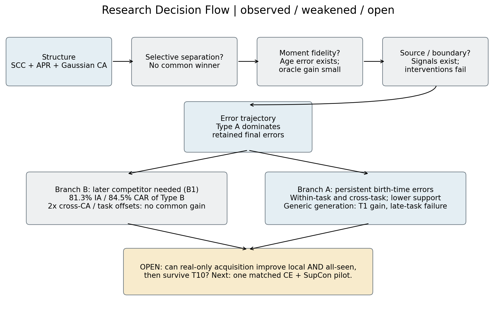
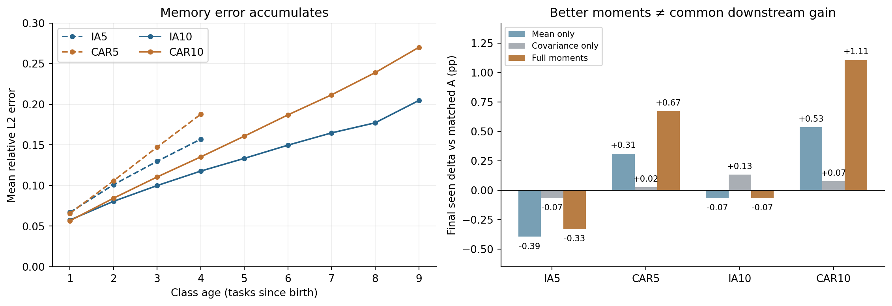
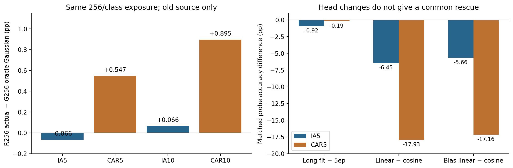
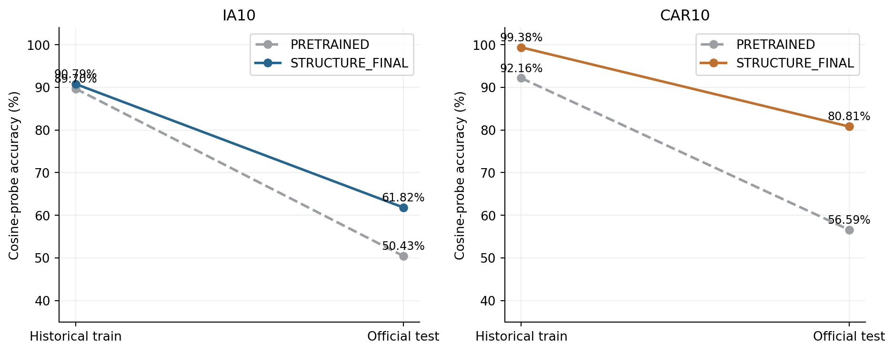
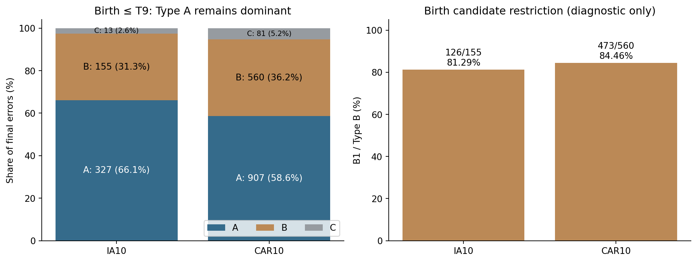
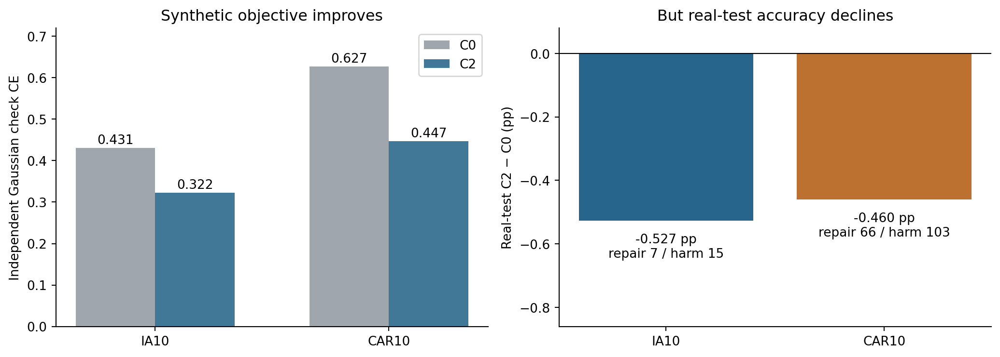
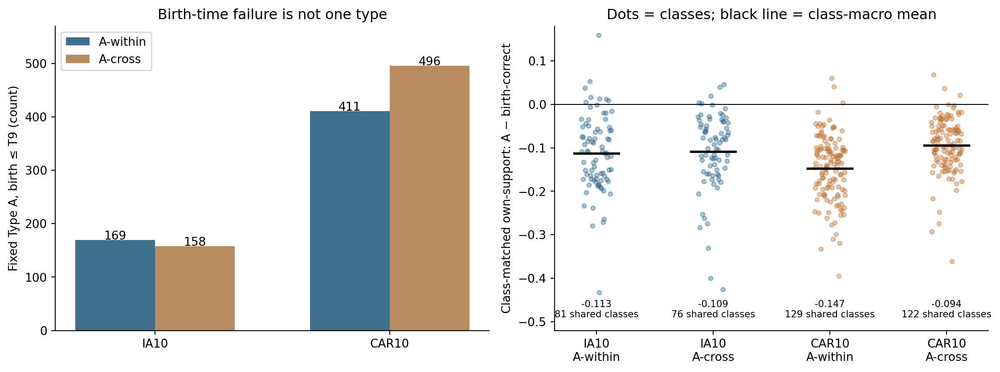
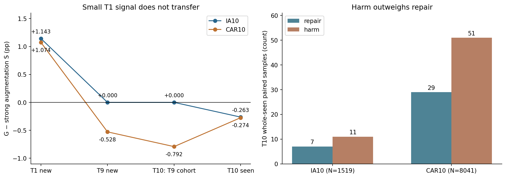
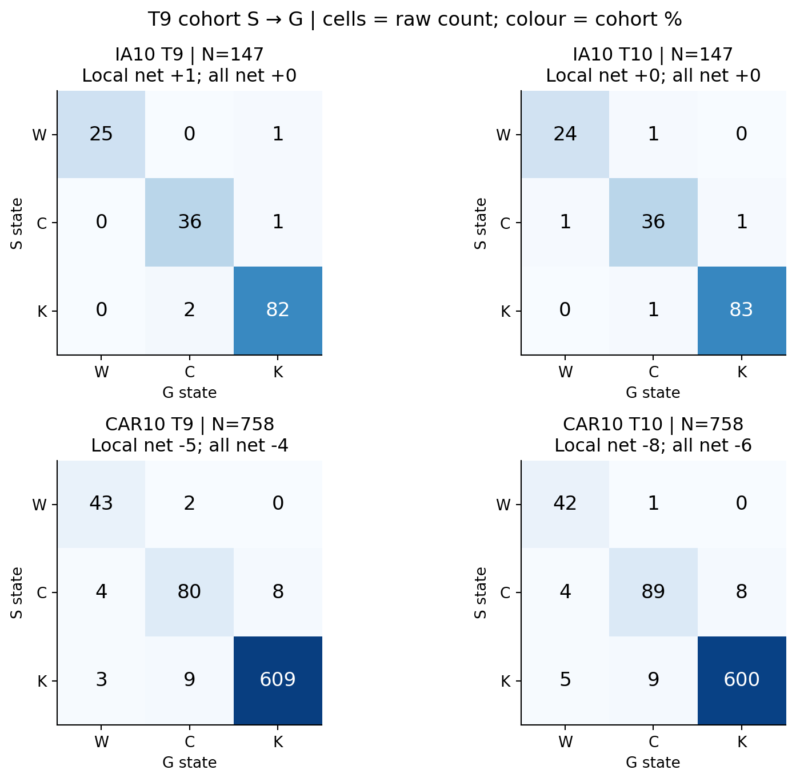

# EFCIL 전체 연구 보고서

## 관찰이 가설을 바꾸어 온 과정 — 교수님 논의용

작성일: 2026-10-12 KST · ImageNet-A(IA) / Cars-196(CAR) · 주된 model seed: 1993

기존 결과의 읽기 전용 재분석이다. 이 보고서를 위해 backbone 학습, classifier 학습, checkpoint 추론, 이미지 생성을 새로 실행하지 않았다. 수치와 그림의 출처는 [evidence map](evidence_map.csv), [전체 수치](key_results.csv), [source map](appendix/source_map.md)에 연결했다.

## Executive Summary — 5분 논의를 위한 연구 지도

### 연구 질문

Structure는 이전 원본 이미지를 저장하지 않고도 class mean/covariance를 보정하고 Gaussian feature로 classifier를 적응시킨다. 그렇다면 남는 오류는 관계 보존, memory fidelity, classifier/source, 아니면 class 최초 학습에서 생기는가? 본 연구는 최종 정확도를 조금씩 높이는 실험에서 출발했지만, 현재는 **birth-time local discrimination과 all-seen competition을 분리해 어느 개선이 다음 task까지 살아남는지**를 묻고 있다.

### 가장 중요한 다섯 발견

1. **Memory 오차는 실재하지만 공통의 큰 병목으로 확인되지는 않았다.** Age와 함께 mean/covariance 오차가 증가한다. 그러나 covariance-only oracle의 최종 정확도 변화는 네 protocol에서 −0.066~+0.132 pp이고, full moments도 IA에서는 개선되지 않았다.
2. **관계 loss·source·classifier 변경은 dataset-common 해결책이 아니었다.** 동일 exposure의 actual−Gaussian 이득은 IA5/IA10에서 −0.066/+0.066 pp, CAR5/CAR10에서는 +0.547/+0.895 pp다. Broad representation collapse 가설과 달리 final representation의 matched test probe는 pretrained보다 +11.390/+24.225 pp 좋았다.
3. **Retained-class 최종 오류의 최대 집단은 birth부터 지속된 Type A다.** Birth≤T9에서 IA10 327/495=66.06%, CAR10 907/1,548=58.59%다. 다만 Type B도 31.31%/36.18%로 중요하며, 그중 81.29%/84.46%는 birth 당시 seen 후보로 제한하면 복원된다. 이는 진단이지 deployable 방법의 이득이 아니다.
4. **B1의 존재가 쉬운 task 보정을 뜻하지는 않았다.** 2× cross-task CA는 공통 개선이 없었고 원 CA weight parity도 실패했다. Within-task ranking을 정확히 보존하는 score 보정은 Gaussian check CE를 낮췄지만 real-test 정확도는 IA/CAR 모두 악화됐다.
5. **현재 generic generation recipe의 확대는 중단하는 것이 맞다.** Strong augmentation 대비 T1의 +1.143/+1.074 pp는 T9·T10으로 전달되지 않았다. 최신 audit에서 IA T9 local net +1은 단 한 sample이며 A-within 복구가 아니다. CAR는 local/all 모두 손실이고, 두 dataset에 공통인 숨은 local 개선은 없다.

*Figure 1. 파란 계열은 관측된 현상, 회색은 주된 병목으로 약해진 설명/개입, 노란색은 열린 질문이다. 화살표는 연구 질문의 전환이지 원인의 증명을 뜻하지 않는다.*

### 현재 결론

단순한 selective separation, exact moment recovery, synthetic boundary hardening, task-level correction으로 공통의 큰 개선을 확보하지 못했다. 그렇다고 memory나 competition 현상이 없는 것은 아니다. Type A는 시간적 오류 집단이지 하나의 원인이며, 그 내부에는 within-task 실패와 이미 birth 시점에 발생한 cross-task 경쟁이 섞여 있다. 현재 우선순위는 생성 recipe 확대가 아니라 **real-only acquisition 개입의 local/all/retention 전달 여부**를 같은 sample에서 확인하는 것이다.

### 다음 결정 실험 — 하나만

동일 vanilla T8에서 시작하는 **real-only, matched two-view acquisition control 대 current-only supervised contrastive(SupCon) 항 추가 pilot**을 T9→T10에서 비교한다. 기존 classification/SCC/APR/CA와 exposure를 고정하고, T9 local 이득뿐 아니라 all-seen, T10 유지, repair/harm을 함께 판정한다. 이것은 다음 실험의 제안이며 이번 보고서에서 구현하거나 실행하지 않았다.

---

## 1. 출발점: Structure는 무엇을 보존하는가?

### 1.1 설정과 비교 단위

Exemplar-free class-incremental learning(EF-CIL)은 task마다 새 class를 학습하되 이전 raw exemplar를 학습용으로 저장하지 않는 설정이다. 실제 평가는 task ID를 알려 주지 않고, 그때까지 등장한 모든 class를 한 head의 후보로 사용한다. Old/New는 **평가 sample의 birth task**에 따른 집계이며, 기본 inference에서 후보를 old-only/new-only로 제한한다는 뜻이 아니다.

이 연구의 vanilla Structure는 pretrained ViT-B/16에 adapter를 학습하고 class당 단일 mean과 full covariance, classifier/network state를 저장한다. Prototype은 class 중심, covariance는 class 내 분산의 근사다. Multi-center 및 separation Off가 기준선이다.

| Protocol | 전체 class / task | Task partition | 최종 vanilla seen (%) | 평가 N |
|---|---:|---|---:|---:|
| IA5 | 200 / 5 | 40 × 5 | 66.425 | 1,519 |
| CAR5 | 196 / 5 | 40 + 39 × 4 | 81.196 | 8,041 |
| IA10 | 200 / 10 | 20 × 10 | 64.648 | 1,519 |
| CAR10 | 196 / 10 | 20 × 6 + 19 × 4 | 78.958 | 8,041 |

*Table 1. Scientific audit의 `CHECKPOINT_MAIN` 기준. 후속 task-end 직접 추론의 IA10은 983/1,519=64.714%로 1 sample 다르다. 이 두 baseline을 임의로 통일하지 않는다. 5/10-task는 class당 표본과 task 크기까지 달라 task 수만의 효과가 아니다.*

Protocol 내 비교는 seed 1993의 관측값이다. Training seed replicate가 하나이므로 seed 간 SD·신뢰구간·유의성 주장은 하지 않는다. Accuracy는 %, 차이는 percentage point(pp), repair/harm은 count로 표기한다. IA의 한 정답은 0.065833 pp, CAR의 한 정답은 0.012436 pp다.

### 1.2 Representation과 acquisition loss

Class 집합을 현재 task $G_t$, 그때까지의 전체 seen을 $C_{\le t}$라 하자. Representation과 cosine classifier score는 다음과 같다.

$$
z=f_{\theta_t}(x),\qquad a_c(x)=\frac{w_c^\top z}{\Vert w_c\Vert_2\Vert z\Vert_2},\qquad s_c(x)=20a_c(x).
$$

`SimpleContinualLinear.forward`의 실제 반환값은 bias 없는 정규화 cosine $a_c$다. 위 $s_c=20a_c$는 CA에서 적용하는 scaled score 표기이며, acquisition의 CosFace도 scale 20을 loss 내부에서 적용한다. 평가 argmax에는 unscaled cosine을 사용하지만 양의 공통 scale은 순위를 바꾸지 않는다.

Acquisition에서는 **현재 class logits만 slice**해 CosFace loss를 계산한다. Vanilla all-seen plain CE와 혼동하면 안 된다.

$$
\ell_{\mathrm{CF}}(x,y)=-\log\frac{\exp(20(a_y-0.2))}{\exp(20(a_y-0.2))+\sum_{c\in G_t,\ c\ne y}\exp(20a_c)}.
$$

이전 모델을 teacher로 고정한 SCC(structure consistency constraint)는 current sample과 old class anchor의 cosine 관계를 보존한다. 두 feature에 **같은 old prototype**을 사용한다.

$$
r_{ik}^{\mathrm{old}}=\hat f_{\theta_{t-1}}(x_i)^\top\hat\mu_k^{t-1},\qquad r_{ik}^{\mathrm{new}}=\hat f_{\theta_t}(x_i)^\top\hat\mu_k^{t-1}.
$$

$$
L_{\mathrm{SCC}}=\frac1B\sum_i\sum_{k\in C_{\le t-1}}(r_{ik}^{\mathrm{new}}-r_{ik}^{\mathrm{old}})^2,\qquad L_{\mathrm{Structure}}=\overline\ell_{\mathrm{CF}}+5L_{\mathrm{SCC}}.
$$

함수명 `LobachevskyRelativeGeomLoss`와 달리 이 경로는 정규화 cosine 관계의 제곱오차다. 코드에서 hyperbolic distance/Poincaré 연산을 확인한 것이 아니다. T1에는 old anchor가 없어 SCC=0이다.

고정: frozen pretrained backbone 구성 및 old teacher, 현재 task sample만의 acquisition. 변경: adapter와 classifier의 학습 및 관계 보존. 질문: raw replay 없이 current 학습과 old 관계를 함께 유지할 수 있는가?

근거: [classifier.py](../structure_multicenter_separation/network/classifier.py)의 `SimpleContinualLinear.forward`, [CDS_adapter.py](../structure_multicenter_separation/models/CDS_adapter.py)의 `_init_train`, [loss.py](../structure_multicenter_separation/utils/loss.py)의 `AngularPenaltySMLoss`, [distill_loss.py](../structure_multicenter_separation/utils/distill_loss.py)의 `LobachevskyRelativeGeomLoss`.

### 1.3 APR: current drift로 old moments를 이동

Current class $j$의 학습 전후 mean 차이를 $d_j=\mu_{j,\mathrm{after}}-\mu_{j,\mathrm{before}}$라 하면, old class $k$의 update는 다음과 같다.

$$
\alpha_{kj}=\frac{\exp(10\cos(\mu_k^{t-1},\mu_{j,\mathrm{before}}))}{\sum_{h\in G_t}\exp(10\cos(\mu_k^{t-1},\mu_{h,\mathrm{before}}))},\quad \Delta_k=\sum_{j\in G_t}\alpha_{kj}d_j,\quad \mu_k^t=\mu_k^{t-1}+\Delta_k.
$$

Covariance는 local Structure 원문과 실제 repo를 구분해야 한다.

Paper:

$$
\Sigma_k^t=\Sigma_k^{t-1}+\rho\Delta_k\Delta_k^\top+\epsilon I.
$$

Repository:

$$
\Sigma_k^t=\Sigma_k^{t-1}+5\sum_{j\in G_t}\mathbf1[\Vert d_j\Vert_2^2>10^{-9}](\alpha_{kj}d_j)(\alpha_{kj}d_j)^\top+10^{-6}I.
$$

Repo는 **weighted displacement별 outer product의 합**이고, paper는 **합쳐진 displacement의 outer product**여서 cross term이 다르다. Repo가 전후 directional variance ratio를 계산하더라도 실제 계수는 `self.cov=5`로 지정한다. 이를 adaptive variance-ratio covariance update로 설명하지 않는다. 새 class의 covariance는 sample covariance에 $10^{-3}I$를 더한다.

고정: 이전 저장 moments 및 current class before/after statistics. 변경: old mean 이동과 directional covariance expansion. 질문: old raw sample 없이 표현 변화를 추적할 수 있는가?

근거: [local Structure 원문](../논문/0_Exemplar-FreeClassIncrementalLearningviaPreservingClass-DiscriminativeStructure.pdf)의 Eq. 8–9, [adjust_distribution.py](../structure_multicenter_separation/utils/adjust_distribution.py)의 `LobachevskyPrototypeCorrector.correct_prototypes`.

### 1.4 Gaussian classifier adaptation(CA)

Task 종료 시 저장 moments에서 **old와 current 모두 Gaussian**을 class당 256개/epoch 생성하고, frozen representation 위의 classifier만 5 epoch 적응시킨다. 기본 CA는 CosFace margin을 쓰지 않는 all-seen CE다.

$$
\tilde z_c\sim\mathcal N(\beta_{c,t}\mu_c^t,\Sigma_c^t),\qquad L_{\mathrm{CA}}=\frac1{N_{\mathrm{syn}}}\sum_i\left[-s_{y_i}(\tilde z_i)+\log\sum_{c\in C_{\le t}}\exp s_c(\tilde z_i)\right].
$$

실제 mean scaling은 0-based class ID $c$, 1-based task $t$, 해당 호출의 `task_size` $b_t$에 대해 다음과 같다.

$$
\beta_{c,t}=0.9+0.1\frac{\lfloor c/b_t\rfloor+1}{t}.
$$

이 값은 균등 partition에서는 birth-task scaling처럼 보이지만 CAR의 불균등 partition에서는 **실제 birth task가 아니라 integer division**이다. 이번 보고서는 이를 의미상 birth index로 바꾸어 쓰지 않는다. Gaussian은 epoch마다 재생성하며 SGD lr=.01, momentum=.9, weight decay=.0005와 cosine schedule을 사용한다. T1에서는 기존 guard에 따라 CA를 건너뛴다.

고정: representation, Gaussian moment source, all-seen 후보와 sampling budget. 변경: classifier weight. 질문: 저장된 분포를 current feature space의 단일 classifier로 읽어낼 수 있는가?

근거: [base.py](../structure_multicenter_separation/models/base.py)의 `_stage2_compact_classifier`. 따라서 초기 질문은 “Structure가 유지하는 class-discriminative structure 중 무엇이 실제 성능을 제한하는가?”였다.

Observation: 실제 baseline은 current-only CosFace + SCC, APR mean/covariance, all-class Gaussian CA의 조합이다.  
What this supports: 개입 위치를 acquisition / memory / CA로 분리해 검증해야 한다.  
What this does NOT prove: 논문 수식과 repo가 전부 동일하거나 저장 Gaussian이 실제 class 분포를 충실히 재현한다는 뜻은 아니다.

## 2. 첫 가설: 위험한 old/current 관계를 더 분리하면 되는가?

Current 학습이 old 영역을 침범한다면 가까운 관계만 밀어내면 되지 않을까? 처음의 multi-center/distance separation, AM-Drift, similarity gate, selective A/B/C, RP 계열은 이 공통 질문을 시험했다. 본문에서는 결정에 필요한 대표 비교만 보고, 모든 run 수치는 appendix로 보낸다.

### 2.1 실제 바뀐 항

기본 변경은 $L=L_{\mathrm{Structure}}+\lambda L_{\mathrm{sep}}$다. Diagonal Mahalanobis distance와 E3 loss는 다음과 같다.

$$
D_{ik}^2=\sum_d\frac{(z_{id}-\mu_{kd}^{\mathrm{APR}})^2}{\sigma_{kd}^2},\qquad L_{\mathrm{E3}}=\frac1B\sum_i\left[1-\min_k\frac{D_{ik}^2}{\tau_k}\right]_+.
$$

Birth training-distance quantile에서 저장한 threshold를 AM-Drift가 축소한다. $r$은 positive APR shift norm의 median, clipping bound는 run config를 따른다.

$$
\tau_k^{\mathrm{drift}}=\tau_k^{\mathrm{birth}}\operatorname{clip}\left(\frac1{1+\kappa\Vert\Delta_k\Vert_2/r},\ell,u\right).
$$

Selective A는 frozen old-model prototype similarity에서 current class별 Top-P 집합 $H_y$를 골라 평균 hinge를 계산한다. B는 cutoff similarity $b_y$를 기준으로 가까운 pair의 threshold를 확대한다.

$$
L_A=\frac1B\sum_i\frac1{|H_{y_i}|}\sum_{k\in H_{y_i}}\left[1-\frac{D_{ik}^2}{\tau_k^{\mathrm{drift}}}\right]_+.
$$

$$
e_{yk}=\operatorname{clip}\left(\frac{S_{yk}-b_y}{1-b_y+\epsilon},0,1\right),\qquad \tau_{yk}^{B}=\tau_k^{\mathrm{drift}}(1+\alpha e_{yk}).
$$

$L_B$는 $L_A$의 threshold만 $\tau_{yk}^{B}$로 바꾼다. 원 명세의 raw $[\tau-D^2]_+$가 아니라 코드의 **dimensionless** $[1-D^2/\tau]_+$다. Proto-CLAD C는 같은 선택 집합에 cosine repulsion을 사용한다.

$$
L_C=\frac1B\sum_i\frac1{|H_{y_i}|}\sum_{k\in H_{y_i}}(1+\hat z_i^\top\hat\mu_k^{\mathrm{APR}}).
$$

RP-C는 이 마지막 cosine만 $\psi_R(z)=\operatorname{ReLU}(zR)$ 공간으로 바꾼다. 원 RP는 old mean을 먼저 평균한 뒤 투영하고, StoredAPR은 sample별 투영 평균을 birth에 저장한 뒤 APR correction을 더한다.

$$
q_k^{\mathrm{oldRP}}=\psi_R(\mu_k^{\mathrm{APR}}),\qquad q_k^{\mathrm{birth}}=\frac1{N_k}\sum_i\psi_R(z_i),\qquad q_k^{\mathrm{StoredAPR}}=q_k^{\mathrm{birth}}+\psi_R(\mu_k^{\mathrm{APR}})-\psi_R(\mu_k^{\mathrm{birth}}).
$$

$R_{uv}\sim\mathcal N(0,1/768)$, shape 768×2048, RP seed 1993이며 run 전체에서 frozen이다. StoredAPR은 매 task의 정확한 projected mean을 oracle로 재계산한 방법이 아니다. Birth의 정확한 nonlinear statistic + 이후 drift 근사다.

고정: current samples, 원공간 SCC/APR/CA, frozen conflict selection 및 protocol. 변경: separation 항 / threshold / repulsion geometry / stored projected statistic. 질문: 위험 관계를 선택적으로 제어하면 stability와 plasticity를 함께 개선하는가?

코드: [E3 loss](../structure_e3_followup/followup/losses.py), [AM threshold](../structure_e3_followup/followup/adaptive_margin.py), [selective A/B/C](../structure_selective_similarity_sweep/selective/losses.py), [RP loss](../structure_rp_protoclad_task5/rp/losses.py), [StoredAPR](../structure_stored_apr_rp/stored_apr_rp/prototypes.py). 초기 S1 similarity relaxation, S2/S3 hard routing, S4 soft routing과 control mask의 정의는 [수식 보충](appendix/method_details.md)에 기록했다.

### 2.2 결과가 바꾼 질문

초기 E0–E7에서 E3 Last +0.066 pp는 정답 하나이고 Inc는 −0.066 pp였다. E4/E7 full-covariance separation은 기록된 활성 epoch 모두 loss/intrusion/gradient가 0이므로 **작동한 full separation의 실패**로 세지 않는다. Multi-center도 IA5에서 큰 이득 없이 비용이 증가했다.

E3 follow-up에서 AM-Drift는 IA5 Inc +0.169, Last +0.263 pp와 함께 Old +0.561 / New −1.107 pp였다. Similarity gate/control은 이 교환을 보편적으로 해결하지 못했다. 특히 High-Off가 Low-Off보다 New −1.476 pp 낮았고, S2의 relative route가 약 99.91%여서 선택적인 hybrid라는 의도와 실제 operating regime을 구분해야 한다.

완료된 reduced IA5/CAR5 matrix에서는 모든 선택 방법의 $|\Delta\mathrm{Inc}|<0.08$ pp였다. IA5 A는 Last +0.263 pp지만 New −1.476 pp; CAR5 A는 Last +0.099 pp지만 Inc −0.028 pp다. C의 IA5 작은 이득도 CAR5에서는 같은 방향으로 이어지지 않았다. **두 dataset의 Inc를 모두 높이는 단일 winner는 없다.**

StoredAPR의 nonlinear statistic 교정은 정의상 타당한 차이를 제거했지만 IA5 old RP 대비 Last −0.527 / New −1.845 pp였다. CAR5는 Structure 대비 Last +0.025 pp 수준이며 **원 RP CAR5 run이 없어 직접 old-RP ablation이 아니다.** 정의의 차이가 커도 downstream 병목일 필요는 없다.

근거: [초기 수치](../structure_multicenter_separation/reports/e0_comparison_20260916/tables/metrics_per_seed.csv), [AM 수치](../structure_e3_followup/reports/e3_followup_comparison_20260917/tables/metrics_per_seed.csv), [reduced final](../structure_selective_similarity_sweep/reports/reduced_stage1_final_20260923/report.md), [StoredAPR final](../structure_stored_apr_rp/reports/stored_apr_rp_final_20260923/report.md).

Observation: 관계/분리 신호는 Old/New operating point를 움직였지만 공통의 큰 성능 개선은 없었다.  
What this supports: 위험 관계의 존재와 loss 변경의 효과는 구분해야 한다; 다음으로 저장 old distribution의 fidelity를 조사할 필요가 있었다.  
What this does NOT prove: 모든 relation learning이 무효이거나 현재 탐색의 best point가 독립 seed에서도 최선이라는 뜻은 아니다.

## 3. Memory fidelity: 실제로 drift하는데 왜 oracle 이득은 작은가?

관계 loss가 해결책이 아니라면 old mean/covariance가 current space를 잘못 추적하는 것 아닐까? 이 가설은 원본 old train을 다시 꺼내 현재 frozen encoder에 통과시킨 **diagnostic oracle**로 시험했다. 실제 EF-CIL 학습에서 접근 가능한 정보가 아니다.

$$
\mu_c^{O,t}=\frac1{N_c}\sum_{i:y_i=c}f_{\theta_t}(x_i),\qquad \Sigma_c^{O,t}=\frac1{N_c-1}\sum_i(z_i-\mu_c^{O,t})(z_i-\mu_c^{O,t})^\top.
$$

실제 audit에서는 비교 대상과 matched covariance jitter를 사용한다. Mean의 tracking cosine, relative L2와 covariance relative Frobenius는 각각 다음과 같다.

$$
T_c=\frac{(\mu_c^S)^\top\mu_c^O}{\Vert\mu_c^S\Vert_2\Vert\mu_c^O\Vert_2},\quad E_c^\mu=\frac{\Vert\mu_c^S-\mu_c^O\Vert_2}{\Vert\mu_c^O\Vert_2},\quad E_c^\Sigma=\frac{\Vert\Sigma_c^S-\Sigma_c^O\Vert_F}{\Vert\Sigma_c^O\Vert_F}.
$$

Oracle A/B/C/D는 동일 pre-CA sidecar·RNG·sampling budget·optimizer에서 시작한다. A=stored, B=old mean만 oracle, C=old covariance만 oracle, D=old 두 moment 모두 oracle이며 비교 내 current/new source는 고정한다.

$$
(\mu_{\mathrm{old}}^S,\Sigma_{\mathrm{old}}^S)\longrightarrow(\mu_{\mathrm{old}}^O,\Sigma_{\mathrm{old}}^S)\ \mathrm{or}\ (\mu_{\mathrm{old}}^S,\Sigma_{\mathrm{old}}^O)\ \mathrm{or}\ (\mu_{\mathrm{old}}^O,\Sigma_{\mathrm{old}}^O).
$$

고정: encoder·pre-CA head·current statistics·CA recipe. 변경: old moments의 source만. 질문: 추적 오차를 제거하면 downstream 성능이 회복되는가?

초기 sanity/incomplete 결과를 제외하고 완결된 scientific audit를 채택했다. A의 원 CA 재현은 26 transition에서 weight relative L2=0, prediction mismatch=0이었다. 이 진단의 재현성 검사가 다른 pilot의 CA parity까지 보장하지는 않는다.

*Figure 2. 왼쪽은 class-task record의 age별 평균 relative L2로 독립 seed의 평균이 아니다. 오른쪽은 각 protocol 최종 seen micro의 oracle−matched A. 오차가 누적된다는 현상과 그 오차의 제거로 회복되는 성능은 서로 다른 질문이다.*

전체 old class-task record에서 tracking cosine은 약 .99, mean relative L2는 .099~.127이다. APR의 mean error 개선은 IA5 400/400, CAR5 392/394, IA10 900/900, CAR10 889/894 record로 대부분을 차지했다. Covariance relative Frobenius는 .288~.391로 더 크지만 서로 다른 metric의 수치를 중요도 순위로 직접 비교하지 않는다.

IA10의 age1→9 mean relative L2는 .0575→.2046, CAR10은 .0565→.2700이다. 그러나 같은 age4에서는 IA5 .1570 대 IA10 .1177, CAR5 .1877 대 CAR10 .1352다. 10-task가 더 오래된 class를 포함하는 구성 효과도 있으므로 “10-task는 매 step drift가 항상 더 크다”고 설명하지 않는다.

Covariance-only oracle delta는 IA5 −0.066, CAR5 +0.025, IA10 +0.132, CAR10 +0.075 pp다. Full oracle는 각각 −0.329, +0.672, −0.066, +1.107 pp였다. CAR에서 moment fidelity의 영향은 남지만 **exact moments가 양 dataset의 큰 회복을 만드는 결과는 아니다.**

Observation: APR은 mean을 잘 추적하고 age error/covariance mismatch는 남지만 oracle 이득은 작거나 dataset별로 다르다.  
What this supports: Memory drift는 실제 현상이지만 현재 CA에서 공통 main bottleneck이라는 가설은 약해졌다.  
What this does NOT prove: Moments가 전혀 중요하지 않거나 모든 memory 설계가 무효라는 뜻은 아니다.

## 4. Classifier/source: 정확한 feature를 head가 활용하지 못하는가?

### 4.1 먼저 불공정한 비교를 분리한다

초기 G_FIXED/R_FIXED의 old class당 epoch exposure는 IA5 약 30.52, CAR5 약 41.69인 반면 current/new는 256이었다. Optimizer step도 적었으므로 source만의 비교가 아니다. 같은 Gaussian source의 old exposure를 256/class로 복구한 것만으로 +3.818/+5.721 pp 회복했다. 따라서 초기의 큰 하락을 actual/Gaussian source의 한계로 다시 사용하지 않는다.

### 4.2 동일 exposure의 source 교체와 longer fitting

G256/R256은 frozen representation, pre-CA init, current bank, label/permutation, 256/class, optimizer/schedule/step이 같다. R256의 old actual feature는 replacement sampling으로 exposure를 맞췄으며 **diagnostic-only raw access**다.

$$
\mathrm{old\ bank}:\quad z\sim\mathcal N(\beta\mu^O,\Sigma^O)\longrightarrow z\sim\operatorname{Empirical}(\mathrm{old\ actual\ features});\qquad L_{\mathrm{CA}}\ \mathrm{unchanged}.
$$

고정: encoder·head 초기화·current bank·학습량. 변경: old source만. 질문: Gaussian 대신 actual을 사용하면 공통의 큰 회복이 있는가?

R256−G256은 IA5 −0.066, CAR5 +0.547, IA10 +0.066, CAR10 +0.895 pp였다. Actual-bank cosine probe를 더 오래 학습하면 training CE는 더 낮아지지만 validation-selected test 성능은 5 epoch 대비 −0.922/−0.187 pp였다. COSINE_CONVERGED는 조건명이지 최적화 수렴의 증명이 아니다. Selected epoch는 1이며 100 epoch 마지막 모델을 최종 평가했다는 뜻도 아니다.

*Figure 3. 각 실험 내부의 matched delta와 0선. 왼쪽 actual−oracle Gaussian, 오른쪽 matched probe 간 차이이며 서로 다른 실험의 baseline을 한꺼번에 빼지 않는다.*

### 4.3 Classifier family와 paired source

Fair L2 linear는 $s_c=w_c^\top\hat z+b_c$, cosine은 $s_c=20\hat w_c^\top\hat z$다. 같은 feature bank와 validation 선택 아래 bias 없는 linear−selected cosine은 IA5 −6.452, CAR5 −17.933 pp였다. Bias를 추가한 linear 내부 개선도 +0.790/+0.771 pp에 그쳤다.

NCM은 sample별 정규화 feature의 평균 $\bar q_c$에 대해 $s_c=-\Vert\hat z-\bar q_c\Vert_2^2$를 사용한다. FeCAM 이식은 correlation-normalized shrunk covariance $C_c$로 $s_c=-(\hat z-\hat\mu_c)^\top C_c^\dagger(\hat z-\hat\mu_c)$를 계산했다. Stored-FeCAM−Structure는 IA10 −4.806, CAR10 −4.365 pp다. Oracle-FeCAM은 stored보다 +0.461/+2.537 pp지만 Structure를 넘지 못했다.

고정: final feature·후보·평가 sample. 변경: readout score family. 질문: cosine family가 숨기고 있는 공통의 회복 가능성이 있는가?

FeCAM은 Structure의 raw-space covariance를 사용했으므로 official normalized-sample covariance의 정확한 재현이 아니다. NCM과의 차이도 순수 covariance 효과로 해석하지 않는다. 실제 shrinkage는 [수식 보충](appendix/method_details.md)에 있다.

Paired A=actual / B=oracle Gaussian / C=stored Gaussian에서 A−B repair/harm은 IA10 30/29, CAR10 180/108이고 B−C는 25/20, 229/135다. 작은 net에도 여러 sample이 바뀐다. A−B의 IA micro +0.066 pp와 macro −0.975 pp가 반대인 점도 중요하다.

근거: [classifier procedure](../structure_prototype_oracle_audit/classifier_procedure_diagnostic_gpu2/classifier_procedure_diagnostic_final_report_20260929.md), [paired raw summary](../structure_prototype_oracle_audit/paired_source_prediction_diagnostic/cross_protocol/final_summary.csv), [FeCAM raw](../fecam_boundary_followup/fecam/IA10/metrics.json).

Observation: CAR에는 actual source의 이점이 있으나 IA는 거의 없고, longer fit/head 교체도 공통 개선을 주지 않았다.  
What this supports: 시험한 classifier/source family가 공통 main bottleneck이라는 증거는 약해졌다.  
What this does NOT prove: Classifier 개선 여지가 없거나 actual replay가 EF-CIL에서 사용 가능하다는 뜻은 아니다.

## 5. Boundary/support/generalization: 어려운 variation을 잃었는가?

### 5.1 Boundary risk와 hardening 효과는 다르다

Normalized head weight의 pair boundary에 대해 다음을 진단했다.

$$
a_{ij}=\hat w_i-\hat w_j,\quad m_{ij}=a_{ij}^\top\mu_i,\quad v_{ij}=a_{ij}^\top\Sigma_i a_{ij},\quad \gamma_{ij}=\frac{m_{ij}}{\sqrt{v_{ij}+\epsilon}},\quad q_{ij}=\Phi(-\gamma_{ij}).
$$

$q$는 Gaussian linear-boundary violation proxy이지 실제 전체 후보 오분류율이 아니다. Stored/oracle gamma ranking이 비슷하더라도 미래의 **동일 sample pair 악화**를 잘 예측한다는 뜻은 아니다. Final directed error pair 상위 20의 점유율도 IA10 8.40%, CAR10 13.30%로 소수 pair만의 오류 집중과는 다르다.

Actual보다 Gaussian의 lower-tail head margin이 높아 쉽게 분류되는 현상은 관측됐다. 이를 직접 바꾸기 위해 CEOS는 old Gaussian $z$와 current actual pool의 nearest enemy $e$를 혼합한다.

$$
z_{\mathrm{CEOS}}=\frac{\lambda z+(1-\lambda)e}{\Vert\lambda z+(1-\lambda)e\Vert_2},\qquad \lambda\sim U(0.7,1).
$$

고정: pre-CA init·new bank·256/class·permutation·optimizer·objective. 변경: old synthetic source의 hardness. 질문: 더 어려운 Gaussian을 만들면 downstream 성능이 좋아지는가?

Official minibatch enemy 대신 고정 current-task actual train pool을 쓴 CEOS-only 이식이며 ACB/focal/class weighting은 넣지 않았다. Synthetic q05 margin은 IA .574→.342, CAR .147→−.075로 실제 낮아졌다. 그러나 seen은 −0.658/−0.473 pp, New는 −4.032/−5.777 pp 악화했다. 동일 C1 복원 후 new-error diagnostic에서 신규 손실 5/124와 45/779는 모두 old competition 방향이었다.

10-task의 9 transition 모두 boundary improvement mass가 positive deterioration mass보다 컸다. 이는 이전 공통 후보를 고정한 pair 집계로 overall accuracy나 후발 경쟁을 직접 상쇄하는 양이 아니다. 일부 pair의 악화를 “관계가 전반적으로 일방 붕괴한다”는 증거로 확대하지 않는다.

### 5.2 Low support는 관측되지만 final 표현은 pretrained보다 개선됐다

Wrong held-out sample의 actual-bank same-class support는 낮다. Actual→oracle Gaussian→stored Gaussian으로 바꾸면 support margin도 낮아진다. Final wrong sample의 5-NN same-class purity는 IA10 약 .119, CAR10 약 .169다. 그러나 이 사실만으로 continual adaptation이 표현 일반화를 파괴했다고 할 수 없다.

동일 split·optimizer·LR grid·permutation·budget의 cosine probe에서 final−pretrained test accuracy는 IA10 +11.390, CAR10 +24.225 pp였다. Train도 +1.091/+7.210 pp, support도 +.0342/+.0430 개선했다.

*Figure 4. 절대 train/test accuracy와 같은 y축. Historical train은 encoder가 과거에 보았으므로 representation-unseen validation을 의미하지 않는다.*

이는 **broad representation collapse**와 반대 방향이다. Train/test gap은 남지만 finite coverage, intrinsic ambiguity, feature geometry, head mismatch를 분리하지는 못한다. Coverage 보고서가 Gaussianization을 NOT SUPPORTED로 판정한 것도 음의 support 차이의 부재가 아니라, 이를 주요 downstream 원인으로 채택하는 기준을 충족하지 못했다고 읽어야 한다.

### 5.3 Matched two-view JS도 지정 설정에서는 개선하지 못했다

동일 ordinary augmentation의 two-view supervised control과 current-only unscaled cosine logits의 JS 추가를 비교했다. Classification/SCC는 view 평균, APR/CA 호출과 budget은 동일하다.

$$
p_v=\operatorname{softmax}(a^{(v)}_{G_t}),\quad \bar p=(p_1+p_2)/2,\quad L_J=L_{2v}+0.1\left[\tfrac12\operatorname{KL}(p_1\Vert\bar p)+\tfrac12\operatorname{KL}(p_2\Vert\bar p)\right].
$$

고정: T8 기점·sample/order/view·two-view control·SCC/APR/CA·update 수. 변경: temperature 1의 JS 항만. 질문: 일반 variation의 prediction consistency가 acquisition/retention을 개선하는가?

JS−control의 T9 New는 IA 0/CAR −0.264 pp, T10 seen은 양쪽 0 pp다. JS 자체가 약 $10^{-4}$~$10^{-3}$로 작았다는 한계도 있으며 모든 consistency의 반증은 아니다. 지정 설정은 stop했다.

근거: [risk code](../structure_prototype_oracle_audit/pair_boundary_risk/pipeline.py), [CEOS raw](../fecam_boundary_followup/ceos/IA10/metrics.json), [probe raw](../structure_prototype_oracle_audit/coverage_generalization_diagnostic/IA10/probe_results.csv), [JS raw](../variation_consistency_pilot/cross_protocol/summary.csv).

Observation: Boundary/support mismatch는 존재하나 hardening/JS로 공통 개선되지 않았고 final probe는 pretrained보다 좋았다.  
What this supports: 낮은 support·어려운 boundary와 “주된 회복 가능 bottleneck”은 구분해야 한다.  
What this does NOT prove: Boundary/coverage가 무관하거나 모든 consistency가 무효라는 뜻은 아니다. 다음 질문은 서로 다른 final-error mechanism을 섞고 있지 않은가였다.

## 6. 전환점: final error를 acquisition과 retention으로 분해

최종 정확도는 처음부터 틀린 sample과 나중에 잃은 sample을 한데 센다. Vanilla T1~T10 task-end checkpoint에서 같은 official test sample의 birth 이후 예측을 추적했다. $c_t(x)=\mathbf1[\operatorname{argmax}_{k\in C_{\le t}}s_k^t(x)=y]$라 하자.

$$
A:\ c_t=0\ \mathrm{for\ all}\ t=b,\ldots,T;\qquad B:\ c_b=1,\ c_T=0;\qquad C:\ c_b=0,\ c_T=0,\ \mathrm{and}\ \exists t\in(b,T):c_t=1.
$$

A는 persistent wrong, B는 birth correct→final wrong, C는 중간 회복→final wrong이다. 최종 오류를 배타적으로 나누되, 학습 중 모든 iteration을 본 것은 아니므로 A를 “한 번도 학습하지 못함”으로 단정하지 않는다.

*Figure 5. 왼쪽 birth≤T9의 retention error 분모 495/1,548. 오른쪽 Type B 분모 155/560. 두 비율은 분모가 다르다.*

전체 final class에서 IA A/B/C=368/155/13, CAR=1,051/560/81이다. T10-born error는 자동으로 A가 되므로 retention 해석에는 birth≤T9를 주로 사용한다. 이때 IA 327/155/13, CAR 907/560/81이고 A share는 66.06%/58.59%, B는 31.31%/36.18%다. Class-macro에서도 A가 최대 69.17%/59.70%다.

Retention birth→final loss는 IA 155/1,037=14.95%, CAR 560/6,071=9.22%; recovery는 18/358=5.03%, 203/1,191=17.04%다. 분모가 달라 CAR recovery%가 loss%보다 높다고 정확도 개선이라 해석하면 안 된다. 실제 개수는 양쪽 모두 loss>recovery다.

연구는 두 가지로 분기했다. **Branch A:** 왜 birth부터 지속적으로 틀리는가? **Branch B:** 왜 birth 정답을 이후에 잃는가? A의 큰 mass는 우선순위이지 B를 무시할 근거가 아니다.

Observation: Retention subset에서도 A가 최대이고 B도 중요하다.  
What this supports: Forgetting만으로 설명하지 말고 acquisition과 후발 경쟁을 나누어야 한다.  
What this does NOT prove: Type A의 원인이 하나이거나 B가 사소하다는 뜻은 아니다.

## 7. Branch B: later competitor가 필요한 오류인가?

Final encoder/head/logit은 그대로 두고 후보만 birth까지 등장한 **모든 class** $C_{\le b}$로 제한했다. Birth task block $G_b$만 남기는 것이 아니다. Type B 중 복원되는 B1은 tie가 없는 score 표현에서 다음을 만족한다.

$$
\max_{k\in C_{\le T}\setminus C_{\le b}}s_k^T(x)>s_y^T(x)>\max_{j\in C_{\le b},\ j\ne y}s_j^T(x).
$$

실제 판정은 코드의 argmax와 후보 제한/tie handling에 따른다. 복원하지 못한 B가 B2다.

고정: Final feature/head/logit. 변경: 후보 집합만. 질문: 해당 final error에 later candidate의 존재가 필요했는가?

B1은 IA 126/155=81.29%, CAR 473/560=84.46%다. Retention 전체 test의 burden은 9.03/6.51 pp다. 그러나 test label/birth 정보의 counterfactual 진단이므로 그대로 회수 가능한 method gain이라고 말하지 않는다. Calibration bias, backbone preservation failure, easy correction 중 무엇인지도 아직 분리하지 못한다.

Observation: Type B의 다수는 후발 후보를 제거하면 정답이다.  
What this supports: Later-class competition은 공통의 중요한 현상이다.  
What this does NOT prove: 단순 task bias로 복구하거나 birth 후보를 통상 inference에 쓸 수 있다는 의미가 아니다.

## 8. Branch B intervention: 경쟁을 조정하면 실제로 복원되는가?

### 8.1 Cross-task CA의 2배 가중치

$G(y)$는 정답 class의 birth **task block**이며 B1의 누적 seen 후보와 다르다. Scaled CA logits $s$의 CE는 정확히 다음과 같이 분해된다.

$$
\ell_{\mathrm{within}}=\log\sum_{c\in G(y)}e^{s_c}-s_y,\qquad \ell_{\mathrm{cross}}=\log\sum_{c\in C_{\le T}}e^{s_c}-\log\sum_{c\in G(y)}e^{s_c}.
$$

$$
\ell_{\mathrm{CE}}=\ell_{\mathrm{within}}+\ell_{\mathrm{cross}},\qquad L_{2\times}=\overline\ell_{\mathrm{within}}+2\overline\ell_{\mathrm{cross}}.
$$

고정: Encoder/pre-CA init, 전 class Gaussian256/epoch,5epoch, optimizer/schedule/RNG. 변경: Cross 계수1→2. 질문: Cross competition을 강화하면 B1을 포함한 real-test가 개선되는가?

**S0 parity 한계:** Control head와 원 head의 max-abs 차이는 IA .011874/CAR .006949로 허용.001을 초과했다. Internal paired control/intervention은 분석하되 vanilla 완전 재현을 전제로 한 method effect로 해석하지 않는다. CE 분해 identity는 통과했으므로 수식 자체의 불일치는 아니다.

IA repair/harm은3/6, net−3=−0.197 pp; CAR는56/50, net+6=+.075 pp였다. 고정 B1 내부 net도−2/+10으로 공통 개선이 아니다. Shared head의 loss weighting은 within ranking을 보호하지 않으므로 다음에는 ranking을 수학적으로 고정하는 보정을 시험했다.

### 8.2 Ranking-preserving task shift

Frozen base logits $s^0$에 task-common shift만 추가하면 같은 task 내부 score 차이를 바꾸지 않는다.

$$
\tilde s_c(x)=s_c^0(x)+\delta_{g(c)}(x),\qquad g(i)=g(j)\ \Longrightarrow\ \tilde s_i-\tilde s_j=s_i^0-s_j^0.
$$

각 task의 max, top1−top2 gap, logsumexp를 이어 붙인30차원 descriptor $d(x)$를 fit Gaussian bank의 mean/std로 표준화한다. Std floor=.001, clip=±5다.

$$
\phi(x)=\operatorname{clip}\left(\frac{d(x)-\bar d_{\mathrm{fit}}}{\max(\sigma_{\mathrm{fit}},10^{-3})},-5,5\right),\quad r=A\phi+b,\quad \delta_g=r_g-\frac1{10}\sum_h r_h.
$$

C1은 constant $r=b$, C2는 conditional affine이다. Zero init에서 다음 objective를 fit한다.

$$
L_{\mathrm{corr}}=\operatorname{CE}(\tilde s,y)+\tfrac12\operatorname{mean}(\delta^2)+\tfrac{10^{-3}}2\sum_{\vartheta\in\{A,b\}}\Vert\vartheta\Vert_2^2.
$$

고정: Final encoder/head/logit, task partition, fit/check Gaussian recipe. 변경: Centered task offset만. 질문: Local ranking 손상 없이 cross-task correction이 real-test에 전달되는가?

C2는 float64 L-BFGS로 fit했으며 test label로 선택/tuning하지 않았다. Independent Gaussian check CE는 IA .431093→.322080, CAR .626735→.447319로 줄었다. 그러나 real-test는 반대 방향이었다.

*Figure 6. CE와 accuracy pp를 별도 axis로 표시한다. Within-task pair-margin drift 최대 약8.88×10⁻¹⁶, local argmax disagreement=0, correct→same-task-wrong=0으로 ranking 보존을 확인했다. Harm은 cross-task move다.*

| Branch B 개입 | IA10 repair / harm / delta | CAR10 repair / harm / delta | 해석의 제한 |
|---|---|---|---|
| 2× cross-task CA − 내부 control | 3 / 6 / −0.197 pp | 56 / 50 / +0.075 pp | 원 CA weight parity FAIL |
| Conditional task shift C2−C0 | 7 / 15 / −0.527 pp | 66 / 103 / −0.460 pp | Local ranking은 불변이나 real-test 악화 |

*Table 2. 두 실험은 각각 자신의 control과 비교했다. C2의 고정 B1 복원은2/126,29/473으로 큰 diagnostic mass를 그대로 회수하지 못했다.*

근거: [CE분해](../cross_task_ca_reweighting/losses.py), [cross raw](../cross_task_ca_reweighting/IA10/summary.json), [correction core](../b1_ranking_preserving_correction/core.py), [C2 raw](../b1_ranking_preserving_correction/CAR10/metrics.json).

Observation: 두 competition 개입은 공통 개선이 없고 ranking 보호 후에도 synthetic fit이 real-test에 전이되지 않았다.  
What this supports: B1이 존재해도 간단한 task-level correction으로 쉽게 복구된다는 가설은 약해졌다.  
What this does NOT prove: 모든 보정의 불가능성이나 B1의 무가치를 뜻하지 않는다. 다음은 예정된 fallback인 Branch A다.

## 9. Branch A: birth부터의 오류도 local failure 하나가 아니다

Type A가 최대 오류 집단이라면 최초 학습을 바꾸는 것이 합리적이다. 그러나 먼저 이 집단이 무엇에 실패했는지 나눠야 한다. Birth checkpoint의 후보를 신규 task block $G_b$로 제한해 다음처럼 정의했다.

$$
A\mathrm{-within}:\quad \operatorname{argmax}_{c\in G_b}s_c^b(x)\ne y.
$$

$$
A\mathrm{-cross}:\quad \operatorname{argmax}_{c\in G_b}s_c^b(x)=y,\qquad \operatorname{argmax}_{c\in C_{\le b}}s_c^b(x)\ne y.
$$

Test-derived diagnostic-only grouping이며 training selector가 아니다. Retained A는 IA327개 중 within169/cross158, CAR907개 중 within411/cross496이다. Cross share는48.32%/54.69%여서 Type A를 단순 current-task variation 부족이라고 부를 수 없다.

Birth의 current-real train bank $B_c^b$로 same-class support와 within support margin을 정의했다.

$$
S_c(x)=\frac1k\sum_{r\in\operatorname{TopK}(B_c^b;x)}\hat f_b(x)^\top\hat f_b(r),\qquad M_{\mathrm{within}}(x)=S_y(x)-\max_{c\in G_b,\ c\ne y}S_c(x).
$$

Class별 bank 수는 $n=\min(64,\mathrm{minimum\ class\ train\ count})$, $k=\min(5,n-1)$로 맞췄다. IA는 n=2~10, k=1~5로 작고, CAR는 n=24~38, k=5다. 같은 class에 A와 birth-correct가 모두 있을 때 차이를 구한 뒤 class-macro로 집계한다.

고정: Vanilla birth feature/head, current real train, balanced bank와 k. 변경: 분석상 grouping만. 질문: Class 난도와 sample 불균형을 줄여도 A의 support가 낮은가?

*Figure 7. 왼쪽은 birth≤T9의 고정 A count. 오른쪽은 동일 class birth-correct와의 own-support 차이로, dot은 class이고 검은 선은 class-macro 평균이다. Bank seed1993 한 개를 사용하며 model-seed uncertainty가 아니다.*

A 전체의 class-matched own-support 차이는 IA−.10980, CAR−.11801이다. Bank seed1994/1995에서도 음수지만 독립 model seed3개를 뜻하지 않는다. IA는 A는 있지만 birth-correct가 없는23class를 matched 비교에 포함하지 못한다. 또한 A-within 중 support margin은 양수인데 head가 틀린 sample이34/169,86/411이다. Support는 head 오류를 충분히 설명하지 못한다.

Observation: Type A는 within/cross의 혼합이고 동일 class에서도 낮은 own-support가 관측된다.  
What this supports: Birth-time discrimination과 competition을 따로 측정해야 한다.  
What this does NOT prove: Raw coverage, annotation ambiguity, representation 한계 중 원인을 특정하지 못한다. Support association이 coverage 개입의 성공을 보장하지 않는다.

## 10. Generation: variation 개입이 strong augmentation을 이겼는가?

낮은 support에서 current train variation 추가를 검토했다. 다만 Type A나 test confidence로 parent/prompt/class를 고르지 않고 고정 generic recipe를 탐색적 pilot으로 시험했다. 목표는 생성 이미지의 label fidelity를 증명하는 것이 아니라, 동일 계산량의 strong conventional augmentation보다 downstream 정확도가 나은지를 판단하는 것이었다.

### 10.1 고정 recipe와 matched 조건

Frozen Stable Diffusion v1.5 img2img, strength=.2, requested steps=30, guidance=7.5, FP16·512×512를 사용했다. Revision은451f4fe16113bff5a5d2269ed5ad43b0592e9a14, parent seed는20261008이다. T1/T9 current train에서 class당 최대16parent를 선택해 각각1variation을 생성했다. 후보1,192장 중1,182장 채택(IA560/CAR622),10장 자동 제외(IA8/CAR2)했다.

V=vanilla 참고, R=ordinary repetition, S=strong augmentation, G=generated auxiliary view, GM=G 표현에 current mixed moments를 쓰는 fork다. S는 RandAugment(2,9)를 ToTensor 전에 적용하고 RandomErasing p=.25를 쓴다. 주 비교는 G−S, 보조는 G−R, memory-source 비교는 GM−G다.

$$
L_{R/S/G}=\tfrac12\overline\ell_{\mathrm{CF}}(x_{\mathrm{anchor}})+\tfrac12\overline\ell_{\mathrm{CF}}(x_{\mathrm{aux}})+5L_{\mathrm{SCC}}(x_{\mathrm{anchor}}).
$$

고정: 초기화, anchor/order, 공통 채택 parent,2B exposure, update/LR, SCC/APR/CA, real moments(R/S/G). 변경: Auxiliary source만. 질문: 동일 compute의 strong augmentation보다 generated source가 유리한가?

T1은 pretrained부터의 독립 실험이고 late는 같은 vanilla T8에서 T9개입→T10 real-only다. **T1 augmented model을 T10까지 이어 학습한 실험이 아니다.** T10은 generated bank를 사용하지 않는다.

Automatic sanity는 생성 실패/손상, SSIM·MAE·dHash 결합의 near duplicate, pixel/edge collapse, global/center CLIP similarity와 구조 proxy를 검사했다. 사람의 개별 선별이나 test/class confidence selection 없이 survivor 전체를 공통으로 썼다.10장 제외의 reason은 비배타적이므로 중복 가산하지 않는다. Contact sheet는 확인용 artifact다. **CAR fine-grained label fidelity는 검증되지 않았고 label_fidelity_verified=false**다. 이전 human HOLD를 사람 QC 완료로 바꾸지 않았다.

### 10.2 T1 signal은 late/retention까지 전달되지 않았다

*Figure 8. G−S의 단계별 pp와0선. 오른쪽은 T10 whole-seen의 repair/harm count다. IA/CAR의 N이 다르므로 count를 효과율로 직접 비교하지 않는다.*

G−S는 T1 new +1.143/+1.074 pp, T9 new all-seen0/−.528 pp, T10의 T9 cohort0/−.792 pp, T10 whole-seen−.263/−.274 pp다. T10 repair/harm은7/11,29/51로 harm이 더 컸다. G−R의 T10도0/−.174 pp로 repetition보다 지속적인 우위가 없다.

### 10.3 GM: generated statistics를 저장해도 일관된 이득은 없다

Real/generated 수 n/m, mean $\mu_r/\mu_g$, unbiased covariance $\Sigma_r/\Sigma_g$에 대해 pooled moments는 다음과 같다.

$$
\mu_{\mathrm{mix}}=\frac{n\mu_r+m\mu_g}{n+m}.
$$

$$
\Sigma_{\mathrm{mix}}=\frac{(n-1)\Sigma_r+(m-1)\Sigma_g+\frac{nm}{n+m}(\mu_r-\mu_g)(\mu_r-\mu_g)^\top}{n+m-1}.
$$

실제 구현은 centered scatter로 계산하고 current-statistics 경로의 jitter를 더한다. Between-source mean scatter를 생략하지 않으며 class별 generated 비율도 일률적인50%가 아니다.

고정: Fork 시점의 G/GM representation, pre-CA head, old APR moments, CA epsilon/permutation RNG. 변경: Current stored moments만. 질문: 생성 variation을 memory에도 저장하면 CA가 좋아지는가?

T9 직후 GM−G seen은 IA−.287/CAR−.110 pp, CAR new는−1.583 pp다. T10 seen은 IA+.263/CAR−.099 pp지만 T9 cohort는−1.361/−1.583 pp다. T1은 CA skip이므로 G/GM prediction이 같아도 stats가 같다는 뜻은 아니다. T10에는 memory 차이가 SCC/APR 및 다음 표현 학습으로 전달되므로 **동일 representation의 stats-only 비교라는 해석은 fork 시점에 한정**한다.

| Branch A 관찰 | IA10 | CAR10 | 해석 |
|---|---:|---:|---|
| Retained A within / cross | 169 / 158 | 411 / 496 | 단일 local coverage failure가 아님 |
| A−same-class birth-correct own support | −.10980 | −.11801 | Bank seed1993, class-macro |
| G−S T1 new | +1.143 pp | +1.074 pp | 별도 위치의 작은 signal |
| G−S T9 new / T10 T9 cohort | 0 / 0 pp | −.528 / −.792 pp | Late/retention 우위 없음 |
| GM−G T9 seen | −.287 pp | −.110 pp | Mixed memory 공통 이득 없음 |

*Table 3. Type A라는 진단 집단과 generation의 효과를 혼동하지 않는다. CAR label identity는 미검증이다.*

Observation: G는 T1에서 작게 개선했지만 late/cohort/whole seen에서 S보다 낫지 않았고 GM도 일관된 이득이 없다.  
What this supports: 사전 stop rule에 따라 **현재 recipe**를 full trajectory로 확대하지 않는다.  
What this does NOT prove: Generation/coverage 일반의 반증은 아니다. Label fidelity가 미검증이라 synthetic contamination 하나로 원인을 단정하지 않는다.

## 11. 최신 audit: local 개선이 all-seen 경쟁에 가려졌을 뿐인가?

최신 analysis-only audit는 **완료**됐다. T9 cohort IA147/CAR758, 총905개 fixed sample을 S→G에서 T9/T10 모두 추적했다. Local 후보는 항상 $G_9$, all 후보는 $C_{\le t}$이고 subtype는 원 vanilla로 고정했다. 이는 final accuracy의 null이 local acquisition 개선을 숨기고 있는지 묻는 마지막 확인이었다.

W=local wrong, C=local correct/all wrong, K=all correct다.

$$
W:\ \operatorname{argmax}_{c\in G_9}s_c\ne y;\qquad C:\ \operatorname{argmax}_{c\in G_9}s_c=y,\ \operatorname{argmax}_{c\in C_{\le t}}s_c\ne y;\qquad K:\ \operatorname{argmax}_{c\in C_{\le t}}s_c=y.
$$

All correct이면 local도 correct이므로 세 상태는 배타적·포괄적이다. $N_{U\to V}$에서 local/all net을 계산한다.

$$
\mathrm{Net}_{\mathrm{local}}=(N_{W\to C}+N_{W\to K})-(N_{C\to W}+N_{K\to W}).
$$

$$
\mathrm{Net}_{\mathrm{all}}=(N_{W\to K}+N_{C\to K})-(N_{K\to W}+N_{K\to C}).
$$

고정: 완료된 S/G sample/logit, T9 cohort, vanilla subtype. 변경: 추가 학습 없는 상태 집계만. 질문: G의 local 개선이 competition에 가려졌는가?

*Figure 9. 행은 S, 열은 G, cell은 raw count다. 색은 cohort 비율이며 공통 0~85% scale이다. K→K를 개입으로 생긴 repair로 세지 않는다.*

IA T9 local repair/harm=1/0, net +1(+.680 pp)에 비해 all=2/2, net 0이다. Local 한 건은 **non-A의 W→K**로 A-within의 hidden repair도, W→C도 아니다. A-cross C→K 한 건은 있지만 non-A K→C 두 건이 상쇄한다. T10에는 local/all 모두 1/1, net 0이다.

CAR T9 local=2/7, net −5(−.660 pp), all=8/12, net −4(−.528 pp)다. W→C 두 건은 실재하지만 local harm 7건이 더 컸다. T10 local=1/9, net −8(−1.055 pp), all=8/14, net −6(−.792 pp)다.

Micro만으로 단정하지 않는다. IA T9 class-macro local은 +.714/all +1.825 pp지만 T10은 −.032/−.317 pp다. CAR는 T9/T10 local/all macro가 모두 음수다. “IA에서 어떤 개선도 없다”는 틀리지만, 공통의 지속되는 late-acquisition gain을 채택할 근거도 아니다.

이번 보고서는 4개의 3×3 matrix를 per-sample CSV에서 재계산해 summary와 대조했다. 최신 상태: [final report](../generation_local_all_transition_audit/final_report.md), [IA sample states](../generation_local_all_transition_audit/IA10/t9_sample_state_transitions.csv), [CAR T10 raw](../generation_local_all_transition_audit/CAR10/t10_transition_summary.csv).

Observation: IA의 한 건 local signal은 A-within 복구가 아니고 지속되지 않았으며 CAR는 local에도 손실이 우세하다.  
What this supports: “공통 local 개선이 competition에 숨었을 뿐”이라는 현 recipe의 구제 설명은 지지되지 않는다. STOP을 유지한다.  
What this does NOT prove: 모든 acquisition 개입의 실패, macro 효과 제로, local 개선의 전이 불가능성은 뜻하지 않는다.

## 12. 결론: 약해진 가설과 남은 질문

| Hypothesis | Evidence | Verdict | 이유 |
|---|---|---|---|
| Selective relation이 공통 주 병목 | Trade-off, common Inc winner 없음 | WEAKENED AS MAIN BOTTLENECK | Signal 추가만으로 공통 개선 없음 |
| Moment drift가 보편적 주 병목 | Age error, cov oracle−.066~+.132 pp | PHENOMENON SUPPORTED / BOTTLENECK WEAKENED | 오차와 회복량 불일치 |
| Gaussian/cosine CA가 보편적 주 병목 | Actual은 CAR 우위, IA 미소 | DATASET-SPECIFIC | Source/head 교체도 공통 해법 아님 |
| Broad representation/pair collapse | Final probe 개선, pair 개선 mass 우위 | WEAKENED | 일부 hard sample에서 전체 붕괴로 비약 불가 |
| 쉬운 boundary/JS/task correction | CEOS/JS/C2 악화·null | FAILED TESTED INTERVENTIONS | 지정 설정에서 전이 없음; CA parity 제한 |
| Birth-time failure가 큰 집단 | Retained A66.06%/58.59% | SUPPORTED AS PHENOMENON | 최대 mass지만 원인은 혼합 |
| Generic img2img 확대 | Late/local/all/retention 공통 gain 없음 | STOP CURRENT RECIPE | T1만으로 확대 기준 미충족 |
| Real-only acquisition의 전달 가능성 | 대조 개입 미실행 | OPEN | 다음 한 pilot의 결정 대상 |

*Table 4. Negative는 method 일반의 불가능성이 아니라 시험한 설정과 비교에 대한 판정이다.*

### 12.1 약해진 가설

Selective relation 추가만, exact moments만, cosine family 교체만, 단순 boundary hardening, 지정 JS, 쉬운 task shift, 현 generation recipe의 대규모 확대라는 설명은 약해졌다. CAR의 source-specific 효과, 초기 불공정 diagnostic, inactive loss는 구분해야 하며 일괄 반증으로 묶지 않는다.

### 12.2 남은 현상

Age-dependent memory error, Gaussian/actual의 support·boundary 차이, wrong sample의 낮은 support, later competitor의 Type B 영향은 관측된다. Type A가 최대 mass이며 그 약 절반은 birth부터 cross-task competition을 잃는다. 질문은 “더 강하게 분리할까”에서 “어디서 개선이 생기고 어디서 상쇄되는가”로 바뀌었다.

### 12.3 Open question 두 개

첫째, **real-only acquisition 개입이 T9 local discrimination을 양 dataset에서 개선할 수 있는가?** 둘째, 그 개선은 **all-seen 경쟁과 T10 유지로 전달되는가, 아니면 어떤 repair/harm으로 사라지는가?** Generation audit는 한 recipe에 대한 답이며 acquisition 일반의 반증이 아니다.

### 12.4 다음 한 개의 decision pilot

IA10/CAR10의 공통 vanilla T8에서 real-only ordinary two-view control과 **current-only SupCon 항만 추가**한 T9를 비교한다. 기존 CosFace/SCC/APR/전 class Gaussian CA, init, augmentation, anchor/view exposure, update/LR, sample schedule을 일치시킨다. T10은 양 branch를 기존 real-only 절차로 돌린다. 외부 generator, oracle old bank, Type A/test-driven selector, 추가 class reweighting은 넣지 않는다.

주요 판정은 T9 cohort의 local/all paired net, T10 동일 cohort/whole-seen net이다. Local positive만 성공으로 세지 않고 all에서의 상쇄, historical collateral, T10 유지를 먼저 규정한다. W/C/K repair와 역방향 harm을 같은 sample에서 추적하고 vanilla subgroup를 고정한다. 실패 후 test-driven tuning으로 구제하지 않는다.

이후 독립 seed 검증의 가치를 결정한다. 지금의 한 seed는 method-ready 결론에 불충분하다. 정식 loss 계수, 성공 threshold, 구현은 별도 실험 명세로 사전 고정해야 한다. 이번 보고서에서 이 새 방법을 구현하거나 학습하지 않았다.

Observation: 공통 개선 method는 아직 없지만 다음에 측정할 failure stage는 명확하다.  
What this supports: 하나의 matched real-only acquisition pilot를 다음 우선 결정 실험으로 제안한다.  
What this does NOT prove: SupCon의 성공, Type A의 원인 확정, publication-ready method를 주장하지 않는다.

## 13. 자료·수치·해석의 검수

처음 6,589개의 MD/PDF/JSON/CSV를 inventory하고 55개 report 후보를 찾았다. Canonical/archive/smoke를 구분하고 recursive source snapshot·이미지·weights를 결과로 중복 집계하지 않았다. 전체 후보에 같은 가치를 부여한 것이 아니라 completed canonical raw 결과를 우선했다. 초기 PTM 문서의 paper reference는 local Structure 실행값과 섞지 않는다.

중요한 차이는 기록했다.

- IA10 원 task summary/scientific은 982 정답, task-end trajectory/cache는 983 정답이다. 원 평가는 after_task 전, 저장 task_end 진단은 그 후다. 평가 시점은 다르지만 한 sample 차이의 엄밀한 수치 기전은 확정하지 못했다. 각 개입은 자신의 matched control을 기준으로 한다.
- 초기 source exposure imbalance와 수정 G256/R256를 분리한다. CONVERGED라는 명칭을 최적화 수렴의 증명으로 쓰지 않는다.
- Cross-task CA S0 parity FAIL을 vanilla 완전 재현으로 부르지 않고 scientific oracle A의 PASS와 혼동하지 않는다.
- Inactive full separation, 없는 CAR5 old-RP, held/interrupted sweep, smoke를 유효한 반증 run으로 세지 않는다.
- Oracle moments/actual old CA/old raw support, B1 후보 제한, test-derived A는 diagnostic-only다. 생성 pilot은 old raw replay는 아니지만 별도 pretrained generator 자원과 label fidelity 한계가 있다.
- Bank/draw seed는 model replicate가 아니다. Class dot/IQR도 seed confidence interval이 아니다. Micro/macro, local/all, old/current, T1 독립 위치/T9 suffix를 분리한다.

최신 local/all audit는 complete로 재확인했다. 본문 그림 9개·table 4개이며 세부는 appendix로 보냈다.

### Appendix와 재현 자료

- [실험/file inventory](appendix/experiment_inventory.md) / [전체 file CSV](appendix/file_inventory.csv)
- [전체 주요 수치 MD](appendix/full_numeric_tables.md) / [key_results.csv](key_results.csv)
- [수식과 초기 method 보충](appendix/method_details.md)
- [Evidence map](evidence_map.csv) / [source map·SHA-256·수치 차이](appendix/source_map.md)
- [Figure index](figure_index.md): PNG/SVG와 metric 정의
- [읽기 전용 build 검증](appendix/build_validation.json)
- [집계 script](build_report.py): --stage all, CPU 분석만; 학습/모델 추론 없음

Observation: 원 CSV/JSON과 per-sample 집계를 사용하고 불일치를 별 source로 보존했다.  
What this supports: 각 claim을 구체적인 비교와 scope로 돌아가 검토할 수 있다.  
What this does NOT prove: 모든 과거 run의 동일 환경 재현, multi-seed 일반화, 미저장 정보 복원까지 완료됐다는 뜻은 아니다.
