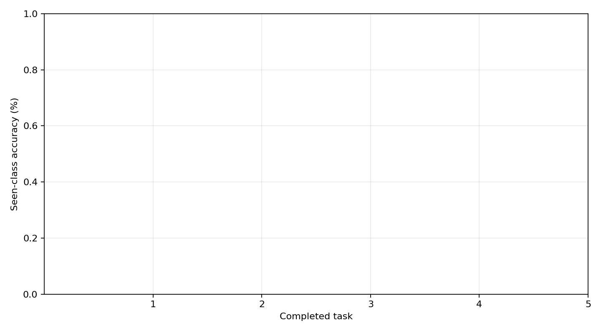
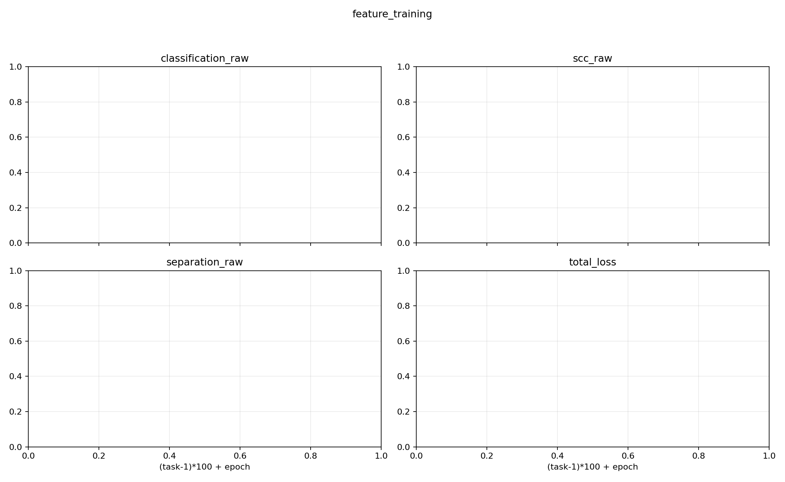
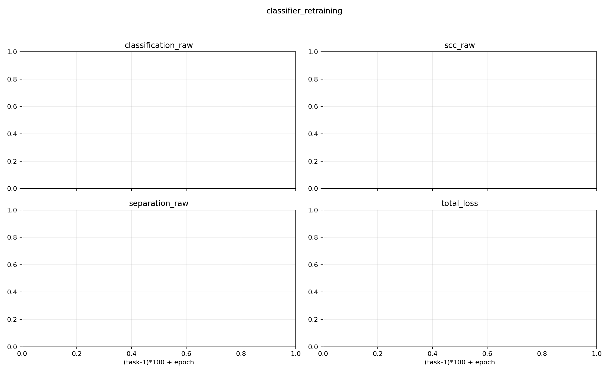

# E0–E7 comparison report

이 보고서는 저장된 CSV/JSON만으로 생성되며 accuracy 단위는 0–100이다.
평균 비교에는 모든 E0–E7에서 완료되고 protocol signature가 같은 seed 교집합만 사용한다.

- Common comparable seeds: 없음
- Excluded/incomplete records: 1

## Overall mean ± std

| Experiment | Multi-center | Separation | Seeds | Inc-Acc | Last-Acc | Forgetting | Time (s) | GPU allocated (bytes) | Statistics (bytes) |
|---|---:|---|---:|---:|---:|---:|---:|---:|---:|
| E0 | False | none | 0 | N/A ± N/A | N/A ± N/A | N/A ± N/A | N/A ± N/A | N/A ± N/A | N/A ± N/A |
| E1 | True | none | 0 | N/A ± N/A | N/A ± N/A | N/A ± N/A | N/A ± N/A | N/A ± N/A | N/A ± N/A |
| E2 | False | isotropic | 0 | N/A ± N/A | N/A ± N/A | N/A ± N/A | N/A ± N/A | N/A ± N/A | N/A ± N/A |
| E3 | False | diagonal | 0 | N/A ± N/A | N/A ± N/A | N/A ± N/A | N/A ± N/A | N/A ± N/A | N/A ± N/A |
| E4 | False | full | 0 | N/A ± N/A | N/A ± N/A | N/A ± N/A | N/A ± N/A | N/A ± N/A | N/A ± N/A |
| E5 | True | isotropic | 0 | N/A ± N/A | N/A ± N/A | N/A ± N/A | N/A ± N/A | N/A ± N/A | N/A ± N/A |
| E6 | True | diagonal | 0 | N/A ± N/A | N/A ± N/A | N/A ± N/A | N/A ± N/A | N/A ± N/A | N/A ± N/A |
| E7 | True | full | 0 | N/A ± N/A | N/A ± N/A | N/A ± N/A | N/A ± N/A | N/A ± N/A | N/A ± N/A |

## Per-seed A1–A5

| Experiment | Seed | A1 | A2 | A3 | A4 | A5 | Inc-Acc | Last-Acc | Forgetting | Time (s) | GPU bytes | Statistics bytes |
|---|---:|---:|---:|---:|---:|---:|---:|---:|---:|---:|---:|---:|

## Mean task-accuracy matrices

### E0

| Trained | Task 1 | Task 2 | Task 3 | Task 4 | Task 5 |
|---|---:|---:|---:|---:|---:|
| Task 1 | N/A | N/A | N/A | N/A | N/A |
| Task 2 | N/A | N/A | N/A | N/A | N/A |
| Task 3 | N/A | N/A | N/A | N/A | N/A |
| Task 4 | N/A | N/A | N/A | N/A | N/A |
| Task 5 | N/A | N/A | N/A | N/A | N/A |

### E1

| Trained | Task 1 | Task 2 | Task 3 | Task 4 | Task 5 |
|---|---:|---:|---:|---:|---:|
| Task 1 | N/A | N/A | N/A | N/A | N/A |
| Task 2 | N/A | N/A | N/A | N/A | N/A |
| Task 3 | N/A | N/A | N/A | N/A | N/A |
| Task 4 | N/A | N/A | N/A | N/A | N/A |
| Task 5 | N/A | N/A | N/A | N/A | N/A |

### E2

| Trained | Task 1 | Task 2 | Task 3 | Task 4 | Task 5 |
|---|---:|---:|---:|---:|---:|
| Task 1 | N/A | N/A | N/A | N/A | N/A |
| Task 2 | N/A | N/A | N/A | N/A | N/A |
| Task 3 | N/A | N/A | N/A | N/A | N/A |
| Task 4 | N/A | N/A | N/A | N/A | N/A |
| Task 5 | N/A | N/A | N/A | N/A | N/A |

### E3

| Trained | Task 1 | Task 2 | Task 3 | Task 4 | Task 5 |
|---|---:|---:|---:|---:|---:|
| Task 1 | N/A | N/A | N/A | N/A | N/A |
| Task 2 | N/A | N/A | N/A | N/A | N/A |
| Task 3 | N/A | N/A | N/A | N/A | N/A |
| Task 4 | N/A | N/A | N/A | N/A | N/A |
| Task 5 | N/A | N/A | N/A | N/A | N/A |

### E4

| Trained | Task 1 | Task 2 | Task 3 | Task 4 | Task 5 |
|---|---:|---:|---:|---:|---:|
| Task 1 | N/A | N/A | N/A | N/A | N/A |
| Task 2 | N/A | N/A | N/A | N/A | N/A |
| Task 3 | N/A | N/A | N/A | N/A | N/A |
| Task 4 | N/A | N/A | N/A | N/A | N/A |
| Task 5 | N/A | N/A | N/A | N/A | N/A |

### E5

| Trained | Task 1 | Task 2 | Task 3 | Task 4 | Task 5 |
|---|---:|---:|---:|---:|---:|
| Task 1 | N/A | N/A | N/A | N/A | N/A |
| Task 2 | N/A | N/A | N/A | N/A | N/A |
| Task 3 | N/A | N/A | N/A | N/A | N/A |
| Task 4 | N/A | N/A | N/A | N/A | N/A |
| Task 5 | N/A | N/A | N/A | N/A | N/A |

### E6

| Trained | Task 1 | Task 2 | Task 3 | Task 4 | Task 5 |
|---|---:|---:|---:|---:|---:|
| Task 1 | N/A | N/A | N/A | N/A | N/A |
| Task 2 | N/A | N/A | N/A | N/A | N/A |
| Task 3 | N/A | N/A | N/A | N/A | N/A |
| Task 4 | N/A | N/A | N/A | N/A | N/A |
| Task 5 | N/A | N/A | N/A | N/A | N/A |

### E7

| Trained | Task 1 | Task 2 | Task 3 | Task 4 | Task 5 |
|---|---:|---:|---:|---:|---:|
| Task 1 | N/A | N/A | N/A | N/A | N/A |
| Task 2 | N/A | N/A | N/A | N/A | N/A |
| Task 3 | N/A | N/A | N/A | N/A | N/A |
| Task 4 | N/A | N/A | N/A | N/A | N/A |
| Task 5 | N/A | N/A | N/A | N/A | N/A |

## Seen/old/new task accuracy

| Experiment | Task | Stage | Seeds | Seen accuracy | Old accuracy | New accuracy |
|---|---:|---|---:|---:|---:|---:|

## Loss records

Loss는 stage와 이름별 별도 열로 유지한다. 비활성 또는 과거 누락 값은 N/A이며 0으로 대체하지 않는다.
집계 가능한 epoch rows: 0

아래 표는 각 experiment/task/stage에서 마지막으로 기록된 epoch이며 서로 다른 loss는 별도 열이다.

| Experiment | Task | Stage | Epoch | Classification | SCC | Separation | Total |
|---|---:|---|---:|---:|---:|---:|---:|

## Excluded and incomplete runs

| Experiment | Seed | Reason | Failure |
|---|---:|---|---|
| E0 | 1993 | missing summary.json | :  |
