# ImageNet-A 5-task: E0 대비 E1–E7 결과 보고서

작성 기준: 저장된 pilot seed 1993, 모든 비교 n=1. 정확도는 %, 차이는 pp. 학습·재평가는 수행하지 않고 기록을 재집계했다.

## 1. 결과 요약

**E0보다 Inc-Acc와 Last-Acc가 모두 높은 방법은 없다.** E3는 Last-Acc가 +0.06583 pp(최종 정답 1개 증가)지만 Inc-Acc는 −0.06574 pp다. E3의 Forgetting은 7.53367 pp로 E0보다 0.31077 pp 낮으며 관측값 중 가장 낮다. E5는 Last-Acc가 E0와 같고 Inc-Acc는 −0.08788 pp이며, E6는 T4에서 +0.56090 pp였다가 최종 −0.65833 pp로 바뀐다.

E4의 정확도 행렬은 E0와, E7의 행렬은 E1과 동일하다. 두 full-covariance 실험은 separation 활성 60개 epoch 모두 loss·intrusion·기록된 separation gradient가 0이다. 이는 full separation의 이득을 확인한 결과가 아니다. **seed가 하나이므로 표본 표준편차와 유의성은 확인할 수 없다.**

## 2. 실험 목록 및 비교 가능성

모든 포함 run은 ImageNet-A **200 classes / 5 tasks / task당 40 classes**, seed 1993이며 완료 상태다. 목표 ImageNet-A 5-task와 일치한다. 공통 완료 seed가 1993 하나여서 전체 비교와 각 E0 paired 비교의 seed 집합은 모두 동일하다.

| 방법 | 실제 Multi-Center | 실제 Separation | 분해 장치 | 상태 / task | seed / n |
| --- | --- | --- | --- | --- | --- |
| E0 | Off | Off | cpu | complete / 5 | 1993 / 1 |
| E1 | On | Off | cpu | complete / 5 | 1993 / 1 |
| E2 | Off | isotropic | cpu | complete / 5 | 1993 / 1 |
| E3 | Off | diagonal | cpu | complete / 5 | 1993 / 1 |
| E4 | Off | full | cuda | complete / 5 | 1993 / 1 |
| E5 | On | isotropic | cpu | complete / 5 | 1993 / 1 |
| E6 | On | diagonal | cpu | complete / 5 | 1993 / 1 |
| E7 | On | full | cuda | complete / 5 | 1993 / 1 |

비교 프로토콜 파일은 8개 run 모두 동일하다. Train 5,981장 / test 1,519장, task별 test 표본 수는 360, 338, 277, 273, 271장이다. 클래스 순서·원본 ID remapping·split 내용 SHA-256과 class별 표본 수까지 일치하며, 기록된 split 간 경로·이름·내용 중복은 모두 0이다. 원본 ID는 이 데이터의 ImageFolder ID이며 ImageNet-1K 전체 인덱스로 해석하지 않는다.

백본은 `pretrained_vit_b16_224_in21k_adapter`, batch=48, SGD lr=0.01, init 30 epochs + incremental 15×4 epochs다. SCC 계수 5, APR On, T2–T5 classifier retraining 각 5 epochs, replay는 **class당 256개/epoch**이며 multi-center에서도 cluster당 256개가 아니다. 모든 run의 epoch별 sample 수·optimizer step·LR가 일치한다(각 run 총 110 epoch 기록, 5,155 optimizer steps, stage 합산 828,580 processed samples). feature 학습과 retraining 표본을 합친 수로 고유 이미지 수가 아니다.

평가는 classifier retraining을 포함한 `incremental_train()` 종료 뒤의 `task_final`이다. 현재 평가 코드는 모든 seen-class logits에서 top-k를 구한 뒤 정답 label로 집계 대상을 나누므로 **single-head CIL**이다. task별 후보 제한이나 best-test epoch 선택은 사용하지 않는다. checkpoint는 `task_end:task_5` latest 상태이며, 이전 epoch/task에 기록된 같은 경로는 나중에 덮어쓰여 현재 과거 모델을 가리키지 않는다. 이번 분석은 저장된 task-final counts를 사용했고 checkpoint 역직렬화나 재평가는 하지 않았다.

**통제 한계:** 방법 변경은 Multi-Center, Separation 활성화, covariance 방식이다. 그 외 E4·E7만 `sep_factor_device=cuda`, 나머지는 `cpu`여서 covariance 비교의 실행 장치 조건이 다르다(Off 실험에서는 해당 설정 비활성). Git commit은 동일하지만 모든 run의 `working_tree_sha256`은 다르고 dirty 상태다. 해시에 증가하는 output 파일도 포함되어 있어 해시 차이가 곧 코드 변경을 뜻하지는 않지만, 당시 소스 파일별 스냅샷이 없어 코드 동일성도 확정할 수 없다. 따라서 아래 비교는 **기록상 protocol·학습량이 맞는 paired 관찰**이며 완전히 통제된 방법론 인과 비교라고 단정하지 않는다.

제외: 기존 `outputs/imageneta/E0/seed_1993`는 최종 summary 없이 1 task만 기록된 legacy 중단 run이다. `outputs_recording_v2`의 seed 1996·1997은 E0–E7 모두 저장 run이 없다(16개 미실행/누락). 이를 실패로 단정하지 않았다. [전체 run 및 제외 목록](tables/run_inventory.csv), [config 차이](tables/config_differences.csv), [실제 학습량](tables/workload.csv)에 보존했다.

## 3. 전체 성능 표

공통 seed={1993}, n=1. SD=N/A이며 0으로 대체하지 않았다. ΔInc·ΔLast는 양수가 개선, ΔForgetting=F_method−F_E0는 **음수가 개선**이다. 시간은 시작–종료 wall time, 통계 메모리는 final persistent statistics이며 checkpoint 디스크 크기·GPU peak와 다른 값이다.

| 방법 | MC | Sep cov | n | Inc-Acc % | ΔInc pp | Last-Acc % | ΔLast pp | Forgetting pp | ΔF pp | 시간 h:mm:ss | 통계 MiB |
| --- | --- | --- | --- | --- | --- | --- | --- | --- | --- | --- | --- |
| E0 | Off | none | 1 | 74.60 | 0.00 | 66.43 | 0.00 | 7.84 | 0.00 | 0:34:47 | 451.2 |
| E1 | On | none | 1 | 74.46 | -0.13 | 66.23 | -0.20 | 7.95 | +0.10 | 1:04:52 | 1730.8 |
| E2 | Off | isotropic | 1 | 74.28 | -0.31 | 65.96 | -0.46 | 8.06 | +0.22 | 0:53:50 | 901.8 |
| E3 | Off | diagonal | 1 | 74.53 | -0.07 | 66.49 | +0.07 | 7.53 | -0.31 | 0:51:28 | 901.8 |
| E4 | Off | full | 1 | 74.60 | 0.00 | 66.43 | 0.00 | 7.84 | 0.00 | 1:06:15 | 901.8 |
| E5 | On | isotropic | 1 | 74.51 | -0.09 | 66.43 | 0.00 | 7.80 | -0.05 | 1:48:12 | 1760.1 |
| E6 | On | diagonal | 1 | 74.47 | -0.13 | 65.77 | -0.66 | 7.95 | +0.10 | 1:49:54 | 1746.6 |
| E7 | On | full | 1 | 74.46 | -0.13 | 66.23 | -0.20 | 7.95 | +0.10 | 2:11:00 | 1730.8 |

수치 검산: task별 correct/sample 합산 A(t), class→task→seen counts, old/new 정확도, Inc-Acc·Last-Acc·Forgetting 모두 저장 summary와 1e−10 허용오차 내 일치했다. 따라서 기존 지표와 요청한 정의 사이에 이번 데이터의 수치 차이는 없다. Inc-Acc 기준 E0=E4가 공동 최고이고 Last-Acc 기준 E3가 가장 높으나, n=1의 관측 순위다. [정밀 seed 원자료 및 비용](tables/metrics_per_seed.csv).

## 4. Inc-Acc / Last-Acc 변화 및 task별 정확도

아래 모든 그림은 seed 1993, n=1, seed 간 SD는 N/A다. 초록/빨강은 관측 방향이며 통계적 유의성이 아니다.

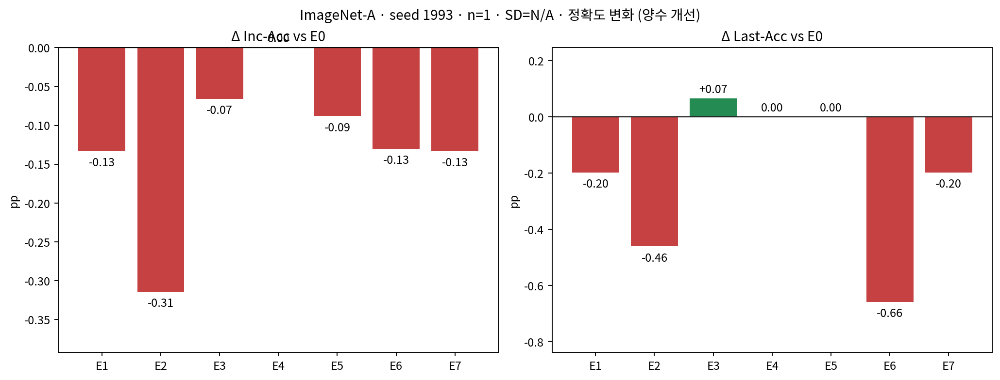

0선 위의 초록 막대는 E0 대비 정확도 개선이다. E3만 Last-Acc가 소폭 양수이고, Inc-Acc는 어느 추가 방법도 E0를 넘지 못한다. E4는 두 지표가 같으며 E5는 마지막만 같다.  
[SVG 원본](figures/performance_deltas.svg)

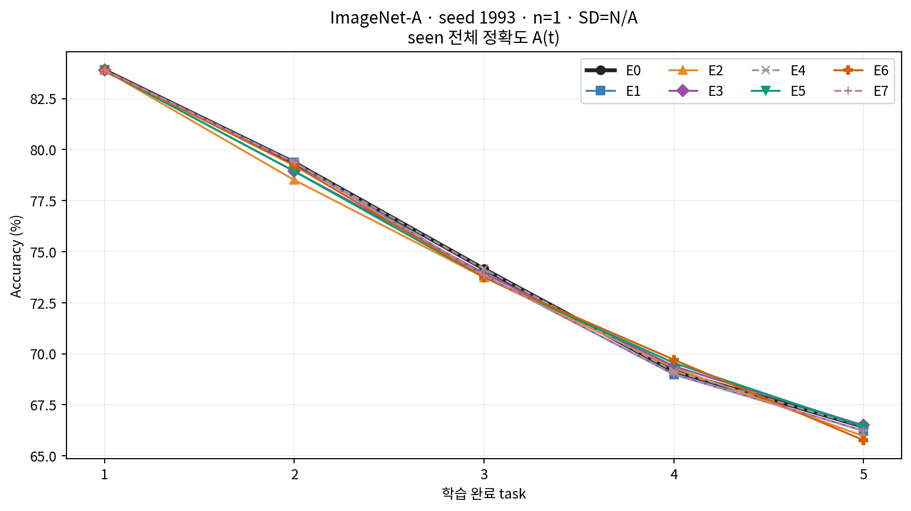

A(t)는 각 시점의 모든 seen test sample을 표본 수로 가중한 정확도다. 모든 방법의 T1은 83.89%로 같고 이후 seen classes가 늘면서 곡선이 내려간다. 평가 집합 자체가 달라지므로 이 하락만으로 forgetting을 측정할 수 없다.  
[SVG 원본](figures/seen_accuracy.svg)

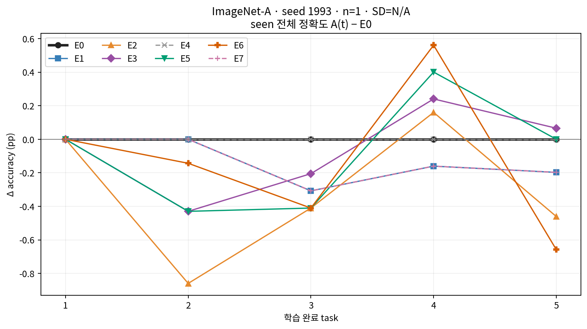

E0를 0으로 맞추면 T2–T3의 음수와 T4에서 E2·E3·E5·E6의 양수가 드러난다. E6는 T4의 +0.56 pp가 T5의 −0.66 pp로 역전되어 중간 task만 보면 결론이 달라진다. E3도 Last-Acc의 작은 이득과 달리 전체 시점 평균은 음수다.  
[SVG 원본](figures/seen_delta.svg)

| 방법 | A(T1) % | A(T2) % | A(T3) % | A(T4) % | A(T5) % |
| --- | --- | --- | --- | --- | --- |
| E0 | 83.89 | 79.37 | 74.15 | 69.15 | 66.43 |
| E1 | 83.89 | 79.37 | 73.85 | 68.99 | 66.23 |
| E2 | 83.89 | 78.51 | 73.74 | 69.31 | 65.96 |
| E3 | 83.89 | 78.94 | 73.95 | 69.39 | 66.49 |
| E4 | 83.89 | 79.37 | 74.15 | 69.15 | 66.43 |
| E5 | 83.89 | 78.94 | 73.74 | 69.55 | 66.43 |
| E6 | 83.89 | 79.23 | 73.74 | 69.71 | 65.77 |
| E7 | 83.89 | 79.37 | 73.85 | 68.99 | 66.23 |

## 5. 삼각형 heatmap

행=학습 완료 task, 열=평가 대상 task. 미래 task는 흰 공백, 유효 셀의 기록 누락은 N/A+빗금이며 이번 8개 run은 유효 셀 누락이 없다. A의 파란 대각선은 절대 정확도이고 B는 대각선까지 E0 차이다. 모든 Δ 색상 범위는 **−4.2~+4.2 pp**로 공통이며 0은 연회색이다. 색 판단은 반올림 전 값, 0 판정 허용오차 1e−10 pp다.

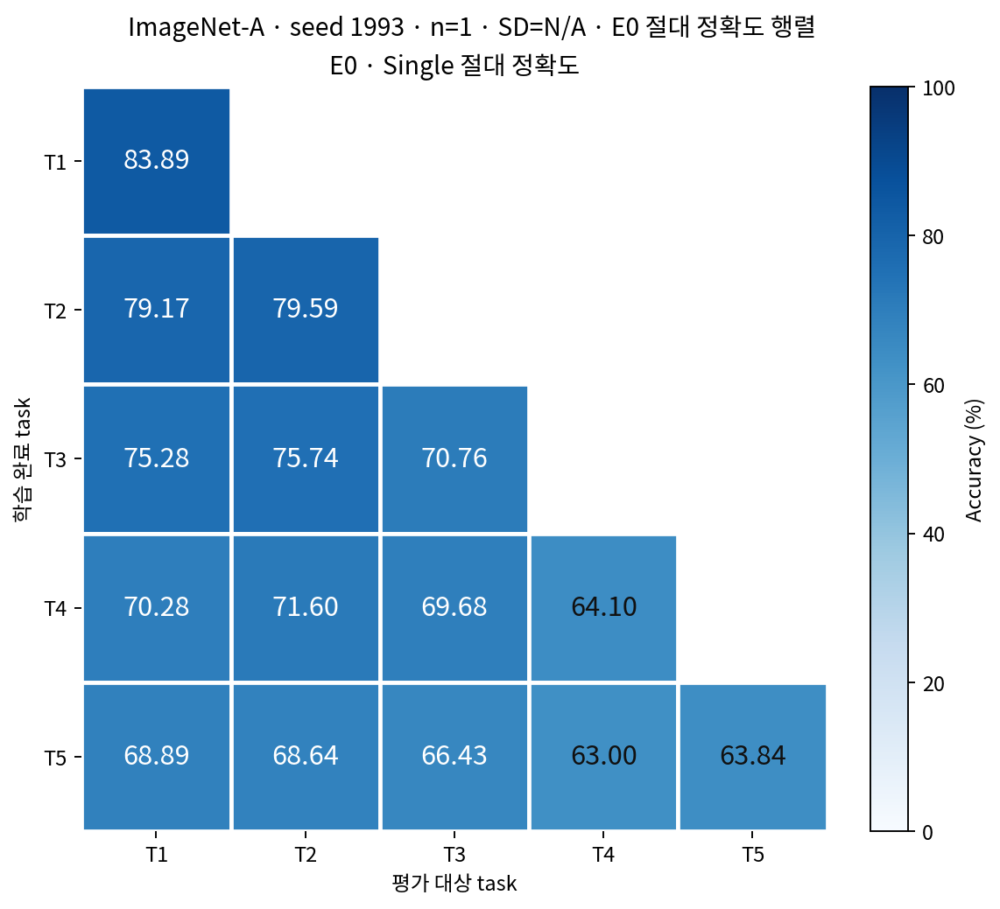

모든 유효 셀은 E0의 절대 정확도(%)이고 파란색은 0–100% 고정 범위다. 첫 task의 정확도는 처음 83.89%에서 마지막 68.89%로 바뀐다. 이 기준 행렬과 동일 seed·동일 셀을 빼서 아래 차이를 계산했다.  
[SVG 원본](figures/E0_absolute.svg)

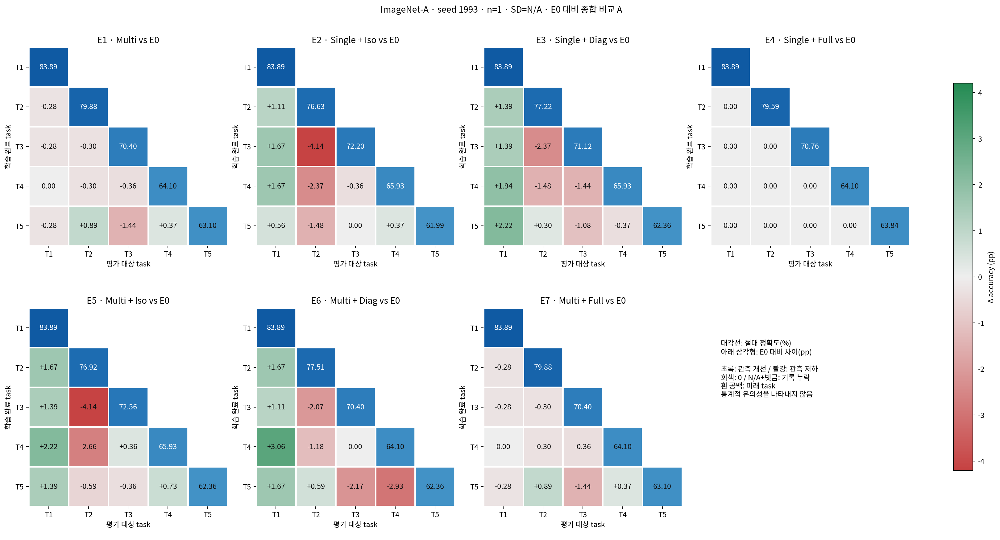

파란 대각선끼리는 새 task의 절대 정확도를 비교하고, 아래 삼각형의 부호로 이전 task 보존 변화를 읽는다. E4의 아래 삼각형은 모두 0이며 E2·E3·E5·E6은 task에 따라 개선과 저하가 섞인다. 대각선의 개선 여부는 다음 B에서 확인해야 한다.  
[SVG 원본](figures/heatmap_A_overview.svg)

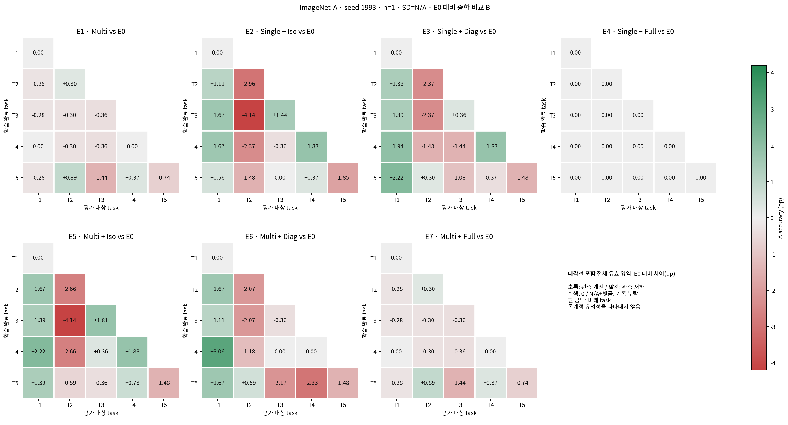

대각선을 포함해 같은 셀의 E0 차이를 표시한다. E2·E3·E5·E6은 T2 새 task 대각선이 음수인 반면 당시 T1 보존은 양수여서 trade-off가 드러난다. E4의 전 영역이 0이고 E7은 E1과 동일한 패턴이다.  
[SVG 원본](figures/heatmap_B_overview.svg)

### E1: Multi


대각선은 이 방법의 새 task 절대 정확도이고 아래는 E0 대비 pp 차이다. 전체 유효 셀에서 최대 변화는 T5→T2의 +0.89 pp, 최소 변화는 T5→T3의 -1.44 pp다. 하나의 seed에서 측정한 셀 변화로 일반화할 수 없다.  
[SVG 원본](figures/heatmap_A_E1.svg)


대각선도 차이로 읽는다. 새 task 변화(T1→T5)는 0.00, +0.30, -0.36, 0.00, -0.74 pp다. 양수 셀과 음수 셀을 함께 보아야 하며 평균 변화가 모든 task의 개선을 뜻하지 않는다.  
[SVG 원본](figures/heatmap_B_E1.svg)

### E2: Single + Iso

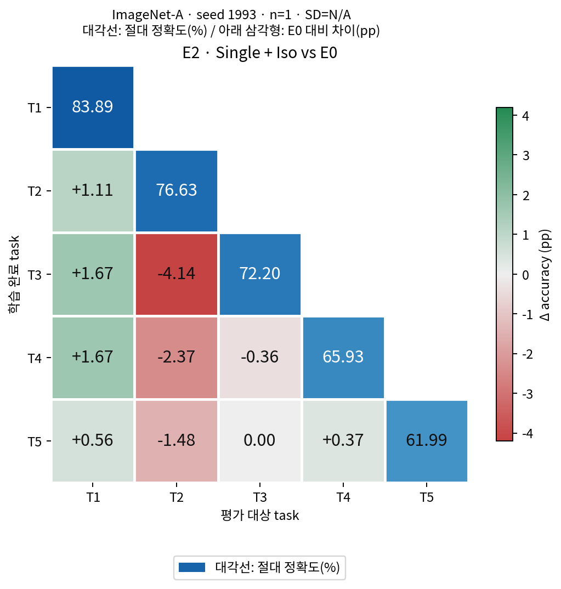

대각선은 이 방법의 새 task 절대 정확도이고 아래는 E0 대비 pp 차이다. 전체 유효 셀에서 최대 변화는 T4→T4의 +1.83 pp, 최소 변화는 T3→T2의 -4.14 pp다. 하나의 seed에서 측정한 셀 변화로 일반화할 수 없다.  
[SVG 원본](figures/heatmap_A_E2.svg)

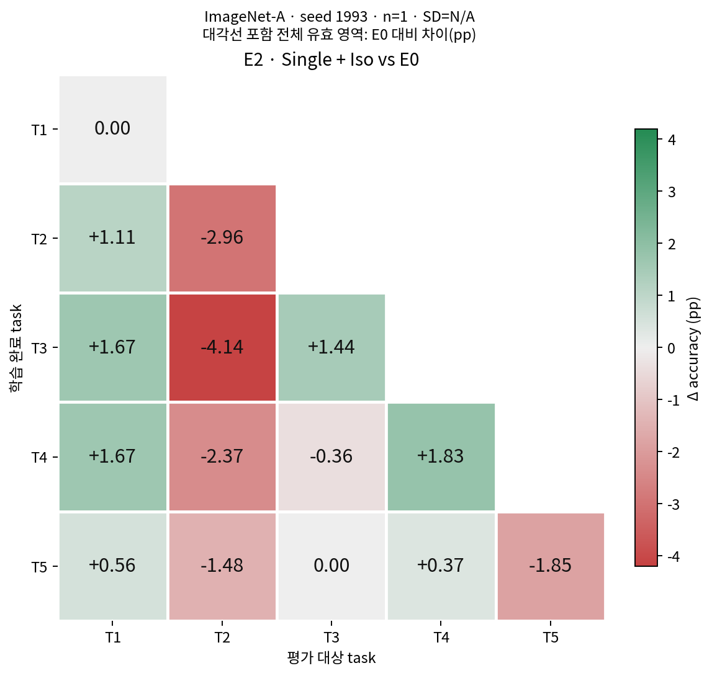

대각선도 차이로 읽는다. 새 task 변화(T1→T5)는 0.00, -2.96, +1.44, +1.83, -1.85 pp다. 양수 셀과 음수 셀을 함께 보아야 하며 평균 변화가 모든 task의 개선을 뜻하지 않는다.  
[SVG 원본](figures/heatmap_B_E2.svg)

### E3: Single + Diag

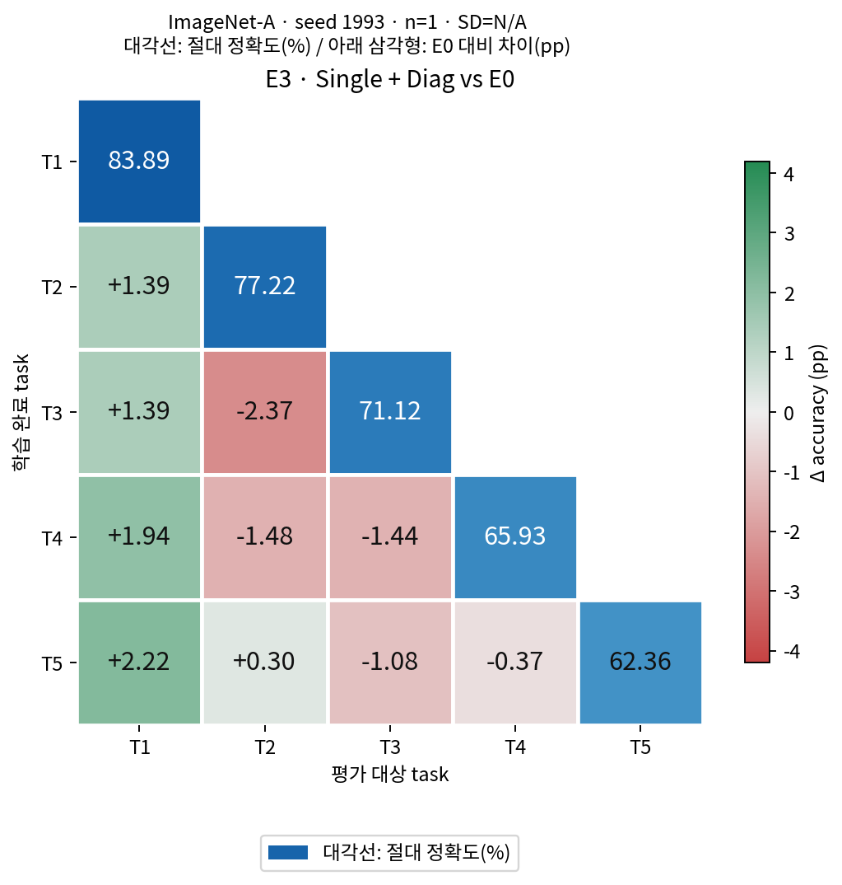

대각선은 이 방법의 새 task 절대 정확도이고 아래는 E0 대비 pp 차이다. 전체 유효 셀에서 최대 변화는 T5→T1의 +2.22 pp, 최소 변화는 T2→T2의 -2.37 pp다. 하나의 seed에서 측정한 셀 변화로 일반화할 수 없다.  
[SVG 원본](figures/heatmap_A_E3.svg)

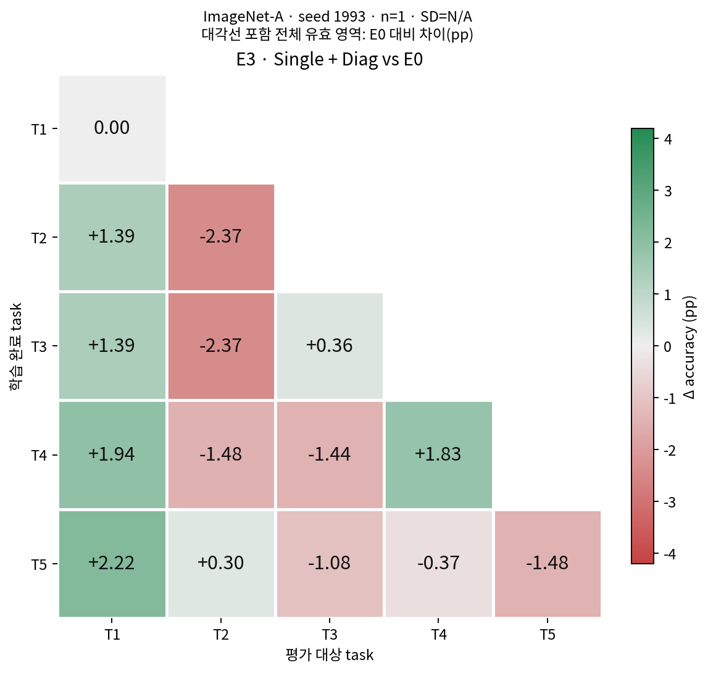

대각선도 차이로 읽는다. 새 task 변화(T1→T5)는 0.00, -2.37, +0.36, +1.83, -1.48 pp다. 양수 셀과 음수 셀을 함께 보아야 하며 평균 변화가 모든 task의 개선을 뜻하지 않는다.  
[SVG 원본](figures/heatmap_B_E3.svg)

### E4: Single + Full

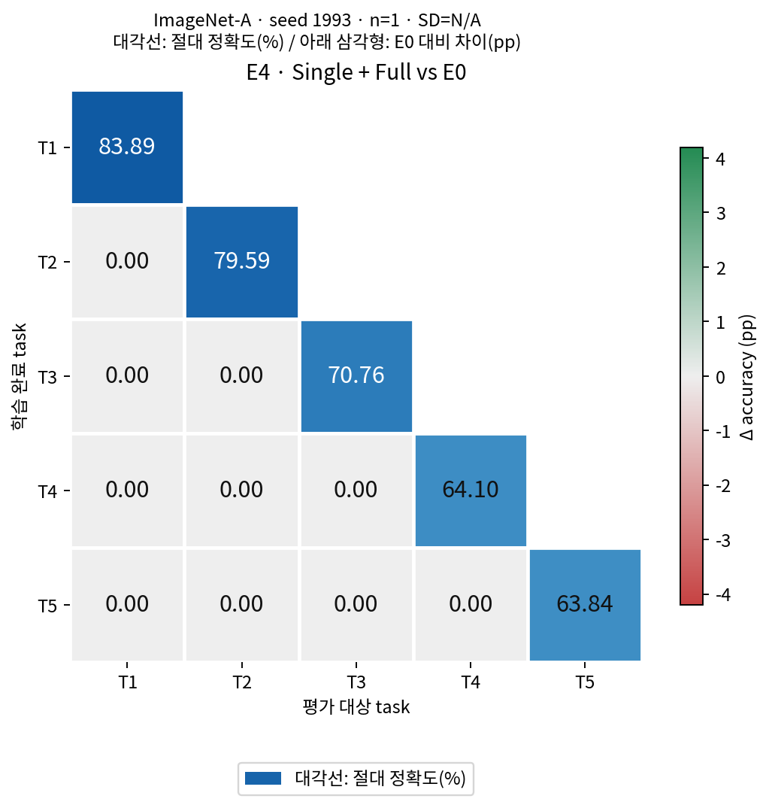

대각선은 이 방법의 새 task 절대 정확도이고 아래는 E0 대비 pp 차이다. 전체 유효 셀에서 최대 변화는 T5→T5의 0.00 pp, 최소 변화는 T1→T1의 0.00 pp다. 하나의 seed에서 측정한 셀 변화로 일반화할 수 없다.  
[SVG 원본](figures/heatmap_A_E4.svg)

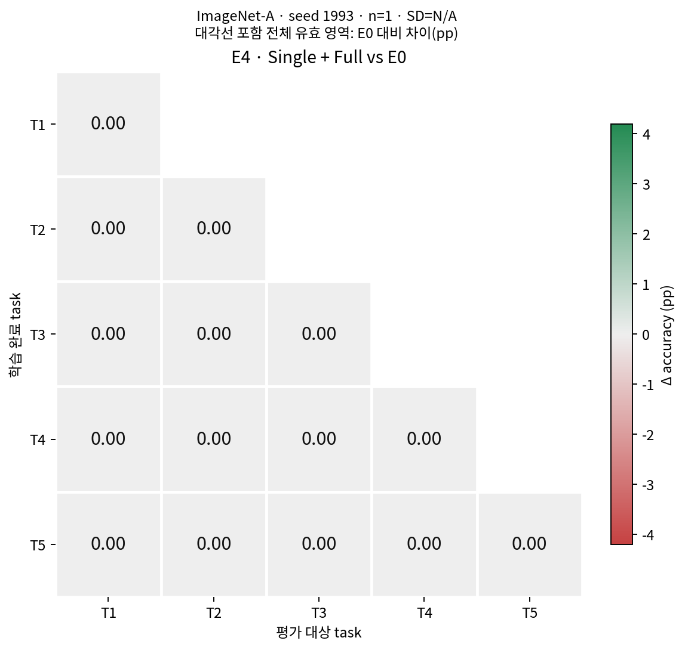

대각선도 차이로 읽는다. 새 task 변화(T1→T5)는 0.00, 0.00, 0.00, 0.00, 0.00 pp다. 모든 셀이 같아 관측된 정확도 이득이 없다.  
[SVG 원본](figures/heatmap_B_E4.svg)

### E5: Multi + Iso

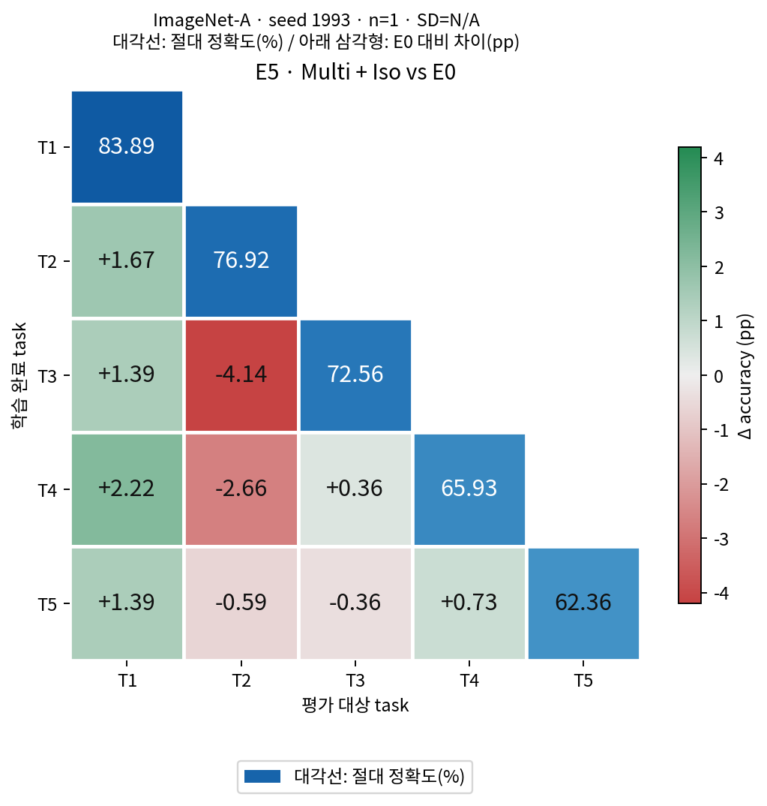

대각선은 이 방법의 새 task 절대 정확도이고 아래는 E0 대비 pp 차이다. 전체 유효 셀에서 최대 변화는 T4→T1의 +2.22 pp, 최소 변화는 T3→T2의 -4.14 pp다. 하나의 seed에서 측정한 셀 변화로 일반화할 수 없다.  
[SVG 원본](figures/heatmap_A_E5.svg)

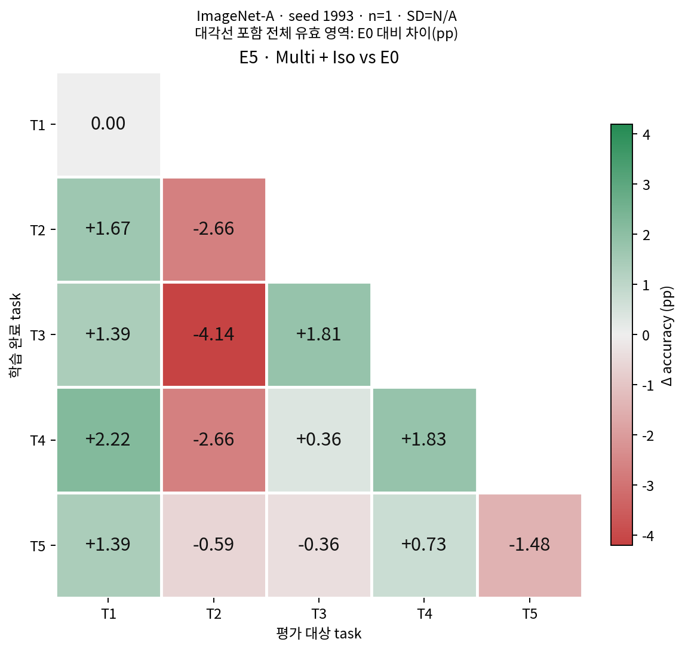

대각선도 차이로 읽는다. 새 task 변화(T1→T5)는 0.00, -2.66, +1.81, +1.83, -1.48 pp다. 양수 셀과 음수 셀을 함께 보아야 하며 평균 변화가 모든 task의 개선을 뜻하지 않는다.  
[SVG 원본](figures/heatmap_B_E5.svg)

### E6: Multi + Diag

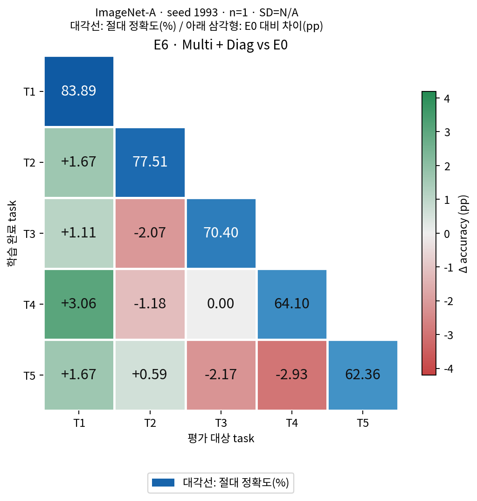

대각선은 이 방법의 새 task 절대 정확도이고 아래는 E0 대비 pp 차이다. 전체 유효 셀에서 최대 변화는 T4→T1의 +3.06 pp, 최소 변화는 T5→T4의 -2.93 pp다. 하나의 seed에서 측정한 셀 변화로 일반화할 수 없다.  
[SVG 원본](figures/heatmap_A_E6.svg)

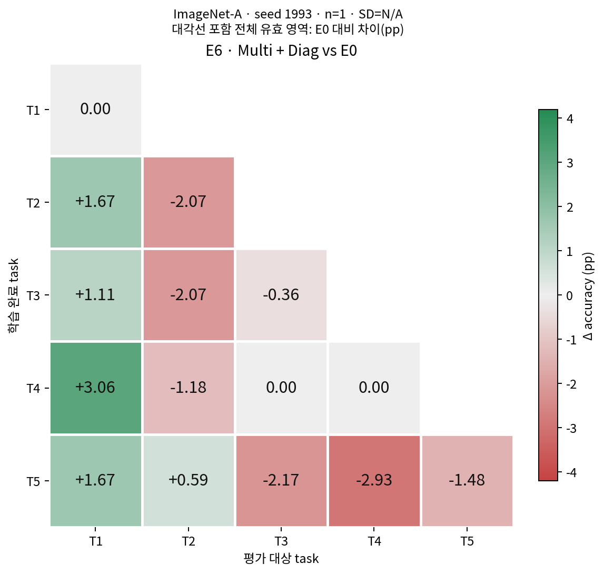

대각선도 차이로 읽는다. 새 task 변화(T1→T5)는 0.00, -2.07, -0.36, 0.00, -1.48 pp다. 양수 셀과 음수 셀을 함께 보아야 하며 평균 변화가 모든 task의 개선을 뜻하지 않는다.  
[SVG 원본](figures/heatmap_B_E6.svg)

### E7: Multi + Full

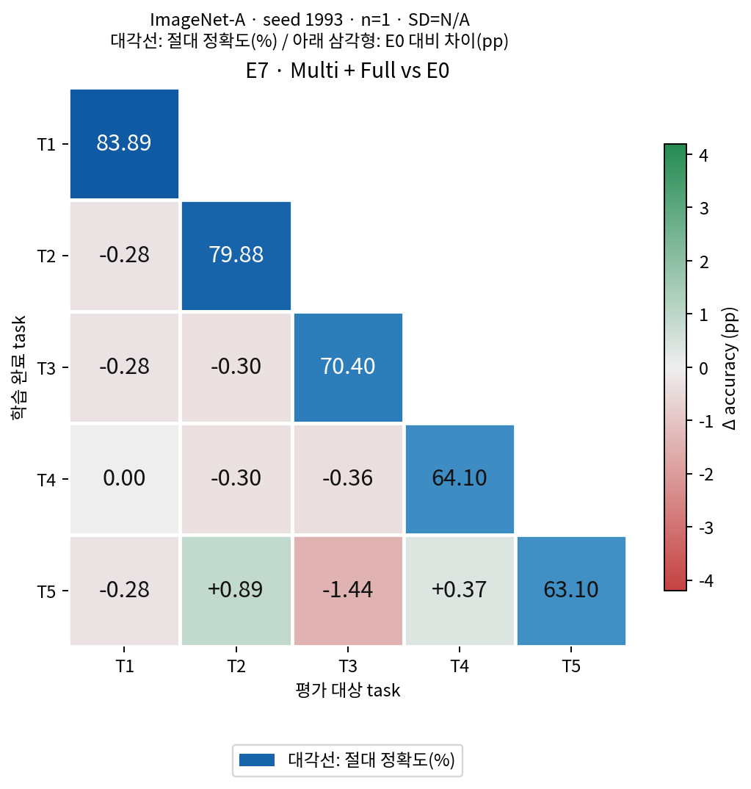

대각선은 이 방법의 새 task 절대 정확도이고 아래는 E0 대비 pp 차이다. 전체 유효 셀에서 최대 변화는 T5→T2의 +0.89 pp, 최소 변화는 T5→T3의 -1.44 pp다. 하나의 seed에서 측정한 셀 변화로 일반화할 수 없다.  
[SVG 원본](figures/heatmap_A_E7.svg)

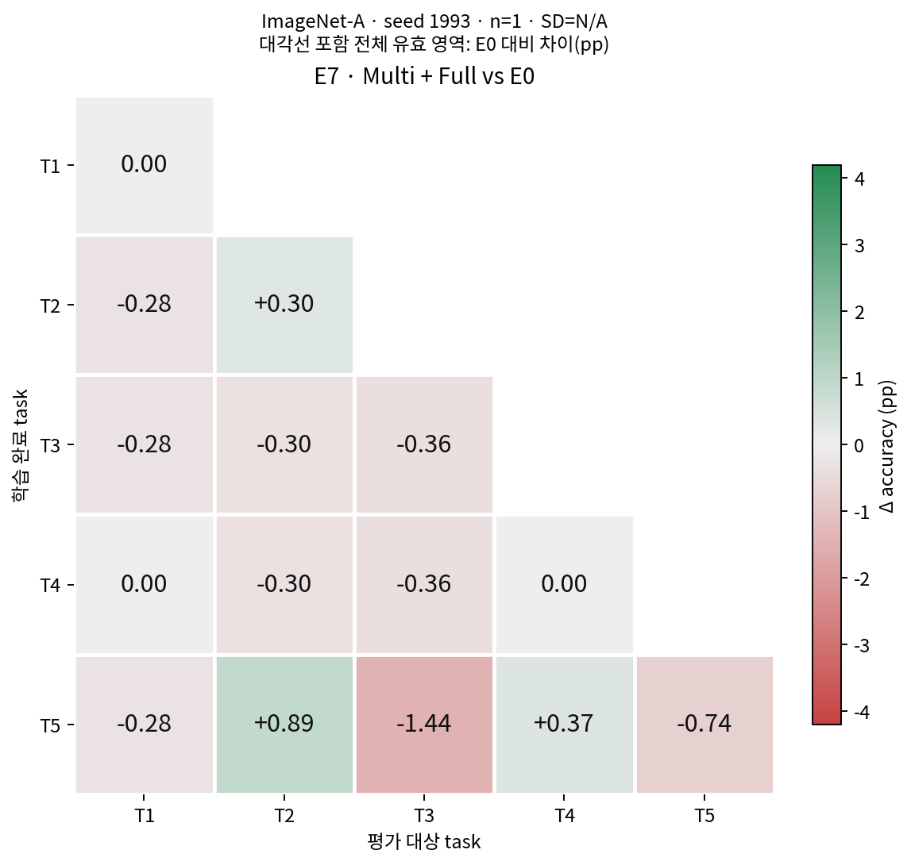

대각선도 차이로 읽는다. 새 task 변화(T1→T5)는 0.00, +0.30, -0.36, 0.00, -0.74 pp다. 양수 셀과 음수 셀을 함께 보아야 하며 평균 변화가 모든 task의 개선을 뜻하지 않는다.  
[SVG 원본](figures/heatmap_B_E7.svg)

## 6. Old/new 성능과 forgetting

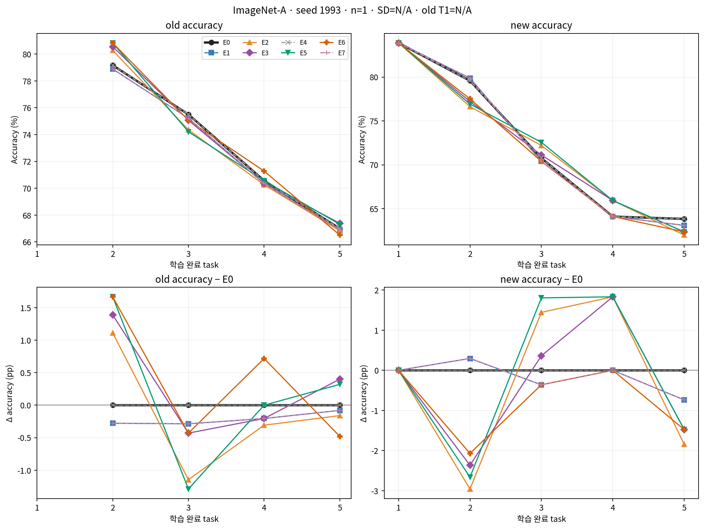

T1 old는 정의되지 않아 N/A로 비웠다. E3의 T5 old 정확도는 E0보다 +0.40 pp, new는 -1.48 pp로 이전 class 보존과 새 class 학습 간 trade-off가 관측된다. E6는 T5 old와 new가 모두 E0보다 낮다.  
[SVG 원본](figures/old_new_accuracy.svg)

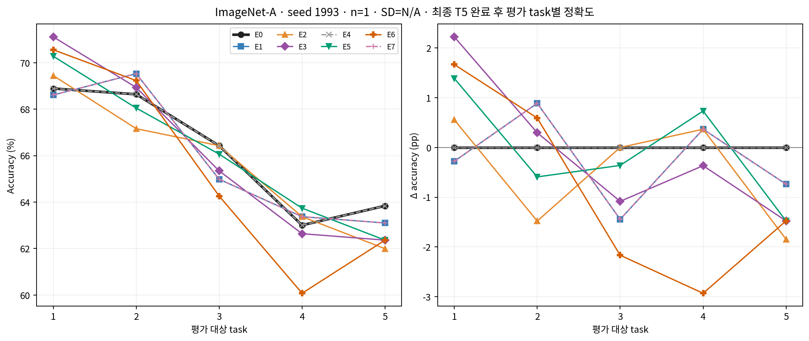

왼쪽은 최종 모델의 각 task 정확도, 오른쪽은 같은 셀의 E0 차이다. 최종 task의 대각선(새 T5)에서 E3·E5·E6는 E0보다 낮고, E3의 seen 전체 소폭 이득은 old 부분에서 나온다. task마다 test 표본 수가 달라 오른쪽 다섯 점의 단순 평균은 ΔLast-Acc가 아니다.  
[SVG 원본](figures/final_task_accuracy.svg)

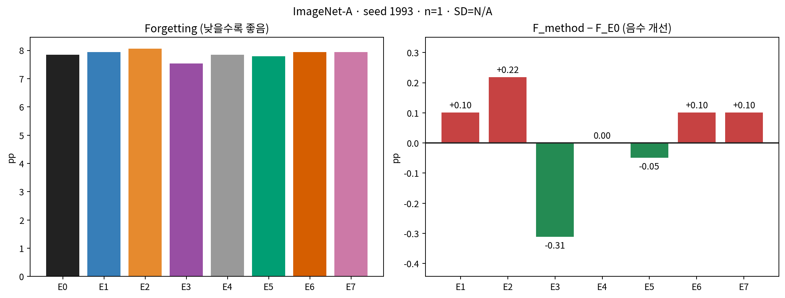

오른쪽 raw ΔF는 음수일 때 초록이며 정확도 그림과 개선 부호가 반대다. E3의 −0.31 pp가 가장 큰 감소이고 E5는 −0.05 pp로 소폭 감소한다. 이 값은 각 과거 task의 final 이전 최고 정확도와 final 정확도의 차이를 평균한 것으로, 음수라도 0으로 자르지 않는다.  
[SVG 원본](figures/forgetting.svg)

| 방법 | T1 forgetting pp | T2 forgetting pp | T3 forgetting pp | T4 forgetting pp |
| --- | --- | --- | --- | --- |
| E0 | 15.00 | 10.95 | 4.33 | 1.10 |
| E1 | 15.28 | 10.36 | 5.42 | 0.73 |
| E2 | 14.44 | 9.47 | 5.78 | 2.56 |
| E3 | 12.78 | 8.28 | 5.78 | 3.30 |
| E4 | 15.00 | 10.95 | 4.33 | 1.10 |
| E5 | 13.61 | 8.88 | 6.50 | 2.20 |
| E6 | 13.33 | 8.28 | 6.14 | 4.03 |
| E7 | 15.28 | 10.36 | 5.42 | 0.73 |

## 7. K-means 분할 현황 및 class별 상세 결과

E1·E5·E6·E7만 K-means 적용, E0·E2·E3·E4는 **K-means 미적용**이다. single prototype을 K=1 K-means로 해석하지 않는다. 요청 K=3, K-means++, n_init=10, 최대 100회, 최소 cluster 크기=2다. 표본·unique feature 제한이나 empty/undersized 시 K를 줄여 재실행하며, cluster를 병합하거나 표본을 버리는 방식이 아니다. 별도 의미적 K 선택 절차는 없다.

| 방법 | K=1 class | K=2 class | K=3 class | K 축소 class | 최소 cluster N | 최대 cluster 비중 | 평균 최대 비중 |
| --- | --- | --- | --- | --- | --- | --- | --- |
| E1 | 4 | 24 | 172 | 28 | 2 | 100.0% | 56.3% |
| E5 | 3 | 13 | 184 | 16 | 2 | 100.0% | 51.9% |
| E6 | 4 | 17 | 179 | 21 | 2 | 100.0% | 55.4% |
| E7 | 4 | 24 | 172 | 28 | 2 | 100.0% | 56.3% |

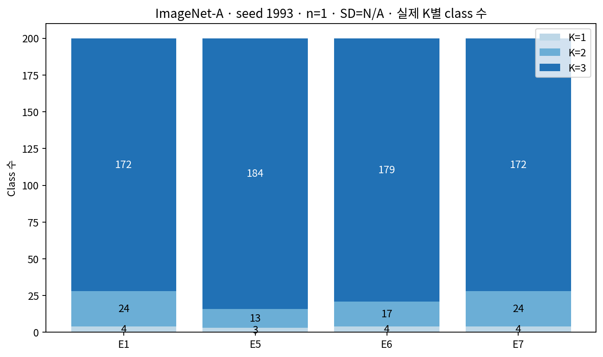

각 막대의 높이는 200 classes이고 숫자는 실제 K별 class 수다. 요청 K=3을 모두 유지한 방법은 없으며 E1/E7은 28개, E5는 16개, E6는 21개 class에서 K가 줄었다. 이는 제약에 따른 유효 cluster 수이지 의미적 하위 유형의 개수 증거가 아니다.  
[SVG 원본](figures/kmeans_K_distribution.svg)

800개 class-clustering 기록과 23,924개 assignment를 대조했다. cluster별 sample 합=class sample 수, weight 합=1, assignment별 count 및 class train 표본 수가 모두 일치했다. 최종 유효 cluster의 empty·singleton은 모두 0이며 최소 cluster 크기는 2다. 중간 초기화에서 부적합한 cluster는 재시도될 수 있으므로 최종 0건과 시도 0건을 혼동하지 않는다. 동일 class의 APR 갱신은 새 clustering으로 세지 않았고 `clustering_run_id`가 중복되지 않는지 확인했다.

클래스 이름은 저장된 WordNet synset 문자열(예: `n04442312`)을 그대로 사용한다. 의미 이름을 추측해 바꾸지 않았다. [전체 800개 class 표](tables/kmeans_all_classes.csv)는 요청한 ID·생성 task·이름·N·요청/실제 K·counts·비율·fallback 사유·feature 공간·checkpoint key 및 최종 Δ를 모두 포함한다. [Cluster 상세 원자료](tables/raw_cluster_details.csv.gz), [assignment](tables/raw_cluster_assignments.csv.gz), [요약 및 사유](tables/kmeans_summary.csv)를 함께 제공한다.

### E1: 생성 task별 전체 class 비율


원본 class ID 순서로 생성 T1의 40개 class를 표시하며 각 막대 합은 100%다. 이 task에서 K 축소는 0개 class, 가장 큰 단일 cluster 비중은 89.5%다. cluster 번호와 색은 해당 clustering 내부 식별자여서 다른 class·실험의 같은 색이 같은 의미를 뜻하지 않는다.  
[SVG 원본](figures/clusters_E1_T1.svg)


원본 class ID 순서로 생성 T2의 40개 class를 표시하며 각 막대 합은 100%다. 이 task에서 K 축소는 7개 class, 가장 큰 단일 cluster 비중은 77.3%다. cluster 번호와 색은 해당 clustering 내부 식별자여서 다른 class·실험의 같은 색이 같은 의미를 뜻하지 않는다.  
[SVG 원본](figures/clusters_E1_T2.svg)

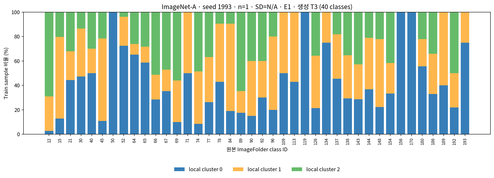

원본 class ID 순서로 생성 T3의 40개 class를 표시하며 각 막대 합은 100%다. 이 task에서 K 축소는 10개 class, 가장 큰 단일 cluster 비중은 100.0%다. cluster 번호와 색은 해당 clustering 내부 식별자여서 다른 class·실험의 같은 색이 같은 의미를 뜻하지 않는다.  
[SVG 원본](figures/clusters_E1_T3.svg)


원본 class ID 순서로 생성 T4의 40개 class를 표시하며 각 막대 합은 100%다. 이 task에서 K 축소는 5개 class, 가장 큰 단일 cluster 비중은 90.9%다. cluster 번호와 색은 해당 clustering 내부 식별자여서 다른 class·실험의 같은 색이 같은 의미를 뜻하지 않는다.  
[SVG 원본](figures/clusters_E1_T4.svg)


원본 class ID 순서로 생성 T5의 40개 class를 표시하며 각 막대 합은 100%다. 이 task에서 K 축소는 6개 class, 가장 큰 단일 cluster 비중은 90.5%다. cluster 번호와 색은 해당 clustering 내부 식별자여서 다른 class·실험의 같은 색이 같은 의미를 뜻하지 않는다.  
[SVG 원본](figures/clusters_E1_T5.svg)

### E5: 생성 task별 전체 class 비율

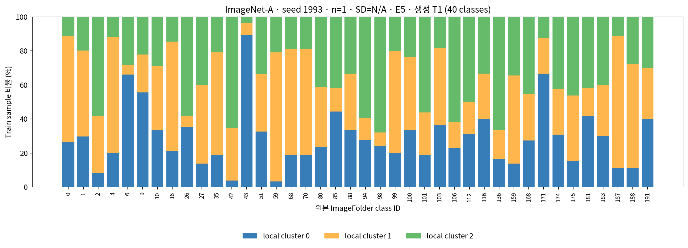

원본 class ID 순서로 생성 T1의 40개 class를 표시하며 각 막대 합은 100%다. 이 task에서 K 축소는 0개 class, 가장 큰 단일 cluster 비중은 89.5%다. cluster 번호와 색은 해당 clustering 내부 식별자여서 다른 class·실험의 같은 색이 같은 의미를 뜻하지 않는다.  
[SVG 원본](figures/clusters_E5_T1.svg)

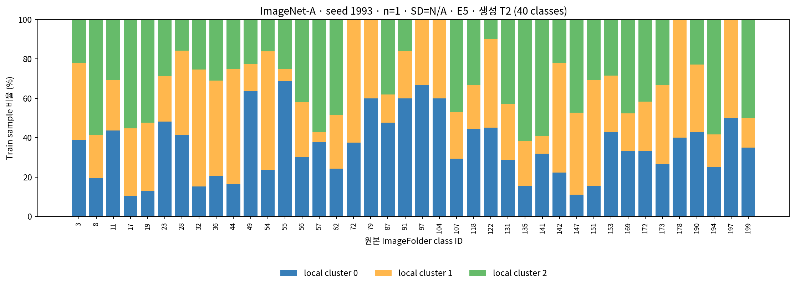

원본 class ID 순서로 생성 T2의 40개 class를 표시하며 각 막대 합은 100%다. 이 task에서 K 축소는 6개 class, 가장 큰 단일 cluster 비중은 68.8%다. cluster 번호와 색은 해당 clustering 내부 식별자여서 다른 class·실험의 같은 색이 같은 의미를 뜻하지 않는다.  
[SVG 원본](figures/clusters_E5_T2.svg)

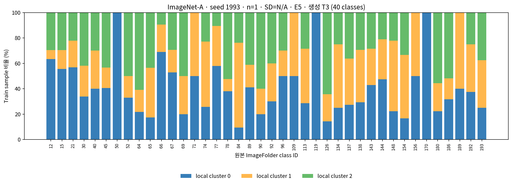

원본 class ID 순서로 생성 T3의 40개 class를 표시하며 각 막대 합은 100%다. 이 task에서 K 축소는 7개 class, 가장 큰 단일 cluster 비중은 100.0%다. cluster 번호와 색은 해당 clustering 내부 식별자여서 다른 class·실험의 같은 색이 같은 의미를 뜻하지 않는다.  
[SVG 원본](figures/clusters_E5_T3.svg)

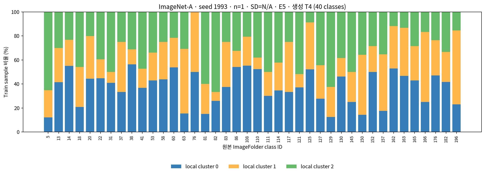

원본 class ID 순서로 생성 T4의 40개 class를 표시하며 각 막대 합은 100%다. 이 task에서 K 축소는 1개 class, 가장 큰 단일 cluster 비중은 66.7%다. cluster 번호와 색은 해당 clustering 내부 식별자여서 다른 class·실험의 같은 색이 같은 의미를 뜻하지 않는다.  
[SVG 원본](figures/clusters_E5_T4.svg)

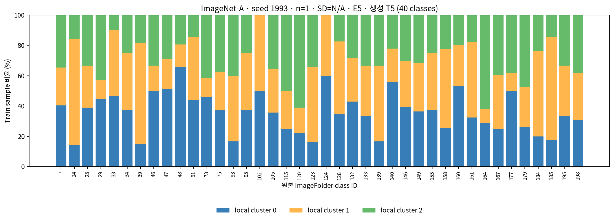

원본 class ID 순서로 생성 T5의 40개 class를 표시하며 각 막대 합은 100%다. 이 task에서 K 축소는 2개 class, 가장 큰 단일 cluster 비중은 69.7%다. cluster 번호와 색은 해당 clustering 내부 식별자여서 다른 class·실험의 같은 색이 같은 의미를 뜻하지 않는다.  
[SVG 원본](figures/clusters_E5_T5.svg)

### E6: 생성 task별 전체 class 비율


원본 class ID 순서로 생성 T1의 40개 class를 표시하며 각 막대 합은 100%다. 이 task에서 K 축소는 0개 class, 가장 큰 단일 cluster 비중은 89.5%다. cluster 번호와 색은 해당 clustering 내부 식별자여서 다른 class·실험의 같은 색이 같은 의미를 뜻하지 않는다.  
[SVG 원본](figures/clusters_E6_T1.svg)

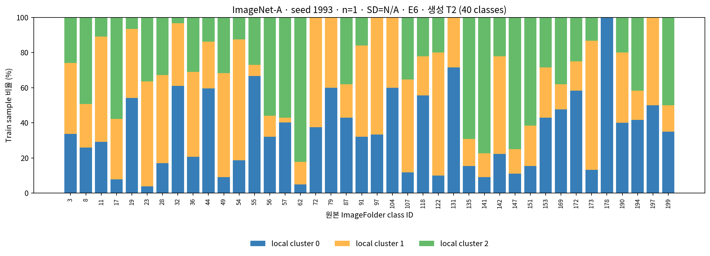

원본 class ID 순서로 생성 T2의 40개 class를 표시하며 각 막대 합은 100%다. 이 task에서 K 축소는 7개 class, 가장 큰 단일 cluster 비중은 100.0%다. cluster 번호와 색은 해당 clustering 내부 식별자여서 다른 class·실험의 같은 색이 같은 의미를 뜻하지 않는다.  
[SVG 원본](figures/clusters_E6_T2.svg)

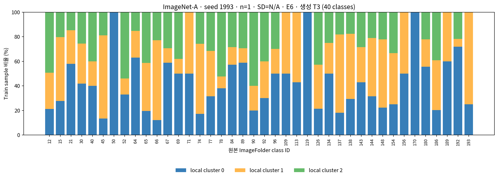

원본 class ID 순서로 생성 T3의 40개 class를 표시하며 각 막대 합은 100%다. 이 task에서 K 축소는 9개 class, 가장 큰 단일 cluster 비중은 100.0%다. cluster 번호와 색은 해당 clustering 내부 식별자여서 다른 class·실험의 같은 색이 같은 의미를 뜻하지 않는다.  
[SVG 원본](figures/clusters_E6_T3.svg)

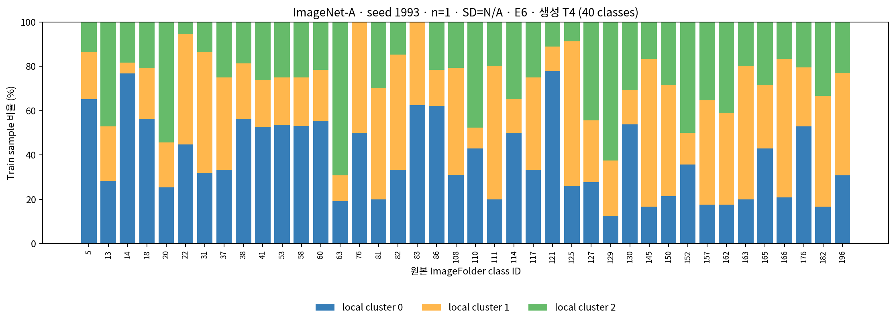

원본 class ID 순서로 생성 T4의 40개 class를 표시하며 각 막대 합은 100%다. 이 task에서 K 축소는 2개 class, 가장 큰 단일 cluster 비중은 77.8%다. cluster 번호와 색은 해당 clustering 내부 식별자여서 다른 class·실험의 같은 색이 같은 의미를 뜻하지 않는다.  
[SVG 원본](figures/clusters_E6_T4.svg)

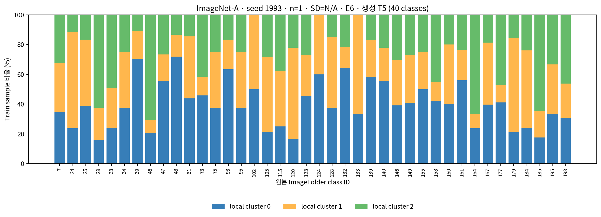

원본 class ID 순서로 생성 T5의 40개 class를 표시하며 각 막대 합은 100%다. 이 task에서 K 축소는 3개 class, 가장 큰 단일 cluster 비중은 72.0%다. cluster 번호와 색은 해당 clustering 내부 식별자여서 다른 class·실험의 같은 색이 같은 의미를 뜻하지 않는다.  
[SVG 원본](figures/clusters_E6_T5.svg)

### E7: 생성 task별 전체 class 비율


원본 class ID 순서로 생성 T1의 40개 class를 표시하며 각 막대 합은 100%다. 이 task에서 K 축소는 0개 class, 가장 큰 단일 cluster 비중은 89.5%다. cluster 번호와 색은 해당 clustering 내부 식별자여서 다른 class·실험의 같은 색이 같은 의미를 뜻하지 않는다.  
[SVG 원본](figures/clusters_E7_T1.svg)

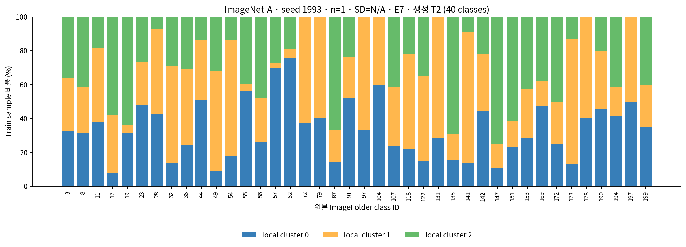

원본 class ID 순서로 생성 T2의 40개 class를 표시하며 각 막대 합은 100%다. 이 task에서 K 축소는 7개 class, 가장 큰 단일 cluster 비중은 77.3%다. cluster 번호와 색은 해당 clustering 내부 식별자여서 다른 class·실험의 같은 색이 같은 의미를 뜻하지 않는다.  
[SVG 원본](figures/clusters_E7_T2.svg)


원본 class ID 순서로 생성 T3의 40개 class를 표시하며 각 막대 합은 100%다. 이 task에서 K 축소는 10개 class, 가장 큰 단일 cluster 비중은 100.0%다. cluster 번호와 색은 해당 clustering 내부 식별자여서 다른 class·실험의 같은 색이 같은 의미를 뜻하지 않는다.  
[SVG 원본](figures/clusters_E7_T3.svg)

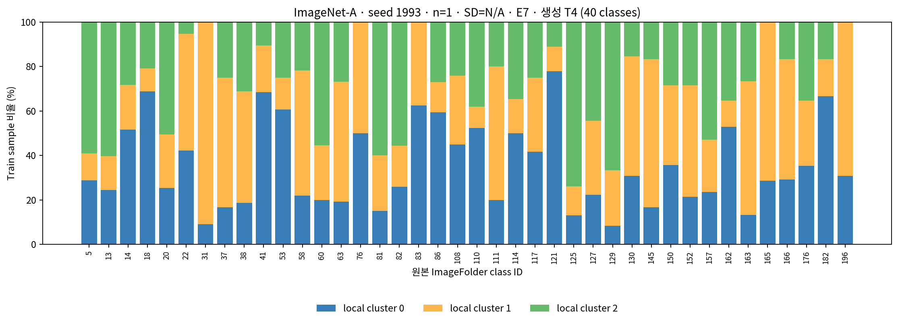

원본 class ID 순서로 생성 T4의 40개 class를 표시하며 각 막대 합은 100%다. 이 task에서 K 축소는 5개 class, 가장 큰 단일 cluster 비중은 90.9%다. cluster 번호와 색은 해당 clustering 내부 식별자여서 다른 class·실험의 같은 색이 같은 의미를 뜻하지 않는다.  
[SVG 원본](figures/clusters_E7_T4.svg)

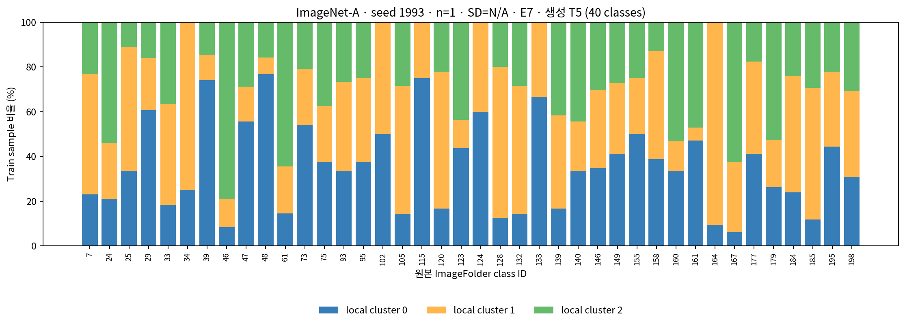

원본 class ID 순서로 생성 T5의 40개 class를 표시하며 각 막대 합은 100%다. 이 task에서 K 축소는 6개 class, 가장 큰 단일 cluster 비중은 90.5%다. cluster 번호와 색은 해당 clustering 내부 식별자여서 다른 class·실험의 같은 색이 같은 의미를 뜻하지 않는다.  
[SVG 원본](figures/clusters_E7_T5.svg)

### 최종 class 정확도와의 연결

아래는 각 방법의 가장 큰 변화 예시이며 전체 class를 [class_final_deltas.csv](tables/class_final_deltas.csv)에 보존했다. class 연결은 원본 ID로 수행하고 학습 ID·이름·test N 일치까지 검산했다. 표본 수가 적은 class의 한 정답 변화는 큰 pp가 되므로 pp만으로 우선순위를 정하면 안 된다.

E1: 개선 12 / 저하 14 / 동일 174 classes; 최종 정답 변화 -3개.

E2: 개선 25 / 저하 30 / 동일 145 classes; 최종 정답 변화 -7개.

E3: 개선 24 / 저하 24 / 동일 152 classes; 최종 정답 변화 +1개.

E4: 개선 0 / 저하 0 / 동일 200 classes; 최종 정답 변화 +0개.

E5: 개선 27 / 저하 24 / 동일 149 classes; 최종 정답 변화 +0개.

E6: 개선 23 / 저하 31 / 동일 146 classes; 최종 정답 변화 -10개.

E7: 개선 12 / 저하 14 / 동일 174 classes; 최종 정답 변화 -3개.

| 방법 | 원본 ID | class | test N | Δ pp | 정답 Δ | K | cluster N |
| --- | --- | --- | --- | --- | --- | --- | --- |
| E1 | 119 | n03584829 | 1 | -100.00 | -1 | 1 | [2] |
| E1 | 199 | n12267677 | 3 | +33.33 | 1 | 3 | [7, 5, 8] |
| E2 | 119 | n03584829 | 1 | -100.00 | -1 | 미적용 | N/A |
| E2 | 88 | n02815834 | 1 | +100.00 | 1 | 미적용 | N/A |
| E3 | 119 | n03584829 | 1 | -100.00 | -1 | 미적용 | N/A |
| E3 | 88 | n02815834 | 1 | +100.00 | 1 | 미적용 | N/A |
| E4 | 168 | n04442312 | 5 | 0.00 | 0 | 미적용 | N/A |
| E4 | 168 | n04442312 | 5 | 0.00 | 0 | 미적용 | N/A |
| E5 | 119 | n03584829 | 1 | -100.00 | -1 | 1 | [2] |
| E5 | 88 | n02815834 | 1 | +100.00 | 1 | 3 | [2, 2, 2] |
| E6 | 119 | n03584829 | 1 | -100.00 | -1 | 1 | [2] |
| E6 | 88 | n02815834 | 1 | +100.00 | 1 | 3 | [2, 2, 2] |
| E7 | 119 | n03584829 | 1 | -100.00 | -1 | 1 | [2] |
| E7 | 199 | n12267677 | 3 | +33.33 | 1 | 3 | [7, 5, 8] |

군집 최대 비중과 최종 class Δ의 기술적 Pearson 상관도 `kmeans_summary.csv`에 저장했다. K=1은 비중이 자동으로 1이고 class별 test N이 다르며 class 난이도도 통제하지 않았으므로 이 상관을 원인·유의성으로 해석하지 않는다.

## 8. Loss · intrusion · 수치 안정성 · 비용

feature stage의 목적함수는 classification + 5×SCC(활성 task) + 1×separation(활성 방법)이다. 아래 raw와 weighted를 분리했으며 distillation은 비활성으로 값이 없어 곡선을 만들지 않았다. 목적함수가 다른 total loss의 크기로 방법 우열을 판단하지 않는다.

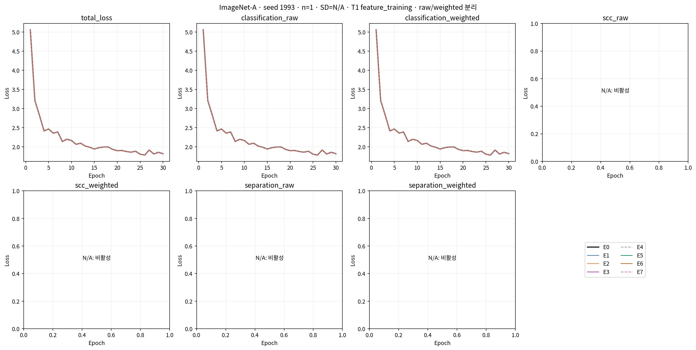

T1의 feature 학습만 표시하며 retraining과 epoch 축을 섞지 않았다. T1에서는 SCC·separation이 비활성이어서 해당 패널은 N/A이며 초기 학습 곡선이 겹친다. 값은 batch 크기로 가중한 epoch 평균이다.  
[SVG 원본](figures/loss_feature_T1.svg)

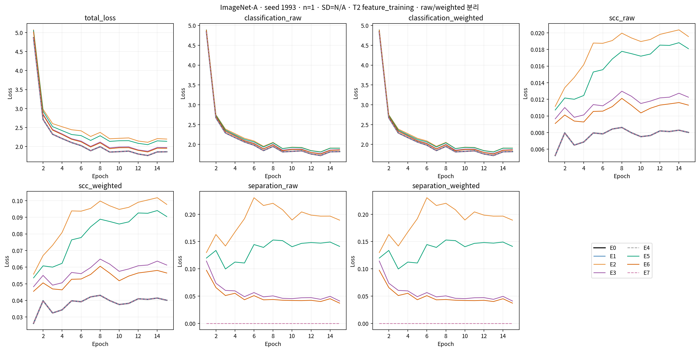

T2의 feature 학습만 표시하며 retraining과 epoch 축을 섞지 않았다. SCC weighted는 raw의 5배이고 separation은 계수 1이라 raw와 weighted가 같다. E4·E7의 separation 곡선은 전 epoch 0이다. 값은 batch 크기로 가중한 epoch 평균이다.  
[SVG 원본](figures/loss_feature_T2.svg)

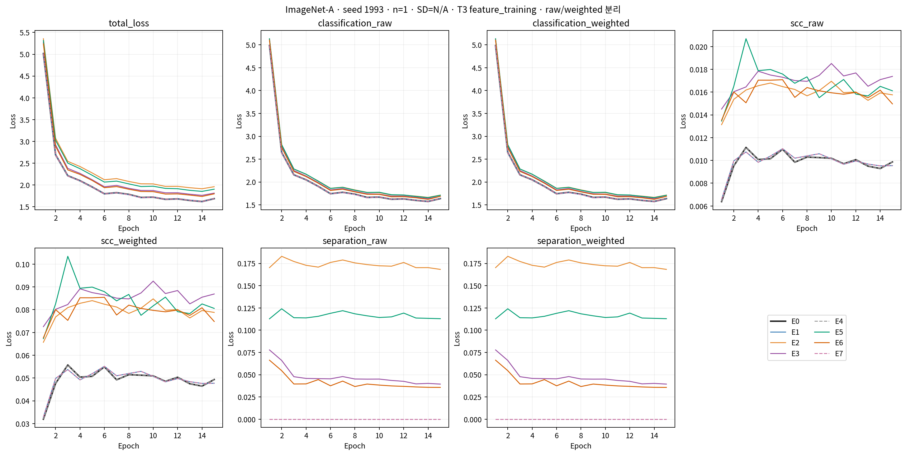

T3의 feature 학습만 표시하며 retraining과 epoch 축을 섞지 않았다. SCC weighted는 raw의 5배이고 separation은 계수 1이라 raw와 weighted가 같다. E4·E7의 separation 곡선은 전 epoch 0이다. 값은 batch 크기로 가중한 epoch 평균이다.  
[SVG 원본](figures/loss_feature_T3.svg)

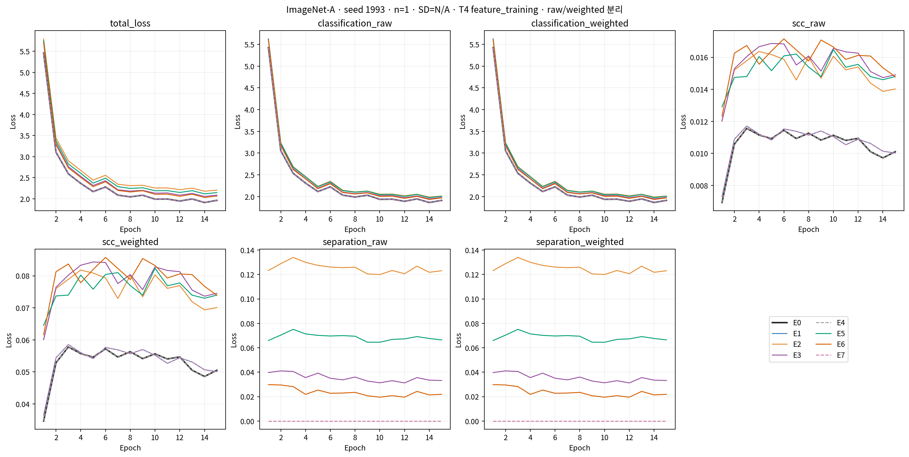

T4의 feature 학습만 표시하며 retraining과 epoch 축을 섞지 않았다. SCC weighted는 raw의 5배이고 separation은 계수 1이라 raw와 weighted가 같다. E4·E7의 separation 곡선은 전 epoch 0이다. 값은 batch 크기로 가중한 epoch 평균이다.  
[SVG 원본](figures/loss_feature_T4.svg)

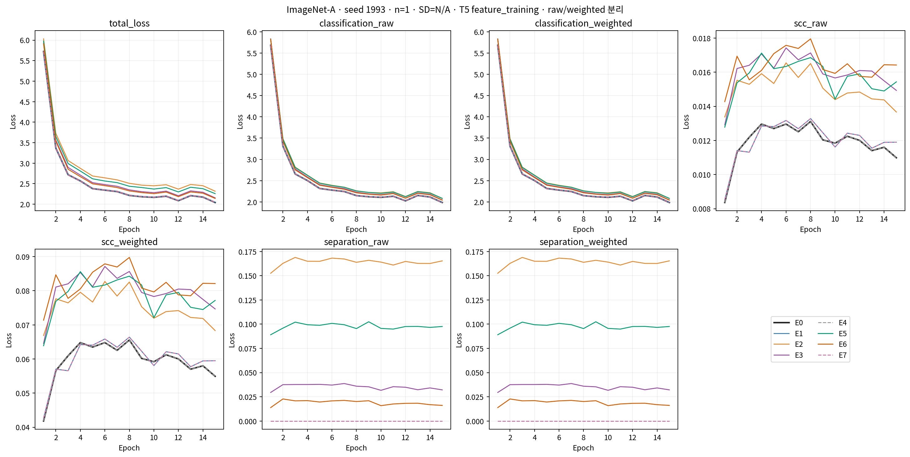

T5의 feature 학습만 표시하며 retraining과 epoch 축을 섞지 않았다. SCC weighted는 raw의 5배이고 separation은 계수 1이라 raw와 weighted가 같다. E4·E7의 separation 곡선은 전 epoch 0이다. 값은 batch 크기로 가중한 epoch 평균이다.  
[SVG 원본](figures/loss_feature_T5.svg)

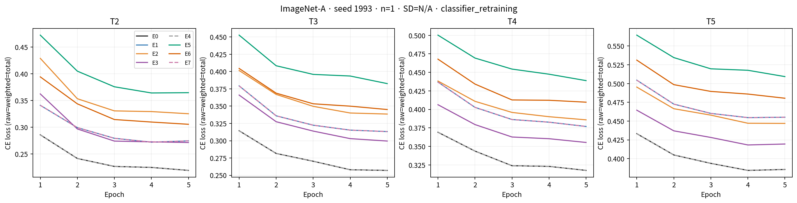

T2–T5의 synthetic replay classifier CE만 표시한다(T1에는 retraining 기록 없음). 이 stage의 classification raw=weighted=total이고 SCC·separation은 비활성이다. 같은 class당 replay 수와 5 epochs를 사용해도 replay 분포가 달라 곡선 차이를 최종 성능 우열로 곧바로 바꿀 수 없다.  
[SVG 원본](figures/loss_classifier.svg)

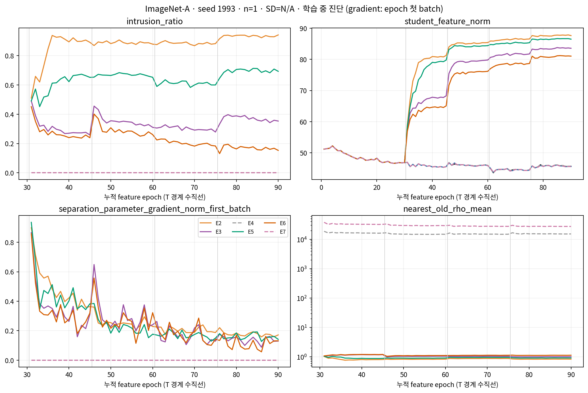

세로선은 task 경계이며 rho는 로그 축이다. E4·E7은 intrusion·loss·첫 batch gradient가 모두 0이고 full rho가 매우 커 활성 hinge 영역 밖에 있는 기록과 일치한다. E2·E3·E5·E6에서는 feature norm 최대치가 E0보다 커지지만, 이 사실만으로 폭주나 원인을 확정하지 않는다.  
[SVG 원본](figures/numerical_diagnostics.svg)

| 방법 | sep 활성/0 epoch | sep loss min–max | 첫 batch grad min–max | feature norm min–max | NaN flag/비유한 | 수치 fallback |
| --- | --- | --- | --- | --- | --- | --- |
| E0 | 0/0 | N/A–N/A | N/A–N/A | 43.58–52.23 | 0/0 | 0 |
| E1 | 0/0 | N/A–N/A | N/A–N/A | 43.77–52.23 | 0/0 | 0 |
| E2 | 60/0 | 0.12–0.23 | 0.16–0.90 | 46.64–87.85 | 0/0 | 0 |
| E3 | 60/0 | 0.03–0.11 | 0.09–0.87 | 46.64–83.78 | 0/0 | 0 |
| E4 | 60/60 | 0.00–0.00 | 0.00–0.00 | 43.58–52.23 | 0/0 | 0 |
| E5 | 60/0 | 0.06–0.15 | 0.13–0.94 | 46.64–86.68 | 0/0 | 0 |
| E6 | 60/0 | 0.01–0.10 | 0.06–0.86 | 46.64–81.20 | 0/0 | 0 |
| E7 | 60/60 | 0.00–0.00 | 0.00–0.00 | 43.77–52.23 | 0/0 | 0 |

기록된 NaN/Inf flag·검사한 수치의 비유한 값·factorization fallback은 모두 0이다. gradient는 **epoch 첫 batch의 separation 항에 한정**되어 전체 목적함수나 모든 batch의 gradient 폭주를 배제할 수 없다. full covariance에서 큰 rho·0 loss의 기하적 원인은 covariance rank, 정규화, birth tau와 변환 후 feature의 관계를 추가 점검해야 하며 현재 기록만으로 버그를 확정하지 않는다.

| 방법 | T | 첫 epoch intrusion | 마지막 epoch intrusion | task-end intrusion | task-end rho 평균 | ΔA pp |
| --- | --- | --- | --- | --- | --- | --- |
| E2 | 2 | 0.51 | 0.89 | 0.91 | 0.82 | -0.86 |
| E2 | 3 | 0.87 | 0.88 | 0.90 | 0.83 | -0.41 |
| E2 | 4 | 0.88 | 0.88 | 0.91 | 0.87 | +0.16 |
| E2 | 5 | 0.92 | 0.94 | 0.96 | 0.82 | -0.46 |
| E3 | 2 | 0.49 | 0.26 | 0.18 | 1.27 | -0.43 |
| E3 | 3 | 0.46 | 0.31 | 0.26 | 1.08 | -0.21 |
| E3 | 4 | 0.31 | 0.28 | 0.25 | 1.06 | +0.24 |
| E3 | 5 | 0.33 | 0.35 | 0.35 | 1.01 | +0.07 |
| E4 | 2 | 0.00 | 0.00 | 0.00 | 17510.71 | 0.00 |
| E4 | 3 | 0.00 | 0.00 | 0.00 | 15901.22 | 0.00 |
| E4 | 4 | 0.00 | 0.00 | 0.00 | 16258.41 | 0.00 |
| E4 | 5 | 0.00 | 0.00 | 0.00 | 16589.81 | 0.00 |
| E5 | 2 | 0.49 | 0.65 | 0.63 | 0.90 | -0.43 |
| E5 | 3 | 0.65 | 0.65 | 0.68 | 0.90 | -0.41 |
| E5 | 4 | 0.59 | 0.60 | 0.64 | 0.95 | +0.40 |
| E5 | 5 | 0.65 | 0.69 | 0.74 | 0.90 | 0.00 |
| E6 | 2 | 0.45 | 0.24 | 0.15 | 1.30 | -0.14 |
| E6 | 3 | 0.40 | 0.26 | 0.19 | 1.16 | -0.41 |
| E6 | 4 | 0.22 | 0.18 | 0.14 | 1.17 | +0.56 |
| E6 | 5 | 0.13 | 0.15 | 0.13 | 1.15 | -0.66 |
| E7 | 2 | 0.00 | 0.00 | 0.00 | 34620.55 | 0.00 |
| E7 | 3 | 0.00 | 0.00 | 0.00 | 31233.92 | -0.31 |
| E7 | 4 | 0.00 | 0.00 | 0.00 | 29908.17 | -0.16 |
| E7 | 5 | 0.00 | 0.00 | 0.00 | 29739.15 | -0.20 |

intrusion은 0–1 비율이다. task-end 값은 새 task의 train feature에 대한 분포 진단이며 test 정확도가 아니다. 학습 epoch 평균과 task-end 재계산은 시점·cache가 달라 같은 측정처럼 합치지 않았다. E6의 task-end intrusion은 E5보다 낮지만 Last-Acc도 더 낮아 intrusion 감소가 성능 개선으로 일관되게 연결되지 않는다. covariance마다 거리와 경계가 달라 방법 간 intrusion 절대값 자체도 공통 척도의 성능 점수가 아니다. E0·E1에는 대응 intrusion 진단이 없어 E0 대비 감소량은 확인 불가다.

### APR / cache feature 공간과 경계 감사

모든 separation run에서 cache 60개가 기록되어 T2–T5의 매 feature epoch 갱신과 맞고, target은 `task_k:epoch_e_cache:student_adapter_*:raw_768d`다. config와 cache의 `epoch_apr_cache`, `birth_quantile_fixed`, covariance 설정을 대조했다. 현재 구현은 corrected mean/covariance를 target 공간에 배치하고 birth tau를 유지한다. 그러나 source 태그가 텐서 변환의 정확성을 보증하는 것은 아니다. 특히 APR CSV의 source는 `task_1:task_final` 같은 축약 태그이고 target은 0-based task 및 adapter를 포함해 **번호 규약과 정보량이 다르다**. single-center cache source 태그에는 과거 birth 공간도 남을 수 있어 문자열만으로 완전 일치를 주장하지 않는다. [전체 feature-space 감사표](tables/feature_space_audit.csv)에 원문을 보존했다.

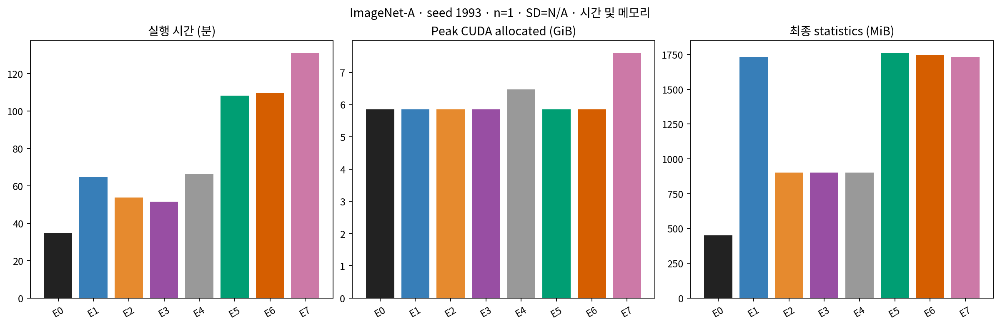

왼쪽은 데이터 로딩·통계·학습·평가·저장을 포함한 run wall time이다. E4와 E7은 대응 E0/E1과 정확도가 같아도 실행 시간이 늘었고 full cache의 GPU 비용도 증가한다. GPU 동시 점유 기록이 없어 시간 차이 전체를 알고리즘 연산량 차이로 돌릴 수 없다.  
[SVG 원본](figures/resource_costs.svg)

| 방법 | wall / E0 | 학습 함수 분 | peak allocated GiB | peak reserved GiB | statistics MiB | max cache MiB | cache 갱신 분 |
| --- | --- | --- | --- | --- | --- | --- | --- |
| E0 | 1.00× | 34.05 | 5.85 | 9.95 | 451.2 | 0.00 | 0.00 |
| E1 | 1.86× | 63.82 | 5.85 | 9.95 | 1730.8 | 0.00 | 0.00 |
| E2 | 1.55× | 52.89 | 5.85 | 9.95 | 901.8 | 0.47 | 12.29 |
| E3 | 1.48× | 50.49 | 5.85 | 9.95 | 901.8 | 0.94 | 11.33 |
| E4 | 1.90× | 65.24 | 6.47 | 10.74 | 901.8 | 360.47 | 24.78 |
| E5 | 3.11× | 106.97 | 5.85 | 9.95 | 1760.1 | 1.36 | 41.01 |
| E6 | 3.16× | 108.59 | 5.85 | 9.95 | 1746.6 | 2.69 | 41.73 |
| E7 | 3.77× | 129.72 | 7.60 | 13.59 | 1730.8 | 1022.84 | 63.17 |

전체 E0 시작→E7 종료는 10:20:44, run wall 합은 10:20:18다. `total_training_seconds`는 `incremental_train` 호출 시간으로 통계·APR·내부 평가 등이 포함되어 순수 GPU kernel 시간은 아니다. statistics는 tensor storage 추정 바이트이며 RAM peak/디스크 크기와 다르고 cache peak와 final statistics는 시점이 달라 단순 합으로 peak를 만들지 않았다.

## 9. 관찰된 변화, 한계, 다음 검증

아래는 동일 seed 차이를 직접 계산한 요인별 비교다. 공통 데이터·학습량은 확인했지만 소스 동일성은 미확정이고 full covariance 비교에는 CPU/CUDA factorization 차이가 있다. 이를 완전 통제된 인과 효과로 명명하지 않았다.

| 비교 | ΔInc pp | ΔLast pp | ΔF pp | factor 장치 차이 |
| --- | --- | --- | --- | --- |
| E1−E0 | -0.13 | -0.20 | +0.10 | 없음 |
| E2−E0 | -0.31 | -0.46 | +0.22 | 없음 |
| E3−E0 | -0.07 | +0.07 | -0.31 | 없음 |
| E4−E0 | 0.00 | 0.00 | 0.00 | 있음 |
| E5−E1 | +0.05 | +0.20 | -0.15 | 없음 |
| E6−E1 | +2.90e-03 | -0.46 | +8.19e-04 | 없음 |
| E7−E1 | 0.00 | 0.00 | 0.00 | 있음 |
| E5−E2 | +0.23 | +0.46 | -0.27 | 없음 |
| E6−E3 | -0.06 | -0.72 | +0.41 | 없음 |
| E7−E4 | -0.13 | -0.20 | +0.10 | 없음 |
| E3−E2 | +0.25 | +0.53 | -0.53 | 없음 |
| E4−E2 | +0.31 | +0.46 | -0.22 | 있음 |
| E4−E3 | +0.07 | -0.07 | +0.31 | 있음 |
| E6−E5 | -0.04 | -0.66 | +0.15 | 없음 |
| E7−E5 | -0.05 | -0.20 | +0.15 | 있음 |
| E7−E6 | -2.90e-03 | +0.46 | -8.19e-04 | 있음 |

E1−E0에서는 Multi-Center만 추가해 두 정확도가 낮아졌다. single-center separation 중 E3만 Last-Acc가 증가하고 E2는 두 지표가 낮아지며 E4는 동일하다. multi-center 상태에서 E5−E1은 Inc·Last 모두 증가하지만 E0의 Inc-Acc까지 넘지는 못한다. E6−E1은 Inc가 약간 증가하나 Last가 감소하고 E7−E1은 동일하다. 같은 covariance의 MC 추가 효과는 isotropic(E5−E2)에서는 양수, diagonal(E6−E3)에서는 음수로 일관되지 않는다.

다음 검증 우선순위는 (1) 나머지 seed를 확보해 동일 seed paired Δ의 표본 SD를 계산, (2) full rho·birth tau·저랭크 covariance 및 feature 변환을 별도로 감사, (3) snapshot 코드와 factor 장치를 고정해 재현성 확인, (4) E3의 old/new trade-off와 E6의 마지막 task 역전을 class별 counts로 추적하는 것이다. 이번 작업은 새 학습이나 방법 변경을 포함하지 않는다. 추가 seed의 결과가 나오기 전에는 E3의 1개 정답 증가를 일반적인 성능 향상으로 주장할 수 없다.

## 10. 부록: 원자료, 정의, 출처 및 재생성

`a(t,i)=100×correct(t,i)/N_i`는 task t의 모든 학습 종료 모델을 task i의 test samples에 평가하되 후보는 모든 seen classes다. `Δ_m,s(t,i)=a_m,s(t,i)−a_E0,s(t,i)`이다. `A(t)=100×Σ_i correct(t,i)/Σ_i N_i`, `Inc-Acc=mean_t A(t)`, `Last-Acc=A(T)`, `F_i=max_{u=i..T−1}a(u,i)−a(T,i)`, `Forgetting=mean_{i<T}F_i`를 사용했다. old는 i<t, new는 i=t의 correct/sample 합이고 T1 old는 N/A다. 정확도 단위 %, 차이·forgetting 단위 pp; memory MiB=2²⁰ bytes, GiB=2³⁰ bytes다. 음수 forgetting을 보정하지 않는다.

이 보고서는 seed 1993 고정 snapshot이다. n=1이므로 모든 SD는 N/A이며 그림에 오차 막대를 그리지 않았다. 여러 seed 분석으로 확장할 때에는 공통 완료 seed를 먼저 선정하고, 평균 Δ와 표본 SD(ddof=1)를 **seed별 paired Δ에서 직접** 계산해야 한다. 현재 스크립트는 나중에 발견한 다른 seed를 이 보고서에 자동으로 섞지 않는다.

| 자료 | 파일 |
| --- | --- |
| 재계산 성능 및 시간·메모리 | [metrics_per_seed.csv](tables/metrics_per_seed.csv) |
| 각 task A/old/new 및 E0 차이 | [task_metrics_recomputed.csv](tables/task_metrics_recomputed.csv) |
| 정확도 셀·paired Δ·셀별 SD=N/A | [cells_per_seed_and_sd.csv](tables/cells_per_seed_and_sd.csv) |
| task별 forgetting | [forgetting_per_task.csv](tables/forgetting_per_task.csv) |
| 원본 class별 최종 Δ | [class_final_deltas.csv](tables/class_final_deltas.csv) |
| 전체 K-means class 표 | [kmeans_all_classes.csv](tables/kmeans_all_classes.csv) |
| 원본 epoch loss | [raw_epoch_metrics.csv](tables/raw_epoch_metrics.csv) |
| 수치 진단 | [numerical_diagnostics.csv](tables/numerical_diagnostics.csv) |
| 요인별 paired 비교 | [controlled_contrasts.csv](tables/controlled_contrasts.csv) |
| 검산 목록 | [validation_checks.csv](tables/validation_checks.csv) |
| 출처·SHA-256·단위·누락 | [metadata.json](metadata.json) |

절대/차이 행렬은 `tables/E{0..7}_absolute_matrix.csv`, `tables/E{0..7}_delta_E0_matrix.csv`이며 미래 셀은 빈 값이다. 원본 CSV는 `tables/raw_*.csv`로 함께 제공한다. metadata의 SHA-256은 보고서 생성 시 읽은 기록의 해시이고 당시 실행 코드의 동일성 증거로 대체하지 않는다. checkpoint는 manifest와 파일 존재/크기를 확인했으며 큰 binary 내용은 읽지 않았다.

출처 구현: `trainer.py`의 task-final 집계·forgetting, `models/base.py`의 all-logit 평가 및 class당 replay, `models/CDS_adapter.py`의 stage loss·APR/cache, `utils/distribution_regions.py`의 K 축소 정책, `RECORDING_SCHEMA_KO.md`의 기록 규약을 현재 파일과 대조했다. 실행 당시 dirty 소스 전문이 저장된 것은 아니므로 현재 코드 해석에는 앞서 언급한 한계가 있다. 해시와 경로는 metadata에 보존한다.

재생성(Python ≥3.9, numpy, matplotlib; pandas/GPU 불필요):

```bash
conda activate cds
python ${RESEARCH_WORKSPACE}/structure_multicenter_separation/reports/e0_comparison_20260916/build_report.py \
  --project-root ${RESEARCH_WORKSPACE}/structure_multicenter_separation \
  --output-dir ${RESEARCH_WORKSPACE}/structure_multicenter_separation/reports/e0_comparison_20260916
```

현재 환경에서 사용한 명시적 interpreter는 `${RESEARCH_WORKSPACE}/miniconda3/envs/cds/bin/python`이다. 다른 곳으로 이동한 보고서에서도 그림과 표 링크는 상대경로로 유지된다. 재생성에는 `--project-root`로 원본 기록이 있는 프로젝트를 지정한다.
