# Paired Source Prediction Diagnostic

## 1. 설계와 재현 검사

- IA10/CAR10, seed 1993, final T10; 동일 test sample ID에 세 matched head를 평가했다.
- h_A/h_B는 기존 R256/G256 설정으로 재현했고 기존 집계 정확도와 차이 1e-6pp 이내를 확인한 후 paired 분석을 시작했다.
- h_C는 old source만 stored/APR Gaussian으로 바꾸고 256/class, new bank, pre-CA 초기 head, label 순서, batch 경계, optimizer와 step을 동일하게 했다.
- Coverage support는 별도 unique-reference bank 실험의 B/C 3회 draw 평균이다. Head 학습의 256/class Gaussian draw와 동일 sample을 뜻하지 않는다.
- Support-loss 상위 20% 기준은 test support-loss의 80th percentile을 정답 여부와 무관하게 계산했다.
- Confidence interval은 동일 sample 단위 paired bootstrap이다. 단일 seed 결과이며 causal mediation 검증이 아니다.

## 2. 전체 paired prediction 결과

| Protocol | 비교 | Winner acc | Loser acc | Repair | Harm | Net gain | Disagreement | 95% CI for net | Class-macro net |
|---|---|---:|---:|---:|---:|---:|---:|---|---:|
| IA10 | AB | 64.78% | 64.71% | 1.97% | 1.91% | +0.07pp | 6.91% | [-0.86, +1.05]pp | -0.97pp |
| IA10 | BC | 64.71% | 64.38% | 1.65% | 1.32% | +0.33pp | 5.60% | [-0.46, +1.18]pp | -0.03pp |
| CAR10 | AB | 80.62% | 79.73% | 2.24% | 1.34% | +0.90pp | 5.50% | [+0.50, +1.29]pp | +0.87pp |
| CAR10 | BC | 79.73% | 78.56% | 2.85% | 1.68% | +1.17pp | 6.84% | [+0.70, +1.62]pp | +1.18pp |

AB는 B wrong→A correct가 Repair, BC는 C wrong→B correct가 Repair다. 모든 행에서 `Net gain = Repair − Harm = Winner accuracy − Loser accuracy` 검사를 통과했다.

## 3. IA10: 집단별 분석

| 비교 | 집단 | N | Repair | Harm | Net | 전체 정확도 기여 | Disagreement | Class-macro |
|---|---|---:|---:|---:|---:|---:|---:|---:|
| AB | all | 1519 | 1.97% | 1.91% | +0.07pp | +0.07pp | 6.91% | -0.97pp |
| AB | old | 1395 | 2.08% | 1.94% | +0.14pp | +0.13pp | 7.03% | -0.99pp |
| AB | new | 124 | 0.81% | 1.61% | -0.81pp | -0.07pp | 5.65% | -0.83pp |
| AB | support_signflip | 86 | 3.49% | 11.63% | -8.14pp | -0.46pp | 15.12% | -8.60pp |
| AB | support_loss_top20 | 304 | 2.63% | 3.95% | -1.32pp | -0.26pp | 8.22% | -3.04pp |
| AB | support_loss_top20_old | 300 | 2.67% | 4.00% | -1.33pp | -0.26pp | 8.00% | -3.17pp |
| AB | support_loss_top20_new | 4 | 0.00% | 0.00% | +0.00pp | +0.00pp | 25.00% | +0.00pp |
| BC | all | 1519 | 1.65% | 1.32% | +0.33pp | +0.33pp | 5.60% | -0.03pp |
| BC | old | 1395 | 1.65% | 1.29% | +0.36pp | +0.33pp | 5.59% | -0.06pp |
| BC | new | 124 | 1.61% | 1.61% | +0.00pp | +0.00pp | 5.65% | +0.24pp |
| BC | support_signflip | 104 | 4.81% | 0.00% | +4.81pp | +0.33pp | 5.77% | +3.53pp |
| BC | support_loss_top20 | 304 | 2.96% | 0.99% | +1.97pp | +0.39pp | 5.92% | -0.33pp |
| BC | support_loss_top20_old | 303 | 2.97% | 0.66% | +2.31pp | +0.46pp | 5.61% | +0.67pp |
| BC | support_loss_top20_new | 1 | 0.00% | 100.00% | -100.00pp | -0.07pp | 100.00% | -100.00pp |

### Support loss와 예측 변화의 정렬

| 비교 | 예측 그룹 | N | Support loss mean | Median | q25 | q75 |
|---|---|---:|---:|---:|---:|---:|
| AB | repair | 30 | +0.0138 | +0.0189 | -0.0087 | +0.0351 |
| AB | harm | 29 | +0.0242 | +0.0242 | +0.0006 | +0.0530 |
| AB | both_correct | 954 | +0.0095 | +0.0094 | -0.0144 | +0.0316 |
| AB | both_wrong | 506 | +0.0009 | +0.0018 | -0.0180 | +0.0220 |
| BC | repair | 25 | +0.0177 | +0.0168 | -0.0038 | +0.0433 |
| BC | harm | 20 | -0.0033 | -0.0067 | -0.0219 | +0.0063 |
| BC | both_correct | 958 | +0.0056 | +0.0033 | -0.0142 | +0.0245 |
| BC | both_wrong | 516 | +0.0029 | +0.0004 | -0.0179 | +0.0224 |

Support loss는 AB에서 `support_A−support_B`, BC에서 `support_B−support_C`다. 이 집단 비교는 상관 설명이며 인과 매개효과가 아니다.

### 시각화

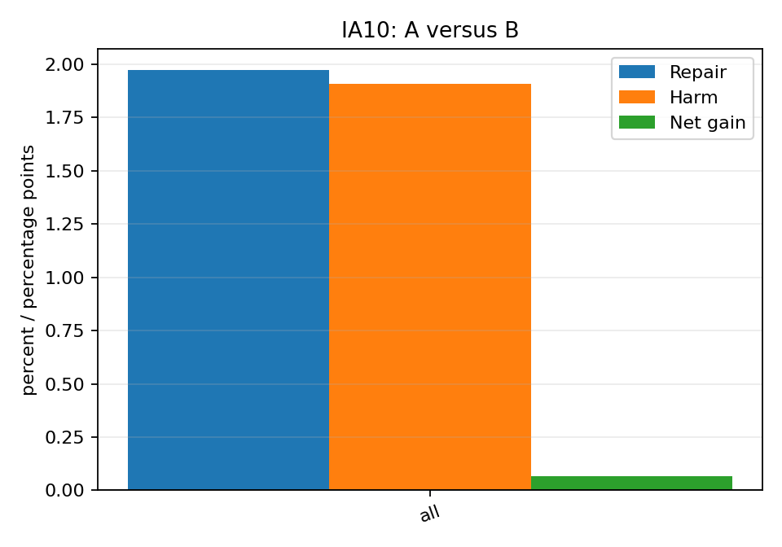

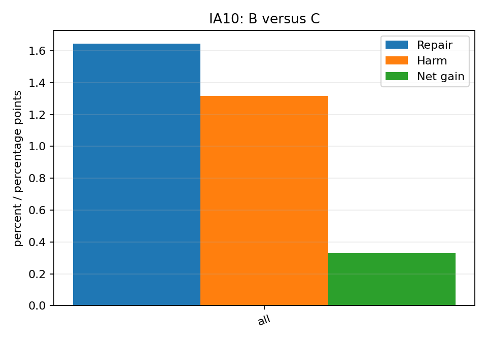

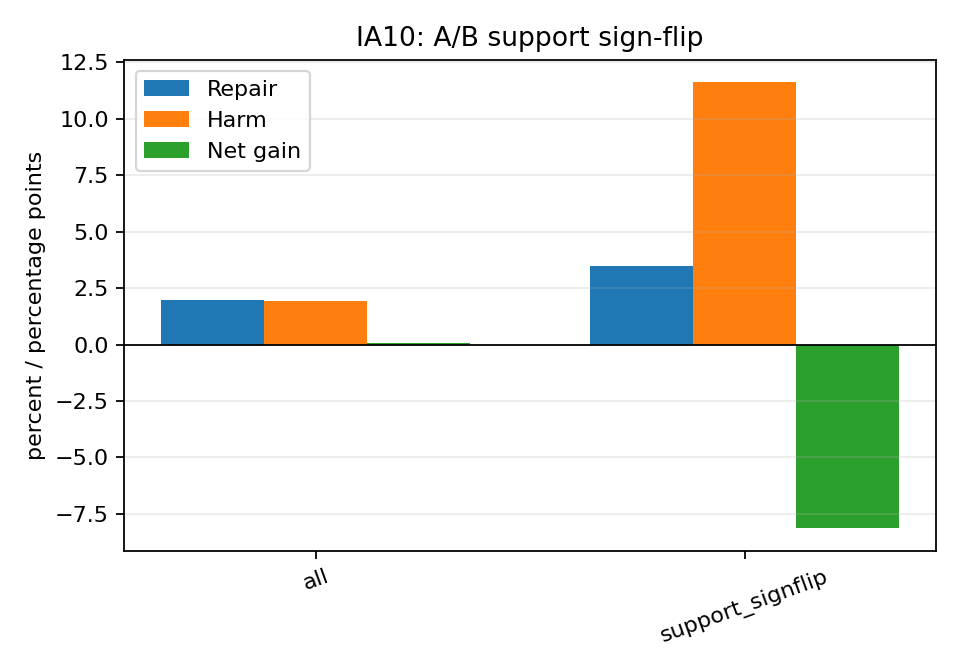

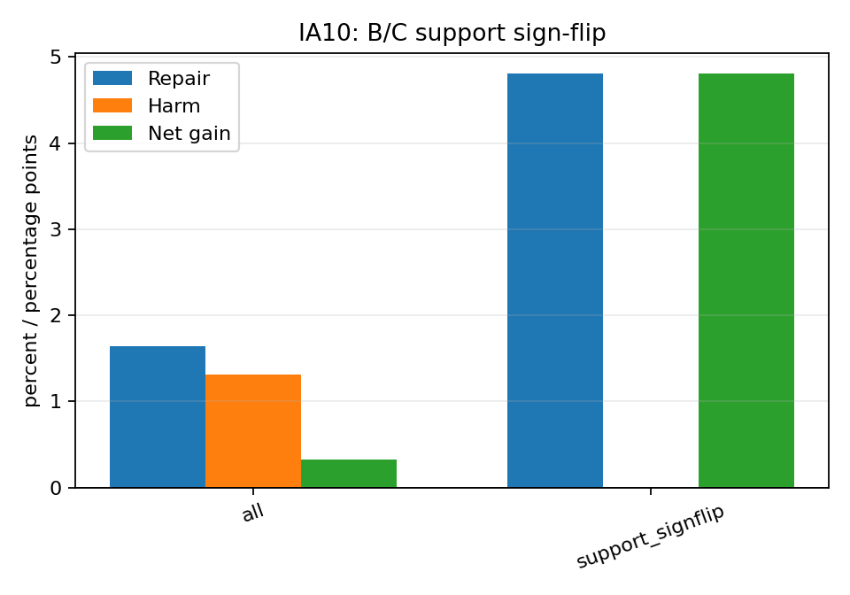

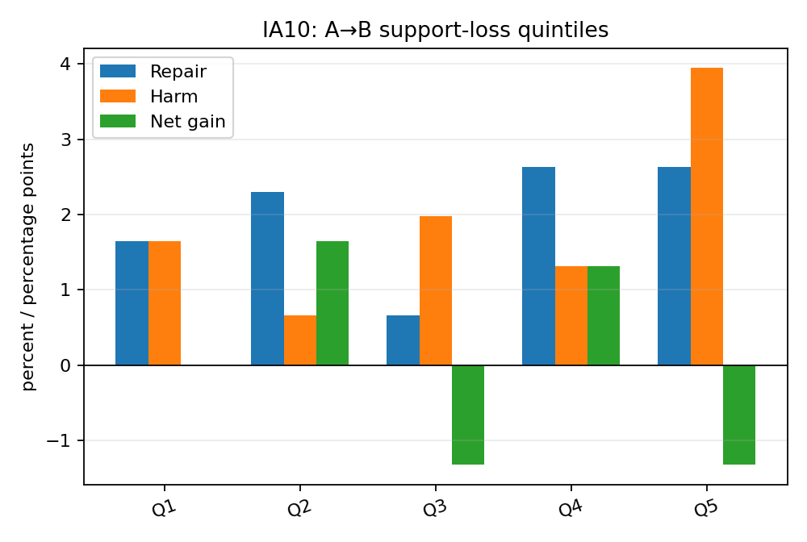

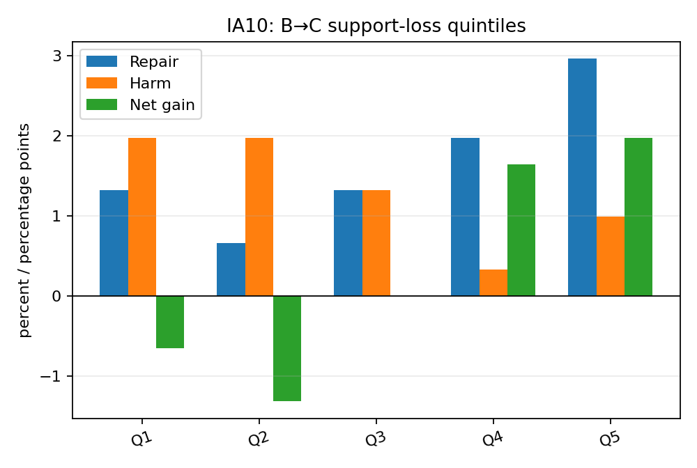

IA10의 class별 결과는 [`class_macro_summary.csv`](IA10/class_macro_summary.csv), quintile별 정확한 값은 [`support_loss_quantile_summary.csv`](IA10/support_loss_quantile_summary.csv)에 있다.

## 4. CAR10: 집단별 분석

| 비교 | 집단 | N | Repair | Harm | Net | 전체 정확도 기여 | Disagreement | Class-macro |
|---|---|---:|---:|---:|---:|---:|---:|---:|
| AB | all | 8041 | 2.24% | 1.34% | +0.90pp | +0.90pp | 5.50% | +0.87pp |
| AB | old | 7262 | 2.26% | 1.36% | +0.90pp | +0.81pp | 5.55% | +0.88pp |
| AB | new | 779 | 2.05% | 1.16% | +0.90pp | +0.09pp | 5.01% | +0.78pp |
| AB | support_signflip | 689 | 4.21% | 2.76% | +1.45pp | +0.12pp | 7.40% | +1.99pp |
| AB | support_loss_top20 | 1609 | 1.49% | 0.99% | +0.50pp | +0.10pp | 3.85% | +0.49pp |
| AB | support_loss_top20_old | 1609 | 1.49% | 0.99% | +0.50pp | +0.10pp | 3.85% | +0.49pp |
| BC | all | 8041 | 2.85% | 1.68% | +1.17pp | +1.17pp | 6.84% | +1.18pp |
| BC | old | 7262 | 3.02% | 1.71% | +1.31pp | +1.18pp | 7.02% | +1.32pp |
| BC | new | 779 | 1.28% | 1.41% | -0.13pp | -0.01pp | 5.13% | -0.14pp |
| BC | support_signflip | 1030 | 5.05% | 1.65% | +3.40pp | +0.44pp | 7.18% | +0.92pp |
| BC | support_loss_top20 | 1609 | 4.29% | 0.50% | +3.79pp | +0.76pp | 6.22% | +3.15pp |
| BC | support_loss_top20_old | 1609 | 4.29% | 0.50% | +3.79pp | +0.76pp | 6.22% | +3.15pp |

### Support loss와 예측 변화의 정렬

| 비교 | 예측 그룹 | N | Support loss mean | Median | q25 | q75 |
|---|---|---:|---:|---:|---:|---:|
| AB | repair | 180 | +0.0034 | +0.0046 | -0.0164 | +0.0257 |
| AB | harm | 108 | +0.0083 | +0.0105 | -0.0101 | +0.0239 |
| AB | both_correct | 6303 | +0.0125 | +0.0111 | -0.0088 | +0.0326 |
| AB | both_wrong | 1450 | +0.0023 | +0.0026 | -0.0178 | +0.0237 |
| BC | repair | 229 | +0.0245 | +0.0228 | +0.0041 | +0.0426 |
| BC | harm | 135 | -0.0051 | -0.0037 | -0.0236 | +0.0130 |
| BC | both_correct | 6182 | +0.0130 | +0.0101 | -0.0087 | +0.0330 |
| BC | both_wrong | 1495 | +0.0074 | +0.0061 | -0.0112 | +0.0247 |

Support loss는 AB에서 `support_A−support_B`, BC에서 `support_B−support_C`다. 이 집단 비교는 상관 설명이며 인과 매개효과가 아니다.

### 시각화

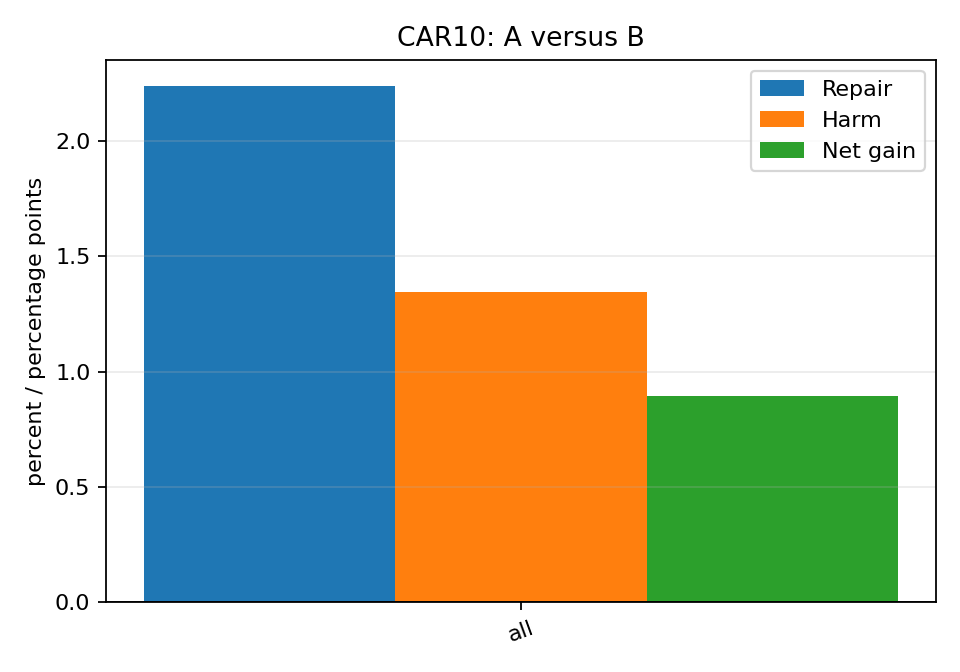

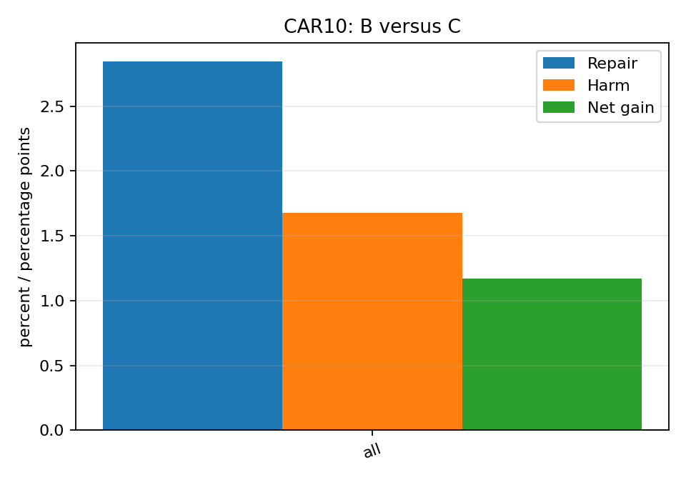

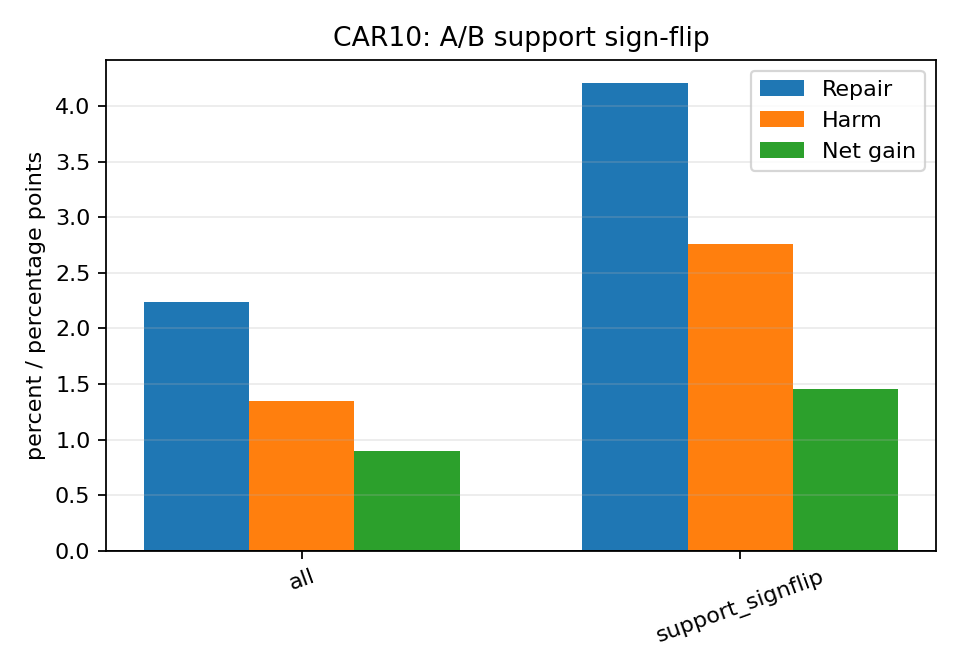

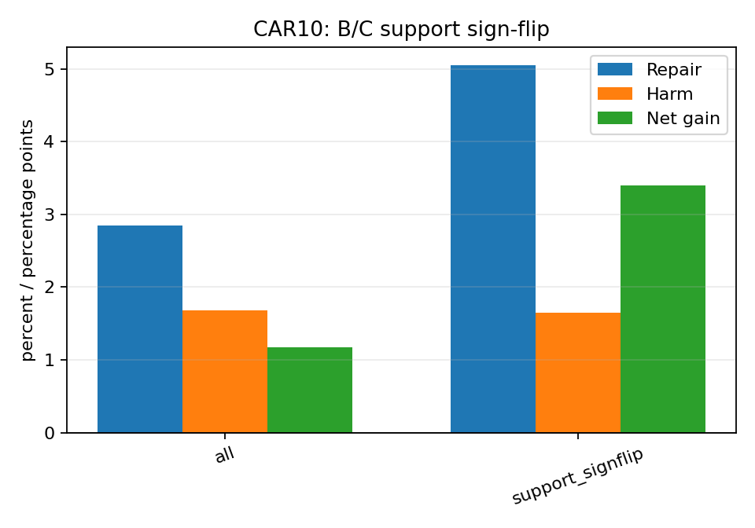

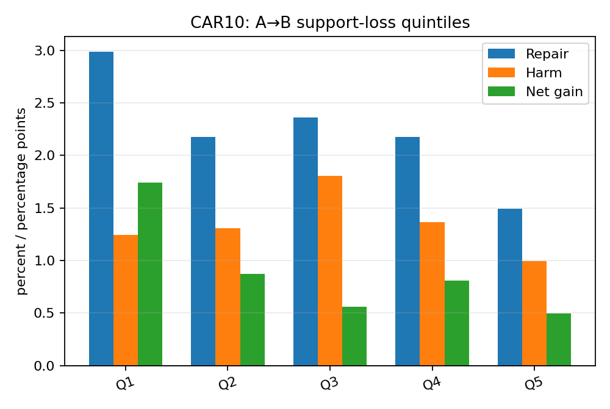

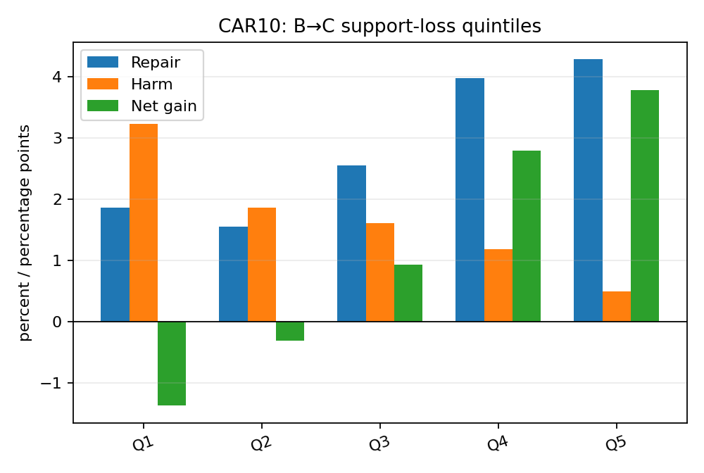

CAR10의 class별 결과는 [`class_macro_summary.csv`](CAR10/class_macro_summary.csv), quintile별 정확한 값은 [`support_loss_quantile_summary.csv`](CAR10/support_loss_quantile_summary.csv)에 있다.

## 5. 최종 판정

| 비교 | 공통 예측 이득 | 근거 | Prototype ready | Method ready |
|---|---|---|---|---|
| AB | False | IA10: net=+0.07pp, macro=-0.97pp, old/new=+0.14/-0.81pp, high-loss contribution=-0.26pp; CAR10: net=+0.90pp, macro=+0.87pp, old/new=+0.90/+0.90pp, high-loss contribution=+0.10pp | NO | NO |
| BC | False | IA10: net=+0.33pp, macro=-0.03pp, old/new=+0.36/+0.00pp, high-loss contribution=+0.39pp; CAR10: net=+1.17pp, macro=+1.18pp, old/new=+1.31/-0.13pp, high-loss contribution=+0.76pp | NO | NO |

**PROTOTYPE READY = NO; METHOD READY = NO. No oracle-free prototype or independent-seed/transition validation was performed.**

판정 기준은 repair/harm의 실제 순이득, class-macro, old/new, high-loss 집단의 전체 기여도와 두 dataset의 일관성이다. Geometry 차이만으로 prototype 또는 method 단계로 넘어가지 않는다.

## 6. 질문별 답변

### IA10

1. A/B prediction disagreement는 **6.91%**이고, B→A repair는 **1.97%** (30개), harm은 **1.91%** (29개)다.
2. A−B 순이득은 **+0.07pp**다. Repair와 harm의 절대 크기, disagreement를 보면 예측 변화가 전혀 없는 상황인지 상쇄되는 상황인지 구분된다.
3. A/B sign-flip 86개에서 순이득은 **-8.14pp**, 전체 기여는 **-0.46pp**다. Support-loss Q1→Q5 순이득은 **+0.00→-1.32pp**다.
4. A/B high-loss 304개의 순이득은 **-1.32pp**, 전체 기여는 **-0.26pp**다. Old/New은 **+0.14/-0.81pp**, class-macro는 **-0.97pp**다.
5. B/C prediction disagreement는 **5.60%**이고, C→B repair/harm은 **1.65/1.32%**다. B−C 순이득은 **+0.33pp**다.
6. B/C sign-flip 104개의 전체 기여는 **+0.33pp**, high-loss 304개의 기여는 **+0.39pp**다. Q1→Q5 순이득은 **-0.66→+1.97pp**이며, Old/New은 **+0.36/+0.00pp**, class-macro는 **-0.03pp**다.

### CAR10

1. A/B prediction disagreement는 **5.50%**이고, B→A repair는 **2.24%** (180개), harm은 **1.34%** (108개)다.
2. A−B 순이득은 **+0.90pp**다. Repair와 harm의 절대 크기, disagreement를 보면 예측 변화가 전혀 없는 상황인지 상쇄되는 상황인지 구분된다.
3. A/B sign-flip 689개에서 순이득은 **+1.45pp**, 전체 기여는 **+0.12pp**다. Support-loss Q1→Q5 순이득은 **+1.74→+0.50pp**다.
4. A/B high-loss 1609개의 순이득은 **+0.50pp**, 전체 기여는 **+0.10pp**다. Old/New은 **+0.90/+0.90pp**, class-macro는 **+0.87pp**다.
5. B/C prediction disagreement는 **6.84%**이고, C→B repair/harm은 **2.85/1.68%**다. B−C 순이득은 **+1.17pp**다.
6. B/C sign-flip 1030개의 전체 기여는 **+0.44pp**, high-loss 1609개의 기여는 **+0.76pp**다. Q1→Q5 순이득은 **-1.37→+3.79pp**이며, Old/New은 **+1.31/-0.13pp**, class-macro는 **+1.18pp**다.

두 dataset을 함께 보면 A/B의 support-loss가 큰 sample에서 A가 더 잘 맞히는 패턴은 유지되지 않는다. B/C는 CAR10에서 support-loss와 prediction recovery가 정렬되지만 IA10에서는 전체·class-macro 이득이 작다. 따라서 source 효과와 현재 support metric의 설명력을 동일시하지 않는다.

Q10 판정: **PROTOTYPE READY = NO; METHOD READY = NO. No oracle-free prototype or independent-seed/transition validation was performed.**

## 7. 산출물과 한계

- [`audit.md`](audit.md)
- [`cross_protocol/final_summary.csv`](cross_protocol/final_summary.csv)
- [`cross_protocol/decision_table.csv`](cross_protocol/decision_table.csv)
- 각 protocol의 `paired_source_prediction_table.csv`와 `matched_scores.npz`에 동일 sample ID 순서의 예측 및 score를 보존했다.
- A의 256/class exposure에는 actual feature replacement가 포함된다. Coverage A의 unique-reference bank와 역할이 다르다.
- B/C support 평균은 분류 head 학습의 Gaussian draw와 독립적이다. Support 정렬은 설명적이다.
- 단일 final task와 seed 1993에 한정된다. Method-ready에는 oracle 없는 개입과 독립 검증이 추가로 필요하다.
