# Structure 5-Task vs 10-Task 가설 재검증 최종 보고서

작성일: 2026-10-01  
실행 GPU: physical GPU 4 → process-local `cuda:0`  
Seed: 1993  
대상: IA5, IA10, CAR5, CAR10  
실행 상태: **정상 완료** (`status=complete`)  
총 실행 시간: **1,223.8초 (약 20분 24초)**

## 1. 결론 요약

10-task에서 새롭게 주병목으로 부활한 단일 가설은 확인되지 않았다.

가장 중요한 결과는 다음과 같다.

1. Stored/APR prototype 오차와 covariance mismatch는 class age와 함께 분명히 누적됐다.
2. 그러나 같은 age 1~4끼리 비교하면 10-task의 오차가 5-task보다 대체로 작았다. 10-task final 평균이 나빠진 주된 이유는 age 5~9인 더 오래된 class가 존재하기 때문이다.
3. Prototype tracking cosine은 IA10 `0.9927`, CAR10 `0.9885`로 여전히 높았고, Oracle mean/covariance 교체의 성능 이득도 작거나 데이터셋 의존적이었다.
4. Gaussian 대신 actual feature를 사용한 공정한 `R256-G256` 차이는 IA10 `+0.066pp`, CAR10 `+0.895pp`였다. Gaussian approximation을 공통 주병목으로 보기는 어렵다.
5. 오류는 task가 늘수록 소수 pair에 집중되지 않고 더 넓게 분산됐다. T10의 Top-20 directional-pair error share는 IA10 `8.40%`, CAR10 `13.30%`였다.
6. 9개 transition 모두에서 boundary improvement mass가 degradation mass보다 컸다. Newly-degraded relation이 누적 오류를 지배한다는 가설은 지지되지 않았다.
7. Stored gamma는 Oracle gamma를 매우 잘 재현했지만, positive degradation을 ranking하는 능력은 약했다.
8. 가장 일관되게 남은 현상은 **held-out generalization / neighborhood coverage 문제**였다. 다만 이 현상이 10-task에서 크게 새로 악화됐다기보다 5-task와 10-task 모두에서 강하게 반복됐다.
9. Single-head old/new competition은 task index와 함께 증가했다. 이는 broad coverage와 함께 남는 보조 설명이지만, candidate class 수 증가와 new-only 평가가 더 쉬워지는 효과가 섞여 있으므로 단독 인과 해석은 불가능하다.

최종 선택은 **F. broad generalization / coverage**이며, **D. classifier/single-head competition**이 보조적인 설명이다.

## 2. 실행 무결성 및 비교 조건

- IA10/CAR10의 T1~T10 checkpoint와 pre-CA classifier sidecar가 모두 존재했다.
- IA10/CAR10 각각 9개 transition을 모두 분석했다.
- Same-sample transition은 canonical sample ID로 연결했다.
- 이전/현재 feature에는 현재 task의 동일한 Structure cosine head를 공통 readout으로 사용했다.
- A/B/C/D Oracle classifier adaptation의 Condition A 재현 검사는 IA5, IA10, CAR5, CAR10 모두 `PASS`였다.
- G256/R256은 동일 pre-CA head, class당 256개 exposure, label sequence, optimizer step, schedule, current/new bank를 사용했다.
- Test label은 hyperparameter 선택에 사용하지 않았다.
- 모든 phase에서 checkpoint fingerprint가 실행 전후 동일했다.
- 기존 CIL checkpoint를 덮어쓰거나 새로 학습하지 않았다.

## 3. Final-task 핵심 비교

| Metric | IA5 T5 | IA10 T10 | CAR5 T5 | CAR10 T10 |
|---|---:|---:|---:|---:|
| Seen accuracy (%) | 66.425 | 64.648 | 81.196 | 78.958 |
| Old tracking cosine | 0.9944 | 0.9927 | 0.9925 | 0.9885 |
| Old tracking relative L2 | 0.1007 | 0.1100 | 0.1087 | 0.1328 |
| Oracle nearest-rival cosine | 0.6913 | 0.7364 | 0.7762 | 0.8256 |
| Old covariance relative error | 0.2984 | 0.3529 | 0.2939 | 0.4034 |
| Oracle covariance only, C-A (pp) | -0.066 | +0.132 | +0.025 | +0.075 |
| Full Oracle, D-A (pp) | -0.329 | -0.066 | +0.672 | +1.107 |
| Matched actual vs Gaussian, R256-G256 (pp) | -0.066 | +0.066 | +0.547 | +0.895 |
| New-only − single-head new (pp) | 16.974 | 17.742 | 10.526 | 14.891 |
| Top-20 pair error share | 0.0882 | 0.0840 | 0.1276 | 0.1330 |
| Test wrong-sample 5-NN purity | 0.125 | 0.119 | 0.169 | 0.169 |

IA10/CAR10 final accuracy는 각각 5-task보다 `1.78pp`, `2.24pp` 낮았다. 다만 task당 class 수, transition 수, class-age 분포가 동시에 달라졌으므로 이 차이를 transition 누적의 순수 인과효과로 해석할 수는 없다.

## 4. Prototype tracking과 class age

### 4.1 Final-task old class

| Protocol | Tracking cosine mean | Relative L2 mean | Relative L2 median | Relative L2 90% quantile |
|---|---:|---:|---:|---:|
| IA5 | 0.9944 | 0.1007 | 0.0975 | 0.1607 |
| IA10 | 0.9927 | 0.1100 | 0.1075 | 0.1976 |
| CAR5 | 0.9925 | 0.1087 | 0.0914 | 0.1939 |
| CAR10 | 0.9885 | 0.1328 | 0.1149 | 0.2466 |

10-task final 평균은 5-task보다 나빴지만 cosine은 모두 `0.988` 이상으로 높았다.

### 4.2 Age 누적

10-task old class 전체에서 age와 tracking relative L2의 Spearman 상관은 IA10 `ρ=0.803`, CAR10 `ρ=0.845`였다. Age별 평균은 다음처럼 증가했다.

| Age | IA10 relative L2 | CAR10 relative L2 |
|---:|---:|---:|
| 1 | 0.0575 | 0.0565 |
| 2 | 0.0805 | 0.0843 |
| 3 | 0.0999 | 0.1105 |
| 4 | 0.1177 | 0.1352 |
| 5 | 0.1334 | 0.1607 |
| 6 | 0.1496 | 0.1869 |
| 7 | 0.1647 | 0.2116 |
| 8 | 0.1772 | 0.2389 |
| 9 | 0.2046 | 0.2700 |

하지만 matched-age 비교에서는 반대 패턴이 나타났다. Age 4의 relative L2는 IA5 `0.1570` 대 IA10 `0.1177`, CAR5 `0.1877` 대 CAR10 `0.1352`였다. 즉:

> tracking 오차는 class가 old 상태로 오래 남을수록 누적되지만, 동일 age에서 10-task protocol 자체가 더 나쁘다는 증거는 없다.

10-task final 악화는 주로 5-task에는 존재하지 않는 age 5~9 class의 포함 효과다.

### 4.3 APR 효과

- IA10: pre-APR relative error `0.1920` → post-APR `0.1086`; 분석된 old class의 `100%`에서 error 감소.
- CAR10: `0.1918` → `0.1271`; `99.44%`에서 error 감소.

APR은 10-task에서도 대부분 올바른 방향으로 작동했다.

### 4.4 시각화

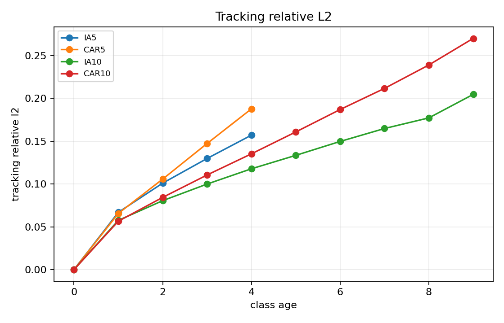

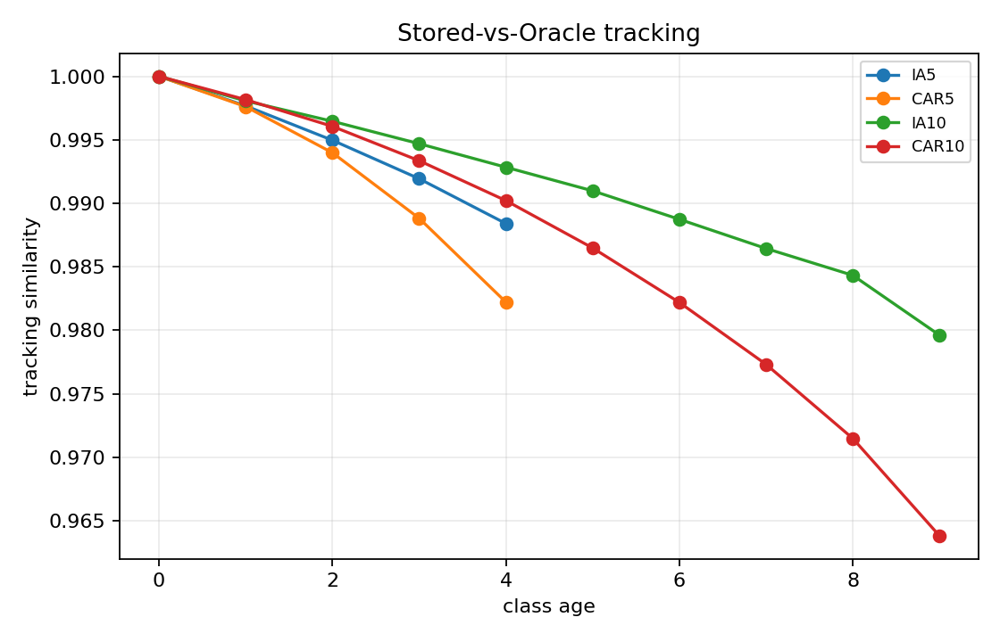

## 5. Temporal self-similarity와 inter-class crowding

Oracle temporal self-similarity 평균은 IA5 `0.9816`, IA10 `0.9860`, CAR5 `0.9894`, CAR10 `0.9889`였다. Stored 값도 각각 `0.9832`, `0.9870`, `0.9908`, `0.9898`로 Oracle과 가까웠다.

10-task에서 transition당 같은 class center 이동이 일관되게 더 커졌다는 증거는 없다. 오히려 IA에서는 10-task의 한-step temporal similarity가 더 높았다. 이는 장기 tracking residual의 누적과 한 transition의 drift 크기가 서로 다른 개념임을 보여준다.

반면 final Oracle nearest-rival similarity는 증가했다.

- IA: `0.6913 → 0.7364`
- CAR: `0.7762 → 0.8256`

Task 진행에 따라서도 IA10 `0.5362 → 0.7364`, CAR10 `0.6262 → 0.8256`로 상승했다. 다만 age와 nearest-rival similarity의 Spearman 상관은 IA10 `0.249`, CAR10 `0.059`에 불과했다. 특히 오류 집중도도 증가하지 않았으므로, 이 결과는 특정 위험 pair의 생성보다는 전체 class 수 증가와 broad crowding에 더 가깝다.

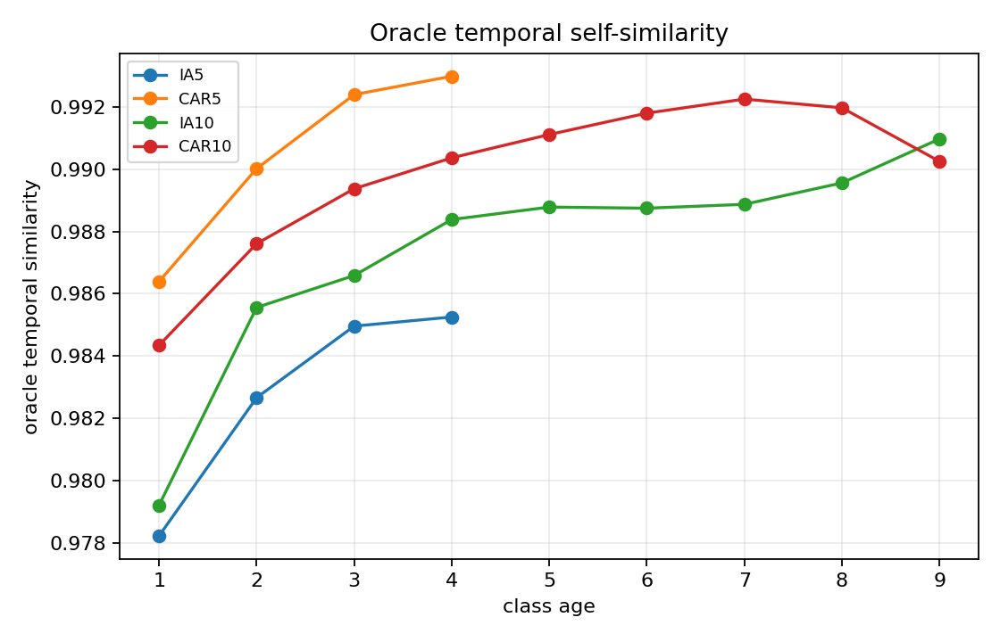

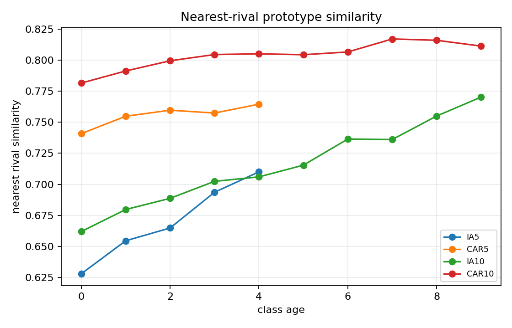

## 6. Covariance mismatch와 Oracle moment replacement

### 6.1 Mismatch 누적

Final old-class covariance relative error는 IA10 `0.3529`, CAR10 `0.4034`로 5-task보다 컸다. Age와의 Spearman 상관도 IA10 `0.761`, CAR10 `0.845`로 높았다.

그러나 tracking과 마찬가지로 matched age에서는 대부분 10-task가 더 작았다. Age 4 covariance error는 IA5 `0.5162` 대 IA10 `0.3903`, CAR5 `0.5016` 대 CAR10 `0.4192`였다.

### 6.2 A/B/C/D 성능 효과

| Protocol | A Structure | B Oracle mean | C Oracle covariance | D Full Oracle | B-A | C-A | D-A |
|---|---:|---:|---:|---:|---:|---:|---:|
| IA10 | 64.648 | 64.582 | 64.779 | 64.582 | -0.066 | +0.132 | -0.066 |
| CAR10 | 78.958 | 79.493 | 79.032 | 80.065 | +0.535 | +0.075 | +1.107 |

Covariance mismatch는 커졌지만 covariance만 Oracle로 바꾼 C-A 효과는 두 데이터셋 모두 `0.14pp` 미만이었다. CAR10의 Full Oracle `+1.107pp`는 mean/covariance 결합 효과의 가능성을 보여주지만 IA10에서는 재현되지 않았다.

따라서 결론은 다음과 같다.

> Covariance mismatch 누적은 실재하지만, 이를 공통 주병목으로 볼 성능 근거는 부족하다.

초기 자동 heuristic의 `REVIVED AT 10-TASK` 판정보다는 `PARTIALLY SUPPORTED`가 타당하다.

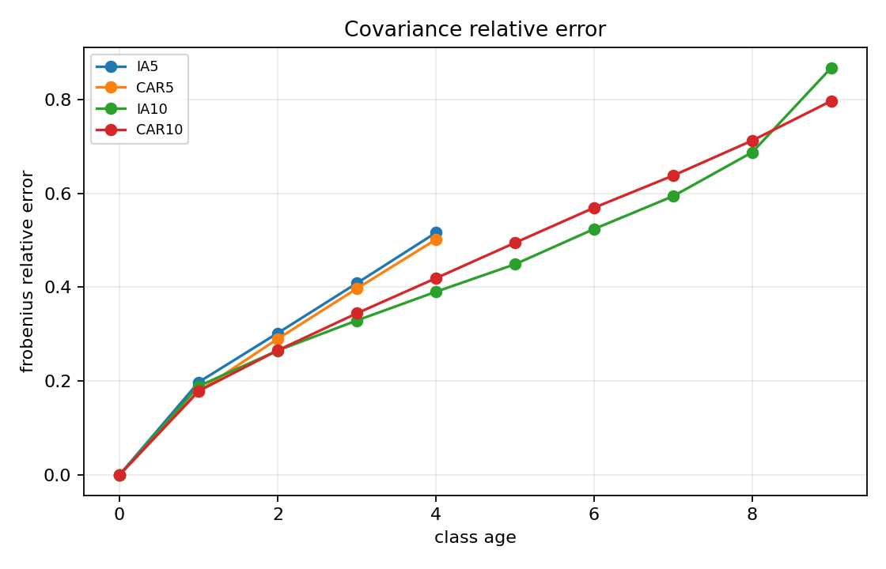

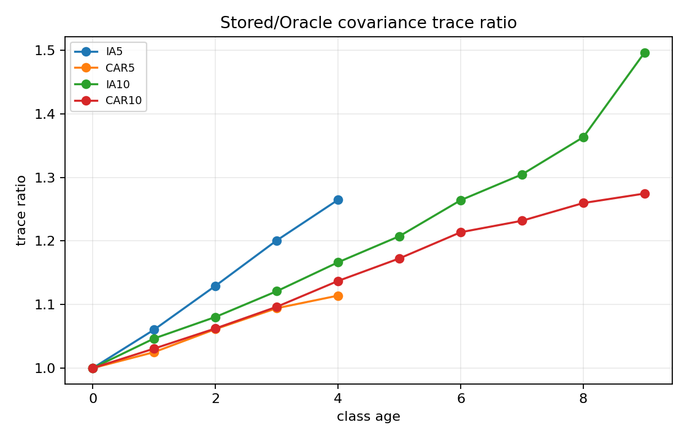

## 7. Gaussian vs actual feature source

공정하게 exposure와 optimizer step을 맞춘 결과:

| Protocol | G256 seen | R256 seen | R256-G256 |
|---|---:|---:|---:|
| IA5 | 66.689 | 66.623 | -0.066pp |
| IA10 | 64.714 | 64.779 | +0.066pp |
| CAR5 | 81.719 | 82.266 | +0.547pp |
| CAR10 | 79.729 | 80.624 | +0.895pp |

CAR10에서 차이가 커지는 경향은 있지만 `1pp` 미만이며 IA10에서는 거의 0이다. Gaussian source 가설은 데이터셋 공통 주병목으로 부활하지 않았다.

## 8. Old/New single-head competition

Task index와 new-only gap의 Spearman 상관은 IA10 `ρ=0.800`, CAR10 `ρ=0.883`이었다. New→Old rate도 두 protocol 모두 `ρ=0.883`이었다.

| Protocol | 초기 측정 task의 new-only gap | Final gap | Final New→Old | Final Old→New |
|---|---:|---:|---:|---:|
| IA10 | T2: 4.324pp | T10: 17.742pp | 0.3226 | 0.0351 |
| CAR10 | T2: 6.802pp | T10: 14.891pp | 0.1759 | 0.0251 |

Task가 누적될수록 new sample이 old classifier에 밀리는 현상은 분명해졌다. 다만 new-only 평가는 old 후보를 제거하여 문제 자체를 쉽게 만들고, task 진행과 함께 old class 수가 늘어난다. 따라서 calibration 하나만의 증거라기보다 **single-head competition과 후보 수 증가가 결합된 현상**으로 해석해야 한다.

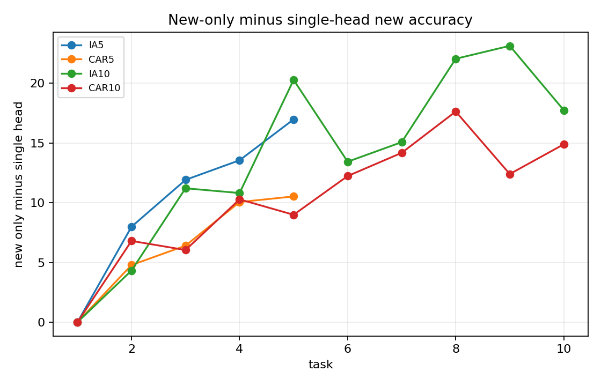

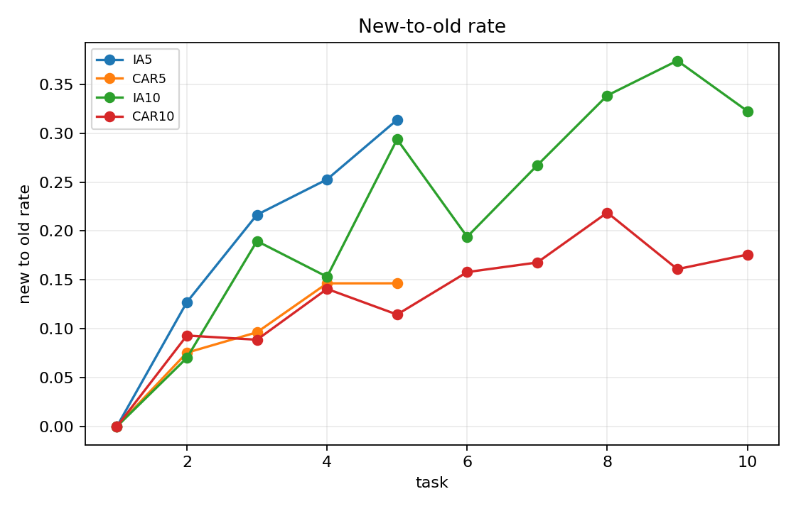

## 9. Error concentration과 transition degradation

### 9.1 Error concentration

IA10 Top-20 error share는 T2 `46.67%`에서 T10 `8.40%`로, CAR10은 T2 `41.70%`에서 T10 `13.30%`로 감소했다. 초기 task는 전체 오류 수와 가능한 pair 수가 작아서 비율이 높았으며, class 수가 증가할수록 오류가 더 넓게 분산됐다.

T10 normalized entropy도 IA10 `0.9949`, CAR10 `0.9571`로 높았다.

> 10-task에서도 소수 directional pair가 전체 오류를 지배하지 않는다.

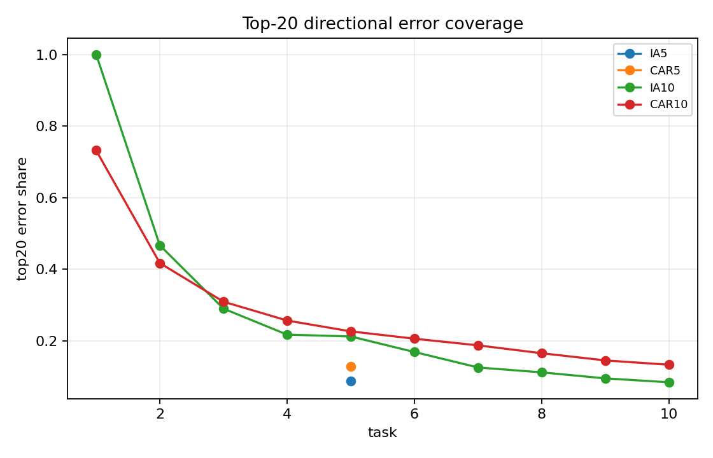

### 9.2 Same-sample 9-transition 합계

| Protocol | Correct→Wrong | Wrong→Correct | Eligible degraded pairs | Degradation mass | Improvement mass | Degradation / improvement |
|---|---:|---:|---:|---:|---:|---:|
| IA10 | 70 | 94 | 50 | 931 | 1,214 | 0.767 |
| CAR10 | 285 | 476 | 179 | 1,493 | 2,397 | 0.623 |

IA10과 CAR10의 **모든 개별 transition**에서 improvement mass가 degradation mass보다 컸다. CAR10 T8→T9에서는 sample-level Correct→Wrong이 Wrong→Correct보다 많았지만, pairwise boundary mass 전체는 여전히 개선 쪽이 컸다.

절대 degradation mass는 후반 transition에서 커졌지만 평가 sample과 class-pair 수도 함께 늘었다. 따라서 absolute mass 증가를 선택적 relation 붕괴의 누적 증거로 볼 수 없다.

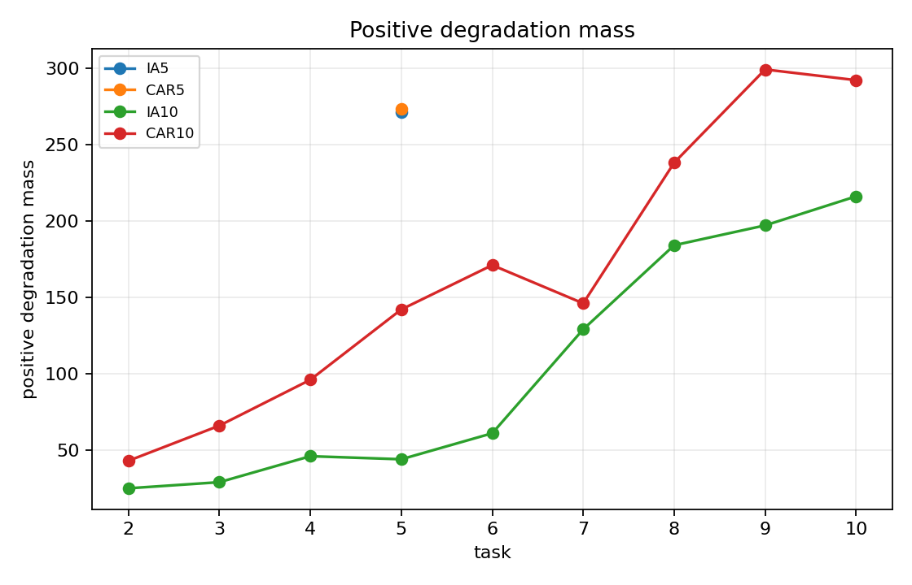

## 10. Boundary-risk gamma

Stored gamma와 Oracle gamma의 pair ranking Spearman은 다음과 같이 높았다.

- IA10 T9→T10: `0.9660`
- CAR10 T8→T9: `0.9797`
- CAR10 T9→T10: `0.9785`

즉 stored moment는 Oracle boundary geometry를 상당히 잘 재현한다. 문제는 gamma 자체의 future degradation ranking 성능이다.

Positive `delta_B`에 대한 K={10,20,50,100} 평균 captured mass:

| Transition | Prototype similarity | Oracle gamma | Stored gamma |
|---|---:|---:|---:|
| IA10 T9→T10 | 0.0081 | 0.0058 | 0.0069 |
| CAR10 T8→T9 | 0.0309 | 0.0535 | 0.0435 |
| CAR10 T9→T10 | 0.0274 | 0.0488 | 0.0385 |

CAR에서는 random보다 낫지만 전체 positive degradation mass의 약 `4~5%`만 포착했고, IA에서는 거의 유효하지 않았다. Correct→Wrong target에서는 CAR10 Oracle gamma가 `18.15~20.83%`, Stored gamma가 `14.06~16.13%`를 포착하여 일부 신호가 있었지만 데이터셋 공통으로 강하지 않았다.

> Stored-vs-Oracle 재현 문제보다 risk definition 자체의 predictive limitation이 더 크다.

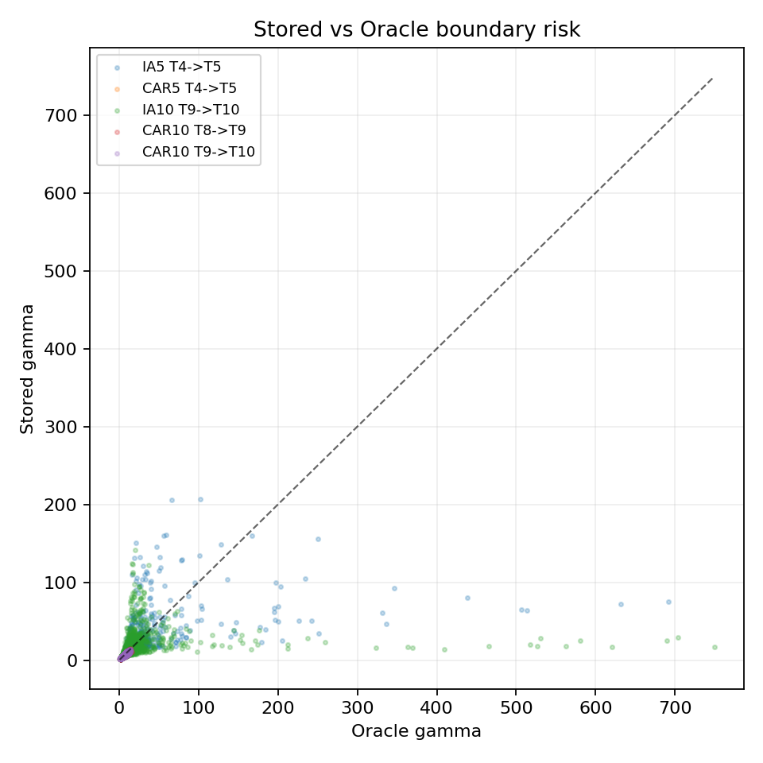

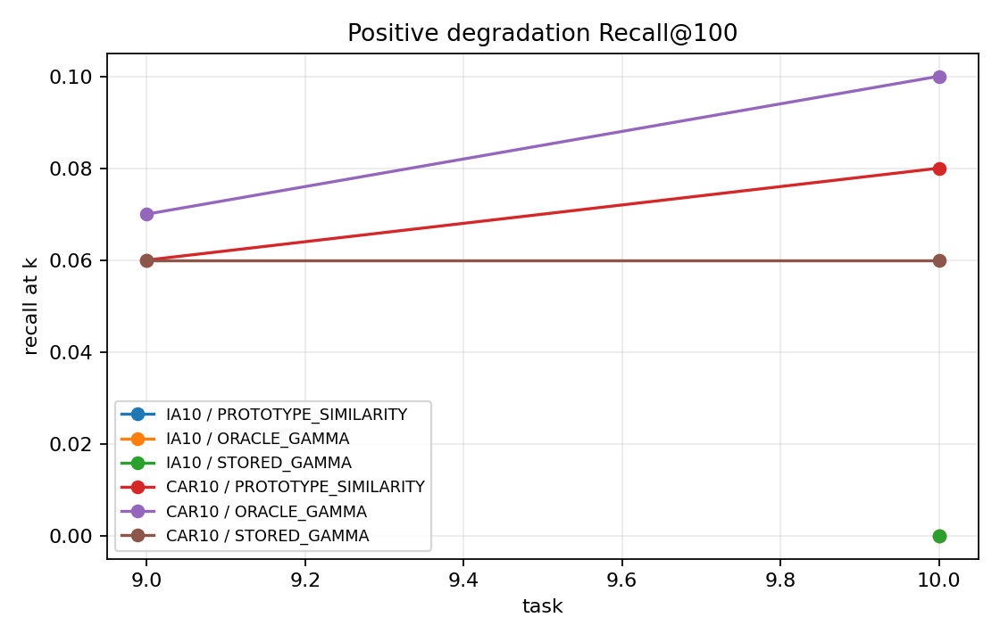

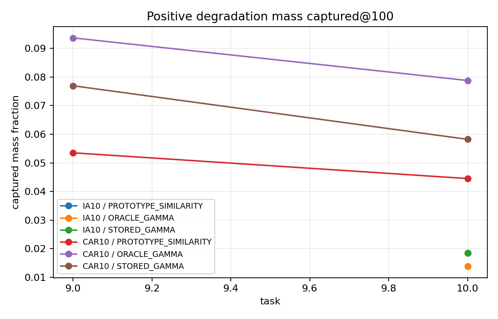

## 11. Generalization 및 neighborhood coverage

### 11.1 Train→test margin gap

| Protocol | Train negative-margin fraction | Test fraction | Test − train |
|---|---:|---:|---:|
| IA5 | 0.097 | 0.336 | +0.239 |
| IA10 | 0.110 | 0.353 | +0.243 |
| CAR5 | 0.043 | 0.188 | +0.145 |
| CAR10 | 0.057 | 0.210 | +0.153 |

10-task에서 gap이 IA `+0.004`, CAR `+0.008`만큼 커졌다. 방향은 일관되지만 증가폭은 작다.

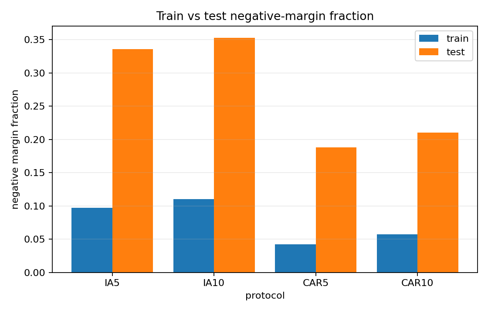

### 11.2 Correct/Wrong neighborhood purity

| Protocol | Correct test purity | Wrong test purity | Difference |
|---|---:|---:|---:|
| IA5 | 0.640 | 0.125 | 0.515 |
| IA10 | 0.621 | 0.119 | 0.502 |
| CAR5 | 0.567 | 0.169 | 0.398 |
| CAR10 | 0.546 | 0.169 | 0.377 |

Wrong sample은 모든 protocol에서 매우 낮은 local class coverage를 보였다. Prototype preference도 correct sample에서는 양수, wrong sample에서는 음수였다.

- IA10: correct `+0.099`, wrong `-0.097`
- CAR10: correct `+0.048`, wrong `-0.077`

Age별 sample geometry는 단조 악화하지 않았다. 따라서 이 문제는 오래된 class에만 국한된 단순 age failure가 아니라 broad held-out coverage 문제로 보는 것이 적절하다.

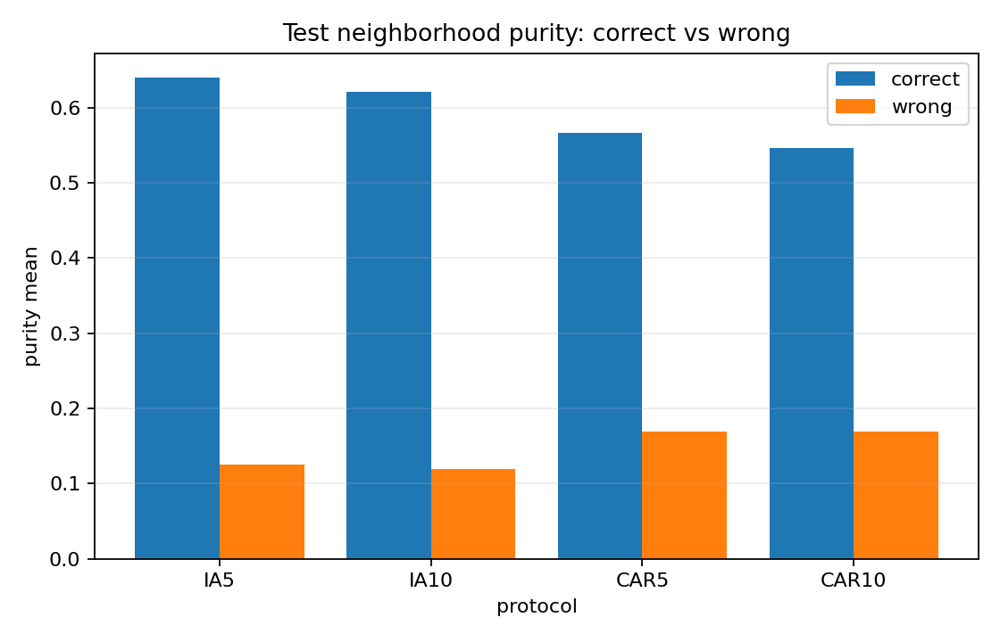

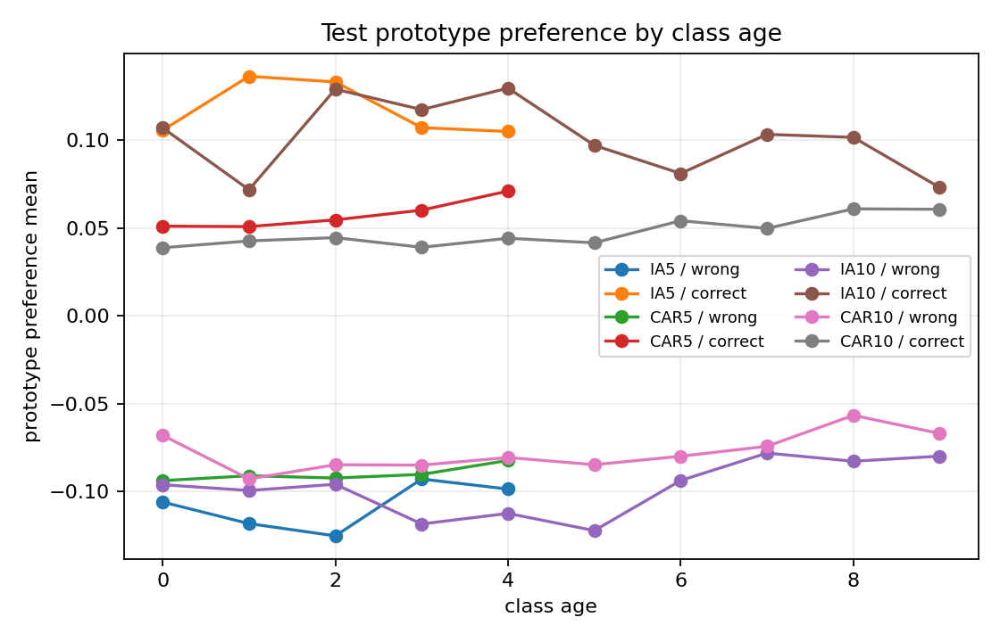

## 12. 가설 상태 재평가

| Hypothesis | 5-task evidence | 10-task evidence | Final status |
|---|---|---|---|
| Prototype tracking error가 age와 함께 누적 | Age 1→4에서 오차 증가 | Age 1→9에서 강한 증가, ρ=0.803/0.845 | **SUPPORTED** |
| Prototype mean tracking error가 주병목 | Tracking cosine 높고 Oracle mean 효과 작음 | IA10 B-A -0.066pp, CAR10 +0.535pp | **NOT SUPPORTED** |
| Covariance mismatch가 누적 | Age 증가와 mismatch 증가 | Final mismatch 증가, 강한 age 상관 | **SUPPORTED** |
| Covariance mismatch가 주병목 | C/D 효과 작거나 불일치 | C-A +0.132/+0.075pp; D는 CAR만 +1.107pp | **PARTIALLY SUPPORTED** |
| Gaussian approximation이 주병목 | Matched 차이 작음 | IA +0.066pp, CAR +0.895pp | **NOT SUPPORTED** |
| Old/New single-head competition 증가 | Task와 함께 gap 증가 | Gap/New→Old가 두 protocol에서 증가 | **PARTIALLY SUPPORTED** |
| 소수 위험 pair가 오류를 지배 | Final Top-20 share 낮음 | T10 8.40%/13.30%, task와 함께 감소 | **NOT SUPPORTED** |
| Incremental pair degradation이 주원인 | T4→T5에서 recovery 우세 | 18개 protocol-transition 모두 improvement mass 우세 | **NOT SUPPORTED** |
| Stored gamma로 future risk 예측 가능 | Stored≈Oracle이나 ranking 약함 | 동일 패턴, CAR에서만 제한적 신호 | **WEAKENED** |
| Broad generalization/coverage 문제 | 큰 train-test gap, wrong purity 낮음 | 동일 현상 반복, 10-task에서 소폭 강화 | **SUPPORTED** |

어떤 가설도 강한 의미의 `REVIVED AT 10-TASK`로 판정하지 않았다.

## 13. Q1–Q13 최종 답변

### Q1. 10-task에서 tracking은 명확히 악화되는가?

Final 평균은 악화되지만 동일 age에서는 악화되지 않는다. 더 오래된 class가 포함된 age-composition 효과가 크다.

### Q2. Tracking error는 class age와 함께 누적되는가?

그렇다. IA10/CAR10 relative L2의 age Spearman은 `0.803/0.845`다. 다만 cosine은 final에도 매우 높다.

### Q3. Inter-class similarity는 증가하는가?

Task 진행과 final 5→10 비교에서는 증가한다. 그러나 age 상관은 약하며, 특정 pair 오류 집중으로 이어지지 않는다.

### Q4. Covariance mismatch는 더 커지는가?

그렇다. 특히 age와 함께 누적된다. 그러나 matched age에서는 10-task가 대체로 더 나쁘지 않다.

### Q5. Oracle mean/covariance replacement 효과가 커지는가?

일관되게 커지지 않는다. CAR10 Full Oracle만 `+1.107pp`였고 IA10은 `-0.066pp`였다. Covariance 단독 효과는 두 protocol 모두 미미했다.

### Q6. Actual vs Gaussian 차이가 커지는가?

CAR에서는 `+0.547→+0.895pp`로 증가했지만 IA10은 `+0.066pp`다. 공통 가설로는 지지되지 않는다.

### Q7. Old/New competition은 심해지는가?

Task index와 함께 new-only gap과 New→Old rate가 증가한다. 단, 후보 class 수와 평가 난이도 confound가 포함된다.

### Q8. 오류가 소수 pair에 더 집중되는가?

아니다. Class 수가 늘수록 Top-K share는 감소하고 entropy는 높아졌다.

### Q9. Newly-degraded pair가 반복 누적되는가?

일부는 존재하지만 지배적이지 않다. 모든 transition에서 improvement mass가 더 컸다.

### Q10. Stored gamma ranking은 좋아지는가?

Stored gamma는 Oracle gamma를 잘 복제하지만 positive degradation 예측력은 약하다. CAR 일부 transition에서만 제한적 신호가 있다.

### Q11. Generalization/coverage 문제는 강해지는가?

10-task에서 소폭 강해지지만 큰 변화는 아니다. 중요한 점은 5/10-task 모두에서 매우 강하고 일관되다는 것이다.

### Q12. 10-task에서 부활한 가설은 무엇인가?

강하게 `REVIVED AT 10-TASK`로 판정할 가설은 없다. Tracking/covariance의 age 누적은 확인됐지만 성능 주병목으로 부활하지 않았다.

### Q13. 현재 가장 강하게 남는 설명은 무엇인가?

**F. broad generalization / coverage**가 가장 강하다. **D. classifier / single-head competition**은 보조적이며, 최종적으로는 dataset-specific 요소가 일부 섞여 있다.

## 14. 한계

1. 모든 결과는 seed 1993 단일 seed다.
2. 5-task와 10-task는 task당 class 수와 class-age 분포가 다르다.
3. Gamma 중간비용 분석은 IA10 final transition, CAR10 worst+final transition에 우선 수행했다.
4. Oracle actual old data는 diagnostic-only이며 replay-free 학습에 사용할 수 없다.
5. Validation은 historical train data의 deterministic split이므로 representation-unseen validation은 아니다. 독립 test 결과를 함께 제시했다.

## 15. 주요 산출물

- 입력 audit: [`ten_task_extension_audit.md`](ten_task_extension_audit.md)
- IA10 상세 CSV: [`IA10/`](IA10/)
- CAR10 상세 CSV: [`CAR10/`](CAR10/)
- Hypothesis table: [`cross_protocol/hypothesis_status_table.csv`](cross_protocol/hypothesis_status_table.csv)
- Plot 모음: [`cross_protocol/plots/`](cross_protocol/plots/)
- Run manifest: [`run_manifest.json`](run_manifest.json)

시각화는 각 분석 절의 해석 바로 아래에 본문 이미지로 삽입했다. 전체 PNG는 위 Plot 모음 링크에서 확인할 수 있다.
