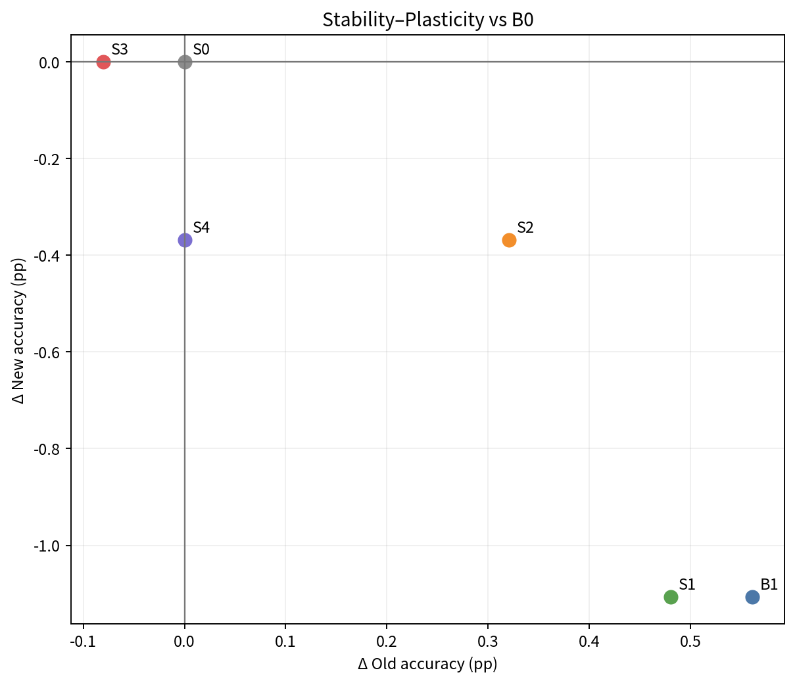
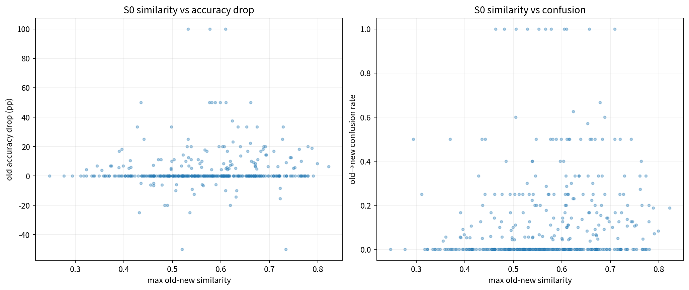
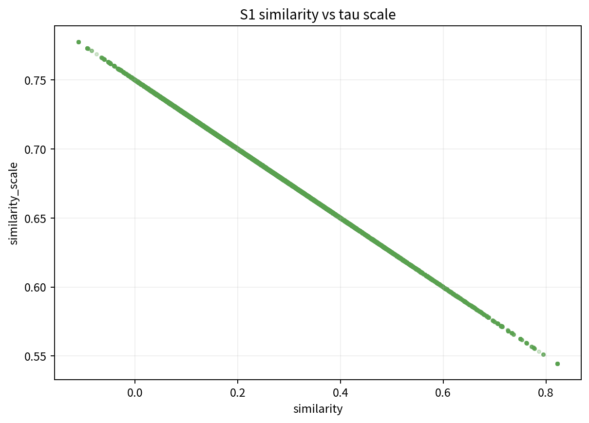
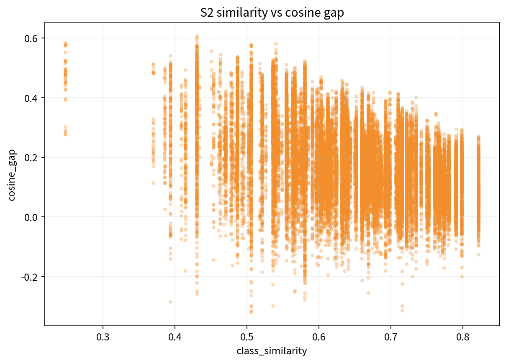
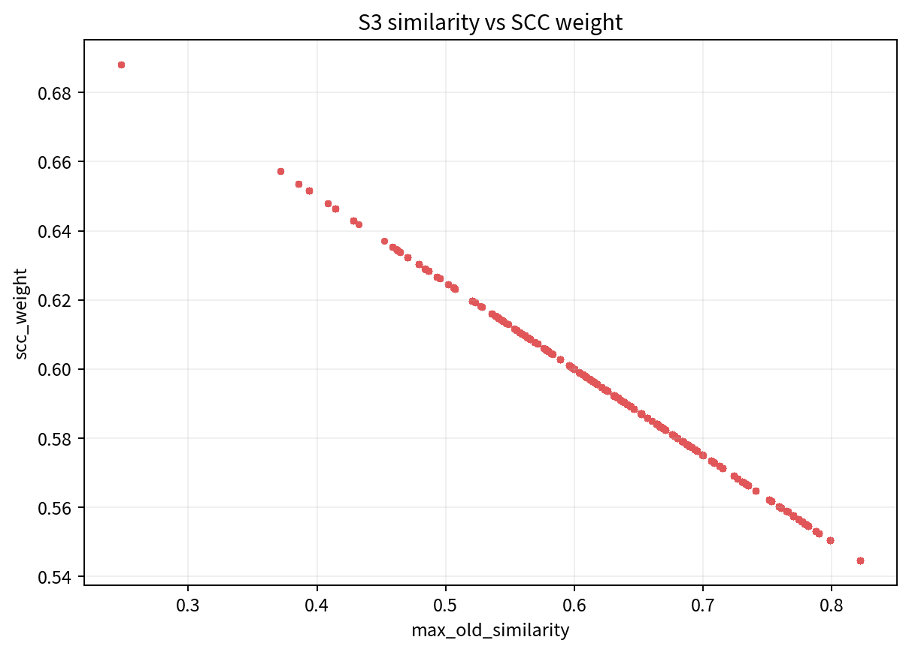
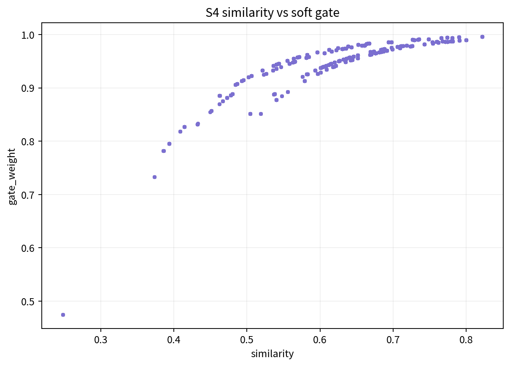
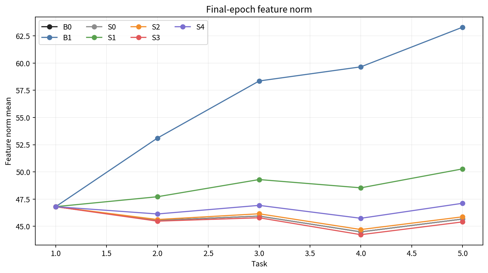

# Structure Similarity-Aware 후속 실험 보고서

작성일: 2026-09-18  
대상: ImageNet-A 200 classes, 5 tasks × 40 classes, single-head CIL  
공통 완료 seed: 1993 (`n=1`)

## 1. 결론 요약

이번 pilot에서 **B1 AM-Drift가 Inc-Acc, Last-Acc, Forgetting을 모두 포함해 가장 좋은 종합 결과**를 보였다. B0 대비 Inc-Acc `+0.17 pp`, Last-Acc `+0.26 pp`, Forgetting `-0.87 pp`였고, final old accuracy도 `+0.56 pp`였다. 다만 final new accuracy는 `-1.11 pp`로 낮아져 기존에 관측한 stability–plasticity trade-off는 남았다.

Similarity-aware 방법 중에는 S1이 Inc/Last 기준 가장 가까웠지만 B1을 넘지 못했고 new accuracy도 B1과 같았다. S2 relative margin은 B1 대비 new accuracy를 `+0.74 pp` 회복했으나 Inc `-0.32 pp`, Forgetting `+0.27 pp`로 전체 이득은 아니었다. S3의 SCC 완화와 S4 soft hybrid는 B0/B1보다 forgetting이 악화됐다.

진단 로그는 중요한 구현적 이유를 보여준다.

- S2의 final-epoch sample 중 `99.91%`가 relative route를 사용했다. 현재 beta가 전체 old-new pair 분포의 75% quantile이어서, 각 new class의 **maximum** old similarity는 거의 항상 beta를 넘었다.
- S4 gate는 평균 `0.957`, 중앙값 `0.969`로 사실상 대부분 relative 쪽에 치우쳤다. 이번 설정은 균형 잡힌 soft hybrid라기보다 relative-dominant 실험에 가깝다.
- S3는 SCC를 평균 약 `0.588×`로 줄였지만 B1 대비 New는 회복한 반면 Old `-0.64 pp`, Forgetting `+1.29 pp`여서 plasticity 회복 비용이 컸다.

따라서 seed 1993에서는 “similar pair를 덜 밀거나 relative constraint로 바꾸면 종합 성능이 좋아진다”는 가설을 지지하지 않는다. 현 단계의 우선 기준은 B1이며, S2/S4를 다시 평가하려면 beta를 **max-similarity 분포 기준**으로 재설계해야 한다.

## 2. 비교 가능성과 한계

모든 run은 완료 상태 `5/5`, recording gap `0`이며 프로토콜 manifest SHA-256이 동일하다.

```text
790a99f9ceeb5391589fa88732c827b08476d2baf9e0cc772624444c198731e1
```

이는 class order, train 5,981장/test 1,519장, task 분할, class별 표본 수 및 split content hash가 같다는 뜻이다. 연구 내부의 base/E3/similarity 소스 snapshot digest도 B0–S4에서 모두 일치한다. B0와 S0의 전체 task accuracy matrix도 byte 단위로 동일하여 logging-only S0가 학습 결과를 바꾸지 않았음을 확인했다.

학습 설정은 ViT-B/16 adapter, init 30 epochs, incremental 15 epochs, SCC/APR/classifier adaptation 동일 조건이다. 각 run의 최대 CUDA allocated memory는 약 `5.85 GiB`, 기록된 총 학습 시간은 B0/S0 약 47.5분, B1 약 52.0분, S1–S4 약 57.9–59.1분이다.

중요한 한계는 seed가 하나뿐이라는 점이다. 아래 차이는 모두 동일 seed의 paired 관측값이며 표본 SD와 유의성은 계산할 수 없다. class별 test 표본 수도 1–26장으로 작아 개별 class/pair 변화는 매우 이산적이다.

## 3. Main Performance

정확도와 forgetting 단위는 `%`, 차이는 percentage point다. `ΔF`는 method−B0이므로 음수가 개선이다.

| 방법 | 의미 | Inc | ΔInc | Last | ΔLast | F↓ | ΔF | Old | ΔOld | New | ΔNew |
|---|---|---:|---:|---:|---:|---:|---:|---:|---:|---:|---:|
| B0 | Structure | 74.60 | 0.00 | 66.43 | 0.00 | 7.84 | 0.00 | 66.99 | 0.00 | 63.84 | 0.00 |
| **B1** | **AM-Drift** | **74.77** | **+0.17** | **66.69** | **+0.26** | **6.97** | **-0.87** | **67.55** | **+0.56** | 62.73 | -1.11 |
| S0 | similarity logging only | 74.60 | 0.00 | 66.43 | 0.00 | 7.84 | 0.00 | 66.99 | 0.00 | **63.84** | 0.00 |
| S1 | similarity-aware tau | 74.70 | +0.10 | 66.62 | +0.20 | 7.40 | -0.45 | 67.47 | +0.48 | 62.73 | -1.11 |
| S2 | hard relative margin | 74.45 | -0.15 | 66.62 | +0.20 | 7.24 | -0.60 | 67.31 | +0.32 | 63.47 | -0.37 |
| S3 | S2 + SCC 완화 | 74.50 | -0.10 | 66.36 | -0.07 | 8.26 | +0.42 | 66.91 | -0.08 | **63.84** | 0.00 |
| S4 | soft hybrid | 74.55 | -0.05 | 66.36 | -0.07 | 8.12 | +0.27 | 66.99 | 0.00 | 63.47 | -0.37 |



오른쪽 위는 B0 대비 final old/new가 동시에 개선된 영역이다. B1과 S1은 old가 개선되지만 new가 낮아지고, S2는 new 손실을 줄이지만 old/Inc가 B1보다 낮다. 이 그림은 seed 1993의 관측 위치이며 신뢰구간이 아니다. [SVG](figures/stability_plasticity.svg)

### B1 직접 비교

| 방법−B1 | ΔInc | ΔLast | ΔF↓ | ΔOld | ΔNew |
|---|---:|---:|---:|---:|---:|
| S1−B1 | -0.07 | -0.07 | +0.42 | -0.08 | 0.00 |
| S2−B1 | -0.32 | -0.07 | +0.27 | -0.24 | +0.74 |
| S3−B1 | -0.27 | -0.33 | +1.29 | -0.64 | +1.11 |
| S4−B1 | -0.22 | -0.33 | +1.14 | -0.56 | +0.74 |

모든 similarity-aware 변형은 B1보다 Inc/Last가 낮다. S2–S4의 new 회복은 old/forgetting 비용과 함께 발생했다.

## 4. Task별 정확도

| 방법 | T1 | T2 | T3 | T4 | T5 |
|---|---:|---:|---:|---:|---:|
| B0 | 83.89 | 79.37 | 74.15 | 69.15 | 66.43 |
| B1 | 83.89 | 79.37 | 74.26 | **69.63** | **66.69** |
| S0 | 83.89 | 79.37 | 74.15 | 69.15 | 66.43 |
| S1 | 83.89 | 79.37 | 74.15 | 69.47 | 66.62 |
| S2 | 83.89 | 79.23 | 73.74 | 68.75 | 66.62 |
| S3 | 83.89 | 79.37 | 73.64 | 69.23 | 66.36 |
| S4 | 83.89 | 79.08 | **74.26** | 69.15 | 66.36 |

T1은 추가 제약이 활성화되기 전이라 모두 동일하다. S1은 T4–T5에서 B0보다 높지만 B1보다는 낮다. S2는 T2–T4 손실 때문에 final 정확도가 같아도 Inc가 낮다. 즉 마지막 task만 보면 S2의 중간 단계 손실을 놓친다.

## 5. S0: similar old-new가 실제로 더 충돌하는가?

각 `(task, old class)`에 대해 현재 new classes와의 최대 frozen cosine을 사용했다. Low/Mid/High는 이 400개 old-task record의 quartile이고, Top1/Top5는 어떤 new class에서 해당 순위에 들어간 old-task record다.

| 그룹 | n | 평균 max similarity | old accuracy drop | old→new confusion | new→old confusion |
|---|---:|---:|---:|---:|---:|
| Low | 100 | 0.422 | 1.40 pp | 0.0774 | 0.00114 |
| Mid | 200 | 0.571 | 4.76 pp | 0.1372 | 0.00225 |
| High | 100 | 0.710 | 4.05 pp | 0.1412 | 0.00347 |
| Top1 | 112 | 0.655 | **6.10 pp** | **0.1528** | 0.00346 |
| Top5 | 285 | 0.609 | 4.41 pp | 0.1274 | 0.00266 |

Pearson correlation은 similarity–forgetting `r=0.077`, similarity–old→new confusion `r=0.138`, similarity–new→old confusion `r=0.259`였다. Spearman은 각각 `0.066`, `0.215`, `0.234`다. 따라서 similarity와 forgetting의 단조 관계는 매우 약하지만, confusion에는 약한 양의 관계가 있다. High가 Mid보다 forgetting이 낮은 점도 단순 선형 가설을 약화한다. Top1 old classes의 평균 drop이 크다는 관측은 있으나 selection 중복과 class별 표본 수 차이를 포함하므로 인과로 해석하지 않는다.



원자료: [old-class records](tables/s0_old_class_records.csv), [group summary](tables/s0_similarity_groups.csv), [top-1 pairs](tables/s0_top1_pair_examples.csv). [SVG](figures/s0_similarity_relationship.svg)

## 6. S1: Similarity-aware tau

S1은 final epoch 기준 16,000개 old-new pair를 기록했다. similarity 범위는 `-0.143–0.822`, similarity scale은 `0.545–0.786`이며 둘의 상관은 식의 정의대로 `-1.000`이다. APR drift까지 포함한 `final_tau/base_tau` 평균은 `0.554`였다.



S1은 B0보다 Inc `+0.10`, Last `+0.20`, Forgetting `-0.45`, Old `+0.48`이지만 New `-1.11`이다. 더 직접적인 B1 비교에서는 Inc/Last/F/Old가 모두 소폭 나쁘고 New가 같다. 즉 **similar old의 tau를 추가 축소해도 B1의 new 손실을 회복하지 못했다.** 다만 T5 raw absolute intrusion은 B1 `0.363`에서 S1 `0.079`로 크게 줄고 feature norm도 `63.30→50.28`로 낮아져 geometry는 의도한 방향으로 바뀌었다. [SVG](figures/s1_similarity_tau.svg)

## 7. S2: Relative margin

Final epoch 4,510 sample의 relative-route 비율은 `99.91%`, relative sample의 margin violation 비율은 `16.62%`였다. cosine gap 평균은 `0.174`, p10/median/p90은 `0.017/0.166/0.349`이고 similarity–gap Pearson correlation은 `-0.386`이었다.



S2는 B1보다 New `+0.74 pp`를 회복했지만 Inc `-0.32`, Old `-0.24`, Forgetting `+0.27`이다. B0와 비교해도 New는 `-0.37 pp`다. 가까운 pair에서 relative boundary만 유지한다는 아이디어는 일부 plasticity 회복 신호를 보였지만 종합 개선으로 이어지지 않았다.

특히 beta가 all-pair distribution의 75% quantile인데 route는 new class별 maximum similarity로 결정된다. 이 두 분포가 달라 거의 전 sample이 relative로 전환됐다. 다음 실험에서는 `max_k s_nk` 분포의 quantile, 목표 route 비율, 혹은 task별 고정 top-k로 beta를 정해야 한다. [SVG](figures/s2_similarity_gap.svg)

## 8. S3: Similarity-aware SCC

Final epoch SCC weight 평균은 `0.588`, min/median/max는 `0.545/0.587/0.688`이고 weighted/raw SCC loss 합 비율은 `0.587`이었다. similarity와 weight는 설계식에 의해 `r=-1.000`이다.



S3는 S2 대비 New `+0.37 pp`지만 Last `-0.26`, Old `-0.40`, Forgetting `+1.02 pp`다. B1 대비로는 New `+1.11`을 회복하는 대신 Old `-0.64`, Forgetting `+1.29`다. 따라서 이번 weight 범위에서 SCC 완화는 plasticity를 조금 회복했지만 stability 비용이 더 컸다. [SVG](figures/s3_similarity_scc.svg)

## 9. S4: Soft hybrid

Final epoch gate 평균은 `0.957`, p10/median/p90은 `0.913/0.969/0.991`이었다. similarity–gate correlation은 `0.851`; weighted relation loss 중 relative 항의 합 비중은 `55.2%`였다.



gate 자체가 거의 1에 몰려 있어 absolute에서 relative로 부드럽게 전환한다는 목적을 충분히 시험하지 못했다. S4는 S2보다 Inc `+0.10`이지만 Last `-0.26`, Forgetting `+0.87`, Old `-0.32`, New는 동일하다. hard threshold보다 안정적이라는 근거는 없다. beta를 max-sim 분포에 맞추고 temperature를 gate p10–p90이 0과 1 사이에 넓게 분포하도록 다시 정해야 한다. [SVG](figures/s4_similarity_gate.svg)

## 10. Feature norm, geometry, gradient

아래 intrusion은 relative route가 선택된 경우에도 계산된 **raw absolute-region 진단값**이다. 곧 실제 적용 loss 비율과 같지 않다.

| 방법 | T5 norm mean | norm p95 | raw rho | raw intrusion | cosine gap |
|---|---:|---:|---:|---:|---:|
| B0 | 45.67 | 55.89 | N/A | N/A | 0.0442 |
| B1 | **63.30** | **74.79** | 1.097 | 0.363 | 0.0408 |
| S0 | 45.67 | 55.89 | N/A | N/A | 0.0442 |
| S1 | 50.28 | 61.34 | 1.430 | **0.079** | 0.0429 |
| S2 | 45.87 | 56.11 | 0.797 | 0.862 | 0.0442 |
| S3 | 45.41 | 55.81 | 0.776 | 0.883 | **0.0463** |
| S4 | 47.12 | 57.54 | 0.832 | 0.812 | 0.0435 |



B1의 절대 separation은 norm inflation과 함께 나타났고 S1은 이를 상당히 줄였다. S2–S4는 norm이 B0에 가깝지만 성능이 B1을 넘지 못해 norm 안정화만으로 성공이라 볼 수 없다. [SVG](figures/feature_norm.svg)

기록 interval 평균에서 classification–absolute gradient cosine은 B1 `-0.058`, S1 `+0.004`, S2 `-0.013`, S3 `-0.027`, S4 `+0.001`이었다. Classification–relative cosine은 S2/S3/S4에서 각각 `+0.178/+0.182/+0.182`로 양수였지만 성능 우위로 이어지지 않았다. SCC와 classification은 모든 방법에서 약한 음수(`-0.052`에서 `-0.074`)였다. 원자료 요약은 [gradient_cosine_summary.csv](tables/gradient_cosine_summary.csv)에 있다.

## 11. Top-similarity pair 사례

아래 class name은 ImageFolder synset ID다. forgetting은 해당 task 직전 대비 old class accuracy drop이며, confusion은 방향별 true-class normalized rate다.

| Task | New class | Old class | similarity | old drop pp | old→new | new→old |
|---:|---|---|---:|---:|---:|---:|
| 2 | n02127052 | n02119022 | 0.822 | 6.25 | 0.0625 | 0.1053 |
| 5 | n02009912 | n01819313 | 0.799 | 8.33 | 0.0833 | 0.0556 |
| 2 | n01558993 | n01534433 | 0.790 | 0.00 | 0.0000 | 0.0435 |
| 5 | n01855672 | n01847000 | 0.788 | 18.75 | 0.1875 | 0.0476 |
| 5 | n02137549 | n02361337 | 0.780 | 0.00 | 0.0000 | 0.0000 |
| 3 | n02206856 | n02190166 | 0.779 | 0.00 | 0.0625 | 0.0476 |
| 5 | n04366367 | n04562935 | 0.779 | 20.00 | 0.0000 | 0.0000 |
| 5 | n03837869 | n04562935 | 0.775 | 20.00 | 0.2000 | 0.0000 |

높은 similarity가 큰 forgetting/confusion과 같이 나타나는 사례도 있지만, similarity가 높아도 drop과 confusion이 0인 사례가 함께 있다. 따라서 pair별 결과는 sample 수, class difficulty, APR drift와 함께 모델링해야 한다.

## 12. 연구 질문 답변

### RQ1. Similar pair가 실제로 더 충돌하는가?

**약한 confusion 신호는 있으나 forgetting 근거는 약하다.** Similarity와 new→old confusion의 Pearson `0.259`, Spearman `0.234`; old→new는 `0.138/0.215`다. Forgetting correlation은 `0.077/0.066`에 불과하다.

### RQ2. Similarity-aware tau가 new 손실을 줄이는가?

**아니다.** S1의 final New는 B1과 동일한 `62.73%`이고 나머지 주요 지표는 B1보다 소폭 낮다. 다만 norm inflation과 raw intrusion은 크게 줄었다.

### RQ3. Relative margin이 absolute separation보다 나은가?

**부분적인 new 회복만 관측됐다.** S2는 B1 대비 New `+0.74 pp`지만 Inc/Old/F가 악화됐다. 또한 99.91%가 relative route여서 의도한 selective 비교가 아니었다.

### RQ4. Similarity-aware SCC가 plasticity를 회복하는가?

**New는 회복하지만 stability 비용이 더 크다.** S3는 B1 대비 New `+1.11 pp`, Old `-0.64 pp`, Forgetting `+1.29 pp`다.

### RQ5. Soft hybrid가 hard threshold보다 안정적인가?

**근거가 없다.** S4는 S2보다 Forgetting이 `+0.87 pp` 나쁘고 gate가 1 근처에 몰렸다.

## 13. 다음 단계

1. 현재 최선인 B1 AM-Drift를 기준으로 유지한다.
2. S2/S4 재실험 전 beta를 `max old similarity per new class` 분포로 다시 계산하고 목표 relative-route 비율을 사전 지정한다.
3. S3는 SCC weight 하한/alpha를 약하게 조정하더라도 old/forgetting guardrail을 둔다.
4. similarity 단독보다 APR drift, 실제 confusion, class sample 수를 함께 쓰는 selection을 검토한다.
5. 어떤 결론도 확정하기 전에 seed 1996/1997을 추가한다. 현재 n=1에서는 방법 순위와 작은 pp 차이를 일반화할 수 없다.

## 재생성 명령

```bash
source ${RESEARCH_WORKSPACE}/miniconda3/etc/profile.d/conda.sh
conda activate cds
cd ${RESEARCH_WORKSPACE}/structure_similarity_aware_followup
MPLBACKEND=Agg python analysis/build_report.py
```

위 명령은 그림·표를 갱신하고 요약형 문안을 `report_auto.md`에 쓴다. 검산된 상세판인 현재 `report.md`는 덮어쓰지 않는다.
