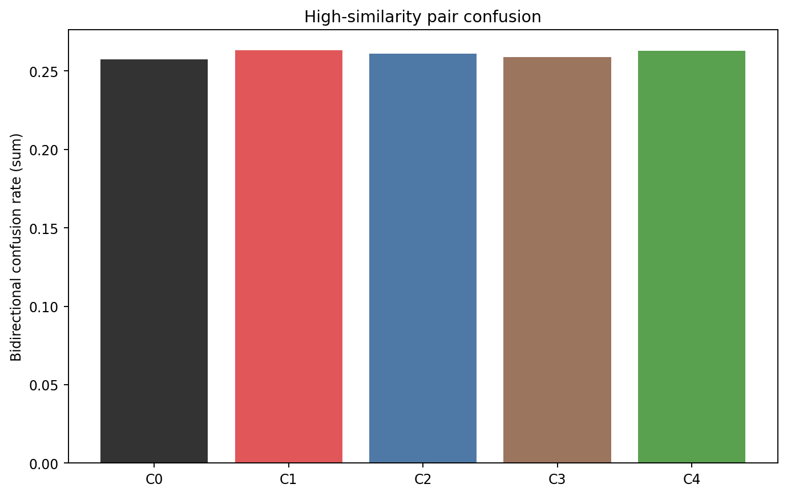
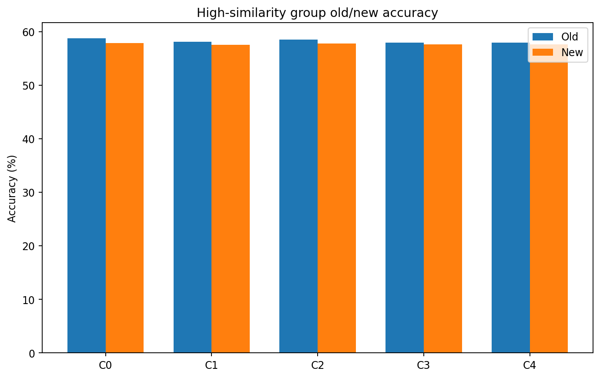
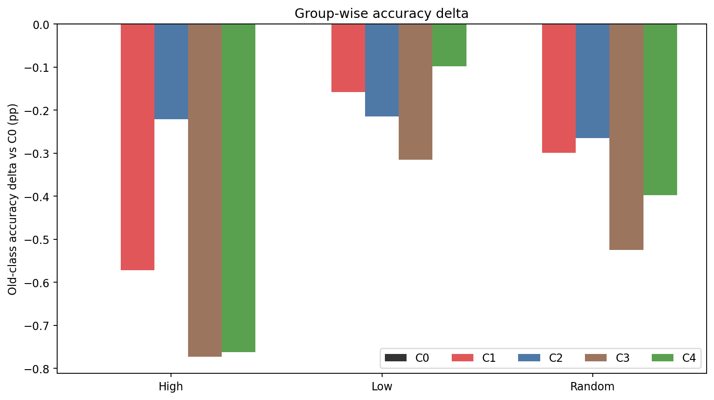
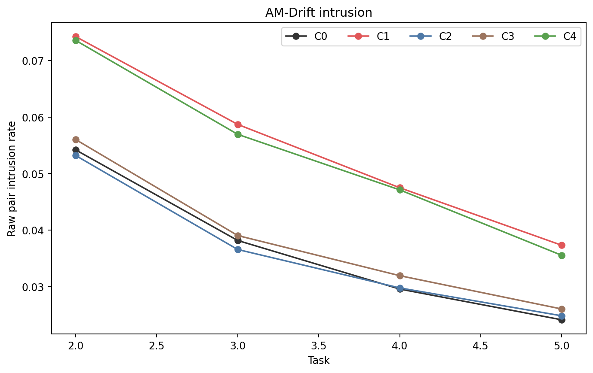
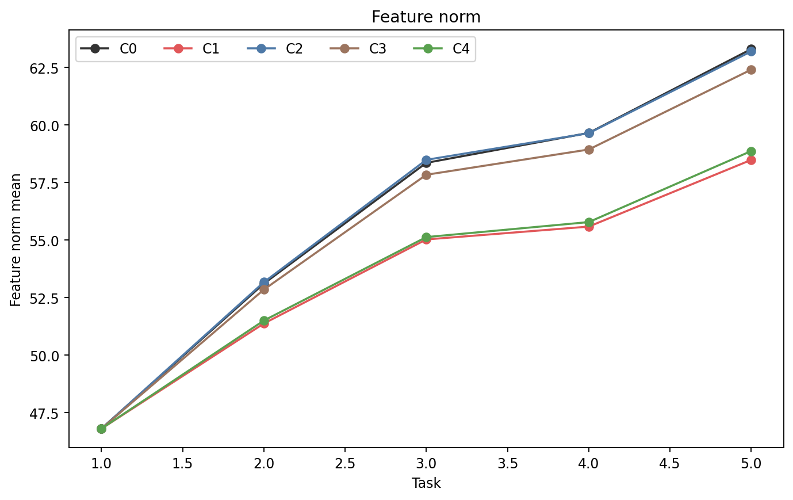
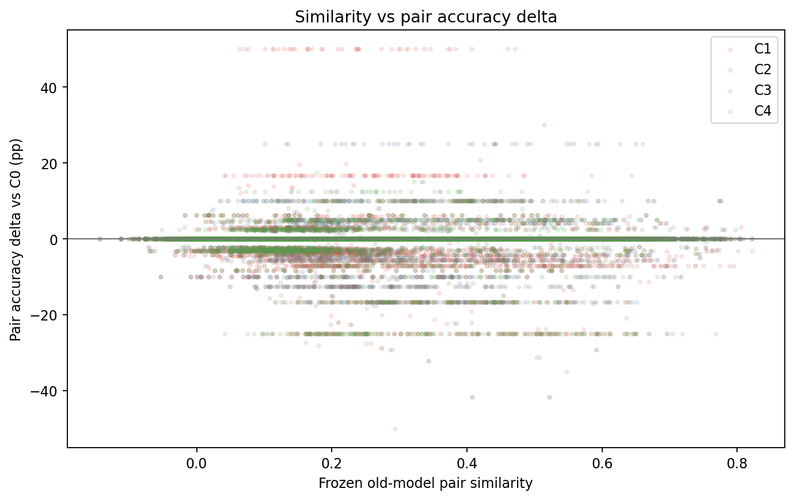

# Additional Control: Does Similarity Matter?

작성일: 2026-09-18  
대상: ImageNet-A 200 classes, 5 tasks × 40 classes, single-head CIL  
공통 완료 seed: 1993 (`n=1`)

## 1. 결론 요약

이번 control pilot은 “high-similarity old-new pair를 강하게 밀어내는 것이 new learning을 방해한다”는 가설을 지지하지 않았다.

- C1 High-Off는 C0 AM-Drift보다 Inc `-0.24 pp`, Last `-0.33 pp`, New `-1.11 pp`, Forgetting `+0.12 pp`로 모든 핵심 방향이 나빠졌다.
- 동일 수의 low-similarity pair를 끈 C2가 가장 유리했다. C0 대비 Last는 같고 New `+0.37 pp`, Forgetting `-0.08 pp`였지만 Inc는 `-0.16 pp`다.
- C1은 C2보다 New가 `-1.48 pp` 낮아, 단순 constraint 수 감소가 아니라 **high pair의 separation을 유지하는 편이 더 나을 가능성**을 보였다.
- C4 High-Weak는 C1보다 New를 `+1.11 pp` 회복했지만 C0를 넘지 못했고 Forgetting은 C1보다 `+0.15 pp` 나빴다.
- High-similarity 양방향 confusion index는 C0 `0.2574`에서 C1 `0.2630`으로 소폭 증가했다. high constraint를 완전히 끄면 confusion이 커질 수 있다는 방향과 일치한다.

따라서 현재 우선순위는 C1/High-Off 확대가 아니라 C0 AM-Drift 유지와 C2 Low-Off의 추가 seed 검증이다. 결과는 seed 1993 하나이므로 이 방향을 확정 결론으로 해석하면 안 된다.

## 2. 비교 가능성과 실행 무결성

C0–C4는 모두 완료 상태 `5/5`, recording gap `0`이다. 프로토콜 manifest SHA-256은 전 run에서 동일하다.

```text
790a99f9ceeb5391589fa88732c827b08476d2baf9e0cc772624444c198731e1
```

class order, split content, train 5,981장/test 1,519장, 학습 epoch와 replay/SCC/APR/classifier adaptation 조건이 같다. Control 연구 내부의 base/E3/similarity/control source snapshot digest도 C0–C4에서 모두 일치한다.

각 방법은 old-new pair 16,000개를 기록했고 C1/C2/C3은 정확히 4,000개씩 off했다. new class당 off 수는 task 2–5에서 각각 `10/20/30/40`으로 동일하다. C4는 같은 4,000개 high pair에 weight `0.3`을 적용했다. C3는 독립 generator를 사용하며 seed/task/new-class로 고정됐다.

별도 similarity 연구의 B1과 이번 C0는 전체 task accuracy matrix가 byte 단위로 동일하다. 이는 AM-Drift baseline 결과가 두 연구 사이에서 수치적으로 이어졌다는 강한 확인이다. 다만 두 연구 시점의 cross-study source snapshot digest는 같지 않으므로 이 일치를 완전한 소스 동일성 증명으로 확대 해석하지 않는다.

총 기록 학습 시간은 C0 `55.5분`, C1–C4 `59.0–59.8분`, 최대 CUDA allocated memory는 모두 약 `5.85 GiB`다.

## 3. Main Performance

정확도와 forgetting은 `%`, 차이는 C0 대비 percentage point다. `ΔF`는 method−C0이므로 음수가 개선이다.

| 방법 | 의미 | Inc | ΔInc | Last | ΔLast | F↓ | ΔF | Old | ΔOld | New | ΔNew |
|---|---|---:|---:|---:|---:|---:|---:|---:|---:|---:|---:|
| **C0** | **AM-Drift** | **74.77** | 0.00 | **66.69** | 0.00 | 6.97 | 0.00 | **67.55** | 0.00 | 62.73 | 0.00 |
| C1 | High-Off | 74.53 | -0.24 | 66.36 | -0.33 | 7.10 | +0.12 | 67.39 | -0.16 | 61.62 | -1.11 |
| C2 | Low-Off | 74.61 | -0.16 | **66.69** | 0.00 | **6.89** | **-0.08** | 67.47 | -0.08 | **63.10** | **+0.37** |
| C3 | Random-Off | 74.43 | -0.33 | 66.36 | -0.33 | 7.17 | +0.19 | 67.15 | -0.40 | 62.73 | 0.00 |
| C4 | High-Weak | 74.59 | -0.18 | 66.43 | -0.26 | 7.24 | +0.27 | 67.23 | -0.32 | 62.73 | 0.00 |

C0가 Inc와 Old에서 가장 높고 C0/C2가 Last 공동 최고다. C2는 New와 Forgetting이 가장 좋지만 중간 task 성능 때문에 Inc는 C0보다 낮다. 단일 seed에서 `0.08–0.37 pp` 차이는 정답 몇 개로 바뀔 수 있으므로 순위를 확정하지 않는다.

## 4. 사전 지정 paired contrasts

| 대비 | ΔInc | ΔLast | ΔF↓ | ΔOld | ΔNew | 관측 해석 |
|---|---:|---:|---:|---:|---:|---|
| C1−C0 | -0.24 | -0.33 | +0.12 | -0.16 | -1.11 | High-Off 자체는 악화 |
| C1−C2 | -0.08 | -0.33 | +0.21 | -0.08 | **-1.48** | High-Off가 Low-Off보다 불리 |
| C1−C3 | +0.10 | 0.00 | -0.07 | +0.24 | -1.11 | old 쪽은 C1, new 쪽은 C3; 혼합 결과 |
| C4−C1 | +0.06 | +0.07 | +0.15 | -0.16 | +1.11 | weak가 new를 회복하지만 F/Old 비용 |

핵심 비교 C1−C2에서 New가 크게 낮고 다른 지표도 C1 우위가 아니다. 따라서 “어떤 pair를 풀어주느냐”는 중요하지만, 이번 seed에서는 high pair가 올바른 해제 대상이라는 근거가 없다.

## 5. Task별 정확도

| 방법 | T1 | T2 | T3 | T4 | T5 |
|---|---:|---:|---:|---:|---:|
| C0 | 83.89 | **79.37** | **74.26** | **69.63** | **66.69** |
| C1 | 83.89 | 79.08 | **74.26** | 69.07 | 66.36 |
| C2 | 83.89 | 79.08 | 74.15 | 69.23 | **66.69** |
| C3 | 83.89 | 79.08 | 73.85 | 68.99 | 66.36 |
| C4 | 83.89 | 79.08 | 74.15 | 69.39 | 66.43 |

T1은 control이 비활성이라 모두 같다. C1의 T3가 C0와 같아도 T2/T4/T5가 낮다. C2는 T2–T4에서 C0보다 낮지만 T5에서 회복해 Last가 같으므로 Inc와 Last를 함께 봐야 한다.

## 6. Pair selection 및 loss 적용 검산

| 방법 | 기록 pair | off pair | weak pair | 적용 weight |
|---|---:|---:|---:|---|
| C0 | 16,000 | 0 | 0 | 1.0 |
| C1 | 16,000 | 4,000 | 0 | 0 / 1 |
| C2 | 16,000 | 4,000 | 0 | 0 / 1 |
| C3 | 16,000 | 4,000 | 0 | 0 / 1 |
| C4 | 16,000 | 0 | 4,000 | 0.3 / 1 |

모든 `weighted_sep_loss = raw_sep_loss × applied_sep_weight` 관계가 저장 row에서 성립한다. C1/C2/C3의 pair 수가 동일하므로 constraint 수가 아닌 선택 위치를 비교한다는 통제가 지켜졌다.

## 7. Similarity group 결과

아래는 T2–T5 네 task 진단값의 단순 평균이다. seed 간 평균/SD가 아니며, bidirectional index는 `new→old rate + old→new rate`다.

| 방법 | High old acc | High new acc | High N→O | High O→N | 양방향 index | High forgetting |
|---|---:|---:|---:|---:|---:|---:|
| C0 | 58.70 | 57.82 | 0.1968 | 0.0606 | 0.2574 | 3.69 |
| C1 | 58.13 | 57.50 | 0.1995 | 0.0635 | **0.2630** | **4.29** |
| C2 | 58.48 | 57.74 | 0.1993 | 0.0617 | 0.2610 | 3.69 |
| C3 | 57.93 | 57.61 | 0.1977 | 0.0612 | 0.2589 | 4.03 |
| C4 | 57.94 | 57.60 | 0.1993 | 0.0634 | 0.2627 | 4.18 |

High-Off C1은 C0보다 high-group old/new accuracy가 낮고 confusion과 forgetting이 높다. 완전히 풀어주면 similar pair가 더 잘 공존할 것이라는 예측과 반대 방향이다.



Task별 high 양방향 index는 C0에서 `0.185/0.219/0.272/0.353`, C1에서 `0.188/0.231/0.271/0.363`이다. C1의 증가는 작고 task마다 완전히 일관되지는 않지만 final task에서는 `+0.0098`이다. [SVG](figures/high_similarity_confusion.svg)



Group accuracy는 pair endpoint를 pair 수만큼 가중한 class-level 정확도다. 독립 표본 16,000개의 accuracy가 아니며 같은 class accuracy가 여러 pair에 반복된다. [SVG](figures/high_similarity_old_new_accuracy.svg)



이 그림은 각 group의 old-endpoint accuracy를 C0와 비교한다. C1/C3/C4에서 high group이 개선되지 않고, C2도 작은 음수다. [SVG](figures/group_accuracy_delta.svg)

## 8. Intrusion과 feature norm

T5 final epoch 값이다. Raw intrusion은 `D² < tau`인 pair 비율이고 effective intrusion은 control weight를 곱한 값이다.

| 방법 | raw overall | raw high | raw low | effective overall | effective high | effective low | norm mean |
|---|---:|---:|---:|---:|---:|---:|---:|
| C0 | 0.0241 | 0.0441 | 0.0136 | 0.0241 | 0.0441 | 0.0136 | 63.30 |
| C1 | 0.0373 | 0.0703 | 0.0194 | 0.0197 | **0.0000** | 0.0194 | 58.48 |
| C2 | 0.0248 | 0.0449 | 0.0142 | 0.0213 | 0.0449 | **0.0000** | 63.20 |
| C3 | 0.0260 | 0.0476 | 0.0144 | 0.0194 | 0.0357 | 0.0110 | 62.41 |
| C4 | 0.0355 | 0.0674 | 0.0191 | 0.0237 | 0.0202 | 0.0191 | 58.87 |

C1/C4는 high constraint를 줄이면서 raw high intrusion이 C0보다 커졌다. C1의 effective high는 정의상 0이고 C4는 0.3 weight 때문에 `0.0202`다. 이는 control이 코드상 의도대로 작동했음을 보여주지만 성능 개선으로 이어지지는 않았다.



[SVG](figures/intrusion.svg)



C1/C4는 T5 norm을 약 `4.4–4.8` 낮췄지만 정확도 우위가 없다. 따라서 norm 감소만으로 더 좋은 representation이라 결론 낼 수 없다. [SVG](figures/feature_norm.svg)

## 9. Similarity와 pair accuracy delta



Pair accuracy delta는 pair 양 끝의 class accuracy 변화 평균이다. C0 대비 전체 pair 평균은 C1 `-0.386 pp`, C2 `-0.146 pp`, C3 `-0.364 pp`, C4 `-0.418 pp`; similarity와 delta의 Pearson은 각각 `-0.074/+0.004/-0.031/-0.071`로 매우 약하다.

C1의 selected high 4,000 pair 평균은 `-0.504 pp`였고, C2의 selected low 4,000 pair는 `-0.093 pp`였다. 다만 같은 class accuracy가 여러 pair에 복제되고 전체 pair의 80% 이상은 delta 0이므로 이 scatter의 점을 독립 관측으로 보거나 유의성 검정을 적용하면 안 된다. 원자료는 [similarity_pair_accuracy_delta.csv](tables/similarity_pair_accuracy_delta.csv.gz)에 있다. [SVG](figures/similarity_pair_accuracy_delta.svg)

## 10. 연구 질문 답변

### Q1. High-similarity separation을 제거하면 new learning이 개선되는가?

**아니다.** C1의 New는 C0보다 `-1.11 pp`, Inc `-0.24 pp`다.

### Q2. 단순 constraint 수 감소가 아니라 similarity selection 효과인가?

**High selection의 이점은 없다.** 동일 수를 끈 C2가 C1보다 New `+1.48 pp`, Last `+0.33 pp`, Forgetting `-0.21 pp`다. C1 대 C3는 old/new 방향이 섞여 명확한 high-selection 우위가 아니다.

### Q3. 완전 제거와 weak constraint 중 어느 쪽이 좋은가?

**Weak가 complete-off보다 new/Inc/Last는 낫지만 종합적으로 C0보다 못하다.** C4−C1 New `+1.11 pp`인 반면 Forgetting `+0.15 pp`, Old `-0.16 pp`다.

### Q4. Constraint 제거 시 similar-pair confusion이 증가하는가?

**작은 증가가 관측됐다.** High bidirectional index가 C0 `0.2574`에서 C1 `0.2630`으로 `+0.0056` 증가했다. 단일 seed와 task 평균이므로 확정할 수 없다.

### Q5. S1 similarity-aware tau 또는 S2 relative margin을 지지하는가?

High pair를 단순히 완화하는 S1 방향은 이 control에서 지지되지 않는다. Confusion을 통제하며 거리를 완화하는 relative-margin의 필요성은 개념적으로 남지만, 별도 S2 실험도 B1 종합 성능을 넘지 못했고 route가 99.91% relative였으므로 현재 구현 설정의 지지는 아니다.

## 11. 다음 단계

1. B1/C0 AM-Drift를 현재 기준으로 유지한다.
2. C1 High-Off와 C4 High-Weak의 3-seed 확대는 우선순위를 낮춘다.
3. C2 Low-Off를 seed 1996/1997에서 먼저 반복해 New/Forgetting 방향이 유지되는지 확인한다.
4. pair selection은 frozen similarity 단독보다 observed confusion, APR drift, uncertainty를 함께 사용하는 방향을 검토한다.
5. High pair를 완화하려면 absolute constraint 제거와 함께 relative decision boundary를 유지하되, beta를 max-sim 분포로 다시 보정한다.

## 재생성 명령

```bash
source ${RESEARCH_WORKSPACE}/miniconda3/etc/profile.d/conda.sh
conda activate cds
cd ${RESEARCH_WORKSPACE}/structure_similarity_control_experiments
MPLBACKEND=Agg python analysis/build_report.py
```

위 명령은 그림·표를 갱신하고 요약형 문안을 `report_auto.md`에 쓴다. 검산된 상세판인 현재 `report.md`는 덮어쓰지 않는다.
