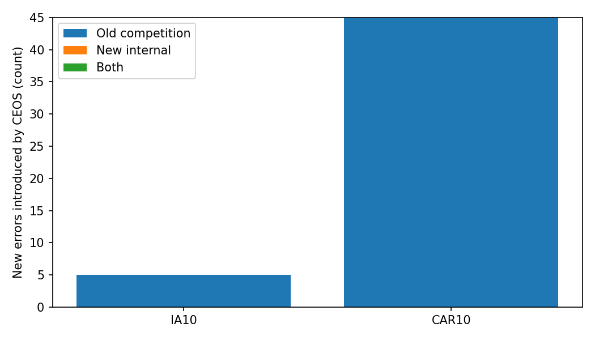
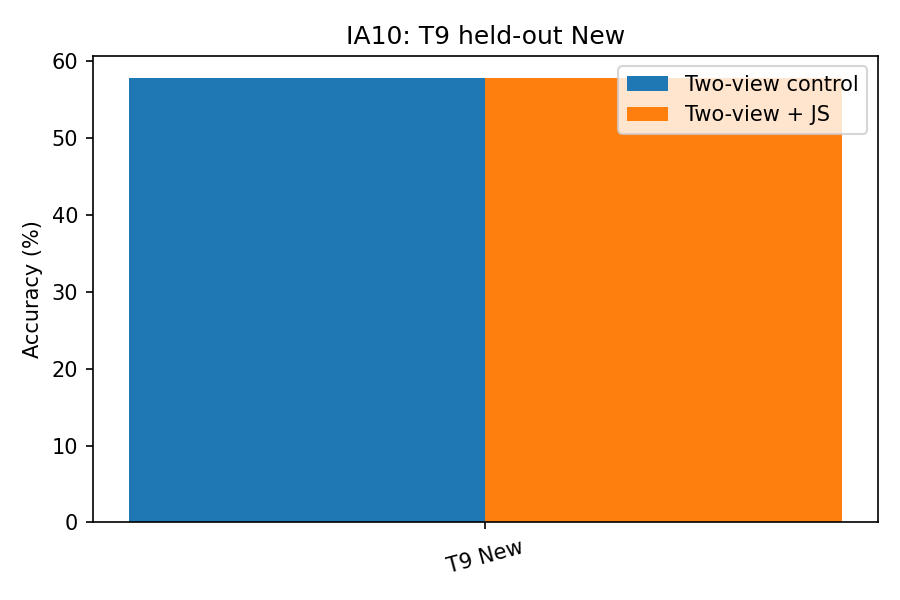
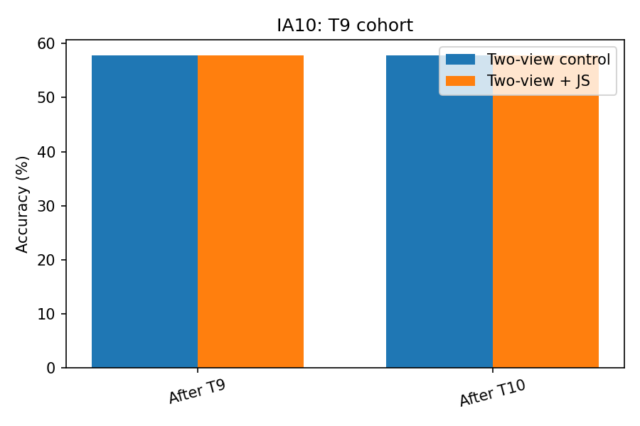
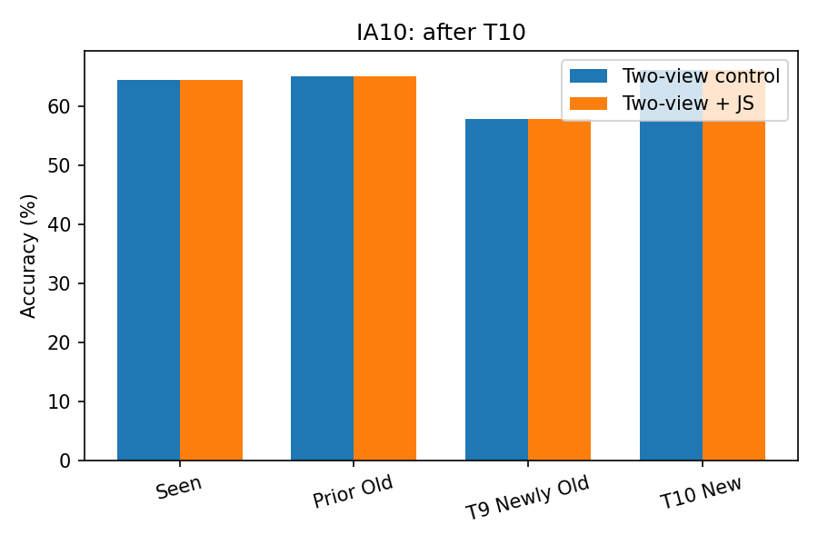
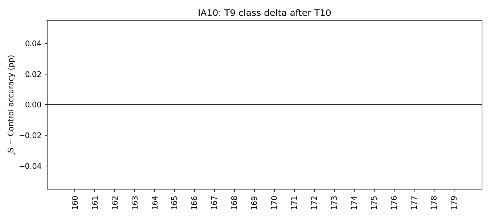
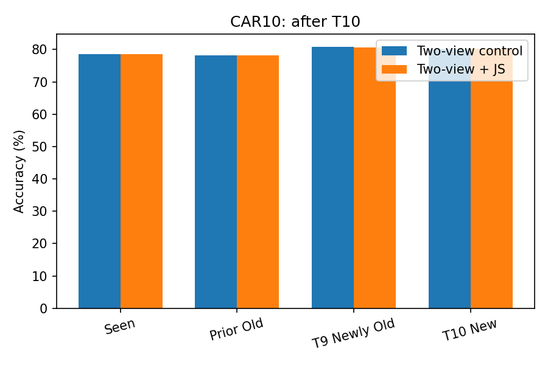
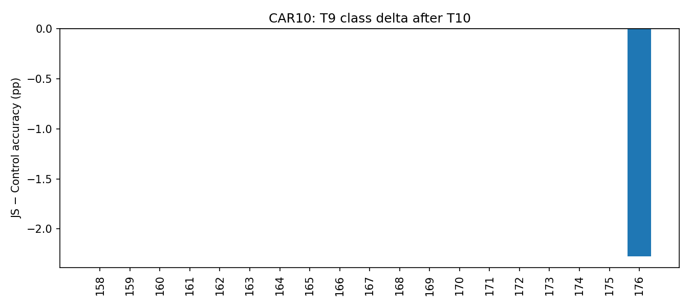

# Final CEOS Diagnostic + Current-Task Variation Consistency Pilot

## 범위와 비교 원칙

- IA10/CAR10, seed 1993. 기존 Structure T8 task-end checkpoint에서 시작해 T9→T10만 학습했다. 기존 checkpoint/result는 읽기만 했다.
- 핵심 인과 비교는 **동일한 두-view supervised Control(C)** 대 **동일한 두-view + JS(J)** 이다. 기존 one-view Structure는 참고값일 뿐이다.
- 원래 Structure train augmentation을 같은 current image에 독립적으로 두 번 적용했다. 두 branch는 sample/order/view SHA-256, optimizer step, stats/APR/CA 호출 수가 정확히 일치해야 보고서를 생성한다.
- SCC loss는 각 view에 적용 후 평균했다. APR 통계는 task 종료 시 원래 경로에서 한 번만 계산했다. Gaussian CA sampling·optimizer·schedule·256/class exposure는 원본을 그대로 사용했다.
- JS는 current-only unscaled cosine logits, temperature 1.0, lambda 0.1. 다른 teacher/selector/replay sampler는 없다.

## Phase A — CEOS New 오류의 목적지

| Protocol | New test | 새 오류 (New%) | Recovery (New%) | Old 경쟁(Type 1; New%) | New-New(Type 2; New%) | 둘 다(Type 3; New%) | 평균 Δg | 평균 Δw |
|---|---:|---:|---:|---:|---:|---:|---:|---:|
| IA10 | 124 | 5 (4.03%) | 0 (0.00%) | 5 (4.03%) | 0 (0.00%) | 0 (0.00%) | -0.31 | -0.11 |
| CAR10 | 779 | 45 (5.78%) | 0 (0.00%) | 45 (5.78%) | 0 (0.00%) | 0 (0.00%) | -0.29 | -0.06 |

기존 C1 head/logit이 저장되지 않아 사용자가 승인한 **동일 C1 설정 1회 재실행**으로 복원했다. 이전 C1 accuracy와 train loss가 일치하지 않으면 이 분석이 중단되도록 했다. C0는 기존 저장된 paired logits을 사용했다.

새 New 오류는 두 protocol 모두 전부 **Type 1: Old competition**이었다. New-New 단독 악화나 recovery는 관찰되지 않았다. Δg는 전반적으로 음수이고 Δw 변화는 더 작다. 따라서 CEOS의 New 손실은 이 조건에서 Old/New score competition으로 설명되며, 추가 boundary sampler 튜닝은 하지 않는다. 전체·손실·회복 집합의 Δg/Δw 분포와 sample별 로그는 `phaseA_ceos_error_destination/`에 있다.

## Phase B — T9 직후 (%)

| Protocol | Branch | Seen | T1–T8 Old | T9 New | Macro | Old→New | New→Old |
|---|---|---:|---:|---:|---:|---:|---:|
| IA10 | control | 65.02 | 65.87 | 57.82 | 54.92 | 0.058 | 0.381 |
| IA10 | js | 65.09 | 65.95 | 57.82 | 54.95 | 0.058 | 0.381 |
| CAR10 | control | 79.52 | 79.26 | 81.79 | 79.61 | 0.023 | 0.157 |
| CAR10 | js | 79.54 | 79.31 | 81.53 | 79.62 | 0.023 | 0.158 |

## Phase B — T10 직후 (%)

| Protocol | Branch | Seen | T1–T8 Prior Old | T9 Newly Old | T10 New | Macro |
|---|---|---:|---:|---:|---:|---:|
| IA10 | control | 64.45 | 65.06 | 57.82 | 66.13 | 53.49 |
| IA10 | js | 64.45 | 65.06 | 57.82 | 66.13 | 53.62 |
| CAR10 | control | 78.63 | 78.21 | 80.74 | 80.10 | 78.71 |
| CAR10 | js | 78.63 | 78.21 | 80.61 | 80.23 | 78.71 |

## T9 cohort retention

`Retention = T9 class accuracy after T10 − immediately after T9` (percentage points).

| Protocol | Branch | T9 Immediate | T9 after T10 | Retention |
|---|---|---:|---:|---:|
| IA10 | control | 57.82 | 57.82 | +0.00 |
| IA10 | js | 57.82 | 57.82 | +0.00 |
| CAR10 | control | 81.79 | 80.74 | -1.06 |
| CAR10 | js | 81.53 | 80.61 | -0.92 |

## JS − Control 핵심 delta (pp)

| Protocol | T9 New | T9 after T10 | ΔRetention | T1–T8 after T10 | T10 New | T10 Seen |
|---|---:|---:|---:|---:|---:|---:|
| IA10 | +0.00 | +0.00 | +0.00 | +0.00 | +0.00 | +0.00 |
| CAR10 | -0.26 | -0.13 | +0.13 | +0.00 | +0.13 | +0.00 |

### 기존 one-view Structure (참고 전용)

| Protocol | T9 cohort after T9 | T9 cohort after T10 | T10 Seen |
|---|---:|---:|---:|
| IA10 | 58.50 | 57.14 | 64.65 |
| CAR10 | 81.27 | 82.19 | 78.96 |

이 one-view 값은 augmentation/view exposure가 달라 JS 효과 추정에 사용하지 않는다.

### IA10 시각화

### CAR10 시각화

## 판정

- IA10: S1/S2: 즉시 held-out T9 이득 없음.
- CAR10: S1/S2: 즉시 held-out T9 이득 없음.
- 두 protocol 공통 성공 조건을 충족하지 못해 full 10-task/독립 seed 확대를 보류한다. teacher·selector·stronger augmentation을 추가해 이 pilot을 구제하지 않는다.

- BOUNDARY AXIS CLOSED = YES
- CONSISTENCY PROTOTYPE PROMISING = NO
- FULL METHOD READY = NO

## 제한

단일 seed, T9→T10 두 transition만 관찰했다. 10-task 전체의 평균 성능을 재측정한 것이 아니다. 이 pilot의 unscaled cosine logit JS는 대략 10⁻⁴~10⁻³ 크기였으므로, null 결과는 지정된 T=1·λ=0.1 설정에 대한 것이지 모든 consistency regularization의 실패를 뜻하지 않는다. 다만 명세의 stop rule에 따라 이번 pilot을 추가 tuning하지 않는다. 원본 one-view Structure와의 수치 차이는 augmentation/view exposure까지 달라 인과 비교가 아니다.

코드 경로와 동등성 검사는 `audit.md`, 실행·사전 판정 기준은 `implementation_notes.md`, 원자료는 `run_manifest.json`과 protocol별 CSV에 있다.
